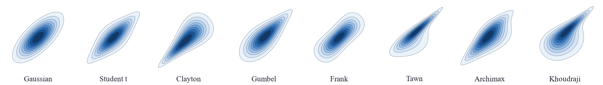

<p align="center"></p>

<h1 align="center">fortvine</h1>

[](https://github.com/Bluerrror/fortvine/actions/workflows/ci.yml)
[](https://bluerrror.github.io/fortvine/)
[](LICENSE)


**Vine copulas in modern Fortran** — pair copulas and regular-vine copulas with 111 families,
exact parameter scores, Dissmann structure selection, densities, Rosenblatt transforms and
simulation. No dependencies beyond a Fortran compiler with OpenMP; callable from Fortran, C and
Python.

**Documentation: <https://bluerrror.github.io/fortvine/>**



---

## Features

- **111 pair-copula families** — 26 hand-coded (Gaussian, Student t, Clayton, Gumbel, Frank, Joe,
  AMH, BB1-BB10, Tawn, Galambos, Hüsler-Reiss, t-EV, Plackett, FGM, nonparametric TLL and
  Bernstein) and 85 from a generic engine covering **Archimedean**, **extreme-value**,
  **Archimax** and **Khoudraji-asymmetrised** copulas. Every family has 90/180/270 degree
  rotations where they make sense; 32 families are asymmetric (non-exchangeable).
- **Exact parameter scores.** Each log-density is written once and compiled for real numbers and
  for dual numbers, so maximum likelihood uses exact gradients for every family.
- **Fast fitting.** Closed-form log-space kernels, a two-stage fit (subsample, then all data),
  candidate pre-selection, racing of candidate families, a fit cache and OpenMP.
- **Vines.** R-, C- and D-vines; Dissmann selection with Kendall's tau, Spearman's rho,
  Hoeffding's D, Chatterjee's xi, mutual information or tail criteria; truncation and thresholds by
  mBICv; density on samples and on prediction grids; log-likelihood; Rosenblatt and inverse
  Rosenblatt transforms; simulation.
- **Real data.** Discrete and mixed margins, observation weights, non-simplified
  (covariate-dependent) target edges.
- **Three languages, one engine.** A typed Fortran API (`fortvine_api`), a C ABI, and thin
  **Python** and **R** packages that call the same compiled Fortran library — every density, fit
  and simulation runs in Fortran whichever language you use.

## Installation

**Python** — `pip install fortvine` (wheels for Linux, macOS and Windows; no compiler needed), or
from GitHub: `pip install "git+https://github.com/Bluerrror/fortvine#subdirectory=python"`.
See [the Python page](https://bluerrror.github.io/fortvine/python/).

**R** — `remotes::install_github("Bluerrror/fortvine", subdir = "r")` (needs Rtools on Windows,
gfortran on Linux/macOS). See [the R page](https://bluerrror.github.io/fortvine/r/).

**Fortran** — build the library from source:

```bash
git clone https://github.com/Bluerrror/fortvine.git
cd fortvine
bash build.sh test          # builds build/libfortvine.a + shared library, runs the test suites
```

Requirements: gfortran 10 or newer with OpenMP (Linux, macOS, or Windows with MinGW-w64 /
MSYS2 / WinLibs). [fpm](https://fpm.fortran-lang.org) works too: `fpm build`, `fpm test`.

Link your own program against the library:

```bash
gfortran -O2 -fopenmp -I fortvine/build my_program.f90 fortvine/build/libfortvine.a -o my_program
```

## Quick start

```fortran
program quickstart
  use fortvine_api
  implicit none
  integer, parameter :: dp = kind(1.0d0), n = 2000, d = 5
  type(fv_bicop) :: cop
  type(fv_vinecop) :: vine
  real(dp) :: u1(n), w(n), u2(n), u(n, d)

  ! a pair copula: simulate from Clayton(2), then select family, rotation and parameter by BIC
  cop%family = FV_CLAYTON; cop%par(1) = 2.0_dp
  call random_number(u1); call random_number(w)
  call cop%hinv1(u1, w, u2)
  call cop%select(u1, u2)
  print *, 'pair copula: ', trim(fv_fam_name(cop%family)), cop%par(1)

  ! a vine copula: simulate from a D-vine, then select a regular vine from the sample
  call vine%set_dvine([1, 2, 3, 4, 5])
  vine%fam(:, 1) = FV_GUMBEL; vine%par(1, :, 1) = 2.0_dp
  call vine%simulate(n, u, seed=1)
  call vine%select(u)
  print *, 'vine log-likelihood:', vine%loglik(u), '  parameters:', vine%npars()
end program quickstart
```

More in [`example/`](example/) and the [examples pages](https://bluerrror.github.io/fortvine/examples/).

## Families at a glance

| general form | families | examples |
|---|---:|---|
| elliptical | 2 | Gaussian, Student t |
| Archimedean | 19 | Clayton, Gumbel, Frank, Joe, AMH, BB1-BB3, BB6-BB10, gamma.Sibuya, logseries.PS, ... |
| extreme-value | 14 | Tawn (3 forms), Galambos, Hüsler-Reiss, t-EV, BB5, asymmetric negative logistic, mixed models, Khoudraji-HR |
| Archimax | 68 | BB4, Archimax(gamma\|HuslerReiss), Archimax(Sibuya\|asymlogistic1), ... |
| Khoudraji | 3 | Khoudraji-Clayton, Khoudraji-Joe, Khoudraji-Frank |
| other | 2 | Plackett, FGM |
| nonparametric | 2 | TLL, Bernstein |
| independence | 1 | |

The complete list with codes, parameter boxes, symmetry and tail behaviour is in the
[catalogue](https://bluerrror.github.io/fortvine/families/catalogue/).

## Performance

Against pyvinecopulib 1.0.1 (vinecopulib) and torchvine 0.2.2 on the same data, family set and
criterion (one machine, see the [benchmark page](https://bluerrror.github.io/fortvine/benchmarks/)
for the method and all tables):

| task | fortvine | pyvinecopulib | torchvine |
|---|---:|---:|---:|
| Clayton density, ns per point | 44 | 117 | 65 |
| BB1 inverse h-function, ns per point | 770 | 12 540 | 3 325 |
| BB1 MLE fit, n = 5000 | 4.7 ms | 66 ms | 95 ms |
| family selection (12 families, rotations), n = 5000 | 50-110 ms | 1-2 s | 0.8-2.2 s |
| vine selection, d = 10, n = 2000, 1 thread | 2.0 s | 34.3 s | 18.5 s |
| vine selection, d = 20, n = 2000, 8 threads | 1.2 s | 27.6 s | — |

fortvine and pyvinecopulib reach identical maximum log-likelihoods in every comparison.

## Documentation

- [Getting started](https://bluerrror.github.io/fortvine/getting-started/installation/) — installation, quick start, concepts
- [Manual](https://bluerrror.github.io/fortvine/manual/) — pair copulas, vines, fitting and selection, controls, rotations, discrete data, the generic engine, performance, C interface
- [Families](https://bluerrror.github.io/fortvine/families/) — every family with formulas and properties
- [Examples](https://bluerrror.github.io/fortvine/examples/) — runnable programs with output
- [API reference](https://bluerrror.github.io/fortvine/api/)
- [Theory](https://bluerrror.github.io/fortvine/theory/numerics/) — numerics, exact scores, validation

## Repository layout

```text
src/        the library: fortvine_ad (dual numbers), fortvine (kernels, C ABI), fortvine_api (typed API),
            families_core.inc / families_ext.inc (hand-coded families), families_gen.inc (generic engine)
test/       test_fortvine (every family x rotation), test_genfam (generic engine)
example/    tutorial programs (Fortran, Python, R, C) and micro-benchmarks
python/     Python package (ctypes binding to the compiled library)
r/          R package (.Call binding; r/src/fortvine is a synced copy of src/)
bench/      cross-library benchmark (fv_bench.f90 + run_bench.py)
tools/      documentation generators: family catalogue (catalogue.f90), figures (figures.py + density_grid.f90, vine_sample.f90)
docs/       documentation site (MkDocs Material)
```

## Testing

```bash
bash build.sh test
```

runs `test/test_fortvine` (properties of every family in every rotation: h-functions against
numerical integrals of the density, inverse consistency, MLE recovery, vine identities) and
`test/test_genfam` (the generic engine: reproduction of the hand-coded families, density / h /
CDF consistency in four rotations, the edge-flip transpose, MLE recovery).

## Citing

If you use fortvine — from Fortran, C, Python or R — in published work, please cite:

> Shojaeezadeh, S. A. (2026). *fortvine: a complete compendium to work on vine copula modeling.*
> In preparation.

```bibtex
@unpublished{shojaeezadeh2026fortvine,
  author = {Shojaeezadeh, Shahab Aldin},
  title  = {fortvine: a complete compendium to work on vine copula modeling},
  year   = {2026},
  note   = {In preparation. Software: https://github.com/Bluerrror/fortvine}
}
```

GitHub's "Cite this repository" button (from [`CITATION.cff`](CITATION.cff)), `citation("fortvine")` in R
and `fortvine.cite()` in Python give the same reference.

## Licence

fortvine is free software: you can redistribute it and/or modify it under the terms of the
[GNU General Public License](LICENSE), version 3 or (at your option) any later version. Copyright
(C) 2026 Shahab Aldin Shojaeezadeh. Distributed versions and derived works must stay under the GPL
and keep this copyright notice.
