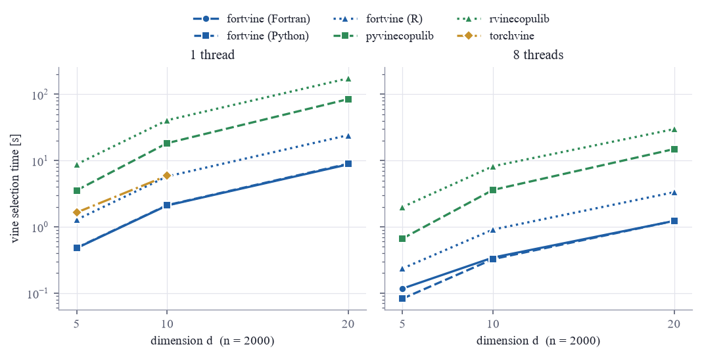
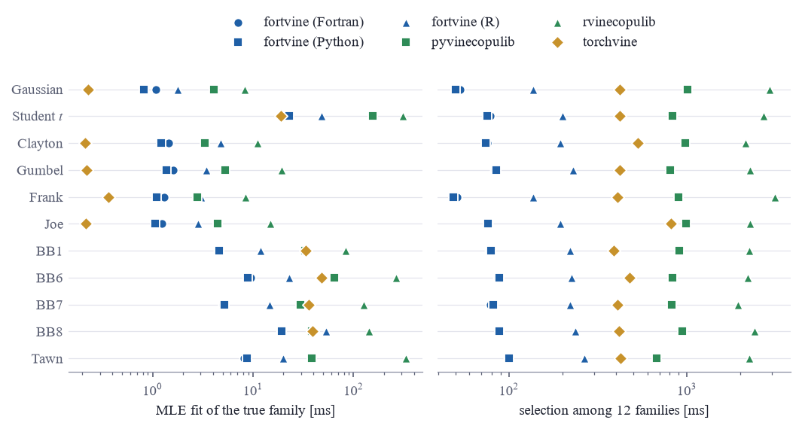
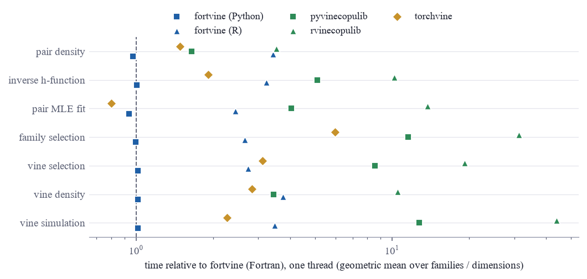

# Benchmarks

This page compares fortvine, used from Fortran, Python and R, with three other vine-copula
packages on identical data:

* **fortvine** three ways: the native Fortran library, the [Python package](python.md) and the
  [R package](r.md). Both packages call the same compiled library, so their columns show what a
  user of each language actually gets;
* **pyvinecopulib 1.0.1** and **rvinecopulib 0.7.2.1.0**: the Python and R bindings of
  [vinecopulib](https://github.com/vinecopulib/vinecopulib) (C++), the reference implementation
  that fortvine's conventions follow;
* **torchvine 0.2.2**: a pure-PyTorch reimplementation of the pyvinecopulib API (CPU build of
  PyTorch 2.15).

All numbers on this page come from `bench/run_bench.py` (with `bench/bench_r.R` for the R
packages); the raw results are in `bench/results/results.json`. You can reproduce them on your
own machine (see the end of the page).

## Set-up

| | |
|---|---|
| machine | Intel Core (Raptor Lake, 32 logical CPUs), Windows 11 |
| fortvine (Fortran) | gfortran 16.1 (WinLibs), `-O3 -march=native -funroll-loops -fopenmp` |
| Python side | Python 3.14.0, NumPy 2.5.5; fortvine built by `pip install ./python` (gfortran 16.1, `-O3 -funroll-loops`); pyvinecopulib 1.0.1 (PyPI wheel); torch 2.15.0+cpu, torchvine 0.2.2 |
| R side | R 4.3.2; fortvine built by `R CMD INSTALL` with Rtools43 (gfortran 12.3, R's default flags); rvinecopulib 0.7.2.1.0 (CRAN binary) |
| family set | the 12 families all libraries share: independence, Gaussian, Student t, Clayton, Gumbel, Frank, Joe, BB1, BB6, BB7, BB8, Tawn (torchvine has no Tawn) — with rotations |
| criterion | BIC everywhere |
| threads | "one thread" runs pin every library to one thread (`FORTVINE_THREADS=1`, `num_threads=1`, `cores = 1`, `torch.set_num_threads(1)`) |

**Data.** Pair-copula data are simulated with pyvinecopulib from each family at Kendall's
$\tau \approx 0.5$ ($n = 5000$). Vine data come from a heavy-tailed, skewed two-factor model
turned into pseudo-observations ($n = 2000$, $d = 5, 10, 20$), so that no library's own model
class generated them. The R packages read the same files.

**Timing.** Wall-clock means after a warm-up call (a call longer than 2 s is timed once). The
Python and R timings include the call overhead of the bindings. Every timed process is exempted
from Windows 11's power throttling: Windows moves a process without a window to the efficiency
cores after about two seconds of work, which slowed long calls by a factor of about 1.6 in a
first run and would have favoured whichever library finishes quickly.

## Results





Colour marks the library (blue fortvine, green vinecopulib, gold torchvine) and the marker
the language (circle Fortran, square Python, triangle R). Both time axes are logarithmic; the
fortvine Fortran and Python markers mostly lie on top of each other.

<figure markdown>
{ width="700" }
<figcaption>Time relative to fortvine called from Fortran, one thread: geometric mean over the
11 families (pair tasks) or the three dimensions (vine tasks). The dashed line is native
fortvine; points to the right are slower.</figcaption>
</figure>

The full tables follow.

--8<-- "bench/results/tables.md"

## What the numbers say

**Same answers.** Where the libraries fit the same model, fortvine (from any language),
pyvinecopulib and rvinecopulib reach the same maximum: the log-likelihoods of every pair fit and
every selected vine agree to the digits shown, and all five select the true family for every
simulated pair. This is by design — fortvine reproduces vinecopulib's rotations, structure
arrays, candidate pre-selection and Dissmann algorithm — and it makes the speed comparison a
like-for-like one. torchvine estimates one-parameter families by inverting Kendall's $\tau$, which
is why its fits are the fastest in Table 4 and its maxima lower (by 0.01 to 24 log-likelihood
units); its selection picks a different family for the Clayton, Joe and Tawn samples (it has no
Tawn family) and its vines have lower likelihoods.

**From Python, fortvine is as fast as from Fortran.** The Python package passes NumPy arrays to
the library without copies, and its timings agree with the native ones within the run-to-run
noise in every table (geometric mean 1.0 in the figure above): the Python user gets the library's full
speed.

**From R, the toolchain costs a factor of about 2.7.** The R package itself adds almost nothing:
the native benchmark program compiled with R's compiler (Rtools43, gfortran 12.3) selects the
$d = 5$ vine in 1.31 s, the same as the R package, against 0.48 s with gfortran 16.1, and
`-O3 -march=native` do not change it. The difference is the older compiler and its MinGW
runtime on Windows; R on Linux and macOS uses other toolchains. Even so, fortvine from R
selects vines 7–9× faster than rvinecopulib, selects pair copulas 8–23× faster and fits them
2–17× faster.

**Pair-copula evaluation.** The density is 1.3–4× faster than pyvinecopulib's for every family
except Student t, where pyvinecopulib is faster (187 against 301 ns per point; fortvine
evaluates the Student t density through the regularised incomplete beta function). The largest
gaps are in the inverse h-function: fortvine inverts h with closed forms where they exist and
with a safeguarded Newton step that uses the density as the exact derivative elsewhere, so the
BB1, BB6, BB7, BB8 and Tawn inversions run in 0.6–1.0 µs per point against 5–11 µs, and the
Frank inversion (closed form) in 22 ns against 2.9 µs; Joe's inversion is the exception (336
against 281 ns). torchvine, vectorised by PyTorch, is the
fastest for a few simple families (Frank, Gaussian, Student t density).

**Fitting.** A maximum-likelihood fit of a known family is 2–7× faster than pyvinecopulib's
(1–21 ms against 3–155 ms at $n = 5000$). Exact parameter scores from dual numbers let
Newton/BFGS converge in a few steps, and large samples are fitted in two stages (a subsample
first, then a short polish on all data).

**Selection.** Choosing among the 12 families and their rotations takes 50–100 ms in fortvine
and 0.7–1.0 s in pyvinecopulib — 7–19× faster. Candidate pre-selection, racing (a cheap bound
decides whether a candidate can still win before it is polished) and the shared closed-form
kernels account for this.

**Vines.** Selecting a regular vine is 7–10× faster than pyvinecopulib on one thread and 6–12×
faster on eight, with identical log-likelihoods. Density evaluation is 3–6× faster and
simulation 8–18× faster. On eight threads a 20-dimensional vine is selected in 1.2 s.

| d | threads | fortvine (Fortran) | fortvine (Python) | fortvine (R) | pyvinecopulib | rvinecopulib |
|---:|---:|---:|---:|---:|---:|---:|
| 5 | 1 | 0.48 s | 0.48 s | 1.28 s | 3.55 s | 8.78 s |
| 10 | 1 | 2.10 s | 2.12 s | 5.76 s | 18.3 s | 40.6 s |
| 20 | 1 | 8.75 s | 8.95 s | 24.2 s | 84.6 s | 174.1 s |
| 5 | 8 | 0.12 s | 0.08 s | 0.24 s | 0.67 s | 1.99 s |
| 10 | 8 | 0.34 s | 0.33 s | 0.91 s | 3.61 s | 8.21 s |
| 20 | 8 | 1.23 s | 1.23 s | 3.33 s | 14.9 s | 29.8 s |

!!! note "Read these numbers with care"
    Benchmarks measure one machine, one operating system and one set of data. pyvinecopulib
    and rvinecopulib were run from their PyPI wheel and CRAN binary on Windows; native Linux
    builds may be faster, and so may the fortvine R package on Linux or macOS. torchvine is
    designed for GPUs and autograd, and its CPU timings do not show what it is built for. The
    scripts are in the repository so you can check the comparison on your own hardware.

## Beyond speed

| | fortvine | vinecopulib (py / r) | torchvine |
|---|---|---|---|
| language | Fortran 2008 + OpenMP; Python and R packages | C++17 (Python and R bindings) | Python / PyTorch |
| dependencies | compiler only | Eigen, Boost (header-only), pybind/nanobind or Rcpp | PyTorch |
| parametric families | 108 | 11 | 10 |
| asymmetric families | 32 (Tawn, asymmetric EV, Archimax, Khoudraji) | 1 (Tawn) | 0 |
| nonparametric families | TLL, Bernstein | TLL | TLL |
| family rotations | yes | yes | yes |
| exact parameter gradients | dual numbers, every family | analytic (1.0) | autograd |
| discrete / mixed margins | yes | yes | yes |
| observation weights | yes | yes | yes |
| truncation / threshold by mBICv | yes | yes | yes |
| non-simplified (covariate-dependent) edges | yes (`relax`) | — | — |
| GPU | no | no | yes |
| C ABI | yes | C++ API | — |

Every feature in the fortvine column is available from Fortran, C, Python and R.

## Reproducing

```bash
bash build.sh bench                       # builds build/fv_bench
python -m venv .venv && . .venv/bin/activate
pip install numpy pyvinecopulib torch torchvine pytorch-minimize ./python
R CMD INSTALL r                           # the R part (optional):
Rscript -e 'install.packages(c("rvinecopulib", "jsonlite"))'
python bench/run_bench.py --rscript Rscript   # about an hour; --quick for a short run
```

The script writes `bench/results/results.json` and `bench/results/tables.md` (included above);
`python tools/figures.py bench` redraws the three figures.
