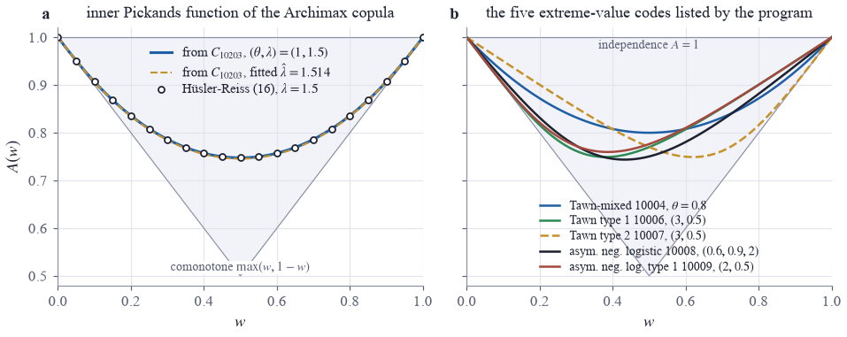
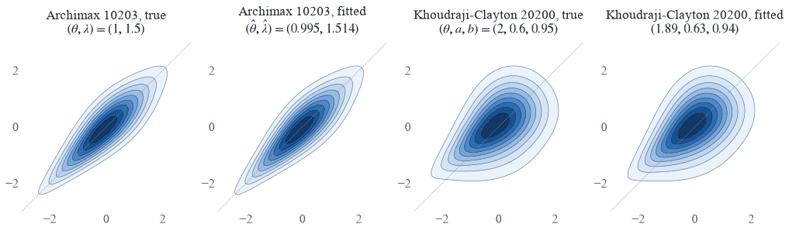

# Generic families

**Program:** `example/ex03_generic_families.f90`, `example/python/ex03_generic_families.py`,
`example/r/ex03_generic_families.R` &nbsp;·&nbsp; **Topics:** generic family
codes, `fv_generic_families`, `fv_par_bounds`, `gen_npar`, Archimax copulas, Khoudraji
asymmetrisation, selection over all families.

Besides the 26 hand-coded families (codes 0-25), fortvine contains a *generic engine* that
assembles pair copulas from building blocks: an outer generator, an inner (Pickands)
function, and optionally a Khoudraji asymmetrisation. It contributes 85 families that are
not available under another code, which brings the total to 111. This program lists some of
them, fits two, and runs a selection over everything.

## Code

=== "Fortran"

    ```fortran
    --8<-- "example/ex03_generic_families.f90"
    ```

=== "Python"

    ```python
    --8<-- "example/python/ex03_generic_families.py"
    ```

=== "R"

    ```r
    --8<-- "example/r/ex03_generic_families.R"
    ```

## Output

=== "Fortran"

    ```text
    generic families: 85; the first five:
      10004  Tawn-mixed                                (1 parameters)
      10006  Tawn-type1                                (2 parameters)
      10007  Tawn-type2                                (2 parameters)
      10008  Joe-asymneglogistic                       (3 parameters)
      10009  asymneglogistic-type1                     (2 parameters)
    fitted Archimax(gamma|HuslerReiss):   0.995   1.514
    fitted Khoudraji-Clayton (theta, a, b):   1.887   0.632   0.940
    selected among all families: Khoudraji-Clayton  rotation 0
    ```

=== "Python"

    ```text
    generic families: 85; the first five:
      10004  Tawn-mixed                                (1 parameters)
      10006  Tawn-type1                                (2 parameters)
      10007  Tawn-type2                                (2 parameters)
      10008  Joe-asymneglogistic                       (3 parameters)
      10009  asymneglogistic-type1                     (2 parameters)
    fitted Archimax(gamma|HuslerReiss):   1.004   1.519
    fitted Khoudraji-Clayton (theta, a, b):   1.800   0.636   0.937
    selected among all families: Khoudraji-Clayton  rotation 0
    ```

=== "R"

    ```text
    generic families: 85; the first five:
      10004  Tawn-mixed                                (1 parameters)
      10006  Tawn-type1                                (2 parameters)
      10007  Tawn-type2                                (2 parameters)
      10008  Joe-asymneglogistic                       (3 parameters)
      10009  asymneglogistic-type1                     (2 parameters)
    fitted Archimax(gamma|HuslerReiss):   1.016   1.505
    fitted Khoudraji-Clayton (theta, a, b):   2.311   0.566   0.931
    selected among all families: Khoudraji-Clayton  rotation 0
    ```

Each program draws its sample with a fixed seed, so its output is reproducible (the Fortran
one with gfortran's intrinsic generator). The three languages draw different uniforms, so
the fitted values differ and scatter around the truths $(1, 1.5)$ and $(2, 0.6, 0.95)$; the
family list and the selected family are the same. The numbers in the walk-through are those
of the Fortran run.

## Walk-through

### How generic codes are built

A generic code reads

$$
\text{code} = 10000\,k + 100\,o + i,
$$

| Digit group | Values |
|---|---|
| $k$ (construction) | 1 plain family; 2 Khoudraji asymmetrisation with two extra parameters $a, b \in (0, 1]$ |
| $o$ (outer generator $\psi$) | 0 none, $\psi(s) = e^{-s}$; 1 positive stable, 2 gamma, 3 Sibuya, 4 logarithmic series; 5 tilted positive stable, 6 generalised Sibuya, 7 negative binomial (two parameters); 11-26 compositions $\psi_p(-\log \zeta_q)$ of two one-parameter Laplace transforms |
| $i$ (inner Pickands function $A$) | 0 independence, $A \equiv 1$ (Archimedean); 1 logistic, 2 negative logistic, 3 Hüsler-Reiss, 4 symmetric mixed, 5 asymmetric logistic, 6/7 its types 1/2, 8 asymmetric negative logistic, 9/10 its types 1/2, 11 asymmetric mixed, 12 Khoudraji-Hüsler-Reiss, 13 Khoudraji-mixed |

All of them share one formula (Capéraà, Fougères & Genest 2000; Charpentier et al. 2014):

$$
C(u, v) = \psi\bigl(\ell(\varphi(u), \varphi(v))\bigr), \qquad \varphi = \psi^{-1},
\qquad \ell(s, t) = (s + t)\, A\!\left(\frac{t}{s + t}\right),
$$

with $\psi$ the Laplace transform of the outer generator and $A$ a Pickands dependence
function. With $A \equiv 1$ ($i = 0$) the copula is Archimedean; with $\psi(s) = e^{-s}$
($o = 0$) it is an extreme-value copula; with both it is an Archimax copula. The parameters
are stored in the order outer, inner, Khoudraji, at most three in all.

Codes that would repeat a hand-coded family (for instance `10100`, positive stable
generator = Gumbel, or `10200`, gamma generator = Clayton) are valid and are used by the
test suite to check the engine against the hand-coded formulas, but
`fv_generic_families()` leaves them out; `fv_generic_families(.false.)` includes them. The
complete list with bounds is the [family catalogue](../families/catalogue.md).

### Listing families

=== "Fortran"

    ```fortran
    codes = fv_generic_families()
    call fv_par_bounds(codes(k), lo, hi)
    print *, codes(k), fv_fam_name(codes(k)), gen_npar(codes(k))
    ```

=== "Python"

    ```python
    gen = [f for f in fv.families() if f.code >= 10000]     # Family(code, name, npars)
    for f in gen[:5]:
        print(f.code, f.name, f.npars)
    ```

    !!! note
        The parameter bounds (`fv_par_bounds`) are available from Fortran only.

=== "R"

    ```r
    fam <- fortvine_families()                              # code, name, npars
    gen <- fam[fam$code >= 10000, ]
    head(gen, 5)
    ```

    !!! note
        The parameter bounds (`fv_par_bounds`) are available from Fortran only.

`fv_fam_name` returns a readable name for any code, `gen_npar` the number of parameters of
a generic code, and `fv_par_bounds` the box in which maximum likelihood searches. The
first five codes are extreme-value copulas ($o = 0$) with Tawn's mixed model and the
asymmetric (negative) logistic models.

### An Archimax copula

=== "Fortran"

    ```fortran
    truth%family = 10203; truth%par = [1.0_dp, 1.5_dp, 0.0_dp]
    ```

=== "Python"

    ```python
    truth = fv.Bicop(10203, 0, [1.0, 1.5])
    ```

=== "R"

    ```r
    truth <- bicop_dist(10203, 0, c(1.0, 1.5))
    ```

Code 10203 combines the gamma Laplace transform $\psi(s) = (1 + s)^{-1/\theta}$ (the Clayton
generator, here $\theta = 1$) with the Hüsler-Reiss Pickands function

$$
A(w) = w\, \Phi\!\left(\frac{1}{\lambda} + \frac{\lambda}{2} \log\frac{w}{1 - w}\right)
     + (1 - w)\, \Phi\!\left(\frac{1}{\lambda} - \frac{\lambda}{2} \log\frac{w}{1 - w}\right),
\qquad \lambda = 1.5 .
$$

The outer gamma part gives lower tail dependence, the extreme-value inner part gives upper
tail dependence, so this one family has both. Data are simulated with `hinv1` exactly as for
a hand-coded family (generic inverse h-functions use the safeguarded Newton iteration with
the exact density), and `fit` recovers $(\hat\theta, \hat\lambda) \approx (1.00, 1.51)$ from
3000 observations.

<figure markdown>

<figcaption>Pickands dependence functions $A(w)$, all computed from fortvine's copula
distribution function. Every $A$ lies in the shaded triangle between
$\max(w, 1 - w)$ (comonotonicity) and 1 (independence). (a) The inner function of the
Archimax copula 10203, recovered from $C$ itself as
$A(w) = \varphi\bigl(C(\psi(1 - w), \psi(w))\bigr)$ with the gamma generator, at the true
$(\theta, \lambda) = (1, 1.5)$ and at the fitted $(\hat\theta, \hat\lambda) = (0.995, 1.514)$;
the circles are the hand-coded Hüsler-Reiss copula (family 16) with $\lambda = 1.5$,
$A(w) = -\log C(e^{-(1-w)}, e^{-w})$, which agrees to all printed digits: the outer
generator does not alter the inner function. (b) The five extreme-value codes listed by
the program, at the parameters shown; types 1 and 2 of Tawn's model are mirror images,
$A_{10007}(w) = A_{10006}(1 - w)$, and asymmetry in $A$ is what makes these copulas
non-exchangeable.</figcaption>
</figure>

### A Khoudraji copula

=== "Fortran"

    ```fortran
    truth%family = 20200; truth%par = [2.0_dp, 0.6_dp, 0.95_dp]
    ```

=== "Python"

    ```python
    truth = fv.Bicop(20200, 0, [2.0, 0.6, 0.95])
    ```

=== "R"

    ```r
    truth <- bicop_dist(20200, 0, c(2.0, 0.6, 0.95))
    ```

Khoudraji's device (Khoudraji 1995; Genest, Ghoudi & Rivest 1998) makes any copula $C_0$
asymmetric:

$$
C(u, v) = u^{1 - a}\, v^{1 - b}\, C_0\bigl(u^{a}, v^{b}\bigr), \qquad a, b \in (0, 1].
$$

With $a \neq b$ the copula is not exchangeable, $C(u, v) \neq C(v, u)$: the dependence is
stronger in one direction than the other. Code 20200 applies it to Clayton (outer gamma,
no inner); the three parameters are $(\theta, a, b)$. The fit recovers them to within a few
hundredths of $a$ and $b$ and about 0.1 of $\theta$.

<figure markdown>

<figcaption>True and fitted densities of the two examples in normal scores (dotted: the
diagonal). The Archimax copula 10203 (left pair) is exchangeable, with a lower tail from the
gamma generator and an upper tail from the Hüsler-Reiss inner function. The Khoudraji-Clayton
copula 20200 (right pair) with $a = 0.6 \ne b = 0.95$ is not exchangeable: its density is
not symmetric about the diagonal. Each fit uses the 3000 draws of the program.</figcaption>
</figure>

When an asymmetric family sits on a vine edge whose orientation is reversed, fortvine
transposes it exactly ($a \leftrightarrow b$ for Khoudraji, swapped asymmetry parameters
or type 1 ↔ type 2 codes for the Pickands families); the test suite checks this identity for
every asymmetric code ([Validation](../theory/validation.md)).

### Selecting among all 109 parametric families

=== "Fortran"

    ```fortran
    ctl%nfam = 24 + size(codes); ctl%family_set = 0
    ctl%family_set(1:24) = FV_ALL; ctl%family_set(25:ctl%nfam) = codes
    call chosen%select(u1, u2, ctl)
    ```

=== "Python"

    ```python
    chosen = fv.Bicop().select(u, family_set=list(range(24)) + [f.code for f in gen])
    ```

=== "R"

    ```r
    chosen <- bicop(u, family_set = list(0:23, "generic"))      # "generic": the 85 generic codes
    ```

`FV_ALL` holds the 24 parametric hand-coded codes 0-23 (including independence and t-EV),
`codes` the 85 generic ones: 109 candidates, each with its admissible rotations. The
selection fits them all to the Khoudraji-Clayton sample and BIC picks the true family. The
whole selection takes about a second for 3000 observations: candidate fits are *raced*,
i.e. a fit is abandoned as soon as a bound on the log-likelihood it can still reach shows
that it cannot beat the best criterion found so far. In vine selection the generic
candidates of each edge are, in addition, pre-screened by a quick fit on a subsample, and
only the best few are fitted on all the data.

!!! tip "When to use the generic families"
    The default family set (hand-coded families 0-22) covers most data. Add the generic
    codes when you suspect tail dependence in both corners with different strengths, or
    asymmetric (non-exchangeable) dependence; the [tail dependence example](tails.md) shows
    a case where only the generic set contains the right model. See
    [The generic engine](../manual/generic.md) for the formulas of every building block.
