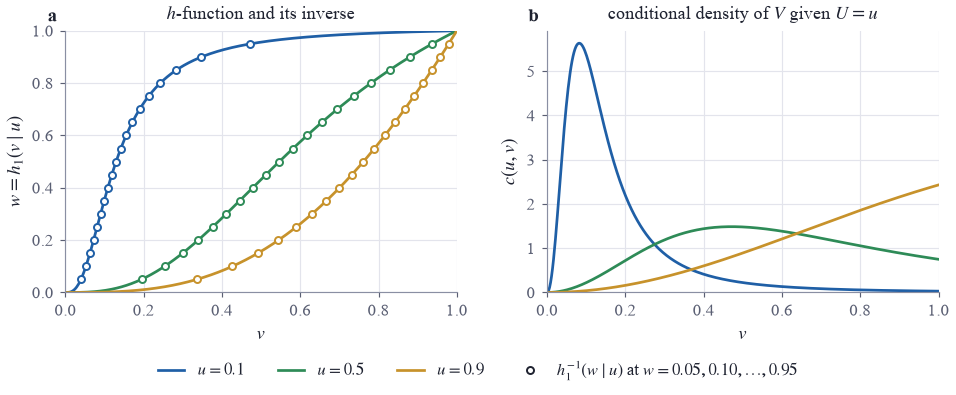
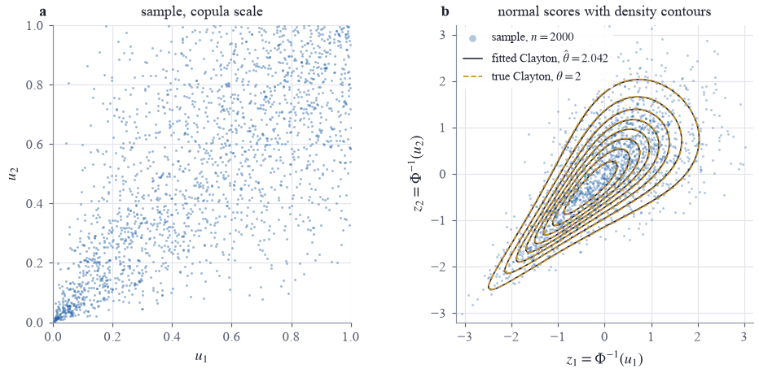

# Pair copula basics

**Program:** `example/ex01_pair_copula.f90`, `example/python/ex01_pair_copula.py`,
`example/r/ex01_pair_copula.R` &nbsp;·&nbsp; **Topics:** `fv_bicop`, density, inverse
h-function, simulation, maximum likelihood, BIC family selection.

The program works with one bivariate copula from start to finish: it evaluates a Clayton
copula, draws a sample from it, refits the parameter, and finally lets fortvine choose the
family without being told.

## Code

=== "Fortran"

    ```fortran
    --8<-- "example/ex01_pair_copula.f90"
    ```

=== "Python"

    ```python
    --8<-- "example/python/ex01_pair_copula.py"
    ```

=== "R"

    ```r
    --8<-- "example/r/ex01_pair_copula.R"
    ```

## Output

=== "Fortran"

    ```text
    Clayton(2) density on the diagonal:    5.3702    1.4810    2.1578
    empirical Kendall tau:  0.514
    fitted theta:  2.0422   log-likelihood:    892.73
    selected: clayton  rotation 0  par   2.042   0.000   0.000
    ```

=== "Python"

    ```text
    Clayton(2) density on the diagonal:    5.3702    1.4810    2.1578
    empirical Kendall tau:  0.517
    fitted theta:  2.0239   log-likelihood:    915.66
    selected: clayton  rotation 0  par   2.024   0.000   0.000
    ```

=== "R"

    ```text
    Clayton(2) density on the diagonal:    5.3702    1.4810    2.1578
    empirical Kendall tau:  0.502
    fitted theta:  1.9733   log-likelihood:    824.55
    selected: clayton  rotation 0  par   1.973   0.000   0.000
    ```

The first line is deterministic and the same in all three languages. The other three depend
on the random sample. Each program fixes its seed (`random_seed(put=seed)` in Fortran,
`np.random.default_rng(seed)` in Python, `set.seed()` in R), so its output is reproducible,
but the three generators produce different uniforms and so slightly different values around
the same truth. Another Fortran compiler has another intrinsic generator as well. The
numbers in the walk-through are those of the Fortran run.

## Walk-through

### Defining a copula

=== "Fortran"

    ```fortran
    truth%family = FV_CLAYTON; truth%par = [2.0_dp, 0.0_dp, 0.0_dp]
    ```

=== "Python"

    ```python
    truth = fv.Bicop("clayton", 0, [2.0])        # family, rotation, parameters
    ```

=== "R"

    ```r
    truth <- bicop_dist("clayton", 0, 2)         # family, rotation, parameters
    ```

An `fv_bicop` is a plain derived type: `family` is an integer code (named constants
`FV_GAUSSIAN`, `FV_CLAYTON`, ... in `fortvine_api`), `rotation` is 0, 90, 180 or 270, and
`par(3)` holds up to three parameters with unused slots left at 0. Nothing has to be
initialised or allocated. In Python and R the family is given by its name (as
`fv_fam_name` spells it, any case) or its integer code, and only as many parameters as the
family has. The Clayton copula has the distribution function and density

$$
C(u, v) = \bigl(u^{-\theta} + v^{-\theta} - 1\bigr)^{-1/\theta},
\qquad
c(u, v) = (1 + \theta)\,(uv)^{-1-\theta} \bigl(u^{-\theta} + v^{-\theta} - 1\bigr)^{-2 - 1/\theta},
$$

with Kendall's $\tau = \theta / (\theta + 2)$, i.e. $\tau = 0.5$ for $\theta = 2$.

### Evaluating the density

=== "Fortran"

    ```fortran
    call truth%pdf([0.1_dp, 0.5_dp, 0.9_dp], [0.1_dp, 0.5_dp, 0.9_dp], dens)
    ```

=== "Python"

    ```python
    dens = truth.pdf([[0.1, 0.1], [0.5, 0.5], [0.9, 0.9]])      # one point per row
    ```

=== "R"

    ```r
    dens <- dbicop(rbind(c(0.1, 0.1), c(0.5, 0.5), c(0.9, 0.9)), truth)   # one point per row
    ```

All evaluation routines take arrays of points (Fortran: two vectors; Python and R: an
$n \times 2$ array): here the three diagonal points
$(0.1, 0.1)$, $(0.5, 0.5)$, $(0.9, 0.9)$. At the centre the formula gives
$3 \cdot 0.25^{-3} \cdot 7^{-5/2} = 1.4810$, as printed. The density is largest near the
origin (5.37 at $(0.1, 0.1)$) because Clayton has lower tail dependence,
$\lambda_L = 2^{-1/\theta} \approx 0.71$; at $(0.9, 0.9)$ it is smaller (2.16) since
$\lambda_U = 0$. The same calling pattern serves `logpdf`, `cdf`, `hfunc1`, `hfunc2`,
`hinv1` and `hinv2` (in R: `dbicop(u, b, log = TRUE)`, `pbicop(u, b)` and
`hbicop(u, 1 or 2, b, inverse =)`). Long arrays (more than 4096 points) are evaluated in parallel.

### Simulating

=== "Fortran"

    ```fortran
    call random_number(u1); call random_number(w)
    call truth%hinv1(u1, w, u2)
    ```

=== "Python"

    ```python
    u1, w = rng.random(n), rng.random(n)
    u2 = truth.hinv1(np.column_stack([u1, w]))
    u = np.column_stack([u1, u2])                # the same in one call: truth.simulate(n, seed=...)
    ```

=== "R"

    ```r
    u1 <- runif(n); w <- runif(n)
    u2 <- hbicop(cbind(u1, w), 1, truth, inverse = TRUE)
    u <- cbind(u1, u2)                           # the same in one call: rbicop(n, truth)
    ```

`hinv1(u1, w, u2)` returns the $v$ that solves $h_1(v \mid u_1) = w$, where
$h_1(v \mid u) = \partial C(u, v)/\partial u$ is the conditional distribution of $V$ given
$U = u$. If $u_1$ and $w$ are independent uniforms, $(u_1, u_2)$ is a draw from the copula:
the inverse Rosenblatt transform in two dimensions. For Clayton, fortvine uses the closed
form

$$
h_1^{-1}(w \mid u) = \Bigl(1 + u^{-\theta}\bigl(w^{-\theta/(1+\theta)} - 1\bigr)\Bigr)^{-1/\theta},
$$

written so that the factor $w^{-\theta/(1+\theta)} - 1$ is computed with `expm1` and nothing
cancels for small $u$.

<figure markdown>

<figcaption>The conditional distribution behind the simulation, for the Clayton copula with
$\theta = 2$. (a) $h_1(v \mid u)$ for $u = 0.1, 0.5, 0.9$ (lines) and the points
$\bigl(h_1^{-1}(w \mid u), w\bigr)$ returned by `hinv1` for $w = 0.05, 0.10, \ldots, 0.95$
(circles), which fall on the curves: over a 401-point grid
$|h_1^{-1}(h_1(v \mid u) \mid u) - v| \le 3 \times 10^{-14}$. (b) The conditional density
$c(u, v) = \partial h_1(v \mid u) / \partial v$: for small $u$ the mass of $V$ piles up near 0,
the lower tail dependence of Clayton.</figcaption>
</figure>

The empirical Kendall tau of the 2000 draws (0.514 with the fixed seed)
scatters around the theoretical 0.5 with a standard error of roughly 0.01.

### Fitting a known family

=== "Fortran"

    ```fortran
    fitted%family = FV_CLAYTON
    call fitted%fit(u1, u2)
    ```

=== "Python"

    ```python
    fitted = fv.Bicop("clayton").fit(u)          # fitted.parameters, fitted.loglik()
    ```

=== "R"

    ```r
    fitted <- bicop(u, family_set = "clayton", rotation = 0)   # fitted$parameters, logLik(fitted)
    ```

`fit` keeps `family` and `rotation` and estimates `par` by maximum likelihood; the
maximised log-likelihood goes to `fitted%loglik`. In R, `bicop()` fits a single family when
`family_set` holds one family and `rotation` is given; without `rotation` it selects. Internally the start value comes from
inverting Kendall's tau, and the likelihood is maximised by Fisher-scoring steps with exact
parameter scores (see [Exact parameter scores](../theory/scores.md)). Passing an
`fv_controls` with `method = FV_ITAU` instead returns the tau-inversion estimate itself
(`method="itau"` in Python, `par_method = "itau"` in R), and `weights=` gives observation
weights (`weights=` in Python and R; [example](weights-discrete.md)).

<figure markdown>

<figcaption>The program's sample, $n = 2000$ draws from the Clayton copula with $\theta = 2$
($\tau = 0.5$). (a) In copula scale the lower tail dependence shows as the dense cluster at
$(0, 0)$. (b) In normal scores $z = \Phi^{-1}(u)$, with the contours of the fitted density
($\hat\theta = 2.042$, solid) and of the true density ($\theta = 2$, dashed): the two are
indistinguishable at this sample size.</figcaption>
</figure>

### Selecting a family

=== "Fortran"

    ```fortran
    call chosen%select(u1, u2)
    ```

=== "Python"

    ```python
    chosen = fv.Bicop().select(u)                # chosen.family, chosen.rotation, chosen.parameters
    ```

=== "R"

    ```r
    chosen <- bicop(u)                           # family_set = "all", selcrit = "bic"
    ```

`select` with no controls tries the default candidate set: the 23 hand-coded parametric
families `0..22` (every parametric family except the slow-to-fit t-EV). A rotatable
family is tried in the two rotations that match the sign of the sample's Kendall tau
(0 and 180 degrees for positive dependence, 90 and 270 for negative). With `preselect`
on (the default), the correlations of the normal scores in the lower and the upper part of
the sample are compared, as in vinecopulib, and a rotation whose tail sits on the weaker
side is dropped before fitting. Every remaining candidate is fitted and the one with the
smallest BIC,
$-2\ell + k \log n$, wins. The data came from Clayton, and Clayton without rotation is
recovered with the same parameter as the dedicated fit.

## Variations

**Restrict or extend the candidates** with a control object (keyword arguments in Python
and R). See [Controls](../manual/controls.md) for every field.

=== "Fortran"

    ```fortran
    type(fv_controls) :: ctl
    ctl%nfam = 5; ctl%family_set(1:5) = FV_ONE_PAR     ! gaussian, clayton, gumbel, frank, joe
    ctl%selcrit = FV_AIC
    call chosen%select(u1, u2, ctl)
    ```

=== "Python"

    ```python
    chosen = fv.Bicop().select(u, family_set=["gaussian", "clayton", "gumbel", "frank", "joe"],
                               criterion="aic")
    ```

=== "R"

    ```r
    chosen <- bicop(u, family_set = c("gaussian", "clayton", "gumbel", "frank", "joe"),
                    selcrit = "aic")
    ```

**Evaluate a rotated copula**: set the rotation to 90 before calling `pdf`/`hinv1`; a 90 or
270 degree rotation of Clayton models negative dependence with a tail in an off-diagonal
corner ([Rotations and asymmetry](../manual/rotations.md)).

=== "Fortran"

    ```fortran
    truth%rotation = 90
    ```

=== "Python"

    ```python
    truth = fv.Bicop("clayton", 90, [2.0])
    ```

=== "R"

    ```r
    truth <- bicop_dist("clayton", 90, 2)
    ```

**The distribution function** $C$ itself is in closed form for every family except the
Gaussian and Student ones, which are integrated by Gauss-Legendre quadrature over their
exact h-function.

=== "Fortran"

    ```fortran
    call truth%cdf(u1, u2, out)
    ```

=== "Python"

    ```python
    out = truth.cdf(u)
    ```

=== "R"

    ```r
    out <- pbicop(u, truth)
    ```
