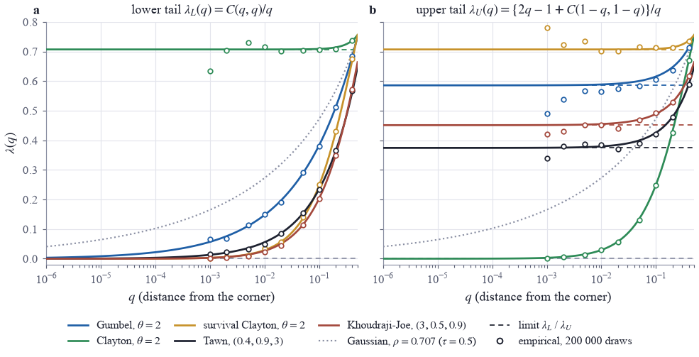

# Tail dependence and asymmetry

**Program:** `example/ex04_tails.f90`, `example/python/ex04_tails.py`,
`example/r/ex04_tails.R` &nbsp;·&nbsp; **Topics:** tail dependence
coefficients, `cdf`, rotations, Tawn and Khoudraji asymmetric families, BIC selection with
and without the generic families.

Two copulas can have the same Kendall tau and behave completely differently in the
corners. This program takes five copulas with very different tails and measures their tail
dependence three ways:

1. the **limit** $\lambda_L$ or $\lambda_U$ from the family's formula;
2. the **exact finite-level coefficient** from the copula distribution function,
   $$
   \lambda_L(q) = \frac{C(q, q)}{q}, \qquad \lambda_U(q) = \frac{1 - 2(1 - q) + C(1 - q, 1 - q)}{q},
   $$
   at $q = 10^{-2}$ and $q = 10^{-4}$ (here $q$ is the distance from the corner);
3. the **empirical** coefficient: the fraction of a 200 000-point sample in the corner square
   of side $q = 0.01$, divided by $q$.

It then asks which family BIC selects from 2000 observations of each copula.

## Code

=== "Fortran"

    ```fortran
    --8<-- "example/ex04_tails.f90"
    ```

=== "Python"

    ```python
    --8<-- "example/python/ex04_tails.py"
    ```

=== "R"

    ```r
    --8<-- "example/r/ex04_tails.R"
    ```

!!! note "The distribution function in R"
    The R package has no copula distribution function (the C interface it calls does not
    export one), so the R script computes the finite-level coefficients from the h-function
    of the library instead: $C(q, q) = \int_0^q h_1(s, q)\, ds$ and
    $P(U_1 > 1 - q, U_2 > 1 - q) = \int_{1-q}^1 \bigl(1 - h_1(s, 1 - q)\bigr)\, ds$, by
    adaptive quadrature (`integrate`). The values agree with the CDF of the Fortran and Python
    programs to the printed digits.

## Output

=== "Fortran"

    ```text
                            |      lower tail lambda_L(q)         |      upper tail lambda_U(q)
    copula              rot |      limit  q=1e-2  q=1e-4  sample |      limit  q=1e-2  q=1e-4  sample
    gumbel                0 |      0.000   0.148   0.022   0.150 |      0.586   0.589   0.586   0.565
    clayton               0 |      0.707   0.707   0.707   0.716 |      0.000   0.029   0.000   0.031
    clayton             180 |      0.000   0.029   0.000   0.035 |      0.707   0.707   0.707   0.703
    tawn                  0 |      0.000   0.056   0.003   0.049 |      0.374   0.379   0.374   0.385
    Khoudraji-Joe         0 |      0.000   0.027   0.000   0.022 |      0.451   0.455   0.451   0.453

    BIC selection from 2000 observations:
      gumbel         default set: galambos   rot  0   + generic families: galambos       rot  0
      clayton        default set: clayton    rot  0   + generic families: clayton        rot  0
      clayton        default set: clayton    rot180   + generic families: clayton        rot180
      tawn           default set: tawn       rot  0   + generic families: tawn           rot  0
      Khoudraji-Joe  default set: tawn       rot  0   + generic families: Khoudraji-Joe  rot  0
    ```

=== "Python"

    ```text
                            |      lower tail lambda_L(q)         |      upper tail lambda_U(q)
    copula              rot |      limit  q=1e-2  q=1e-4  sample |      limit  q=1e-2  q=1e-4  sample
    gumbel                0 |      0.000   0.148   0.022   0.150 |      0.586   0.589   0.586   0.623
    clayton               0 |      0.707   0.707   0.707   0.685 |      0.000   0.029   0.000   0.028
    clayton             180 |      0.000   0.029   0.000   0.035 |      0.707   0.707   0.707   0.699
    tawn                  0 |      0.000   0.056   0.003   0.053 |      0.374   0.379   0.374   0.363
    Khoudraji-Joe         0 |      0.000   0.027   0.000   0.023 |      0.451   0.455   0.451   0.462

    BIC selection from 2000 observations:
      gumbel         default set: gumbel     rot  0   + generic families: gumbel         rot  0
      clayton        default set: joe        rot180   + generic families: joe            rot180
      clayton        default set: clayton    rot180   + generic families: clayton        rot180
      tawn           default set: tawn       rot  0   + generic families: Joe-asymneglogistic rot  0
      Khoudraji-Joe  default set: tawn       rot  0   + generic families: Khoudraji-Joe  rot  0
    ```

=== "R"

    ```text
                            |      lower tail lambda_L(q)         |      upper tail lambda_U(q)
    copula              rot |      limit  q=1e-2  q=1e-4  sample |      limit  q=1e-2  q=1e-4  sample
    gumbel                0 |      0.000   0.148   0.022   0.135 |      0.586   0.589   0.586   0.579
    clayton               0 |      0.707   0.707   0.707   0.702 |      0.000   0.029   0.000   0.033
    clayton             180 |      0.000   0.029   0.000   0.028 |      0.707   0.707   0.707   0.683
    tawn                  0 |      0.000   0.056   0.003   0.054 |      0.374   0.379   0.374   0.349
    Khoudraji-Joe         0 |      0.000   0.027   0.000   0.028 |      0.451   0.455   0.451   0.444

    BIC selection from 2000 observations:
      gumbel         default set: gumbel     rot  0   + generic families: gumbel         rot  0
      clayton        default set: clayton    rot  0   + generic families: clayton        rot  0
      clayton        default set: clayton    rot180   + generic families: clayton        rot180
      tawn           default set: tawn       rot  0   + generic families: tawn           rot  0
      Khoudraji-Joe  default set: tawn       rot  0   + generic families: Khoudraji-Joe  rot  0
    ```

All samples use fixed seeds, so each output is reproducible (the Fortran program takes about
4 seconds, mostly the two selections over 109 families per copula). The limits and the
finite-level columns are exact and the same in all three languages. The "sample" columns and
the selections depend on the random draws, which differ between Fortran, NumPy and R: on
the Python samples BIC picks survival Joe (also lower-tail dependent) for the Clayton data,
and with the generic families Joe-asymneglogistic (another asymmetric extreme-value-type
upper tail) for the Tawn data. The discussion below refers to the Fortran run.

## The five copulas and their tail formulas

| Copula | Parameters | Tail formula | $\lambda_L$ | $\lambda_U$ |
|---|---|---|---:|---:|
| Gumbel | $\theta = 2$ | $\lambda_U = 2 - 2^{1/\theta}$ | 0 | 0.586 |
| Clayton | $\theta = 2$ | $\lambda_L = 2^{-1/\theta}$ | 0.707 | 0 |
| Clayton rotated 180° (survival Clayton) | $\theta = 2$ | $\lambda_U = 2^{-1/\theta}$ | 0 | 0.707 |
| Tawn (asymmetric logistic) | $(\psi_1, \psi_2, \theta) = (0.4, 0.9, 3)$ | $\lambda_U = \psi_1 + \psi_2 - (\psi_1^\theta + \psi_2^\theta)^{1/\theta}$ | 0 | 0.374 |
| Khoudraji-Joe (code 20300) | $(\theta, a, b) = (3, 0.5, 0.9)$ | $\lambda_U = a + b - (a^\theta + b^\theta)^{1/\theta}$ | 0 | 0.451 |

The last two formulas follow from the tail behaviour of extreme-value-type copulas. Near
$(1, 1)$ any copula with upper tail dependence behaves like
$C(1 - x, 1 - y) \approx 1 - \ell(x, y)$ with the *stable tail dependence function* $\ell$,
and $\lambda_U = 2 - \ell(1, 1)$. For an extreme-value copula with Pickands function $A$,
$\ell(x, y) = (x + y) A(y / (x + y))$, so $\lambda_U = 2(1 - A(1/2))$. Tawn's model has
$A(w) = (1 - \psi_1)(1 - w) + (1 - \psi_2) w + [(\psi_1 (1 - w))^\theta + (\psi_2 w)^\theta]^{1/\theta}$,
which gives the formula in the table. For the Khoudraji construction
$C(u, v) = u^{1-a} v^{1-b} C_0(u^a, v^b)$, expanding each factor at $(1 - x, 1 - y)$ gives
$\ell(x, y) = (1 - a)x + (1 - b)y + \ell_0(ax, by)$; with Joe's
$\ell_0(x, y) = (x^\theta + y^\theta)^{1/\theta}$ this yields $\lambda_U = a + b - \ell_0(a, b)$,
the same expression as for Tawn: Khoudraji-Joe and Tawn share their upper tail
*structure* but not their bodies.

## Reading the table

**The finite-level coefficients converge, at very different speeds.** For Clayton,
$\lambda_L(q) = (2 - q^{\theta})^{-1/\theta}$, so the lower tail coefficient is already
0.707 at $q = 0.01$. For the zero limits, the convergence can be slow: Gumbel's lower tail
coefficient is 0.148 at $q = 0.01$ and still 0.022 at $q = 10^{-4}$, since
$C(q, q)/q = q^{2^{1/\theta} - 1}$ decays only like $q^{0.41}$. A finite sample never
reaches the limit; an empirical tail coefficient estimates the finite-level value, as the
"sample" columns show (0.150 against 0.148, 0.565 against 0.589, and so on, within the
binomial noise of roughly $\pm 0.02$ for about 1000-1500 corner points).

<figure markdown>

<figcaption>Finite-level tail dependence $\lambda_L(q)$ (a) and $\lambda_U(q)$ (b) from the
copula distribution function, for $10^{-6} \le q \le 0.5$ (lines). Dashed: the limits
$\lambda_L$, $\lambda_U$ of the table above (the grey dashed line is the common limit 0).
Circles: empirical coefficients of the program's 200 000-point samples at
$q = 10^{-3}, \ldots, 0.4$; at $q = 10^{-3}$ the corner square holds only
$200\,000\, q\, \lambda(q) \le 140$ points, hence the scatter. Dotted: a Gaussian copula with the same $\tau = 0.5$
($\rho = 0.707$), whose $\lambda_U(q)$ decays to 0 slowly, like Gumbel's lower tail.
Clayton reaches its limit almost at once; the zero limits are approached only as a power of
$q$.</figcaption>
</figure>

**The rotation swaps the tails.** Survival Clayton has exactly the numbers of Clayton with
the two tails exchanged, because $C_{180}(u, v) = u + v - 1 + C(1 - u, 1 - v)$.

**Asymmetric families keep their tail where the formula says.** Tawn and Khoudraji-Joe have
no lower tail dependence and upper tail coefficients 0.374 and 0.451, reproduced by the
CDF to three decimals at $q = 10^{-4}$.

!!! note "Khoudraji copulas lose the base copula's lower tail"
    The [catalogue](../families/catalogue.md) flags Khoudraji-Clayton (20200) as a
    lower-tail family because its base copula is one, and the flag is used to decide which
    rotations to try. Unless $a = b = 1$ the construction actually has $\lambda_L = 0$: with
    $a \le b$, $C(t, t) \le t^{2 - a - b}\, t^{b} = t^{2 - a}$, so $C(t, t)/t \to 0$. Only
    the upper tail survives the asymmetrisation, as in this example.

## Which family does BIC select?

* **Gumbel → Galambos.** Gumbel and Galambos are both extreme-value copulas, with Pickands
  functions that are nearly indistinguishable for comparable dependence. With 2000
  observations the data cannot separate them; BIC takes the one with the marginally higher
  likelihood. Both have $\lambda_L = 0$ and a positive $\lambda_U$, so tail inference is not
  affected.
* **Clayton and survival Clayton** are recovered with the correct rotation. Rotation
  selection is driven by the sign of Kendall's tau (0 or 180 for positive dependence) and by
  which half of the data is more strongly correlated in normal scores.
* **Tawn** is recovered by both family sets.
* **Khoudraji-Joe** is not in the default family set, so the default selection settles for
  the closest available model, Tawn, which has the same kind of asymmetric upper tail. Once
  the generic families are added, BIC picks the true family.

Tail dependence in a model matters for joint exceedance probabilities. A Gaussian copula
with the same Kendall tau as the Gumbel copula above ($\tau = 0.5$, $\rho = 0.707$) has
$\lambda_U(q) = 0.273$ at $q = 10^{-2}$ and $0.103$ at $q = 10^{-4}$, against Gumbel's
0.589 and 0.586: at the 1-in-10 000 level the Gaussian model underestimates the chance of a
joint extreme almost sixfold. Selecting among families with the right tail behaviour,
including the generic ones when asymmetry is suspected, is the point of having many
families.

See also [Rotations and asymmetry](../manual/rotations.md),
[Extreme-value families](../families/extreme-value.md) and
[Khoudraji asymmetrisation](../families/khoudraji.md).
