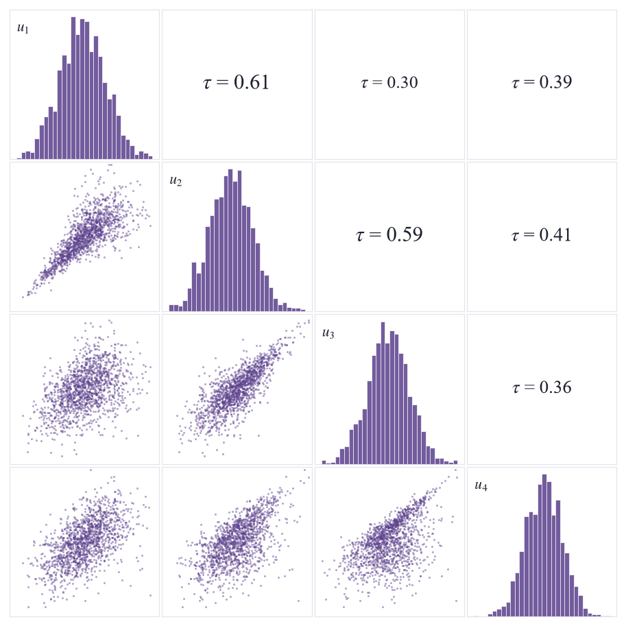

# Vine copula workflow

**Program:** `example/ex02_vine.f90` &nbsp;·&nbsp; **Topics:** `fv_vinecop`, `set_dvine`,
`simulate`, `select` (Dissmann's algorithm), `loglik`, `npars`, `pdf`, `rosenblatt`,
`print`, `fv_controls%nthreads`.

The program builds a five-dimensional D-vine by hand, draws 3000 observations from it,
forgets the model, selects a new regular vine from the sample, and then uses the fitted
model: its density, its Rosenblatt transform and new simulations.

<figure markdown>
{ width="560" }
<figcaption>What a vine sample looks like: 1500 draws from a four-dimensional D-vine with
Clayton, Gumbel and Tawn pairs in the first tree, Frank and Gaussian in the second and a
Student t in the third (`tools/vine_sample.f90`), shown in normal scores. Below the diagonal:
scatter plots; above: empirical Kendall's tau.</figcaption>
</figure>

## Code

```fortran
--8<-- "example/ex02_vine.f90"
```

## Output

```text
fortvine vine copula: d = 5, trunc = 4
order: 4 2 1 3 5
  tree 1 edge 1:       gumbel rot   0 par  1.9794E+00  0.0000E+00  0.0000E+00
  tree 1 edge 2:       gumbel rot   0 par  2.0272E+00  0.0000E+00  0.0000E+00
  tree 1 edge 3:          bb1 rot   0 par  9.5591E-02  1.9079E+00  0.0000E+00
  tree 1 edge 4:          bb1 rot   0 par  1.2148E-01  1.9325E+00  0.0000E+00
  tree 2 edge 1:     plackett rot   0 par  1.7121E+00  0.0000E+00  0.0000E+00
  tree 2 edge 2:      student rot   0 par  3.7896E-01  8.0422E+00  0.0000E+00
  tree 2 edge 3:     plackett rot   0 par  1.2170E+00  0.0000E+00  0.0000E+00
  tree 3 edge 1:          bb1 rot   0 par  1.0692E-01  1.2345E+00  0.0000E+00
  tree 3 edge 2:     plackett rot   0 par  1.4716E+00  0.0000E+00  0.0000E+00
  tree 4 edge 1:      student rot   0 par  3.8256E-01  1.3891E+01  0.0000E+00
log-likelihood:     5271.62   parameters:15
Kendall tau of the first two Rosenblatt columns (should be ~0): -0.0145
first simulated row:  0.2060  0.0264  0.0755  0.1306  0.5556
tree 1 families: gumbel gumbel bb1 bb1
tree 2 families: plackett student plackett
```

The sample is drawn with `seed=42`, so this output is reproducible.

## Walk-through

### Building a vine by hand

```fortran
call truth%set_dvine([1, 2, 3, 4, 5])
truth%fam(e, 1) = FV_GUMBEL; truth%par(1, e, 1) = 2.0_dp     ! tree 1
truth%fam(e, 2) = FV_FRANK;  truth%par(1, e, 2) = 3.0_dp     ! tree 2
```

`set_dvine(order)` allocates a vine for `d = size(order)` variables with the D-vine
(path) structure along `order`, and every pair copula set to independence. Edge `e` of tree
`t` is then configured through `fam(e, t)`, `rot(e, t)` and `par(1:3, e, t)`. In this
D-vine, tree 1 holds the pairs $(1,2), (2,3), (3,4), (4,5)$, each a Gumbel copula with
$\theta = 2$ ($\tau = 0.5$, upper tail dependence $\lambda_U = 2 - \sqrt 2 \approx 0.59$);
tree 2 holds $(1,3 \mid 2)$, $(2,4 \mid 3)$, $(3,5 \mid 4)$, Frank copulas with
$\theta = 3$ ($\tau \approx 0.31$). Trees 3 and 4 stay independent, so the truth has
$4 + 3 = 7$ parameters.

`simulate(n, u, seed=42)` fills `u(n, d)` by applying the inverse Rosenblatt transform to
uniforms drawn from a generator seeded with 42.

### Selecting a vine

```fortran
ctl%nthreads = 4
call vc%select(u, ctl)
```

`vc` has no structure yet, so `select` runs the full Dissmann et al. (2013) algorithm: tree
by tree it builds a maximum spanning tree on $|\hat\tau|$, then selects family, rotation
and parameters for every edge by BIC among the default 23 parametric families, and
computes the conditional pseudo-observations for the next tree. Independent edges are
fitted in parallel on the requested 4 threads.

### Why the selected vine differs from the truth

The selected model has 15 parameters and log-likelihood 5271.6, although the true model
reaches 5429.4 with 7. The reason is visible in the sample's Kendall tau matrix
(`fv_tau_mat(u, tm)`):

```text
   1.000   0.502   0.506   0.402   0.362
   0.502   1.000   0.494   0.503   0.389
   0.506   0.494   1.000   0.500   0.512
   0.402   0.503   0.500   1.000   0.498
   0.362   0.389   0.512   0.498   1.000
```

The Frank copulas in tree 2 add so much dependence between second neighbours that
$\hat\tau_{13} = 0.506$ and $\hat\tau_{35} = 0.512$ exceed the true tree-1 pair
$\hat\tau_{23} = 0.494$. The maximum spanning tree takes the stronger pairs, the first tree
is no longer the path 1-2-3-4-5, and higher trees have to mop up the dependence that the
first tree misplaced (hence BB1, Plackett and Student copulas in trees 2-4 instead of Frank
and independence). Greedy tree selection is a heuristic; it is very good when the strongest
dependence really sits in the first tree and can be fooled otherwise.

When the structure is known, fixing it avoids the problem. With

```fortran
call vc%set_dvine([1, 2, 3, 4, 5])
call vc%select(u, ctl)            ! only families and parameters are selected
```

fortvine selects Gumbel in all four tree-1 edges ($\hat\theta$ from 1.98 to 2.03), Frank in
all three tree-2 edges ($\hat\theta$ from 2.90 to 3.06), independence above, 7 parameters
and log-likelihood 5431.45, slightly above the truth's 5429.45 as a maximum-likelihood fit
should be. (The fitted vine is stored with the order reversed, `5 4 3 2 1`, which describes
the same D-vine.)

### Using the fitted model

```fortran
print *, vc%loglik(u), vc%npars()
call vc%pdf(u, dens)
call vc%rosenblatt(u, w)
call vc%simulate(10, sim, seed=7)
```

* `loglik(u)` is $\sum_i \log c(u_i)$ and `npars()` the number of parameters, the two
  ingredients of an information criterion ($\mathrm{BIC} = -2 \cdot 5271.6 + 15 \log 3000$).
* `pdf(u, dens)` returns the vine density at every row; it is a product of 10 pair-copula
  densities evaluated along the trees (computed as a sum of logs).
* `rosenblatt(u, w)` maps the data to what should be independent uniforms if the model is
  right. The Kendall tau between the first two transformed columns, $-0.0145$, is well
  within the sampling noise of $\pm 0.012$ (one standard error at $n = 3000$), as expected
  since the selected vine fits the data well even with the "wrong" structure.
* `simulate(10, sim, seed=7)` draws ten new rows from the fitted model.

The `fam` array is indexed `(edge, tree)`, so the last loop prints the families of tree 1
and tree 2 by name with `fv_fam_name`.

## Variations

* `ctl%select_trunc = .true.` lets the mBICv choose a truncation level; `ctl%trunc_lvl = 2`
  truncates after tree 2 by fiat.
* `ctl%tree_crit = FV_TREE_RHO` (or `FV_TREE_HOEFFD`, `FV_TREE_XI`, `FV_TREE_MI`, ...) changes
  the edge weights of the spanning trees; `ctl%tree_algo = FV_KRUSKAL` the algorithm.
* `vc%matrix()` returns the R-vine matrix in the original variable labels, the format used
  by vinecopulib and VineCopula.

See [Vine copulas](../manual/vinecop.md) and [Fitting and selection](../manual/fitting.md).
