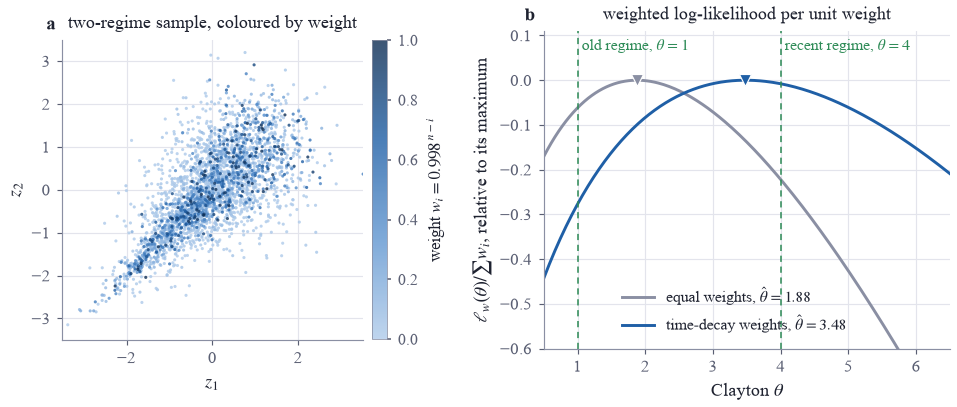
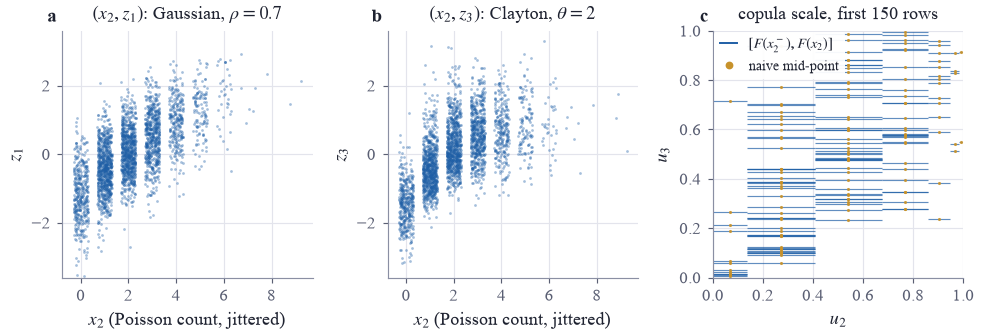
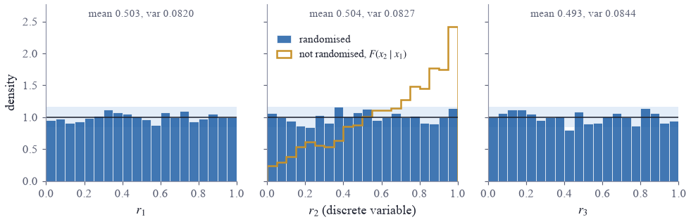

# Weighted and discrete data

**Program:** `example/ex05_weights_discrete.f90` &nbsp;·&nbsp; **Topics:** the `weights=`
argument of `fit`/`select`, the `discrete=` and `u_minus=` arguments of
`fv_vinecop%select`, `pdf`, `loglik` and `rosenblatt`, randomised Rosenblatt residuals.

Two features that real data often need:

1. **Observation weights.** Every fitting and selection routine accepts `weights(n)`. The
   weighted log-likelihood $\sum_i w_i \log c(u_i; \theta)$ is maximised, and weighted
   Kendall taus drive the vine structure.
2. **Discrete variables.** Counts, classes and other discrete margins are supported inside a
   vine following the convention of vinecopulib: each discrete variable is passed as
   $u = F(x)$ together with $u^- = F(x^-)$, the margin's distribution function just below
   the observed value.

!!! note "Fortran only"
    Observation weights and discrete margins are available from Fortran only: the C
    interface that the [Python](../python.md) and [R](../r.md) packages call does not pass
    them. This page therefore has no Python or R version.

## Code

```fortran
--8<-- "example/ex05_weights_discrete.f90"
```

## Output

```text
Clayton fit, equal weights:          theta =  1.877
Clayton fit, time-decay weights:     theta =  3.479   (effective n =  994.1)
weights 1/2:     theta =  1.87489409  loglik =   1746.7519
duplicated rows: theta =  1.87489409  loglik =   1746.7519

count variable: 389 zeros, maximum 9, mean  2.027
tree-1 pair      truth             discrete-aware    naive
  (1,2)    gaussian    0.700 gaussian    0.714 gaussian    0.706
  (2,3)    clayton     2.000 clayton     2.119 bb8         3.407
loglik of the mixed data: truth   2241.17   discrete-aware fit   2246.63
first three mixed densities:  6.789E-02  2.063E+00  3.971E+00
Rosenblatt column means (1/2):         0.5032  0.5040  0.4932
Rosenblatt column variances (1/12):    0.0820  0.0827  0.0844
Kendall tau (1,2) (1,3) (2,3), ~0:     0.0003  0.0057 -0.0035
```

The seeds are fixed; the output is reproducible.

## Part 1: observation weights

### Following a change in dependence

The 3000 observations are generated in two regimes: the first half from Clayton with
$\theta = 1$ ($\tau = 1/3$), the second half from Clayton with $\theta = 4$ ($\tau = 2/3$).
An ordinary fit treats all rows alike and lands in between ($\hat\theta = 1.88$). Weights
that decay exponentially with age,

$$
w_i = 0.998^{\,n - i}, \qquad n_{\text{eff}} = \frac{(\sum_i w_i)^2}{\sum_i w_i^2} \approx 994,
$$

concentrate the fit on the recent regime: $\hat\theta = 3.48$, close to the current value
4 (the oldest weights still pull it down a little). This is the usual way to obtain a
time-varying dependence estimate from a rolling sample.

```fortran
wt = [(0.998_dp**(n - i), i = 1, n)]
call fit%fit(u1, u2, weights=wt)
```

<figure markdown>

<figcaption>(a) The 3000 observations in normal scores, coloured by their weight
$w_i = 0.998^{\,n - i}$: the recent regime ($\theta = 4$, dark) is the tighter cloud. (b) The
Clayton log-likelihood per unit weight, $\ell_w(\theta) / \sum_i w_i$, each curve shifted to
a maximum of 0, with equal weights (grey) and with the time-decay weights (blue); the
triangles mark the estimates $\hat\theta = 1.88$ and $\hat\theta = 3.48$. Fitted to each
regime alone, the same data give $\hat\theta = 1.03$ and $\hat\theta = 3.81$.</figcaption>
</figure>

### Weights as frequencies

With integer weights, a weighted fit is exactly the fit to a sample in which observation
$i$ is repeated $w_i$ times. The program draws weights 1 or 2 at random, builds the
expanded sample, and fits both: the estimates agree to all printed digits
($\hat\theta = 1.87489409$) and so do the log-likelihoods. The test suite checks the same
identity for the weighted Kendall tau and for a two-parameter family
([Validation](../theory/validation.md)).

Weights are accepted by `fv_bicop%fit`, `fv_bicop%select` and `fv_vinecop%select`; for a
vine they also enter the weighted tau that builds the spanning trees, and with
`select_threshold` the effective sample size $n_{\text{eff}}$ replaces $n$ in the mBICv.

## Part 2: a vine with a count variable

### Making the data

A three-dimensional D-vine 1-2-3 is simulated (Gaussian $\rho = 0.7$ on (1,2), Clayton
$\theta = 2$ on (2,3), Frank $\theta = 2$ on (1,3 | 2)), and variable 2 is turned into a
Poisson(2) count through its quantile function, $x_2 = F_{\text{Pois}}^{-1}(u_2)$. The
copula of $(U_1, X_2, U_3)$ is still the D-vine; only the second margin is now discrete,
with 389 zeros among the 3000 values.

For the discrete column the program stores

```fortran
u(i, 2)  = ppois(k)       ! F(x)   with k = x_i2
um(i, 2) = ppois(k - 1)   ! F(x-)  = F(x - 1) for integer data
```

and for the continuous columns `um = u` (the values are not used). Here the Poisson
distribution function is known; with real data the empirical distribution function of the
counts plays its role.

<figure markdown>

<figcaption>The mixed data. (a, b) The count $x_2$ (jittered horizontally for display only)
against the normal scores of the continuous variables: Gaussian dependence with
$\rho = 0.7$ on $(1, 2)$ and Clayton dependence with $\theta = 2$ on $(2, 3)$, whose lower
tail shows as the tight cluster at $x_2 = 0$. (c) On the copula scale an observed count
only says that $u_2$ lies in the interval $[F(x_2^-), F(x_2)]$ (blue segments, first 150
rows); the discrete-aware likelihood integrates over that interval, the naive fit replaces it
by its mid-point (gold).</figcaption>
</figure>

### Fitting with and without the discrete information

```fortran
call vd%set_dvine([1, 2, 3])
call vd%select(u, discrete=[.false., .true., .false.], u_minus=um)
```

With `discrete=` and `u_minus=`, every pair copula that involves a discrete argument is
evaluated as a probability of a rectangle instead of a density. For a pair
(continuous $u_1$, discrete $x_2$) the likelihood contribution is

$$
h_1\bigl(F(x_2) \mid u_1\bigr) - h_1\bigl(F(x_2^-) \mid u_1\bigr),
$$

and for two discrete arguments it is the copula mass of the cell
$C(u_1, u_2) - C(u_1^-, u_2) - C(u_1, u_2^-) + C(u_1^-, u_2^-)$ (Panagiotelis, Czado & Joe
2012). Conditional distributions for the next tree are formed from the same differences,
so the whole vine sweep carries both $F(x)$ and $F(x^-)$ for discrete nodes.

The naive alternative pretends the count is continuous by placing each value in the middle
of its jump, $u = (F(x) + F(x^-))/2$. The table compares the tree-1 pairs:

| Pair | Truth | $\theta$ | Discrete-aware | $\hat\theta$ | Naive (mid-point) | $\hat\theta$ |
|---|---|---:|---|---:|---|---:|
| $(1, 2)$ | Gaussian | 0.700 | Gaussian | 0.714 | Gaussian | 0.706 |
| $(2, 3)$ | Clayton | 2.000 | Clayton | 2.119 | **BB8** | **3.407** |

($\theta$ is the first parameter of each family: $\rho$ for the Gaussian copula.)

The discrete-aware fit recovers both families. The naive one keeps the Gaussian pair but
mistakes the Clayton pair: the ties at only ten distinct values destroy the fine structure
of the lower tail that identifies Clayton, and BIC prefers a different family. The size of
such distortions depends on how coarse the discrete variable is; with only a handful of
categories they can be severe.

!!! note "Edges are identified by their variables"
    `select` may store a fixed D-vine in the reverse order (`3 2 1` instead of `1 2 3`,
    which is the same vine). The program therefore locates the tree-1 edge that joins two
    given variables through `vc%matrix()`: in the R-vine matrix `m`, edge `e` of tree 1
    joins `m(d-e+1, e)` and `m(1, e)`.

### Density, likelihood and residuals

```fortran
print *, truth%loglik(u, um), vd%loglik(u, um)
call vd%pdf(u, dens, u_minus=um)
call vd%rosenblatt(u, r, u_minus=um, seed=1)
```

* `loglik(u, um)` is the log of a mixed density: a density in $u_1$ and $u_3$ times a
  probability mass in $x_2$. The fit (2246.6) exceeds the truth (2241.2) by a few units, as
  a maximum-likelihood fit with 3 parameters should.
* `pdf(u, dens, u_minus=um)` returns those mixed densities per row. The truth's discrete
  flags are set by hand (`truth%disc = [.false., .true., .false.]`) because it was not
  produced by `select`.
* `rosenblatt(u, r, u_minus=um)` returns Brockwell's (2007) randomised transform: for the
  discrete coordinate the conditional distribution has a jump from $F(x^-\mid\cdot)$ to
  $F(x \mid \cdot)$, and a uniform point $W F(x \mid \cdot) + (1 - W)F(x^- \mid \cdot)$ inside
  the jump is returned, with $W$ drawn reproducibly from `seed`. Under the model the result
  is i.i.d. uniform: here the column means are 0.49-0.50 (expected 1/2), the variances
  0.082-0.084 (expected $1/12 = 0.0833$), and the pairwise Kendall taus are at most 0.006
  in absolute value. Pass `randomize=.false.` to get $F(x \mid \cdot)$ itself, with
  `out_minus=` receiving $F(x^- \mid \cdot)$.

<figure markdown>

<figcaption>Histograms (20 bins) of the randomised Rosenblatt residuals $r_1, r_2, r_3$ of
the discrete-aware fit, $n = 3000$. The shaded band is the uniform density 1 plus or minus
two binomial standard errors per bin; all three columns scatter about 1 with the expected
spread. For the discrete variable, the non-randomised $F(x_2 \mid x_1)$ (gold outline) is
far from uniform: it is the upper end of each conditional jump and therefore piles up
towards 1, which is why the randomisation is needed before any uniformity check.</figcaption>
</figure>

See [Discrete and mixed data](../manual/discrete.md) for the full interface, including
`pdf_grid` with discrete variables.
