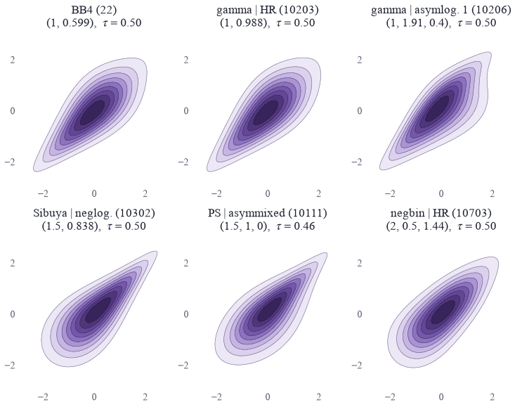

# Archimax families

Archimax copulas (Capéraà, Fougères & Genest 2000) join the two previous constructions. An
Archimedean generator $\psi$ (with inverse $\varphi$) supplies the body and the lower tail, an
extreme-value Pickands function $A$ supplies the shape of the upper tail and, if wanted,
asymmetry:

$$
C(u, v) = \psi\Big( \ell\big(\varphi(u), \varphi(v)\big) \Big), \qquad
\ell(s, t) = (s + t)\, A\!\left(\frac{t}{s + t}\right).
$$

The two special cases are the familiar ones. With $A \equiv 1$, $\ell(s, t) = s + t$ and $C$ is
Archimedean; with $\psi(s) = e^{-s}$, $\varphi(u) = -\log u$ and $C$ is an extreme-value copula.
In fortvine the generator is any of the [Laplace transforms](archimedean.md#the-seven-laplace-transforms)
(or a [composition](archimedean.md#compositions-psi-stopped-zeta) of two) and $A$ is any of the
[Pickands functions](extreme-value.md#pickands-functions-in-fortvine); one formula in
`src/families_gen.inc` evaluates them all.

*Archimax copulas at Kendall's $\tau \approx 0.5$. BB4 and gamma–Hüsler–Reiss (left two) are
exchangeable with both tails; gamma with the asymmetric logistic type 1 (top right) adds
asymmetry to both-tail dependence.*

## Formulas

With $S = \varphi(u)$, $T = \varphi(v)$, $w = T/(S + T)$ and $L = \ell(S, T)$, the partial
derivatives of $\ell$ are

$$
\ell_s = A(w) - w A'(w), \qquad \ell_t = A(w) + (1 - w) A'(w), \qquad
\ell_{st} = -\frac{w(1 - w)}{S + T}\, A''(w) \le 0,
$$

and the density and h-functions are

$$
c(u, v) = \frac{\psi''(L)\, \ell_s \ell_t + \big(-\psi'(L)\big)\big(-\ell_{st}\big)}{\psi'(S)\, \psi'(T)}, \qquad
h_1(v \mid u) = \frac{\psi'(L)\, \ell_s}{\psi'(S)}, \qquad
h_2(u \mid v) = \frac{\psi'(L)\, \ell_t}{\psi'(T)} .
$$

Both terms of the density numerator are non-negative, and fortvine adds them in log space. The
Pickands argument $w$ is computed from $\log S$ and $\log T$, so it stays exact even when $S$ and
$T$ differ by many orders of magnitude.

**Kendall's tau** separates into the two ingredients (Capéraà, Fougères & Genest 2000):

$$
\tau = \tau_A + (1 - \tau_A)\, \tau_\psi ,
$$

where $\tau_A = \int_0^1 w(1-w) A''(w)/A(w)\, dw$ is the tau of the EV copula with Pickands
function $A$, and $\tau_\psi$ is the tau of the Archimedean copula with generator $\psi$. The
formula was checked with fortvine's own quadrature: gamma generator $\theta = 1$
($\tau_\psi = 1/3$) with Hüsler–Reiss $\lambda = 2$ ($\tau_A = 0.5387$) gives $0.6925$ both ways.

**Tail dependence** combines the midpoint value $A(1/2)$ with the end behaviour of $\psi$ used on
the [Archimedean page](archimedean.md#the-general-formulas). If $1 - \psi(s)$ behaves like
$s^{1/m}$ at zero ($m = 1$ when $\psi'(0)$ is finite) and $\psi(s)$ like $s^{-1/k}$ at infinity, then

$$
\lambda_U = 2 - \big(2A(1/2)\big)^{1/m}, \qquad
\lambda_L = \big(2A(1/2)\big)^{-1/k},
$$

and $\lambda_L = 0$ when $\psi$ decays faster than any power. For the generators in fortvine:

| outer generator | $m$ (upper tail) | $k$ (lower tail) |
|---|---|---|
| positive stable ($\theta$) | $\theta$ | none ($\lambda_L = 0$) |
| gamma ($\theta$) | 1 | $\theta$ |
| Sibuya ($\theta$) | $\theta$ | none |
| log series, tilted PS, generalised Sibuya ($\delta < 1$), negative binomial | 1 | none |
| PS.Sibuya ($\theta, \delta$) | $\theta\delta$ | none |
| gamma.PS ($\theta, \delta$) | $\delta$ | $\theta\delta$ |
| gamma.Sibuya ($\theta, \delta$) | $\delta$ | $\theta$ |
| gamma.logseries ($\theta, \delta$) | 1 | $\theta$ |
| Sibuya.PS ($\theta, \delta$) | $\theta\delta$ | none |
| logseries.PS, logseries.Sibuya ($\theta, \delta$) | $\delta$ | none |

So an Archimax copula has lower-tail dependence exactly when its generator contains the gamma
transform as the outer part, and with $m = 1$ its upper tail coefficient equals that of the
Pickands function alone, $2 - 2A(1/2)$. These values were confirmed numerically for one member of
each row.

**Symmetry and rotations.** The generator is symmetric, so an Archimax copula is exchangeable
exactly when $A$ is ($A(w) = A(1 - w)$, i.e. Pickands codes 1 to 4). A vine edge flip transposes
the inner Pickands function as described on the
[extreme-value page](extreme-value.md#general-formulas). All Archimax codes accept the 90°, 180°
and 270° rotations.

**Parameter order.** Outer generator parameters first (one or two), then the Pickands
parameters, at most three in total. Hence a two-parameter generator can only be combined with a
one-parameter Pickands function (codes 1–4).

## Named members

Several classical two-parameter families are Archimax copulas. fortvine keeps the hand-coded
versions and marks the generic codes as duplicates:

| Family | Generator | Pickands function | Hand code | Generic code |
|---|---|---|---:|---:|
| BB1 | gamma | logistic | 7 | `10201` |
| BB4 | gamma | negative logistic | 22 | `10202` |
| BB5 | positive stable | negative logistic | 19 | `10102` |
| BB6 | Sibuya | logistic | 8 | `10301` |
| logseries.PS | log series | logistic | — | `10401` (= `12300`) |
| Gumbel | positive stable | logistic | 4 | (rejected) |

The last two rows illustrate a general rule: combining any generator with the *logistic*
Pickands function gives the Archimedean copula of the composition "generator stopped positive
stable", because $\psi\big((S^\delta + T^\delta)^{1/\delta}\big)$ is Archimedean with generator
$s \mapsto \psi(s^{1/\delta})$.

### BB4

| Property | Value |
|---|---|
| Code | `22` (`FV_BB4`); generic `10202` |
| Parameters, box | $\theta \in [0.01, 15]$ (gamma), $\delta \in [0.01, 15]$ (negative logistic) |
| Kendall's $\tau$ | $\tau_{\text{Galambos}}(\delta) + \big(1 - \tau_{\text{Galambos}}(\delta)\big)\, \frac{\theta}{\theta + 2}$; $\tau \in [0, 0.992]$ in the box |
| $\lambda_L$, $\lambda_U$ | $\left(2 - 2^{-1/\delta}\right)^{-1/\theta}$, $2^{-1/\delta}$ |
| Exchangeable | yes |
| Rotations | 90, 180, 270 |

$$
C(u, v) = \left( u^{-\theta} + v^{-\theta} - 1 - \left[ (u^{-\theta} - 1)^{-\delta} + (v^{-\theta} - 1)^{-\delta} \right]^{-1/\delta} \right)^{-1/\theta}.
$$

BB4 (Joe & Hu 1996) has both tails, each with its own parameter. With $x = u^{-\theta} - 1$,
$y = v^{-\theta} - 1$, $S = (x^{-\delta} + y^{-\delta})^{-1/\delta}$, $W = 1 + x + y - S$ and
$p = (S/x)^{\delta+1}$, $q = (S/y)^{\delta+1}$ (both below one):

$$
c(u, v) = (uv)^{-\theta - 1}\, W^{-1/\theta - 2} \left[ (1 + \theta)(1 - p)(1 - q) + \theta(1 + \delta)\, \frac{W p q}{S} \right],
\qquad
h_1(v \mid u) = W^{-1/\theta - 1} (1 - p)\, u^{-\theta - 1}.
$$

For BB1, BB5 and BB6 see the [Archimedean](archimedean.md) and [extreme-value](extreme-value.md)
pages.

## The 67 new Archimax codes

The code is `10000 + 100 og + ie` with `og` the generator and `ie` the Pickands function. The
table lists every code that `fv_generic_families()` returns; "—" marks a combination that is
either a duplicate (see above) or not allowed.

Pickands columns: **lg** logistic (1), **nl** negative logistic (2), **HR** Hüsler–Reiss (3),
**mx** symmetric mixed (4), **al1/al2** asymmetric logistic types 1/2 (6/7), **anl1/anl2**
asymmetric negative logistic types 1/2 (9/10), **amx** asymmetric mixed (11).

**One-parameter generators** (3 parameters with a two-parameter Pickands function):

| generator (`og`) | lg | nl | HR | mx | al1 | al2 | anl1 | anl2 | amx |
|---|---|---|---|---|---|---|---|---|---|
| positive stable (1) | — | — | `10103` | `10104` | `10106` | `10107` | `10109` | `10110` | `10111` |
| gamma (2) | — | — | `10203` | `10204` | `10206` | `10207` | `10209` | `10210` | `10211` |
| Sibuya (3) | — | `10302` | `10303` | `10304` | `10306` | `10307` | `10309` | `10310` | `10311` |
| log series (4) | — | `10402` | `10403` | `10404` | `10406` | `10407` | `10409` | `10410` | `10411` |

**Two-parameter generators** (only the one-parameter Pickands functions fit in three parameters):

| generator (`og`) | lg | nl | HR | mx |
|---|---|---|---|---|
| tilted positive stable (5) | `10501` | `10502` | `10503` | `10504` |
| generalised Sibuya (6) | `10601` | `10602` | `10603` | `10604` |
| negative binomial (7) | `10701` | `10702` | `10703` | `10704` |
| PS.Sibuya (13) | `11301` | `11302` | `11303` | `11304` |
| gamma.PS (15) | — | `11502` | `11503` | `11504` |
| gamma.Sibuya (17) | `11701` | `11702` | `11703` | `11704` |
| gamma.logseries (18) | `11801` | `11802` | `11803` | `11804` |
| Sibuya.PS (19) | — | `11902` | `11903` | `11904` |
| logseries.PS (23) | — | `12302` | `12303` | `12304` |
| logseries.Sibuya (25) | `12501` | `12502` | `12503` | `12504` |

That is $7 + 7 + 8 + 8 = 30$ codes with one-parameter generators and $10 \times 4 - 3 = 37$ with
two-parameter generators. Parameter boxes are those of the parts: generator boxes as on the
[Archimedean page](archimedean.md), Pickands boxes as on the
[extreme-value page](extreme-value.md); the [catalogue](catalogue.md) lists each code's box.

Reading the table by tails:

- **Row positive stable** — these are all extreme-value copulas (see
  [positive stable Archimax](extreme-value.md#more-extreme-value-copulas-positive-stable-archimax)):
  upper tail only, $\lambda_U = 2 - (2A(1/2))^{1/\theta}$.
- **Rows gamma, gamma.PS, gamma.Sibuya, gamma.logseries** — dependence in both tails. With an
  asymmetric Pickands function (`10206` to `10211`) these are the only non-exchangeable families
  in fortvine with lower *and* upper tail dependence.
- **All other rows** — upper tail only, of the Pickands function's strength ($m = 1$) or stronger
  ($m > 1$ for Sibuya, PS.Sibuya, Sibuya.PS, logseries.PS, logseries.Sibuya).

!!! note "Three combinations are reparametrisations of two-parameter families"
    By the logistic rule above, a generator that already ends in a positive stable inner part
    absorbs the logistic exponent: `11501` (gamma.PS with logistic) is BB1$(\theta, \delta\theta_\ell)$,
    `11901` (Sibuya.PS with logistic) is BB6$(\theta, \delta\theta_\ell)$ and `12301`
    (logseries.PS with logistic) is `12300`$(\theta, \delta\theta_\ell)$, where $\theta_\ell$ is
    the logistic parameter. Only the product $\delta\theta_\ell$ is identified, so these three
    codes add a flat direction to the likelihood without adding any shape; their densities agree
    with the two-parameter families to machine precision. `gen_dup` therefore marks them as
    duplicates: they remain valid codes for cross-checks but are not returned by
    `fv_generic_families()`.

## Excluded combinations

- **A logistic inner with a one-parameter generator** duplicates a hand-coded or Archimedean
  code (BB1, BB6, `12300`), and positive stable with logistic is Gumbel itself.
- **Three-parameter Pickands functions** (asymmetric logistic 5, asymmetric negative logistic 8,
  Khoudraji–Hüsler–Reiss 12, Khoudraji–mixed 13) would need four or more parameters with any
  generator; fortvine stores at most three per pair copula. The one-weight types 6/7 and 9/10
  carry the asymmetry instead.
- **Generators with a gamma inner part** (BB3-type `og 12`, BB2-type `og 16`, BB7-type `og 20`
  and logseries.gamma `og 24`) are not combined with any Pickands function: such combinations did
  not pass fortvine's numerical consistency tests (`gen_valid` rejects them). They remain
  available as Archimedean copulas.
- The generators excluded on the [Archimedean page](archimedean.md#the-sixteen-combinations)
  (PS.PS, Sibuya.Sibuya and the log-series inner compositions) are excluded here as well.

## References

- Capéraà, P., Fougères, A.-L. and Genest, C. (2000). Bivariate distributions with given extreme
  value attractor. *Journal of Multivariate Analysis* 72, 30–49.
- Joe, H. and Hu, T. (1996). Multivariate distributions from mixtures of max-infinitely
  divisible distributions. *Journal of Multivariate Analysis* 57, 240–265.
- Joe, H. (2014). *Dependence Modeling with Copulas*. Chapman & Hall/CRC, §3.18.
