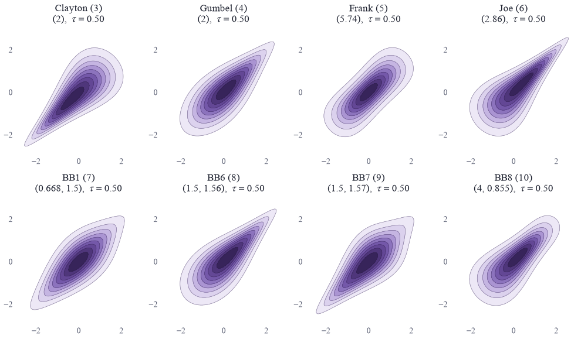
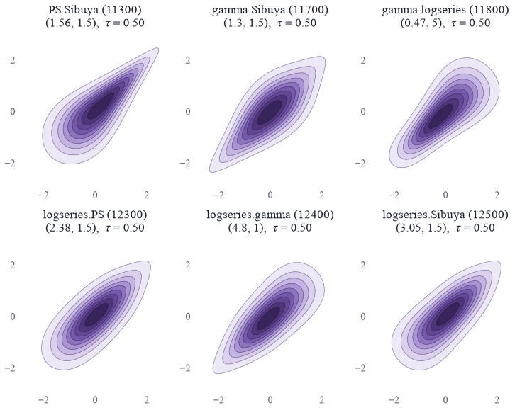

# Archimedean families

An Archimedean copula is built from a single univariate function. Take a *generator*
$\psi : [0, \infty) \to (0, 1]$ that starts at $\psi(0) = 1$, decreases to $0$ and is convex,
and let $\varphi = \psi^{-1}$ be its inverse. Then

$$
C(u, v) = \psi\big(\varphi(u) + \varphi(v)\big).
$$

Every generator fortvine uses is the **Laplace transform** of a positive random variable $M$,
$\psi(s) = \mathrm{E}\, e^{-sM}$. This gives the family a mixing ("frailty") reading: draw a
common factor $M$, then draw $U$ and $V$ independently given $M$ with
$P(U \le u \mid M) = \exp(-M \varphi(u))$. The heavier the variation of $M$, the stronger the
dependence (Marshall & Olkin 1988).

*Hand-coded Archimedean families at Kendall's $\tau = 0.5$, density contours in normal scores
(parameters in brackets, in fortvine's order).*

## The general formulas

With $s = \varphi(u) + \varphi(v)$, every quantity fortvine needs follows from $\psi$ and its first
two derivatives:

$$
c(u, v) = \frac{\psi''(s)}{\psi'(\varphi(u))\, \psi'(\varphi(v))}, \qquad
h_1(v \mid u) = \frac{\psi'(s)}{\psi'(\varphi(u))}, \qquad
h_2(u \mid v) = \frac{\psi'(s)}{\psi'(\varphi(v))}.
$$

All Archimedean copulas are exchangeable. In two dimensions a convex, decreasing $\psi$ is enough
for $C$ to be a copula; complete monotonicity (the Laplace-transform property) is what lets the
same generator work in any dimension, and it is what makes the compositions below valid.
fortvine evaluates $\log\psi$, $\log(-\psi')$ and $\log\psi''$ directly, so $C$ itself never has
to be formed and nothing cancels.

**Kendall's tau** has a one-dimensional representation (Genest & MacKay 1986; Joe 2014, §3.3):

$$
\tau = 1 - 4 \int_0^\infty s\, \big[\psi'(s)\big]^2 \, ds
     = 1 + 4 \int_0^1 \frac{\varphi(t)}{\varphi'(t)}\, dt .
$$

**Tail dependence** depends only on the behaviour of $\psi$ at the two ends of its domain:

$$
\lambda_L = \lim_{s \to \infty} \frac{\psi(2s)}{\psi(s)}, \qquad
\lambda_U = 2 - \lim_{s \to 0} \frac{1 - \psi(2s)}{1 - \psi(s)} .
$$

So a generator with a power-law right tail, $\psi(s) \sim c\, s^{-1/k}$, gives
$\lambda_L = 2^{-1/k}$, and one with $1 - \psi(s) \sim c\, s^{1/m}$ near zero ($m > 1$) gives
$\lambda_U = 2 - 2^{1/m}$. A generator that decays exponentially has $\lambda_L = 0$; one with a
finite slope $\psi'(0)$ has $\lambda_U = 0$.

**Rotations.** The Archimedean families with a positive parameter range model positive
dependence only. The 90° and 270° rotations give negative dependence and the 180° rotation
(the survival copula) swaps the two tails; see [rotations](../manual/rotations.md). Frank and
Ali–Mikhail–Haq cover negative dependence through their parameter and are not rotated.

## The seven Laplace transforms

The generic engine (codes `10000+`, see the [index](index.md#family-codes)) builds every
Archimedean and Archimax family from seven Laplace-transform families. Each one, used alone,
is the generator of a classical copula:

| `og` | Laplace transform | $\psi(s)$ | $\varphi(u) = \psi^{-1}(u)$ | Copula | Hand code |
|---:|---|---|---|---|---:|
| 1 | positive stable | $e^{-s^{1/\theta}}$, $\theta \ge 1$ | $(-\log u)^\theta$ | Gumbel | 4 |
| 2 | gamma | $(1+s)^{-1/\theta}$, $\theta > 0$ | $u^{-\theta} - 1$ | Clayton | 3 |
| 3 | Sibuya | $1 - (1 - e^{-s})^{1/\theta}$, $\theta \ge 1$ | $-\log\big(1 - (1-u)^\theta\big)$ | Joe | 6 |
| 4 | logarithmic series | $-\frac{1}{\theta}\log\big(1 - (1 - e^{-\theta}) e^{-s}\big)$, $\theta > 0$ | $-\log\frac{1 - e^{-\theta u}}{1 - e^{-\theta}}$ | Frank ($\theta > 0$) | 5 |
| 5 | exponentially tilted positive stable | $\exp\big(\delta^{-1} - (\delta^{-\theta} + s)^{1/\theta}\big)$ | $(\delta^{-1} - \log u)^\theta - \delta^{-\theta}$ | BB9 | 20 |
| 6 | generalised Sibuya | $\delta^{-1}\big[1 - (1 - \eta e^{-s})^{1/\theta}\big]$, $\eta = 1 - (1-\delta)^\theta$ | $-\log\frac{1 - (1 - \delta u)^\theta}{\eta}$ | BB8 | 10 |
| 7 | shifted negative binomial | $\left(\frac{1 - \pi}{e^s - \pi}\right)^{1/\theta}$ | $\log\big((1-\pi) u^{-\theta} + \pi\big)$ | BB10 | 21 |

The generic codes of these seven Archimedean copulas, `10100` to `10700`, are valid and are
used for cross-checks against the hand-coded versions, but `fv_generic_families()` leaves them
out because they duplicate codes 3–6, 10, 20 and 21.

For implementers, the derivatives fortvine evaluates (in log form) are:

| LT | $-\psi'(s)$ | $\psi''(s)$ |
|---|---|---|
| positive stable ($q = s^{1/\theta}$) | $\frac{q}{\theta s} e^{-q}$ | $\frac{q}{\theta s^2} e^{-q} \left(\frac{q}{\theta} + 1 - \frac{1}{\theta}\right)$ |
| gamma | $\frac{1}{\theta} (1+s)^{-1/\theta - 1}$ | $\frac{1}{\theta}\left(\frac{1}{\theta} + 1\right)(1+s)^{-1/\theta - 2}$ |
| Sibuya ($w = 1 - e^{-s}$) | $\frac{1}{\theta} w^{1/\theta - 1} e^{-s}$ | $\frac{1}{\theta} w^{1/\theta - 2} e^{-s} \left(1 - \frac{e^{-s}}{\theta}\right)$ |
| log series ($z = (1 - e^{-\theta}) e^{-s}$) | $\frac{z}{\theta (1 - z)}$ | $\frac{z}{\theta (1 - z)^2}$ |
| tilted PS ($r = \delta^{-\theta} + s$, $q = r^{1/\theta}$) | $\psi(s) \frac{q}{\theta r}$ | $\psi(s) \frac{q}{\theta r^2}\left(\frac{q}{\theta} + 1 - \frac{1}{\theta}\right)$ |
| gen. Sibuya ($z = \eta e^{-s}$) | $\frac{z (1-z)^{1/\theta - 1}}{\delta\theta}$ | $\frac{z (1-z)^{1/\theta - 2}}{\delta\theta}\left(1 - \frac{z}{\theta}\right)$ |
| neg. binomial ($e = e^{-s}$) | $\frac{\psi(s)}{\theta (1 - \pi e)}$ | $\frac{\psi(s)}{(1 - \pi e)^2} \left(\frac{1}{\theta^2} + \frac{\pi e}{\theta}\right)$ |

## One-parameter families

### Clayton

| Property | Value |
|---|---|
| Code | `3` (`FV_CLAYTON`); generic duplicate `10200` |
| Generator | gamma LT, $\psi(s) = (1 + s)^{-1/\theta}$ |
| Parameter, box | $\theta \in [10^{-10}, 28]$ |
| Kendall's $\tau$ | $\theta / (\theta + 2)$, so $\tau \in (0, 0.933]$ in the box |
| $\lambda_L$, $\lambda_U$ | $2^{-1/\theta}$, $0$ |
| Exchangeable | yes |
| Rotations | 90, 180, 270 |

$$
C(u, v) = \left(u^{-\theta} + v^{-\theta} - 1\right)^{-1/\theta}, \qquad
c(u, v) = (1 + \theta)(uv)^{-1-\theta}\left(u^{-\theta} + v^{-\theta} - 1\right)^{-2-1/\theta},
$$

$$
h_1(v \mid u) = u^{-1-\theta}\left(u^{-\theta} + v^{-\theta} - 1\right)^{-1-1/\theta}, \qquad
h_1^{-1}(p \mid u) = \left[1 + u^{-\theta}\left(p^{-\theta/(1+\theta)} - 1\right)\right]^{-1/\theta}.
$$

Clayton (1978) is the canonical lower-tail family. The negative-parameter branch
$\theta \in [-1, 0)$ of the literature is left out: there the density vanishes on a region of
positive area, which breaks likelihood fitting (see [other families](other.md#families-not-implemented));
negative dependence comes from the 90° and 270° rotations instead.

### Gumbel

| Property | Value |
|---|---|
| Code | `4` (`FV_GUMBEL`); generic duplicate `10100` (and `10001` as an EV copula) |
| Generator | positive stable LT, $\psi(s) = \exp(-s^{1/\theta})$ |
| Parameter, box | $\theta \in [1, 50]$ |
| Kendall's $\tau$ | $1 - 1/\theta$, $\tau \in [0, 0.98]$ |
| $\lambda_L$, $\lambda_U$ | $0$, $2 - 2^{1/\theta}$ |
| Exchangeable | yes |
| Rotations | 90, 180, 270 |

With $x = -\log u$, $y = -\log v$ and $m = (x^\theta + y^\theta)^{1/\theta}$:

$$
C(u, v) = e^{-m}, \qquad
c(u, v) = \frac{e^{-m}}{uv}\, (xy)^{\theta - 1} \left(x^\theta + y^\theta\right)^{1/\theta - 2} (\theta - 1 + m),
$$

$$
h_1(v \mid u) = \frac{e^{-m}}{u}\, x^{\theta - 1} \left(x^\theta + y^\theta\right)^{1/\theta - 1}.
$$

Gumbel (1960) is the only copula that is both Archimedean and extreme-value; its Pickands
function is the logistic model of the [extreme-value page](extreme-value.md#logistic-gumbel).
The h-inverse has no closed form; fortvine solves the equivalent scalar equation
$d + (\theta - 1)\log(1 + d/x) = -\log p$ for $d = m - x$ by a Newton iteration that is monotone
from its starting point, so it never needs bracketing.

### Frank

| Property | Value |
|---|---|
| Code | `5` (`FV_FRANK`); generic duplicate `10400` (positive branch only) |
| Generator | logarithmic-series LT (for $\theta > 0$) |
| Parameter, box | $\theta \in [-35, 35]$, $\theta = 0$ is independence |
| Kendall's $\tau$ | $1 - \frac{4}{\theta} + \frac{4}{\theta^2}\int_0^\theta \frac{t}{e^t - 1}\,dt$, $\tau \in [-0.891, 0.891]$ |
| $\lambda_L$, $\lambda_U$ | $0$, $0$ |
| Exchangeable | yes, and radially symmetric |
| Rotations | none ($\theta < 0$ gives negative dependence) |

$$
C(u, v) = -\frac{1}{\theta}\log\left(1 + \frac{(e^{-\theta u} - 1)(e^{-\theta v} - 1)}{e^{-\theta} - 1}\right),
\qquad
c(u, v) = \frac{-\theta\,(e^{-\theta} - 1)\, e^{-\theta(u + v)}}{\big[(e^{-\theta} - 1) + (e^{-\theta u} - 1)(e^{-\theta v} - 1)\big]^2},
$$

$$
h_1(v \mid u) = \frac{e^{-\theta u}\,(e^{-\theta v} - 1)}{(e^{-\theta} - 1) + (e^{-\theta u} - 1)(e^{-\theta v} - 1)},
\qquad
h_1^{-1}(p \mid u) = -\frac{1}{\theta}\log\left(1 + \frac{p\,(e^{-\theta} - 1)}{e^{-\theta u} - p\,(e^{-\theta u} - 1)}\right).
$$

Frank (1979) is the standard "no tail dependence, symmetric" family. The integral in $\tau$ is
the first Debye function; fortvine evaluates it numerically and inverts $\tau$ by
Newton's method with the analytic derivative. For $\theta < 0$ the generator is no longer a
Laplace transform, but it stays convex, so the formula is a valid two-dimensional copula.

### Joe

| Property | Value |
|---|---|
| Code | `6` (`FV_JOE`); generic duplicate `10300` |
| Generator | Sibuya LT, $\psi(s) = 1 - (1 - e^{-s})^{1/\theta}$ |
| Parameter, box | $\theta \in [1, 30]$ |
| Kendall's $\tau$ | $1 + \frac{2}{2 - \theta}\big[\Psi(2) - \Psi(2/\theta + 1)\big]$ ($\Psi$ = digamma function), $\tau \in [0, 0.936]$ |
| $\lambda_L$, $\lambda_U$ | $0$, $2 - 2^{1/\theta}$ |
| Exchangeable | yes |
| Rotations | 90, 180, 270 |

With $\bar u = 1 - u$, $\bar v = 1 - v$ and $S = \bar u^\theta + \bar v^\theta - \bar u^\theta \bar v^\theta$:

$$
C(u, v) = 1 - S^{1/\theta}, \qquad
c(u, v) = S^{1/\theta - 2}\, (\bar u \bar v)^{\theta - 1}\, (\theta - 1 + S), \qquad
h_1(v \mid u) = \bar u^{\theta - 1} (1 - \bar v^\theta)\, S^{1/\theta - 1}.
$$

Joe (1993) has a stronger upper tail than Gumbel at the same $\tau$. The $\tau$ formula has a
removable singularity at $\theta = 2$ (where $\tau = 2 - \pi^2/6$); fortvine expands it there.
As for Gumbel, the h-inverse is found by a monotone scalar Newton iteration.

### Ali–Mikhail–Haq (AMH) {#ali-mikhail-haq-amh}

| Property | Value |
|---|---|
| Code | `14` (`FV_AMH`) |
| Generator | $\psi(s) = (1 - \theta)/(e^s - \theta)$: for $\theta \in [0, 1)$ the LT of a geometric distribution |
| Parameter, box | $\theta \in [-1, 0.9999]$ |
| Kendall's $\tau$ | $1 - \frac{2\left[\theta + (1 - \theta)^2 \log(1 - \theta)\right]}{3\theta^2}$, $\tau \in [-0.182, 1/3)$ |
| $\lambda_L$, $\lambda_U$ | $0$, $0$ (inside the box) |
| Exchangeable | yes |
| Rotations | none ($\theta < 0$ gives negative dependence) |

$$
C(u, v) = \frac{uv}{1 - \theta(1-u)(1-v)}, \qquad
c(u, v) = \frac{1 + \theta\big[(1+u)(1+v) - 3\big] + \theta^2 (1-u)(1-v)}{\big[1 - \theta(1-u)(1-v)\big]^3},
$$

$$
h_1(v \mid u) = \frac{v\,\big[1 - \theta(1 - v)\big]}{\big[1 - \theta(1-u)(1-v)\big]^2}.
$$

Ali, Mikhail & Haq (1978). AMH is a weak-dependence family: even at $\theta \to 1$ Kendall's
$\tau$ only reaches $1/3$. The geometric LT is the negative-binomial LT of BB10 with exponent one,
so AMH is the $\theta = 1$ slice of [BB10](#bb10), with AMH's parameter in the role of $\pi$.
Its lower tail coefficient jumps to $1/2$ exactly at the excluded end point $\theta = 1$.

## Two-parameter Laplace transforms

### BB9

| Property | Value |
|---|---|
| Code | `20` (`FV_BB9`); generic duplicate `10500` |
| Generator | exponentially tilted positive stable LT |
| Parameters, box | $\theta \in [1, 10]$, $\delta \in [0.01, 30]$ |
| Kendall's $\tau$ | no closed form; $\tau \in [0, 0.893]$ in the box |
| $\lambda_L$, $\lambda_U$ | $0$, $0$ |
| Exchangeable | yes |
| Rotations | 90, 180, 270 |

$$
C(u, v) = \exp\left\{ \frac{1}{\delta} - \left[ \left(\frac{1}{\delta} - \log u\right)^\theta + \left(\frac{1}{\delta} - \log v\right)^\theta - \delta^{-\theta} \right]^{1/\theta} \right\}.
$$

BB9 is Crowder's (1989) copula. Tilting gives the generator a finite slope at zero, so the upper
tail dependence of Gumbel disappears for every finite $\delta$; as $\delta \to \infty$ the family
tends to Gumbel($\theta$). The power-variance-function (PVF) frailty
copula and the inverse-Gaussian frailty copula of other software are reparametrisations of BB9.

### BB8

| Property | Value |
|---|---|
| Code | `10` (`FV_BB8`); generic duplicate `10600` |
| Generator | generalised Sibuya LT |
| Parameters, box | $\theta \in [1, 8]$, $\delta \in [10^{-4}, 1]$ |
| Kendall's $\tau$ | no closed form; $\tau \in [0, 0.783]$ in the box |
| $\lambda_L$, $\lambda_U$ | $0$, $0$ for $\delta < 1$; $\lambda_U = 2 - 2^{1/\theta}$ at $\delta = 1$ |
| Exchangeable | yes |
| Rotations | 90, 180, 270 |

With $\eta = 1 - (1 - \delta)^\theta$:

$$
C(u, v) = \frac{1}{\delta}\left( 1 - \left[ 1 - \frac{\big(1 - (1 - \delta u)^\theta\big)\big(1 - (1 - \delta v)^\theta\big)}{\eta} \right]^{1/\theta} \right).
$$

At $\delta = 1$ BB8 is the Joe copula; $\theta = 1$ gives independence. The parameter $\delta$
therefore dials between a tail-dependent and a tail-free shape at fixed $\theta$.

### BB10

| Property | Value |
|---|---|
| Code | `21` (`FV_BB10`); generic duplicate `10700` |
| Generator | shifted negative binomial LT |
| Parameters, box | $\theta \in [0.01, 30]$, $\pi \in [0, 1]$ |
| Kendall's $\tau$ | no closed form; $\tau \in [0, 0.943]$ in the box |
| $\lambda_L$, $\lambda_U$ | $0$, $0$ |
| Exchangeable | yes |
| Rotations | 90, 180, 270 |

$$
C(u, v) = uv \left[ 1 - \pi (1 - u^\theta)(1 - v^\theta) \right]^{-1/\theta}, \qquad
c(u, v) = \frac{\big(1 - \pi\bar v_\theta + \pi\theta v^\theta\big) D - (1 + \theta)\pi\,(1 - \pi\bar v_\theta)\, v^\theta \bar u_\theta}{D^{2 + 1/\theta}},
$$

with $\bar u_\theta = 1 - u^\theta$, $\bar v_\theta = 1 - v^\theta$ and
$D = 1 - \pi \bar u_\theta \bar v_\theta$. $\pi = 0$ is independence and $\theta = 1$ is
AMH($\pi$). Like AMH it is a moderate-dependence family without tail dependence.

## Compositions: $\psi$ stopped $\zeta$ {#compositions-psi-stopped-zeta}

New Laplace transforms can be made by composing two old ones. If $\zeta$ is a Laplace transform
such that $g = -\log\zeta$ is increasing and concave with $g(0) = 0$ (it is a Bernstein function
when $\zeta$ belongs to an infinitely divisible distribution), then

$$
\psi(s) = \psi_{o}\big(g(s)\big) = \psi_o\big(-\log \zeta(s)\big)
$$

is again a generator. Joe (2014, Appendix A.1.2) calls this "$\psi$ stopped $\zeta$"; in the
frailty picture the outer frailty is replaced by a compound one. Its derivatives

$$
\psi'(s) = \psi_o'(g)\, g', \qquad
\psi''(s) = \psi_o''(g)\, g'^2 + \psi_o'(g)\, g''
$$

are sums of non-negative terms (since $\psi_o' < 0$ and $g'' \le 0$), which is how fortvine
keeps them in log space. The inverse is $\varphi(u) = g^{-1}\big(\varphi_o(u)\big)$.

The generic engine uses the four one-parameter transforms both as outer generator
$\psi_o(\,\cdot\,;\theta)$ and as inner Bernstein function $g(\,\cdot\,;\delta)$. The parameter
order is always (outer $\theta$, inner $\delta$). The inner functions are:

| inner | $g(s; \delta)$ | $g^{-1}(x; \delta)$ | box of $\delta$ in a composition |
|---|---|---|---|
| positive stable | $s^{1/\delta}$ | $x^\delta$ | $[1, 10]$ |
| gamma | $\delta^{-1}\log(1 + s)$ | $e^{\delta x} - 1$ | $[10^{-3}, 15]$ |
| Sibuya | $-\log\big(1 - (1 - e^{-s})^{1/\delta}\big)$ | $-\log\big(1 - (1 - e^{-x})^\delta\big)$ | $[1, 10]$ |
| log series | $-\log\left[-\delta^{-1}\log\big(1 - (1 - e^{-\delta})e^{-s}\big)\right]$ | $\log(1 - e^{-\delta}) - \log\big(1 - e^{-\delta e^{-x}}\big)$ | $[10^{-3}, 30]$ |

The outer parameter boxes in a composition are the same as the inner ones: $[1, 10]$ for
positive stable and Sibuya, $[10^{-3}, 15]$ for gamma, $[10^{-3}, 30]$ for log series.

### The sixteen combinations

The outer-generator code of a composition is `og = 10 + 4 (po - 1) + pin`, where `po` and `pin`
number the outer and inner transform as 1 positive stable, 2 gamma, 3 Sibuya, 4 log series. The
Archimedean code is then `10000 + 100 og`.

| outer $\downarrow$ / inner $\rightarrow$ | positive stable | gamma | Sibuya | log series |
|---|---|---|---|---|
| **positive stable** | `og 11`: excluded, equals Gumbel($\theta\delta$) | `og 12`: **BB3** (hand code 18) | `og 13`: **new, `11300`** | `og 14`: excluded (numerics) |
| **gamma** | `og 15`: **BB1** (hand code 7) | `og 16`: **BB2** (hand code 17) | `og 17`: **new, `11700`** | `og 18`: **new, `11800`** |
| **Sibuya** | `og 19`: **BB6** (hand code 8) | `og 20`: **BB7** (hand code 9) | `og 21`: excluded, equals Joe($\theta\delta$) | `og 22`: excluded (numerics) |
| **log series** | `og 23`: **new, `12300`** | `og 24`: **new, `12400`** | `og 25`: **new, `12500`** | `og 26`: excluded (numerics) |

Why some cells are missing:

- **Closed under composition.** Positive stable after positive stable is positive stable with
  exponent $\theta\delta$, and Sibuya after Sibuya is Sibuya with $\theta\delta$:
  $1 - \big(1 - e^{-g}\big)^{1/\theta}$ with $e^{-g} = 1 - (1 - e^{-s})^{1/\delta}$ collapses to
  $1 - (1 - e^{-s})^{1/(\theta\delta)}$. Both parameters would not be identifiable.
- **Numerically unreliable.** A log-series inner under a positive-stable, Sibuya or log-series
  outer does not reach the accuracy fortvine requires in double precision, so those three codes
  are rejected (`gen_valid` returns false; compare the remarks in Joe 2014, Appendix A.1.2).
  Under a gamma outer the same inner is accurate, which is why `11800` is offered.
- **Already hand-coded.** The five BB cells are valid generic codes (`11200`, `11500`, `11600`,
  `11900`, `12000`), useful for cross-checking, but `fv_generic_families()` omits them as
  duplicates.

*The six new compositions at $\tau = 0.5$ (outer $\theta$ tuned, inner $\delta$ fixed).*

### Tail behaviour of a composition

The two ends of $\psi_o \circ g$ combine the two ends of the parts. Near $s = 0$, positive
stable and Sibuya behave like a power, $1 - \psi(s) \approx s^{1/\theta}$, while gamma and log
series are linear; near $s = \infty$ only the gamma transform has a power-law tail, and a gamma
*inner* turns $s$ into $\log s$, so the outer tail is read on a logarithmic scale. The resulting
coefficients are listed in each family below; they agree with numerical limits of $C(t,t)/t$
computed with fortvine.

### BB1

| Property | Value |
|---|---|
| Code | `7` (`FV_BB1`); generic `11500` (gamma outer, positive-stable inner) |
| Parameters, box | $\theta \in [0, 7]$, $\delta \in [1, 7]$ |
| Kendall's $\tau$ | $1 - \dfrac{2}{\delta(\theta + 2)}$ |
| $\lambda_L$, $\lambda_U$ | $2^{-1/(\theta\delta)}$, $2 - 2^{1/\delta}$ |
| Exchangeable | yes |
| Rotations | 90, 180, 270 |

$$
\psi(s) = \left(1 + s^{1/\delta}\right)^{-1/\theta}, \qquad
C(u, v) = \left\{ 1 + \left[ (u^{-\theta} - 1)^\delta + (v^{-\theta} - 1)^\delta \right]^{1/\delta} \right\}^{-1/\theta}.
$$

BB1 (Joe & Hu 1996) has dependence in both tails with two separate controls; $\delta = 1$ is
Clayton($\theta$) and $\theta \to 0$ gives Gumbel($\delta$). It is also the Archimax copula of a
gamma generator with the logistic Pickands function (see [Archimax](archimax.md)).

### BB2

| Property | Value |
|---|---|
| Code | `17` (`FV_BB2`); generic `11600` (gamma outer, gamma inner) |
| Parameters, box | $\theta \in [0.01, 30]$, $\delta \in [0.01, 30]$ |
| Kendall's $\tau$ | no closed form; $\tau \in [0, 0.997]$ in the box |
| $\lambda_L$, $\lambda_U$ | $1$, $0$ |
| Exchangeable | yes |
| Rotations | 90, 180, 270 |

$$
\psi(s) = \left(1 + \delta^{-1}\log(1 + s)\right)^{-1/\theta}, \qquad
C(u, v) = \left[ 1 + \frac{1}{\delta}\log\!\left( e^{\delta(u^{-\theta} - 1)} + e^{\delta(v^{-\theta} - 1)} - 1 \right) \right]^{-1/\theta}.
$$

The generator decays only like a power of $\log s$, which makes the lower tail coefficient equal
to one for every parameter value: the lower tail is as heavy as possible without being singular.
Nelsen's (2006) families 4.2.19 and 4.2.20 are the slices $\theta = 1$ and $\delta = 1$ of BB2.

### BB3

| Property | Value |
|---|---|
| Code | `18` (`FV_BB3`); generic `11200` (positive-stable outer, gamma inner) |
| Parameters, box | $\theta \in [1, 10]$, $\delta \in [0.01, 30]$ |
| Kendall's $\tau$ | no closed form; $\tau \in [0, 0.956]$ in the box |
| $\lambda_L$, $\lambda_U$ | $1$ if $\theta > 1$, $2^{-1/\delta}$ if $\theta = 1$; $2 - 2^{1/\theta}$ |
| Exchangeable | yes |
| Rotations | 90, 180, 270 |

$$
\psi(s) = \exp\!\left( -\left[\delta^{-1}\log(1 + s)\right]^{1/\theta} \right), \qquad
C(u, v) = \exp\!\left( -\left[ \frac{1}{\delta}\log\!\left( e^{\delta x^\theta} + e^{\delta y^\theta} - 1 \right) \right]^{1/\theta} \right),
$$

with $x = -\log u$, $y = -\log v$. At $\theta = 1$ BB3 is Clayton($\delta$).

### BB6

| Property | Value |
|---|---|
| Code | `8` (`FV_BB6`); generic `11900` (Sibuya outer, positive-stable inner) |
| Parameters, box | $\theta \in [1, 6]$, $\delta \in [1, 8]$ |
| Kendall's $\tau$ | no closed form; $\tau \in [0, 0.965]$ in the box |
| $\lambda_L$, $\lambda_U$ | $0$, $2 - 2^{1/(\theta\delta)}$ |
| Exchangeable | yes |
| Rotations | 90, 180, 270 |

$$
\psi(s) = 1 - \left(1 - e^{-s^{1/\delta}}\right)^{1/\theta}, \qquad
C(u, v) = 1 - \left(1 - \exp\!\left\{ -\left[ \big(-\log(1 - \bar u^\theta)\big)^\delta + \big(-\log(1 - \bar v^\theta)\big)^\delta \right]^{1/\delta} \right\}\right)^{1/\theta}.
$$

$\theta = 1$ is Gumbel($\delta$) and $\delta = 1$ is Joe($\theta$). BB6 is the Archimax copula of
the Sibuya generator and the logistic Pickands function.

### BB7

| Property | Value |
|---|---|
| Code | `9` (`FV_BB7`); generic `12000` (Sibuya outer, gamma inner) |
| Parameters, box | $\theta \in [1, 6]$, $\delta \in [0.01, 25]$ |
| Kendall's $\tau$ | no closed form; $\tau \in [0, 0.863]$ in the box |
| $\lambda_L$, $\lambda_U$ | $2^{-1/\delta}$, $2 - 2^{1/\theta}$ |
| Exchangeable | yes |
| Rotations | 90, 180, 270 |

$$
\psi(s) = 1 - \left[1 - (1 + s)^{-1/\delta}\right]^{1/\theta}, \qquad
C(u, v) = 1 - \left( 1 - \left[ (1 - \bar u^\theta)^{-\delta} + (1 - \bar v^\theta)^{-\delta} - 1 \right]^{-1/\delta} \right)^{1/\theta}.
$$

BB7 ("Joe–Clayton") separates the two tails cleanly: $\delta$ sets the lower tail and $\theta$ the
upper. $\theta = 1$ is Clayton($\delta$); $\delta \to 0$ gives Joe($\theta$).

### PS.Sibuya (11300)

| Property | Value |
|---|---|
| Code | `11300` (generic only) |
| Parameters, box | $\theta \in [1, 10]$ (positive stable), $\delta \in [1, 10]$ (Sibuya) |
| Kendall's $\tau$ | no closed form; $\tau \in [0, 0.961]$ in the box |
| $\lambda_L$, $\lambda_U$ | $0$, $2 - 2^{1/(\theta\delta)}$ |
| Exchangeable | yes |

$$
\psi(s) = \exp\!\left( -\left[-\log\big(1 - (1 - e^{-s})^{1/\delta}\big)\right]^{1/\theta} \right), \qquad
\varphi(u) = -\log\!\left(1 - \left[1 - e^{-(-\log u)^\theta}\right]^{\delta}\right).
$$

An upper-tail family that interpolates between Gumbel ($\delta = 1$) and Joe ($\theta = 1$),
the mirror image of BB6 (which puts Sibuya outside and positive stable inside).

### gamma.Sibuya (11700)

| Property | Value |
|---|---|
| Code | `11700` (generic only) |
| Parameters, box | $\theta \in [10^{-3}, 15]$ (gamma), $\delta \in [1, 10]$ (Sibuya) |
| Kendall's $\tau$ | no closed form; $\tau \in [0, 0.897]$ in the box |
| $\lambda_L$, $\lambda_U$ | $2^{-1/\theta}$, $2 - 2^{1/\delta}$ |
| Exchangeable | yes |

$$
\psi(s) = \left[ 1 - \log\big(1 - (1 - e^{-s})^{1/\delta}\big) \right]^{-1/\theta}.
$$

A both-tails family like BB1 and BB7, with the lower tail set by $\theta$ alone and the upper
tail by $\delta$ alone. $\delta = 1$ is Clayton($\theta$) and $\theta \to 0$ tends to Joe($\delta$).

### gamma.logseries (11800)

| Property | Value |
|---|---|
| Code | `11800` (generic only) |
| Parameters, box | $\theta \in [10^{-3}, 15]$ (gamma), $\delta \in [10^{-3}, 30]$ (log series) |
| Kendall's $\tau$ | no closed form; $\tau \in [0, 0.901]$ in the box |
| $\lambda_L$, $\lambda_U$ | $2^{-1/\theta}$, $0$ |
| Exchangeable | yes |

$$
\psi(s) = \left[ 1 - \log\!\left( -\frac{1}{\delta}\log\big(1 - (1 - e^{-\delta})e^{-s}\big) \right) \right]^{-1/\theta}.
$$

A lower-tail family with a Frank-like body: $\delta \to 0$ gives Clayton($\theta$) and
$\theta \to 0$ gives Frank($\delta$).

### logseries.PS (12300)

| Property | Value |
|---|---|
| Code | `12300` (generic only) |
| Parameters, box | $\theta \in [10^{-3}, 30]$ (log series), $\delta \in [1, 10]$ (positive stable) |
| Kendall's $\tau$ | no closed form; $\tau \in [0, 0.987]$ in the box |
| $\lambda_L$, $\lambda_U$ | $0$, $2 - 2^{1/\delta}$ |
| Exchangeable | yes |

$$
\psi(s) = -\frac{1}{\theta}\log\!\left( 1 - (1 - e^{-\theta})\, e^{-s^{1/\delta}} \right).
$$

$\delta = 1$ is Frank($\theta$); $\theta \to 0$ gives Gumbel($\delta$). It is also the Archimax
copula of the log-series generator with the logistic Pickands function.

### logseries.gamma (12400)

| Property | Value |
|---|---|
| Code | `12400` (generic only) |
| Parameters, box | $\theta \in [10^{-3}, 30]$ (log series), $\delta \in [10^{-3}, 15]$ (gamma) |
| Kendall's $\tau$ | no closed form; $\tau \in [0, 0.882]$ in the box |
| $\lambda_L$, $\lambda_U$ | $2^{-1/\delta}$, $0$ |
| Exchangeable | yes |

$$
\psi(s) = -\frac{1}{\theta}\log\!\left( 1 - (1 - e^{-\theta})(1 + s)^{-1/\delta} \right).
$$

The lower-tail counterpart of 11800 with the roles of the two transforms swapped:
$\theta \to 0$ gives Clayton($\delta$) and $\delta \to 0$ gives Frank($\theta$).

### logseries.Sibuya (12500)

| Property | Value |
|---|---|
| Code | `12500` (generic only) |
| Parameters, box | $\theta \in [10^{-3}, 30]$ (log series), $\delta \in [1, 10]$ (Sibuya) |
| Kendall's $\tau$ | no closed form; $\tau \in [0, 0.987]$ in the box |
| $\lambda_L$, $\lambda_U$ | $0$, $2 - 2^{1/\delta}$ |
| Exchangeable | yes |

$$
\psi(s) = -\frac{1}{\theta}\log\!\left( 1 - (1 - e^{-\theta})\left[1 - (1 - e^{-s})^{1/\delta}\right] \right).
$$

$\delta = 1$ is Frank($\theta$); $\theta \to 0$ gives Joe($\delta$).

## References

- Ali, M. M., Mikhail, N. N. and Haq, M. S. (1978). A class of bivariate distributions including
  the bivariate logistic. *Journal of Multivariate Analysis* 8, 405–412.
- Clayton, D. G. (1978). A model for association in bivariate life tables. *Biometrika* 65,
  141–151.
- Crowder, M. (1989). A multivariate distribution with Weibull connections. *Journal of the
  Royal Statistical Society B* 51, 93–107.
- Frank, M. J. (1979). On the simultaneous associativity of F(x, y) and x + y − F(x, y).
  *Aequationes Mathematicae* 19, 194–226.
- Genest, C. and MacKay, J. (1986). The joy of copulas: bivariate distributions with uniform
  marginals. *The American Statistician* 40, 280–283.
- Gumbel, E. J. (1960). Distributions des valeurs extrêmes en plusieurs dimensions. *Publ.
  Inst. Statist. Univ. Paris* 9, 171–173.
- Joe, H. (1993). Parametric families of multivariate distributions with given margins.
  *Journal of Multivariate Analysis* 46, 262–282.
- Joe, H. (2014). *Dependence Modeling with Copulas*. Chapman & Hall/CRC.
- Joe, H. and Hu, T. (1996). Multivariate distributions from mixtures of max-infinitely
  divisible distributions. *Journal of Multivariate Analysis* 57, 240–265.
- Marshall, A. W. and Olkin, I. (1988). Families of multivariate distributions. *Journal of the
  American Statistical Association* 83, 834–841.
- Nelsen, R. B. (2006). *An Introduction to Copulas*, 2nd ed. Springer.
