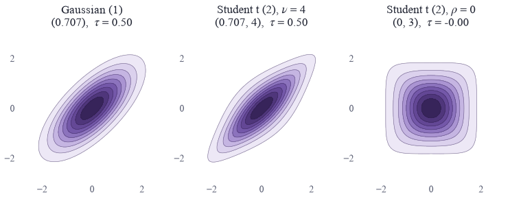

# Elliptical families

An elliptical copula is the dependence structure left over when the margins of an elliptically
contoured distribution are transformed to uniform. If $F_\rho$ is the bivariate distribution
function with correlation $\rho$ and $F$ is its univariate margin, then

$$
C(u, v) = F_\rho\big(F^{-1}(u),\, F^{-1}(v)\big).
$$

Both elliptical families in fortvine are exchangeable and radially symmetric: the lower and
upper tails behave alike, and the 180° rotation gives back the same copula. Negative dependence
needs no rotation, because $\rho$ can be negative. fortvine therefore registers no rotations for
these two families.

Throughout, $x = F^{-1}(u)$ and $y = F^{-1}(v)$ are the scores of the two arguments, and
$h_1(v \mid u) = \partial C / \partial u$ is the conditional distribution of $V$ given $U = u$.

*Density contours of the copula with standard normal margins. Left and middle: the same
Kendall's $\tau = 0.5$; the Student t puts more mass in both corners. Right: a Student t copula
with $\rho = 0$ is uncorrelated but not independent.*

## Gaussian

| Property | Value |
|---|---|
| Code | `1` (`FV_GAUSSIAN`) |
| Parameter | $\rho$ (correlation) |
| Box in fortvine | $[-1, 1]$ |
| Kendall's $\tau$ | $\frac{2}{\pi}\arcsin\rho$, any value in $(-1, 1)$ |
| $\lambda_L$, $\lambda_U$ | $0$, $0$ (for $\lvert\rho\rvert < 1$) |
| Exchangeable | yes |
| Rotations | none (radially symmetric; $\rho < 0$ gives negative dependence) |

With $\Phi$ the standard normal distribution function, $x = \Phi^{-1}(u)$, $y = \Phi^{-1}(v)$:

$$
C(u, v) = \Phi_2(x, y; \rho), \qquad
c(u, v) = \frac{1}{\sqrt{1 - \rho^2}}
\exp\!\left( -\frac{\rho^2 (x^2 + y^2) - 2 \rho x y}{2 (1 - \rho^2)} \right).
$$

The h-function and its inverse are both closed:

$$
h_1(v \mid u) = \Phi\!\left( \frac{y - \rho x}{\sqrt{1 - \rho^2}} \right), \qquad
h_1^{-1}(p \mid u) = \Phi\!\left( \rho x + \sqrt{1 - \rho^2}\, \Phi^{-1}(p) \right),
$$

and $h_2$ is the same expression with the roles of $x$ and $y$ exchanged.

**Dependence measures.** Kendall's $\tau = \frac{2}{\pi}\arcsin\rho$ and Spearman's
$\rho_S = \frac{6}{\pi}\arcsin(\rho/2)$. fortvine uses the first relation to start the fit
($\rho = \sin(\pi\tau/2)$) and for the `FV_ITAU` method.

**Notes.**

- The Gaussian copula is asymptotically independent in both tails: however strong $\rho$ is,
  $\lambda_L = \lambda_U = 0$ (Sibuya 1960). Joint extremes still occur more often than under
  independence, but at a rate that vanishes in the limit.
- fortvine evaluates $C$ itself (needed for discrete margins) by Gauss–Legendre quadrature of the
  exact h-function, since the bivariate normal integral has no elementary form.
- At $\rho = \pm 1$ the copula is singular (the comonotone or countermonotone copula); the box
  boundary is never reached in practice because the likelihood diverges there.

## Student t

| Property | Value |
|---|---|
| Code | `2` (`FV_STUDENT`) |
| Parameters | $\rho$ (correlation), $\nu$ (degrees of freedom), in this order |
| Box in fortvine | $\rho \in [-1, 1]$, $\nu \in [2, 30]$ |
| Kendall's $\tau$ | $\frac{2}{\pi}\arcsin\rho$, independent of $\nu$ |
| $\lambda_L = \lambda_U$ | $2\, T_{\nu+1}\!\left(-\sqrt{(\nu+1)\frac{1-\rho}{1+\rho}}\right)$ |
| Exchangeable | yes |
| Rotations | none (radially symmetric) |

Let $t_\nu$ and $T_\nu$ be the density and distribution function of the univariate Student t
with $\nu$ degrees of freedom, and $x = T_\nu^{-1}(u)$, $y = T_\nu^{-1}(v)$. The density is the
bivariate t density divided by its two margins:

$$
c(u, v) =
\frac{\Gamma\!\left(\frac{\nu+2}{2}\right)\Gamma\!\left(\frac{\nu}{2}\right)}
     {\Gamma\!\left(\frac{\nu+1}{2}\right)^2 \sqrt{1 - \rho^2}}
\;
\frac{\left(1 + \dfrac{x^2 - 2\rho x y + y^2}{\nu (1 - \rho^2)}\right)^{-\frac{\nu+2}{2}}}
     {\left(1 + \dfrac{x^2}{\nu}\right)^{-\frac{\nu+1}{2}} \left(1 + \dfrac{y^2}{\nu}\right)^{-\frac{\nu+1}{2}}}.
$$

Given $U = u$, the variable $V$ is again of Student type, now with $\nu + 1$ degrees of freedom
and a scale that depends on $x$. Hence the closed forms

$$
h_1(v \mid u) = T_{\nu+1}\!\left( \frac{y - \rho x}{\sqrt{\dfrac{(\nu + x^2)(1 - \rho^2)}{\nu + 1}}} \right),
\qquad
h_1^{-1}(p \mid u) = T_\nu\!\left( \rho x + T_{\nu+1}^{-1}(p) \sqrt{\dfrac{(\nu + x^2)(1 - \rho^2)}{\nu + 1}} \right).
$$

**Tail dependence.** Both tail coefficients equal
$2\,T_{\nu+1}\big(-\sqrt{(\nu+1)(1-\rho)/(1+\rho)}\big)$ (Embrechts, McNeil & Straumann 2002;
Demarta & McNeil 2005). They grow as $\nu$ falls and as $\rho$ rises, and they are positive even
at $\rho = 0$ and at moderately negative $\rho$: a small $\nu$ makes large values of both
variables (of either sign) occur together, which is visible as the four "arms" in the right
panel of the figure above.

**Notes.**

- Kendall's $\tau$ does not involve $\nu$, so $\rho$ is started from $\tau$ exactly as for the
  Gaussian. Under maximum likelihood, $(\rho, \nu)$ are then fitted jointly with $\rho$ kept
  in the window $\sin(\pi(\tau \pm 0.1)/2)$ (the practice of vinecopulib); under `FV_ITAU`,
  $\rho$ stays at $\sin(\pi\tau/2)$ and only $\nu$ is estimated.
- As $\nu \to \infty$ the family tends to the Gaussian copula. The upper box limit $\nu = 30$
  is already close to that limit; selection then prefers the Gaussian because it has one
  parameter fewer.
- The t extreme-value copula (code 23), the max-stable limit of the t copula, is listed with the
  [extreme-value families](extreme-value.md#t-ev-student-extreme-value).
- Skew-t and other radially asymmetric elliptical constructions are not implemented; see
  [families not implemented](other.md#families-not-implemented).

## References

- Demarta, S. and McNeil, A. J. (2005). The t copula and related copulas. *International
  Statistical Review* 73(1), 111–129.
- Embrechts, P., McNeil, A. and Straumann, D. (2002). Correlation and dependence in risk
  management: properties and pitfalls. In *Risk Management: Value at Risk and Beyond*, CUP.
- Sibuya, M. (1960). Bivariate extreme statistics. *Annals of the Institute of Statistical
  Mathematics* 11, 195–210.
