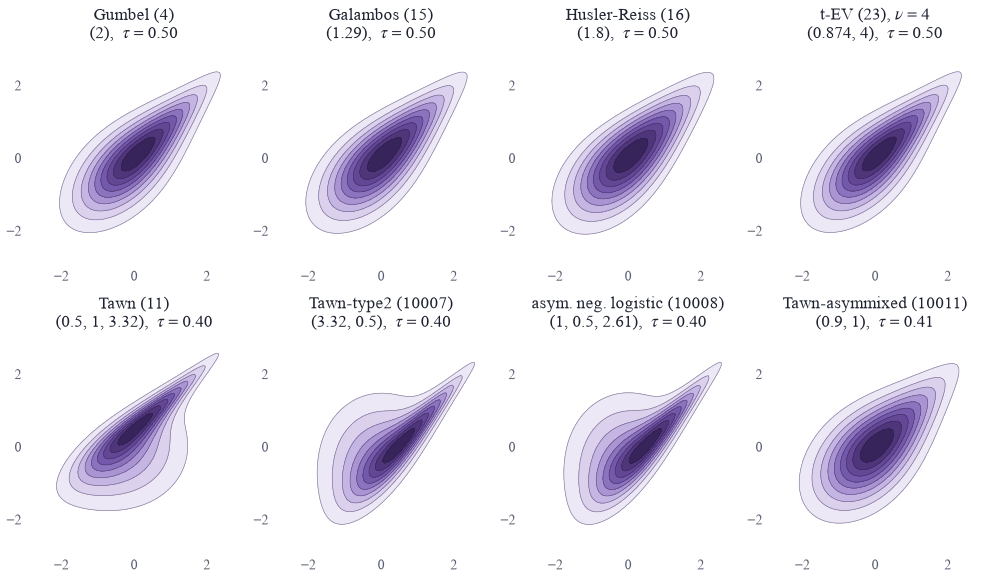

# Extreme-value families

Extreme-value (EV) copulas are the possible dependence structures of componentwise maxima in the
limit of many observations. They are exactly the copulas that are *max-stable*,
$C(u^t, v^t) = C(u, v)^t$ for all $t > 0$, and in two dimensions every one of them can be written
with a single function of one variable, the **Pickands dependence function** $A$ (Pickands 1981):

$$
C(u, v) = \exp\!\big(-\ell(x, y)\big), \qquad
\ell(x, y) = (x + y)\, A\!\left(\frac{y}{x + y}\right), \qquad x = -\log u,\; y = -\log v .
$$

$A : [0, 1] \to [1/2, 1]$ is convex with $\max(w, 1 - w) \le A(w) \le 1$. The lower bound
$A(w) = \max(w, 1 - w)$ is the comonotone copula and the upper bound $A \equiv 1$ is
independence. $\ell$ is called the stable tail dependence function.

!!! note "Orientation of the Pickands argument"
    In fortvine, $w = y/(x + y) = \log v / \log(uv)$ is the share of the **second** argument.
    Some software (for example the R package `evd`) uses the share of the first argument, which
    replaces $A(w)$ by $A(1 - w)$. For exchangeable families the two conventions agree; for the
    asymmetric ones the parameters attached to the first and second margins swap.

*Top row: the four exchangeable EV families at Kendall's $\tau = 0.5$; they are very close to
one another. Bottom row: asymmetric EV families at $\tau \approx 0.4$. Tawn (11) and Tawn type 2
(10007) with the same $\theta$ and the weight 0.5 on opposite margins are mirror images.*

## General formulas

Write $A'$, $A''$ for the derivatives of $A$ at $w$ and

$$
\ell_x = A - w A', \qquad \ell_y = A + (1 - w) A', \qquad
\ell_{xy} = -\frac{w (1 - w)}{x + y}\, A'' \;(\le 0).
$$

Then

$$
c(u, v) = \frac{C(u, v)}{uv}\,\big[\ell_x \ell_y - \ell_{xy}\big], \qquad
h_1(v \mid u) = \frac{C(u, v)}{u}\, \ell_x, \qquad
h_2(u \mid v) = \frac{C(u, v)}{v}\, \ell_y .
$$

The bracket is a sum of two non-negative terms, which is how fortvine keeps the log-density free
of cancellation. No EV family has a closed-form h-inverse. fortvine reduces Gumbel's to a
monotone scalar equation and inverts all the others with a bracketed Newton iteration that uses
the density as the exact derivative; for asymmetric families $h_1$ and $h_2$ are inverted
separately.

**Kendall's tau and Spearman's rho** are one-dimensional integrals of $A$ (Hürlimann 2003;
Gudendorf & Segers 2010):

$$
\tau = \int_0^1 \frac{w (1 - w)}{A(w)}\, A''(w)\, dw, \qquad
\rho_S = 12 \int_0^1 \frac{dw}{\big(1 + A(w)\big)^2} - 3 .
$$

**Tails.** The upper tail coefficient is read off at the midpoint,

$$
\lambda_U = 2\big(1 - A(1/2)\big),
$$

and every EV copula other than the comonotone one has $\lambda_L = 0$: near the origin the
copula behaves like $u^{2A(1/2)}$ along the diagonal, which goes to zero faster than $u$.

**Positive dependence only.** An EV copula always satisfies $C(u, v) \ge uv$ (positive quadrant
dependence), so $\tau \ge 0$ and $\rho_S \ge 0$. Negative dependence and lower-tail dependence
are obtained by rotation: 90° and 270° for negative association, 180° to move the tail
dependence to the lower-left corner (see [rotations](../manual/rotations.md)).

**Symmetry.** An EV copula is exchangeable exactly when $A(w) = A(1 - w)$. For the asymmetric
families, swapping the two arguments (which a vine does when it flips an edge) replaces $A(w)$ by
$A(1 - w)$; fortvine maps this to an exact change of parameters (or of code), listed per family.

**Codes.** The hand-coded EV families are Gumbel (4), Tawn (11), Galambos (15), Hüsler–Reiss
(16), BB5 (19) and t-EV (23). The generic engine adds nine EV codes `100ie` (outer generator
`og = 0`, $\psi(s) = e^{-s}$), with `ie` the Pickands function below. The generic codes of the
logistic, negative logistic, Hüsler–Reiss and asymmetric logistic models (`10001`, `10002`,
`10003`, `10005`) are kept for cross-checks but left out of `fv_generic_families()`.

## Pickands functions in fortvine

| `ie` | model | $A(w)$ | parameters (fortvine order) | exch. |
|---:|---|---|---|:-:|
| 1 | logistic (Gumbel) | $\left(w^\theta + (1-w)^\theta\right)^{1/\theta}$ | $\theta \ge 1$ | yes |
| 2 | negative logistic (Galambos) | $1 - \left(w^{-\theta} + (1-w)^{-\theta}\right)^{-1/\theta}$ | $\theta > 0$ | yes |
| 3 | Hüsler–Reiss | $w\,\Phi(z_1) + (1-w)\,\Phi(z_2)$ | $\lambda > 0$ | yes |
| 4 | symmetric mixed | $1 - \theta w (1 - w)$ | $\theta \in [0, 1]$ | yes |
| 5 | asymmetric logistic | $(1-\psi_1)(1-w) + (1-\psi_2) w + \left[(\psi_1 (1-w))^\theta + (\psi_2 w)^\theta\right]^{1/\theta}$ | $\psi_1, \psi_2, \theta$ | no |
| 6 | asymmetric logistic, type 1 | as 5 with $\psi_2 = 1$ | $\theta, \psi_1$ | no |
| 7 | asymmetric logistic, type 2 | as 5 with $\psi_1 = 1$ | $\theta, \psi_2$ | no |
| 8 | asymmetric negative logistic | $1 - \left[(\psi_1 (1-w))^{-\theta} + (\psi_2 w)^{-\theta}\right]^{-1/\theta}$ | $\psi_1, \psi_2, \theta$ | no |
| 9 | asym. negative logistic, type 1 | as 8 with $\psi_2 = 1$ | $\theta, \psi_1$ | no |
| 10 | asym. negative logistic, type 2 | as 8 with $\psi_1 = 1$ | $\theta, \psi_2$ | no |
| 11 | asymmetric mixed | $1 - (\theta + \phi) w + \theta w^2 + \phi w^3$ | $\theta, \kappa$ (see below) | no |
| 12 | Khoudraji–Hüsler–Reiss | $(1-a)(1-w) + (1-b)w + v\,A_{HR}(bw/v)$, $v = a(1-w) + bw$ | $\lambda, a, b$ | no |
| 13 | Khoudraji–mixed | as 12 with the symmetric mixed $A_0$ | $\theta, a, b$ | no |

The same thirteen Pickands functions are the inner part of the
[Archimax families](archimax.md).

## Logistic (Gumbel)

| Property | Value |
|---|---|
| Codes | `4` (hand-coded, see [Archimedean](archimedean.md#gumbel)); generic `10001` |
| Parameter, box | $\theta \in [1, 50]$ (code 4), $[1, 20]$ (generic) |
| Kendall's $\tau$ | $1 - 1/\theta$ |
| $\lambda_U$ | $2 - 2^{1/\theta}$ |
| Exchangeable | yes |

$$
A(w) = \left(w^\theta + (1 - w)^\theta\right)^{1/\theta}, \qquad
\ell(x, y) = \left(x^\theta + y^\theta\right)^{1/\theta}.
$$

The logistic model (Gumbel 1960) is the benchmark EV family; $\theta = 1$ is independence and
$\theta \to \infty$ the comonotone copula.

## Negative logistic (Galambos)

| Property | Value |
|---|---|
| Codes | `15` (`FV_GALAMBOS`); generic `10002` |
| Parameter, box | $\theta \in [0.01, 30]$ (code 15), $[0.01, 20]$ (generic) |
| Kendall's $\tau$ | no closed form; $\tau \in [0, 0.967]$ in the box |
| $\lambda_U$ | $2^{-1/\theta}$ |
| Exchangeable | yes |
| Rotations | 90, 180, 270 |

$$
A(w) = 1 - \left(w^{-\theta} + (1 - w)^{-\theta}\right)^{-1/\theta}, \qquad
C(u, v) = uv\, \exp\!\left\{ \left(x^{-\theta} + y^{-\theta}\right)^{-1/\theta} \right\}.
$$

Galambos (1975). The second form makes the structure visible: the copula is the independence
copula times a correction that only matters when both $x$ and $y$ are small, i.e. in the upper
corner. fortvine evaluates $A$, $A'$, $A''$ in log space through the two shares
$r_p = w^{-\theta}/m$ and $r_q = (1-w)^{-\theta}/m$, $m = w^{-\theta} + (1-w)^{-\theta}$, which sum
to one, so nothing cancels even for large $\theta$.

## Hüsler–Reiss {#husler-reiss}

| Property | Value |
|---|---|
| Codes | `16` (`FV_HUSLER_REISS`); generic `10003` |
| Parameter, box | $\lambda \in [0.01, 30]$ (code 16), $[0.01, 20]$ (generic) |
| Kendall's $\tau$ | no closed form; $\tau \in [0, 0.963]$ in the box |
| $\lambda_U$ | $2\big(1 - \Phi(1/\lambda)\big)$ |
| Exchangeable | yes |
| Rotations | 90, 180, 270 |

$$
A(w) = w\, \Phi(z_1) + (1 - w)\, \Phi(z_2), \qquad
z_{1,2} = \frac{1}{\lambda} \pm \frac{\lambda}{2}\log\frac{w}{1 - w},
$$

with derivatives $A'(w) = \Phi(z_1) - \Phi(z_2)$ (the density terms cancel because
$w\,\phi(z_1) = (1 - w)\,\phi(z_2)$) and $A''(w) = \lambda\,\phi(z_1) / \big(2 w (1-w)^2\big)$.

Hüsler & Reiss (1989) obtained this copula as the limit of maxima of bivariate normal samples
whose correlation tends to one at a suitable rate. Larger $\lambda$ means *stronger* dependence:
$\lambda \to 0$ is independence and $\lambda \to \infty$ comonotonicity. For the log-density
fortvine uses $\ell_x = \Phi(z_2)$ and $\ell_y = \Phi(z_1)$, evaluated as $\log\Phi$ with an
asymptotic series far in the lower tail.

## Symmetric mixed (Tawn)

| Property | Value |
|---|---|
| Code | `10004` (generic only) |
| Parameter, box | $\theta \in [0, 1]$ |
| Kendall's $\tau$ | $\dfrac{8 \arctan\sqrt{\theta/(4 - \theta)}}{\sqrt{\theta(4 - \theta)}} - 2$, so $\tau \in [0, 0.418]$ |
| $\lambda_U$ | $\theta / 2$ |
| Exchangeable | yes |

$$
A(w) = 1 - \theta\, w (1 - w), \qquad
\ell(x, y) = x + y - \theta\,\frac{xy}{x + y}.
$$

The mixed model (Tawn 1988) has the simplest possible Pickands function, a quadratic. It is a
weak-dependence family: even at $\theta = 1$ Kendall's tau stays below $0.42$. The R package
`copula` calls this model `tawnCopula`; it is not the same as fortvine's `tawn` (code 11), which is
the asymmetric logistic model.

## Asymmetric logistic (Tawn)

| Property | Value |
|---|---|
| Codes | `11` (`FV_TAWN`); generic `10005` |
| Parameters, box | $(\psi_1, \psi_2, \theta) \in [0, 1] \times [0, 1] \times [1, 60]$ (code 11); $[0.01, 1]^2 \times [1, 20]$ (generic) |
| Kendall's $\tau$ | no closed form; $\tau \in [0, 0.983]$ in the box of code 11 |
| $\lambda_U$ | $\psi_1 + \psi_2 - \left(\psi_1^\theta + \psi_2^\theta\right)^{1/\theta}$ |
| Exchangeable | only if $\psi_1 = \psi_2$ |
| Rotations | 90, 180, 270 |
| Edge flip | swap $\psi_1 \leftrightarrow \psi_2$ |

$$
A(w) = (1 - \psi_1)(1 - w) + (1 - \psi_2)\, w + \left[ \big(\psi_1 (1 - w)\big)^\theta + (\psi_2 w)^\theta \right]^{1/\theta},
$$

$$
\ell(x, y) = (1 - \psi_1)\, x + (1 - \psi_2)\, y + \left[ (\psi_1 x)^\theta + (\psi_2 y)^\theta \right]^{1/\theta}.
$$

Tawn (1988). The stable tail function reads as a mixture of three sources of extremes: a share
$1 - \psi_1$ of the first variable's extremes that is independent of everything, a share
$1 - \psi_2$ of the second's, and the remaining shares $\psi_1$, $\psi_2$ that are tied together
by a logistic (Gumbel) dependence. Unequal weights make the copula non-exchangeable. $\psi_1 =
\psi_2 = 1$ is Gumbel($\theta$); either weight at $0$ gives independence. This is also the
[Khoudraji asymmetrisation](khoudraji.md) of the Gumbel copula with $a = \psi_1$, $b = \psi_2$.

**Parameter order.** fortvine stores Tawn as $(\psi_1, \psi_2, \theta)$, the weights first, in
both the hand-coded and the generic version; $\psi_1$ is attached to the first argument $u$.

**Two-parameter sub-models.** With one weight fixed at one, the asymmetric logistic model keeps
its asymmetry with one parameter less, which BIC rewards when the data support only one-sided
asymmetry:

| Code | Name | Parameters, box | Fixed |
|---:|---|---|---|
| `10006` | Tawn type 1 | $(\theta, \psi_1) \in [1, 20] \times [0.01, 1]$ | $\psi_2 = 1$ |
| `10007` | Tawn type 2 | $(\theta, \psi_2) \in [1, 20] \times [0.01, 1]$ | $\psi_1 = 1$ |

Note the parameter order of the types: $\theta$ comes first. An edge flip maps type 1 to type 2
with the same parameter values (fortvine changes the code). For the type numbering used by other
packages, compare the formulas rather than the names.

## Asymmetric negative logistic (Joe)

| Property | Value |
|---|---|
| Code | `10008` (generic only) |
| Parameters, box | $(\psi_1, \psi_2, \theta) \in [0.01, 1]^2 \times [0.01, 20]$ |
| Kendall's $\tau$ | no closed form; $\tau \in [0, 0.952]$ in the box |
| $\lambda_U$ | $\left(\psi_1^{-\theta} + \psi_2^{-\theta}\right)^{-1/\theta}$ |
| Exchangeable | only if $\psi_1 = \psi_2$ |
| Edge flip | swap $\psi_1 \leftrightarrow \psi_2$ |

$$
A(w) = 1 - \left[ \big(\psi_1 (1 - w)\big)^{-\theta} + (\psi_2 w)^{-\theta} \right]^{-1/\theta}.
$$

Joe (1990). This is to Galambos what the asymmetric logistic is to Gumbel, and it is likewise the
Khoudraji asymmetrisation of the Galambos copula with $a = \psi_1$, $b = \psi_2$. $\psi_1 = \psi_2 = 1$
recovers Galambos($\theta$). The one-weight sub-models are

| Code | Name | Parameters, box | Fixed |
|---:|---|---|---|
| `10009` | asymmetric negative logistic, type 1 | $(\theta, \psi_1) \in [0.01, 20] \times [0.01, 1]$ | $\psi_2 = 1$ |
| `10010` | asymmetric negative logistic, type 2 | $(\theta, \psi_2) \in [0.01, 20] \times [0.01, 1]$ | $\psi_1 = 1$ |

!!! tip "Asymmetric lower-tail dependence"
    The upper tail of the asymmetric negative logistic is that of a Khoudraji-transformed
    *survival* Clayton copula. Rotated by 180°, code `10008` therefore gives a non-exchangeable
    copula with lower-tail dependence $\left(\psi_1^{-\theta} + \psi_2^{-\theta}\right)^{-1/\theta}$,
    something [Khoudraji-Clayton](khoudraji.md) itself cannot provide.

## Asymmetric mixed (Tawn)

| Property | Value |
|---|---|
| Code | `10011` (generic only) |
| Parameters, box | $(\theta, \kappa) \in [0, 1]^2$ |
| Kendall's $\tau$ | no closed form; $\tau \in [0, 0.418]$ |
| $\lambda_U$ | $\theta/2 + 3\phi/4$ |
| Exchangeable | only if $\phi = 0$ |
| Edge flip | $(\theta, \phi) \to (\theta + 3\phi, -\phi)$, then $\kappa$ recomputed |

$$
A(w) = 1 - (\theta + \phi)\, w + \theta\, w^2 + \phi\, w^3 .
$$

Tawn (1988) gives the admissible region of the cubic as $\theta \ge 0$, $\theta + 3\phi \ge 0$,
$\theta + \phi \le 1$ and $\theta + 2\phi \le 1$. A box is much easier for an optimiser than four
linear constraints, so fortvine replaces $\phi$ by a share $\kappa \in [0, 1]$:

$$
\phi = -\frac{\theta}{3} + \kappa \left( \frac{1 - \theta}{2} + \frac{\theta}{3} \right).
$$

$\kappa = 0$ puts $\phi$ on the edge $\theta + 3\phi = 0$ and $\kappa = 1$ on the edge
$\theta + 2\phi = 1$; every $(\theta, \kappa)$ in the unit square is admissible and every
admissible $(\theta, \phi)$ is reached. The symmetric mixed model is the slice $\phi = 0$. Since
$w$ is the share of the second argument, $A(1 - w)$ is again a cubic of the same form, with
$\theta' = \theta + 3\phi$ and $\phi' = -\phi$; that is the transposition fortvine applies when a
vine edge is flipped. Like the symmetric model, the asymmetric mixed model is limited to weak and
moderate dependence.

## Khoudraji–Hüsler–Reiss and Khoudraji–mixed

| Property | Khoudraji–HR | Khoudraji–mixed |
|---|---|---|
| Code | `10012` | `10013` |
| Parameters, box | $(\lambda, a, b) \in [0.01, 20] \times [0.01, 1]^2$ | $(\theta, a, b) \in [0, 1] \times [0.01, 1]^2$ |
| Kendall's $\tau$ range in the box | $[0, 0.945]$ | $[0, 0.418]$ |
| $\lambda_U$ | $(a + b)\left[1 - A_{HR}\!\left(\frac{b}{a+b}\right)\right]$ | $\dfrac{\theta\, a b}{a + b}$ |
| Exchangeable | only if $a = b$ | only if $a = b$ |
| Edge flip | swap $a \leftrightarrow b$ | swap $a \leftrightarrow b$ |

The Khoudraji construction $C_K(u, v) = u^{1-a} v^{1-b} C_0(u^a, v^b)$ (see the
[Khoudraji page](khoudraji.md)) maps an EV copula to another EV copula. In terms of the stable
tail function, $\ell_K(x, y) = (1 - a)x + (1 - b)y + \ell_0(ax, by)$, so the new Pickands function
is

$$
A_K(w) = (1 - a)(1 - w) + (1 - b)\, w + v\, A_0\!\left(\frac{b w}{v}\right), \qquad
v = a (1 - w) + b w,
$$

with $A_K''(w) = a^2 b^2 A_0''(bw/v) / v^3$. fortvine provides it for the two symmetric bases whose
asymmetric versions are not already in the list: Hüsler–Reiss and the symmetric mixed model.
Applied to Gumbel or Galambos the same construction gives the asymmetric logistic and asymmetric
negative logistic models above, so those are not repeated.

## t-EV (Student extreme value)

| Property | Value |
|---|---|
| Code | `23` (`FV_TEV`) |
| Parameters, box | $(\rho, \nu) \in [-0.95, 0.99] \times [1, 30]$ |
| Kendall's $\tau$ | no closed form; $\tau \in [0, 0.894]$ in the box |
| $\lambda_U$ | $2\, T_{\nu+1}\!\left(-\sqrt{(\nu+1)\frac{1-\rho}{1+\rho}}\right)$, the same as the t copula |
| Exchangeable | yes |
| Rotations | 90, 180, 270 |

$$
A(w) = w\, T_{\nu+1}(z_1) + (1 - w)\, T_{\nu+1}(z_2), \qquad
z_1 = k\left[\left(\frac{w}{1-w}\right)^{1/\nu} - \rho\right], \quad
z_2 = k\left[\left(\frac{1-w}{w}\right)^{1/\nu} - \rho\right], \quad
k = \sqrt{\frac{\nu + 1}{1 - \rho^2}} .
$$

The t-EV copula (Demarta & McNeil 2005) is the extreme-value limit of the Student t copula; in
the joint limit $\nu \to \infty$, $\rho \to 1$ it contains Hüsler–Reiss. Its parameters are poorly
separated: quite different $(\rho, \nu)$ pairs give almost the same $A$, along a ridge that is
nearly straight in $(\rho, \log\nu)$. The t distribution function has no elementary derivative
in its degrees of freedom, so fortvine first locates the optimum on a subsample by profiling
$\log\nu$ (with $\rho$ solved by Newton on its exact score), then refines $(\rho, \nu)$ jointly
on all data with a dedicated $\nu$-derivative of the t distribution function. Even so, code 23 is
the slowest family to fit, which is why the default family set leaves it out.

## BB5

| Property | Value |
|---|---|
| Code | `19` (`FV_BB5`); generic `10102` |
| Parameters, box | $\theta \in [1, 10]$, $\delta \in [0.01, 30]$ |
| Kendall's $\tau$ | no closed form; $\tau \in [0, 0.997]$ in the box |
| $\lambda_U$ | $2 - \left(2 - 2^{-1/\delta}\right)^{1/\theta}$ |
| Exchangeable | yes |
| Rotations | 90, 180, 270 |

$$
C(u, v) = \exp\!\left\{ -\left[ x^\theta + y^\theta - \left(x^{-\theta\delta} + y^{-\theta\delta}\right)^{-1/\delta} \right]^{1/\theta} \right\},
\qquad
A(w) = \left[ w^\theta + (1 - w)^\theta - \left(w^{-\theta\delta} + (1 - w)^{-\theta\delta}\right)^{-1/\delta} \right]^{1/\theta}.
$$

BB5 (Joe & Hu 1996) combines a logistic and a negative logistic part: $\delta \to 0$ leaves
Gumbel($\theta$) and $\theta = 1$ gives Galambos($\delta$). It is the [Archimax](archimax.md)
copula of the positive stable generator with the negative logistic Pickands function.

## More extreme-value copulas: positive stable Archimax

Any Archimax copula whose outer generator is the positive stable transform,
$\psi(s) = e^{-s^{1/\theta}}$, is again an EV copula, because
$C(u, v) = \exp\{-\ell_0(x^\theta, y^\theta)^{1/\theta}\}$ is max-stable. Its Pickands function is

$$
A^*(w) = \left[ \big((1 - w)^\theta + w^\theta\big)\; A_0\!\left( \frac{w^\theta}{(1 - w)^\theta + w^\theta} \right) \right]^{1/\theta},
$$

and its Kendall's tau is $\tau_{A_0} + (1 - \tau_{A_0})(1 - 1/\theta)$. So the seven codes `10103`,
`10104`, `10106`, `10107`, `10109`, `10110` and `10111` (positive stable with Hüsler–Reiss, mixed,
the asymmetric logistic types, the asymmetric negative logistic types and the asymmetric mixed
model) extend the EV list with three-parameter members. They are documented with the
[Archimax families](archimax.md).

## References

- Demarta, S. and McNeil, A. J. (2005). The t copula and related copulas. *International
  Statistical Review* 73, 111–129.
- Galambos, J. (1975). Order statistics of samples from multivariate distributions. *Journal of
  the American Statistical Association* 70, 674–680.
- Gudendorf, G. and Segers, J. (2010). Extreme-value copulas. In *Copula Theory and Its
  Applications*, Lecture Notes in Statistics 198, Springer, 127–145.
- Gumbel, E. J. (1960). Bivariate exponential distributions. *Journal of the American
  Statistical Association* 55, 698–707.
- Hürlimann, W. (2003). Hutchinson–Lai's conjecture for bivariate extreme value copulas.
  *Statistics & Probability Letters* 61, 191–198.
- Hüsler, J. and Reiss, R.-D. (1989). Maxima of normal random vectors: between independence and
  complete dependence. *Statistics & Probability Letters* 7, 283–286.
- Joe, H. (1990). Families of min-stable multivariate exponential and multivariate extreme value
  distributions. *Statistics & Probability Letters* 9, 75–81.
- Joe, H. and Hu, T. (1996). Multivariate distributions from mixtures of max-infinitely
  divisible distributions. *Journal of Multivariate Analysis* 57, 240–265.
- Pickands, J. (1981). Multivariate extreme value distributions. *Bulletin of the International
  Statistical Institute* 49, 859–878.
- Tawn, J. A. (1988). Bivariate extreme value theory: models and estimation. *Biometrika* 75,
  397–415.
