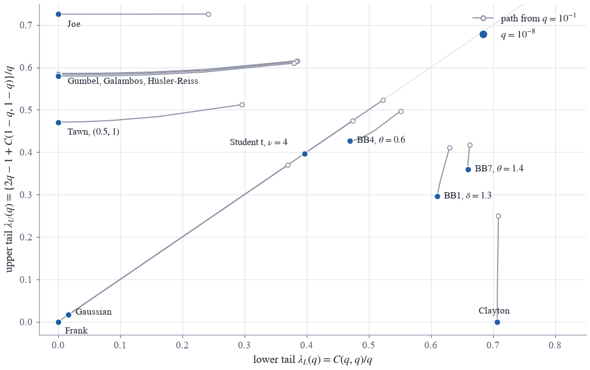
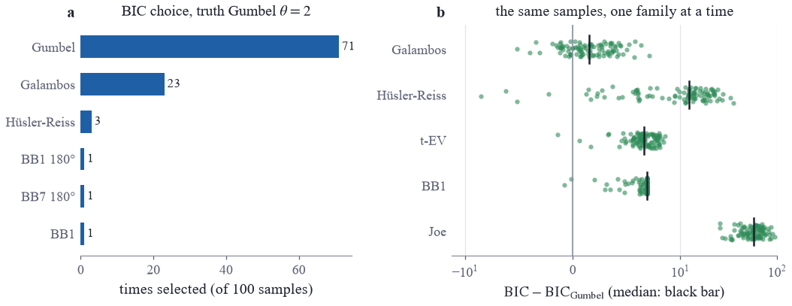

# Copula families

fortvine offers **111 pair-copula families**: 26 hand-coded families with codes `0` to `25`, and
85 families produced by a single generic engine with codes from `10000` up. This section
describes them by construction. Every page gives the copula, its density and h-functions, the
parameter box fortvine uses, Kendall's tau, the tail dependence coefficients and the symmetry
properties; the [complete catalogue](catalogue.md) lists every code with its name and box in one
table.

## Notation

Throughout, $(u, v) \in (0, 1)^2$ and

- $C(u, v)$ is the copula and $c(u, v) = \partial^2 C / \partial u\, \partial v$ its density;
- $h_1(v \mid u) = \partial C(u, v) / \partial u$ is the conditional distribution of $V$ given
  $U = u$, and $h_2(u \mid v) = \partial C(u, v) / \partial v$ that of $U$ given $V = v$
  (fortvine's `hfunc1` and `hfunc2`); their inverses (`hinv1`, `hinv2`) drive simulation and the
  inverse Rosenblatt transform;
- $\tau$ is Kendall's tau, $\tau = 4\,\mathrm{E}\,C(U, V) - 1$;
- $\lambda_L = \lim_{t \to 0} C(t, t)/t$ and $\lambda_U = \lim_{t \to 1} \big(1 - 2t + C(t, t)\big)/(1 - t)$
  are the lower and upper tail dependence coefficients;
- a copula is *exchangeable* if $C(u, v) = C(v, u)$;
- parameters are written in the order in which they are stored in `par(1:3)`.

**Rotations.** Most families describe positive dependence only. fortvine extends them by
rotating the data counter-clockwise, as vinecopulib does: with $c_0$ the unrotated density,

| rotation | density | effect |
|---:|---|---|
| 0 | $c_0(u, v)$ | as defined |
| 90 | $c_0(v, 1 - u)$ | negative dependence |
| 180 | $c_0(1 - u, 1 - v)$ | survival copula: lower and upper tails swap |
| 270 | $c_0(1 - v, u)$ | negative dependence |

The families that already cover both signs, or are radially symmetric (independence, Gaussian,
Student t, Frank, Plackett, FGM, AMH and the two nonparametric families), have no rotations.
Details are in the [manual](../manual/rotations.md).

## Constructions

| Construction | General form | Hand-coded | Generic | Page |
|---|---|---:|---:|---|
| Independence | $C(u, v) = uv$ | 1 | — | — |
| Elliptical | $F_\rho\big(F^{-1}(u), F^{-1}(v)\big)$ | 2 | — | [Elliptical](elliptical.md) |
| Archimedean | $\psi\big(\varphi(u) + \varphi(v)\big)$, $\psi$ a Laplace transform | 13 | 6 | [Archimedean](archimedean.md) |
| Extreme-value | $\exp\!\big(-(x + y)\, A\big(\tfrac{y}{x + y}\big)\big)$, $x = -\log u$ | 5 (+ Gumbel) | 9 | [Extreme-value](extreme-value.md) |
| Archimax | $\psi\big(\ell(\varphi(u), \varphi(v))\big)$ | 1 | 67 | [Archimax](archimax.md) |
| Khoudraji | $u^{1-a} v^{1-b} C_0(u^a, v^b)$ | — | 3 | [Khoudraji](khoudraji.md) |
| Other parametric | Plackett, FGM | 2 | — | [Other](other.md) |
| Nonparametric | TLL, Bernstein | 2 | — | [Nonparametric](nonparametric.md) |
| **Total** | | **26** | **85** | |

**Elliptical.** The Gaussian and Student t copulas: the dependence of an elliptical distribution
with its margins made uniform. Symmetric in every sense; the t copula has equal tail dependence
in both corners.

**Archimedean.** A single decreasing convex function $\psi$, the generator, with inverse
$\varphi$. fortvine draws every generator from seven Laplace-transform families (positive
stable, gamma, Sibuya, logarithmic series, tilted positive stable, generalised Sibuya, negative
binomial) and from compositions $\psi_o(-\log\zeta(s))$ of two of them. The hand-coded members
are Clayton, Gumbel, Frank, Joe, AMH and BB1, BB2, BB3, BB6, BB7, BB8, BB9, BB10; the generic
engine adds six new compositions. Gumbel is counted here even though it is also extreme-value.

**Extreme-value.** Max-stable copulas, determined by a convex Pickands function $A$ on $[0, 1]$.
Positive dependence and upper-tail dependence only. Hand-coded: Tawn's asymmetric logistic,
Galambos, Hüsler–Reiss, BB5 and the t-EV copula (plus Gumbel); the generic engine adds the
symmetric and asymmetric mixed models, the one-weight Tawn types, Joe's asymmetric negative
logistic and its types, and Khoudraji versions of Hüsler–Reiss and the mixed model.

**Archimax.** Capéraà, Fougères & Genest's (2000) combination of an Archimedean generator and a
Pickands function, $\ell(s, t) = (s + t) A(t/(s + t))$. It contains both previous classes and
gives the only non-exchangeable families with dependence in both tails. BB4 is hand-coded; BB1,
BB5 and BB6 are also Archimax copulas.

**Khoudraji.** An asymmetrisation that turns any copula into a non-exchangeable one with two
extra exponents. Applied to Clayton, Joe and Frank it gives three new families; applied to
extreme-value bases it gives the asymmetric EV models listed above.

**Other parametric and nonparametric.** Plackett and Farlie–Gumbel–Morgenstern belong to no
construction above. TLL (transformation local likelihood) and the Bernstein copula estimate the
copula density directly from the data.

## Family codes

### Hand-coded families: codes 0 to 25

| code | constant | family | construction | page |
|---:|---|---|---|---|
| 0 | `FV_INDEP` | independence | — | — |
| 1 | `FV_GAUSSIAN` | Gaussian | elliptical | [link](elliptical.md#gaussian) |
| 2 | `FV_STUDENT` | Student t | elliptical | [link](elliptical.md#student-t) |
| 3 | `FV_CLAYTON` | Clayton | Archimedean | [link](archimedean.md#clayton) |
| 4 | `FV_GUMBEL` | Gumbel | Archimedean and EV | [link](archimedean.md#gumbel) |
| 5 | `FV_FRANK` | Frank | Archimedean | [link](archimedean.md#frank) |
| 6 | `FV_JOE` | Joe | Archimedean | [link](archimedean.md#joe) |
| 7 | `FV_BB1` | BB1 (Clayton–Gumbel) | Archimedean, Archimax | [link](archimedean.md#bb1) |
| 8 | `FV_BB6` | BB6 (Joe–Gumbel) | Archimedean, Archimax | [link](archimedean.md#bb6) |
| 9 | `FV_BB7` | BB7 (Joe–Clayton) | Archimedean | [link](archimedean.md#bb7) |
| 10 | `FV_BB8` | BB8 (Joe–Frank) | Archimedean | [link](archimedean.md#bb8) |
| 11 | `FV_TAWN` | Tawn (asymmetric logistic) | EV | [link](extreme-value.md#asymmetric-logistic-tawn) |
| 12 | `FV_PLACKETT` | Plackett | other | [link](other.md#plackett) |
| 13 | `FV_FGM` | Farlie–Gumbel–Morgenstern | other | [link](other.md#farlie-gumbel-morgenstern-fgm) |
| 14 | `FV_AMH` | Ali–Mikhail–Haq | Archimedean | [link](archimedean.md#ali-mikhail-haq-amh) |
| 15 | `FV_GALAMBOS` | Galambos | EV | [link](extreme-value.md#negative-logistic-galambos) |
| 16 | `FV_HUSLER_REISS` | Hüsler–Reiss | EV | [link](extreme-value.md#husler-reiss) |
| 17 | `FV_BB2` | BB2 | Archimedean | [link](archimedean.md#bb2) |
| 18 | `FV_BB3` | BB3 | Archimedean | [link](archimedean.md#bb3) |
| 19 | `FV_BB5` | BB5 | EV, Archimax | [link](extreme-value.md#bb5) |
| 20 | `FV_BB9` | BB9 (Crowder) | Archimedean | [link](archimedean.md#bb9) |
| 21 | `FV_BB10` | BB10 | Archimedean | [link](archimedean.md#bb10) |
| 22 | `FV_BB4` | BB4 | Archimax | [link](archimax.md#bb4) |
| 23 | `FV_TEV` | t extreme value | EV | [link](extreme-value.md#t-ev-student-extreme-value) |
| 24 | `FV_TLL` | TLL | nonparametric | [link](nonparametric.md#tll-transformation-local-likelihood) |
| 25 | `FV_BERNSTEIN` | Bernstein | nonparametric | [link](nonparametric.md#bernstein-copula) |

### Generic families: `fam = 10000 k + 100 og + ie`

A generic code is read as three digits groups. Take `10206` as an example: `k = 1`, `og = 02`,
`ie = 06`, an Archimax copula with the gamma generator and the type-1 asymmetric logistic
Pickands function, parameters $(\theta, \theta_\ell, \psi_1)$.

| field | values | meaning |
|---|---|---|
| `k` | 1 | the copula as built from `og` and `ie` |
| | 2 | its [Khoudraji asymmetrisation](khoudraji.md), two more parameters $(a, b)$ |
| `og` | 0 | no generator, $\psi(s) = e^{-s}$: the copula is extreme-value |
| | 1–4 | positive stable, gamma, Sibuya, log series (one parameter) |
| | 5–7 | tilted positive stable, generalised Sibuya, negative binomial (two parameters) |
| | 11–26 | composition `po.pin`: outer `po` and inner `pin` from 1–4, `og = 10 + 4(po - 1) + pin` (two parameters) |
| `ie` | 0 | independence inner, $\ell(s, t) = s + t$: the copula is Archimedean |
| | 1–4 | logistic, negative logistic, Hüsler–Reiss, symmetric mixed (one parameter) |
| | 6, 7, 9, 10, 11 | asymmetric logistic types 1/2, asymmetric negative logistic types 1/2, asymmetric mixed (two parameters) |
| | 5, 8, 12, 13 | asymmetric logistic, asymmetric negative logistic, Khoudraji–HR, Khoudraji–mixed (three parameters) |

Parameters are stored in the order **generator, Pickands function, Khoudraji exponents**, with at
most three in total. The generic engine accepts a code only if it is well defined and
identifiable (`gen_valid`):

- at most three parameters;
- not the independence copula (`og = 0`, `ie = 0`) and not Gumbel written as positive stable plus
  logistic (`10101`);
- not a composition that collapses to one transform (PS.PS, Sibuya.Sibuya) or that is not
  accurate in double precision (a log-series inner under a positive stable, Sibuya or log-series
  outer);
- no Pickands function together with a gamma-inner composition (BB2, BB3, BB7 and logseries.gamma
  type generators);
- no Khoudraji wrapper around an already asymmetric Pickands function (`ie` ≥ 5).

Of the valid codes, those that duplicate a hand-coded family or another generic code
(`gen_dup`: for example `10200` = Clayton, `10202` = BB4, `20100` = Tawn) stay usable for
cross-checks but are left out of `fv_generic_families()`. The 85 codes it returns are 6
Archimedean, 9 extreme-value, 67 Archimax and 3 Khoudraji families.

=== "Fortran"

    ```fortran
    integer, allocatable :: codes(:)
    codes = fv_generic_families()          ! the 85 new codes
    print *, trim(fv_fam_name(10206))      ! Archimax(gamma|asymlogistic1)
    print *, gen_npar(10206)               ! 3
    ```

=== "Python"

    ```python
    codes = [f.code for f in fv.families() if f.code >= 10000]   # the 85 new codes
    cop = fv.Bicop(10206, 0, [1.5, 0.5, 2.0])
    print(cop.family)                      # Archimax(gamma|asymlogistic1)
    print(cop.npars)                       # 3
    ```

=== "R"

    ```r
    fam <- fortvine_families()
    codes <- fam$code[fam$code >= 10000]   # the 85 new codes
    fam[fam$code == 10206, ]               # Archimax(gamma|asymlogistic1), npars 3
    ```

## Tail dependence at a glance

Unrotated families; the 180° rotation swaps $\lambda_L$ and $\lambda_U$, and the 90°/270°
rotations move the tail dependence to the off-diagonal corners.

| code | family | $\lambda_L$ | $\lambda_U$ |
|---:|---|---|---|
| 1 | Gaussian | 0 | 0 |
| 2 | Student t | $2T_{\nu+1}\!\left(-\sqrt{(\nu+1)\frac{1-\rho}{1+\rho}}\right)$ | same as $\lambda_L$ |
| 3 | Clayton | $2^{-1/\theta}$ | 0 |
| 4 | Gumbel | 0 | $2 - 2^{1/\theta}$ |
| 5 | Frank | 0 | 0 |
| 6 | Joe | 0 | $2 - 2^{1/\theta}$ |
| 7 | BB1 | $2^{-1/(\theta\delta)}$ | $2 - 2^{1/\delta}$ |
| 8 | BB6 | 0 | $2 - 2^{1/(\theta\delta)}$ |
| 9 | BB7 | $2^{-1/\delta}$ | $2 - 2^{1/\theta}$ |
| 10 | BB8 | 0 | 0 for $\delta < 1$ ($2 - 2^{1/\theta}$ at $\delta = 1$) |
| 11 | Tawn | 0 | $\psi_1 + \psi_2 - (\psi_1^\theta + \psi_2^\theta)^{1/\theta}$ |
| 12 | Plackett | 0 | 0 |
| 13 | FGM | 0 | 0 |
| 14 | AMH | 0 | 0 |
| 15 | Galambos | 0 | $2^{-1/\theta}$ |
| 16 | Hüsler–Reiss | 0 | $2\big(1 - \Phi(1/\lambda)\big)$ |
| 17 | BB2 | 1 | 0 |
| 18 | BB3 | 1 ($\theta > 1$), $2^{-1/\delta}$ ($\theta = 1$) | $2 - 2^{1/\theta}$ |
| 19 | BB5 | 0 | $2 - (2 - 2^{-1/\delta})^{1/\theta}$ |
| 20 | BB9 | 0 | 0 |
| 21 | BB10 | 0 | 0 |
| 22 | BB4 | $(2 - 2^{-1/\delta})^{-1/\theta}$ | $2^{-1/\delta}$ |
| 23 | t-EV | 0 | $2T_{\nu+1}\!\left(-\sqrt{(\nu+1)\frac{1-\rho}{1+\rho}}\right)$ |

For the generic families the rules are short:

| generic class | $\lambda_L$ | $\lambda_U$ |
|---|---|---|
| extreme-value (`og = 0`) | 0 | $2(1 - A(1/2))$ |
| Archimedean compositions | from a gamma part only | from a positive stable or Sibuya part |
| Archimax | $(2A(1/2))^{-1/k}$ with a gamma outer part, else 0 | $2 - (2A(1/2))^{1/m}$, positive unless $A \equiv 1$ |
| Khoudraji | 0 unless $a = b = 1$ | $a + b - \ell_0(a, b)$ |

The exponents $k$ and $m$ and the per-family formulas are on the
[Archimedean](archimedean.md#tail-behaviour-of-a-composition) and
[Archimax](archimax.md#formulas) pages. The *lower tail* and *upper tail* columns of the
[catalogue](catalogue.md) record which tails a family can have somewhere in its parameter box;
they are what fortvine's preselection uses.

<figure markdown>
{ width="700" }
<figcaption>Where the families sit in the tail plane. For each family at Kendall's
$\tau = 0.5$ (Tawn: $\tau = 0.4$), the finite-level coefficients
$\lambda_L(q) = C(q, q)/q$ and $\lambda_U(q) = \{2q - 1 + C(1 - q, 1 - q)\}/q$ from fortvine's
`cdf`, followed from $q = 10^{-1}$ (open circle) to $q = 10^{-8}$ (filled). Clayton ends on the
$\lambda_L$ axis, the extreme-value and Joe copulas on the $\lambda_U$ axis (Gumbel, Galambos and
Hüsler-Reiss on top of each other), BB1, BB7 and BB4 inside the plane with both tails, the
Student t copula ($\nu = 4$) on the diagonal at 0.397 (its limit $\lambda_L = \lambda_U$; its path
runs under those of the Gaussian and Frank copulas), Frank at the origin. The Gaussian copula is still at 0.017 at $q = 10^{-8}$: its limit is 0, but it is
approached only logarithmically.</figcaption>
</figure>

## Choosing a family set

The family set is the list of candidates that `select` compares for each pair (or vine edge),
held in `ctl%family_set(1:ctl%nfam)`. Some guidelines:

- **Default.** `fv_controls` starts with the 23 parametric families `0`–`22`. Setting
  `ctl%nfam = 24` adds the t-EV copula, which is slow to fit, and `ctl%nfam = FV_NCLASSIC` (26)
  adds the two nonparametric families as well.
- **vinecopulib parity.** `FV_PARAMETRIC` (codes 0–11) is the set used by vinecopulib and
  pyvinecopulib, convenient for comparisons.
- **Fast first pass.** `FV_ONE_PAR` (Gaussian, Clayton, Gumbel, Frank, Joe) plus independence.
  With `ctl%method = FV_ITAU` (tau inversion instead of maximum likelihood) only codes 0–6 are
  considered.
- **Adding generic families.** Append `fv_generic_families()` (85 codes) or a hand-picked subset;
  `family_set` holds up to 192 codes.

    ```fortran
    integer, allocatable :: g(:)
    g = fv_generic_families()
    ctl%family_set = 0
    ctl%family_set(1:24) = FV_ALL                       ! hand-coded 0..23
    ctl%family_set(25:24 + size(g)) = g
    ctl%nfam = 24 + size(g)
    ```

- **What the extra families buy.** Asymmetry (Tawn and its types, the asymmetric EV models,
  Khoudraji and the asymmetric Archimax codes) and both-tail dependence with separate control of
  each tail (BB1, BB4, BB7, gamma.Sibuya `11700`, gamma-generator Archimax). Families that differ
  only in fine detail add run time but rarely change a selection: at equal Kendall's tau, Gumbel,
  Galambos, Hüsler–Reiss and t-EV are nearly indistinguishable.
- **Penalties and sample size.** With BIC, every extra parameter must earn its keep, so
  three-parameter families win only on large samples with clear asymmetry. On small samples a
  short list of one- and two-parameter families is both faster and more stable.
- **Preselection** (`ctl%preselect`, on by default) drops rotations and families whose tail
  pattern contradicts the data, using the correlation of the normal scores in the two opposite
  quadrants, so a large family set costs less than its length suggests.

<figure markdown>
{ width="700" }
<figcaption>How alike Gumbel, Galambos and Hüsler-Reiss are. (a) The family that BIC selects
from all 24 parametric families on 100 samples of 1000 points from a Gumbel copula with
$\theta = 2$: Gumbel 71 times, Galambos 23, Hüsler-Reiss 3. (b) On the same samples, the BIC of
each alternative fitted on its own, relative to the Gumbel fit (symmetric log scale): Galambos
is within a few units either way, the two-parameter families pay their extra $\log n$, and Joe,
whose upper tail is shaped differently, is far behind.</figcaption>
</figure>

See [fitting and selection](../manual/fitting.md) for the selection criteria and the
[generic engine](../manual/generic.md) for how the 85 codes are evaluated.
