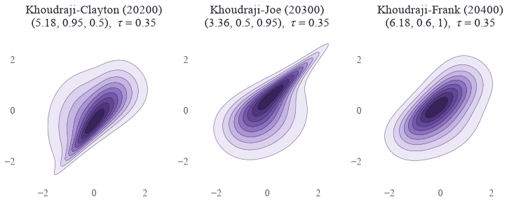

# Khoudraji asymmetrisation

Most parametric copulas are exchangeable: swapping the two variables changes nothing. Khoudraji's
device (Khoudraji 1995; Genest, Ghoudi & Rivest 1998) turns any copula $C_0$ into a
non-exchangeable one with two extra parameters $a, b \in [0, 1]$:

$$
C_K(u, v) = u^{1 - a}\, v^{1 - b}\, C_0\big(u^a, v^b\big).
$$

*The three Khoudraji families in fortvine at Kendall's $\tau = 0.35$, parameters
$(\theta, a, b)$. The unequal exponents bend the density away from the diagonal.*

## Intuition: a shared and a private component

The construction has a simple stochastic reading. Let $(X_1, Y_1)$ be independent uniforms and
$(X_2, Y_2)$ a pair with copula $C_0$, independent of the first pair. Put

$$
U = \max\big(X_1^{1/(1 - a)},\, X_2^{1/a}\big), \qquad
V = \max\big(Y_1^{1/(1 - b)},\, Y_2^{1/b}\big).
$$

Then $P(U \le u, V \le v) = P(X_1 \le u^{1-a})\,P(Y_1 \le v^{1-b})\,P(X_2 \le u^a, Y_2 \le v^b)$,
which is exactly $C_K(u, v)$. Each variable is the larger of a *private* component, unrelated to
the other variable, and a *shared* component that carries the dependence of $C_0$. The exponent
$a$ is the weight of the shared component in $U$, and $b$ its weight in $V$:

- $a = b = 1$: no private parts, $C_K = C_0$;
- $a = 0$ or $b = 0$: one variable is purely private, $C_K$ is the independence copula;
- $a \ne b$: one variable is more "driven" by the common factor than the other, and the copula
  is no longer symmetric in its arguments.

## Formulas

Write $x = u^a$, $y = v^b$, and let $C_0$, $\partial_1 C_0$, $\partial_2 C_0$ and $c_0$ be the base
copula, its two partial derivatives and its density, all at $(x, y)$. Then

$$
c_K(u, v) = (1 - a)(1 - b)\, u^{-a} v^{-b}\, C_0
          + a (1 - b)\, v^{-b}\, \partial_1 C_0
          + (1 - a)\, b\, u^{-a}\, \partial_2 C_0
          + a b\, c_0 ,
$$

$$
h_1(v \mid u) = v^{1 - b}\left[ (1 - a)\, u^{-a} C_0 + a\, \partial_1 C_0 \right], \qquad
h_2(u \mid v) = u^{1 - a}\left[ (1 - b)\, v^{-b} C_0 + b\, \partial_2 C_0 \right].
$$

All four density terms are non-negative, so fortvine forms the log-density as a log-sum of
four logs without cancellation. The base quantities come from the generic engine, which already
returns $\log C_0$, $\log \partial_1 C_0$, $\log \partial_2 C_0$ and $\log c_0$ for every member.
Neither h-function has a closed-form inverse; fortvine inverts each of them by a bracketed Newton
iteration.

## Tail dependence

**Upper tail.** Suppose the base copula has a stable tail dependence function $\ell_0$ at the
upper corner, $1 - C_0(1 - sx, 1 - sy) \approx s\, \ell_0(x, y)$ as $s \to 0$. Then

$$
\lambda_U(C_K) = a + b - \ell_0(a, b).
$$

For an extreme-value base, $\ell_0(a, b) = (a + b) A_0\big(b/(a + b)\big)$, which gives

$$
\lambda_U(C_K) = (a + b)\left[ 1 - A_0\!\left(\frac{b}{a + b}\right) \right].
$$

With $a = b$ the coefficient is simply $a\, \lambda_U(C_0)$. For the Joe base, whose upper corner
behaves like Gumbel's, $\ell_0(x, y) = (x^\theta + y^\theta)^{1/\theta}$ and
$\lambda_U = a + b - (a^\theta + b^\theta)^{1/\theta}$. For Clayton and Frank, $\ell_0(x, y) = x + y$
and $\lambda_U = 0$.

**Lower tail.** Lower-tail dependence does not survive the transformation unless
$a = b = 1$. Along the diagonal, $C_K(t, t) = t^{2 - a - b}\, C_0(t^a, t^b)$, and the Fréchet
bound $C_0(t^a, t^b) \le \min(t^a, t^b) = t^{\max(a, b)}$ gives

$$
\frac{C_K(t, t)}{t} \le t^{\,1 - \min(a, b)} \longrightarrow 0 \quad (t \to 0)
$$

as soon as either exponent is below one: the private components dominate the joint small values. Khoudraji-Clayton therefore has $\lambda_L = 0$ everywhere except at the corner
$a = b = 1$ of its box, where it is Clayton. (The tail flags in the [catalogue](catalogue.md) say
which tails a family *can* have anywhere in its box, so they mark Khoudraji-Clayton as lower-tail.)

For asymmetric lower-tail dependence use the 180° rotation of an asymmetric family with an upper
tail, for example the asymmetric negative logistic model (code `10008`, see the
[tip on the extreme-value page](extreme-value.md#asymmetric-negative-logistic-joe)).

## Codes in fortvine

Khoudraji codes are `20000 + 100 og + ie`: the base family's generic code plus 10000. The base
parameters come first, then $a$ and $b$.

| Code | Base | Parameters, box | $\tau$ range in box | $\lambda_L$ | $\lambda_U$ |
|---:|---|---|---|---|---|
| `20200` | Clayton (gamma LT) | $\theta \in [10^{-3}, 20]$, $a, b \in [0.01, 1]$ | $[0, 0.909]$ | $2^{-1/\theta}$ only at $a = b = 1$ | $0$ |
| `20300` | Joe (Sibuya LT) | $\theta \in [1, 20]$, $a, b \in [0.01, 1]$ | $[0, 0.906]$ | $0$ | $a + b - (a^\theta + b^\theta)^{1/\theta}$ |
| `20400` | Frank (log-series LT, $\theta > 0$) | $\theta \in [10^{-3}, 35]$, $a, b \in [0.01, 1]$ | $[0, 0.891]$ | $0$ | $0$ |

All three are non-exchangeable for $a \ne b$, positive-dependence families (negative dependence
through the 90° and 270° rotations), and accept all rotations.

**Edge flips.** Transposing a Khoudraji copula with an exchangeable base just swaps the two
exponents, $C_K(v, u)$ with $(a, b)$ equals $C_K(u, v)$ with $(b, a)$. fortvine applies this swap
exactly when a vine flips an edge, so no refit is needed.

**Identifiability.** When $a$ or $b$ is close to zero the copula is nearly independent whatever
the base parameter, and when both are near one the exponents hardly matter. Between these
regimes the three parameters are well identified, but expect wide confidence intervals on $a$
and $b$ for weakly dependent pairs.

## Why only three codes?

The generic engine could wrap any member, but most wraps are either duplicates or exceed
fortvine's limit of three parameters per pair copula:

- **Gumbel base.** $C_K$ with a Gumbel base is Tawn's asymmetric logistic model with
  $\psi_1 = a$, $\psi_2 = b$, already available as code 11 (and `10005`). The code `20100` is
  therefore marked as a duplicate.
- **Extreme-value bases.** The Khoudraji transform of an EV copula is again EV (its stable tail
  function is $(1 - a)x + (1 - b)y + \ell_0(ax, by)$). The wraps of Gumbel-EV, Galambos,
  Hüsler–Reiss and the mixed model (`20001` to `20004`) are the Pickands functions `ie = 5, 8, 12,
  13` of the [extreme-value page](extreme-value.md): asymmetric logistic, asymmetric negative
  logistic, Khoudraji–Hüsler–Reiss and Khoudraji–mixed. They are offered there, under their EV
  codes.
- **Two-parameter bases** (BB families, compositions, Archimax) plus $a, b$ would need four or
  more parameters.
- **Already asymmetric inner functions** (`ie` 5 and above) are rejected: they are asymmetric by
  construction and would exceed three parameters.
- **Elliptical bases** (Gaussian, Student t) are not part of the generic engine, which is built
  on Laplace-transform generators and Pickands functions.

## References

- Genest, C., Ghoudi, K. and Rivest, L.-P. (1998). Discussion of "Understanding relationships
  using copulas" by Frees and Valdez. *North American Actuarial Journal* 2, 143–149.
- Khoudraji, A. (1995). *Contributions à l'étude des copules et à la modélisation de valeurs
  extrêmes bivariées*. PhD thesis, Université Laval, Québec.
- Liebscher, E. (2008). Construction of asymmetric multivariate copulas. *Journal of
  Multivariate Analysis* 99, 2234–2250.
