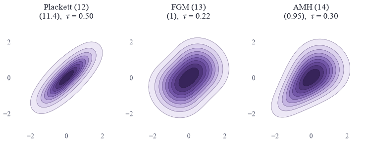

# Other parametric families

Two hand-coded families belong to none of the constructions on the previous pages: Plackett and
Farlie–Gumbel–Morgenstern. Both are exchangeable, radially symmetric, free of tail dependence and
cover negative dependence through their own parameter, so fortvine registers no rotations for
them. The Ali–Mikhail–Haq copula (code 14) is Archimedean and is described on the
[Archimedean page](archimedean.md#ali-mikhail-haq-amh), together with BB10 (code 21), which
contains it.

The second half of this page explains which families from the literature fortvine leaves out on
purpose, and why.

*Plackett at $\tau = 0.5$, and the strongest positive members of FGM ($\theta = 1$) and AMH
($\theta = 0.95$), density contours in normal scores. FGM and AMH cannot reach strong
dependence.*

## Plackett

| Property | Value |
|---|---|
| Code | `12` (`FV_PLACKETT`) |
| Parameter, box | $\theta \in [10^{-3}, 10^3]$; $\theta = 1$ is independence, $\theta < 1$ negative dependence |
| Kendall's $\tau$ | no closed form; $\tau \in [-0.926, 0.926]$ in the box |
| Spearman's $\rho_S$ | $\dfrac{\theta + 1}{\theta - 1} - \dfrac{2\theta\log\theta}{(\theta - 1)^2}$ |
| $\lambda_L$, $\lambda_U$ | $0$, $0$ |
| Exchangeable | yes, and radially symmetric |
| Rotations | none |

With $s = 1 + (\theta - 1)(u + v)$ and $D = s^2 - 4\theta(\theta - 1)\, uv$:

$$
C(u, v) = \frac{s - \sqrt{D}}{2(\theta - 1)}, \qquad
c(u, v) = \frac{\theta\,\big[1 + (\theta - 1)(u + v - 2uv)\big]}{D^{3/2}}, \qquad
h_1(v \mid u) = \frac{1}{2}\left[ 1 - \frac{s - 2\theta v}{\sqrt{D}} \right].
$$

Plackett (1965) built the family from a constant cross-product ratio: for every point $(u, v)$,

$$
\frac{P(U \le u, V \le v)\; P(U > u, V > v)}{P(U \le u, V > v)\; P(U > u, V \le v)} = \theta ,
$$

so $\theta$ is a global odds ratio, the continuous analogue of the odds ratio of a 2×2 table.
It reaches strong dependence of both signs without any tail dependence, which makes it a
symmetric alternative to Frank with a somewhat different body shape. fortvine inverts the
h-function numerically.

## Farlie–Gumbel–Morgenstern (FGM) {#farlie-gumbel-morgenstern-fgm}

| Property | Value |
|---|---|
| Code | `13` (`FV_FGM`) |
| Parameter, box | $\theta \in [-1, 1]$ |
| Kendall's $\tau$ | $2\theta/9$, so $\lvert\tau\rvert \le 2/9$ |
| Spearman's $\rho_S$ | $\theta / 3$ |
| $\lambda_L$, $\lambda_U$ | $0$, $0$ |
| Exchangeable | yes, and radially symmetric |
| Rotations | none |

$$
C(u, v) = uv\,\big[1 + \theta (1 - u)(1 - v)\big], \qquad
c(u, v) = 1 + \theta (1 - 2u)(1 - 2v), \qquad
h_1(v \mid u) = v\,\big[1 + \theta (1 - v)(1 - 2u)\big].
$$

The FGM copula (Morgenstern 1956; Gumbel 1960; Farlie 1960) is the independence copula plus a
single product perturbation. That makes it the simplest possible model for weak dependence, and
also limits it: $\lvert\tau\rvert \le 2/9$ and $\lvert\rho_S\rvert \le 1/3$. In vines it is useful in
the higher trees, where the conditional dependence is often weak and a one-parameter family with
a polynomial density is cheap to fit.

## Families not implemented

fortvine's family list is meant for **likelihood-based fitting and selection inside vines**.
That rules out several well-known copulas. The reasons fall into four groups.

### Singular families

A copula with a singular component puts positive probability on a curve of zero area. Such a
copula has no density on that part of its mass, so the product of densities that a vine
likelihood is made of does not describe the model, and an observation on the curve has no
finite likelihood contribution. Left out for this reason:

- **Marshall–Olkin** (Marshall & Olkin 1967) and its one-parameter case **Cuadras–Augé**
  (Cuadras & Augé 1981): mass on the curve $u^\alpha = v^\beta$ (the diagonal for Cuadras–Augé);
- **Fréchet** and **Mardia** families, mixtures of the comonotone, independence and
  countermonotone copulas: mass on the two diagonals;
- Lévy-frailty, Durante–Salvadori and similar shock-model constructions;
- Archimedean copulas with a **non-strict generator** ($\varphi(0) < \infty$), for example
  Nelsen's (2006) families 4.2.2, 4.2.7, 4.2.8 and 4.2.18: they carry mass
  $-\varphi(0)/\varphi'(0^+)$ on their zero curve $\varphi(u) + \varphi(v) = \varphi(0)$.

The **Raftery** copula (Raftery 1984) is sometimes listed as singular. It is not: it is absolutely
continuous, with a density that has a kink along the diagonal. It is simply not implemented
(see the candidates below).

### Families with a zero-density region

Some absolutely continuous copulas have a density that is exactly zero on a region of positive
area. One pseudo-observation in that region sends the log-likelihood to $-\infty$, and because the
region moves with the parameter the likelihood is discontinuous. In a vine, the conditional
pseudo-observations of the higher trees fill the whole unit square, so such regions are hit
sooner or later. Left out for this reason:

- Nelsen's (2006) families 4.2.11, 4.2.15, 4.2.21 and 4.2.22;
- the negative-parameter branch of **Clayton** ($-1 \le \theta < 0$), whose density vanishes
  wherever $u^{-\theta} + v^{-\theta} < 1$ (negative dependence comes from rotating Clayton
  instead);
- the **Pearson type II** copula, whose elliptical support excludes the corners of the square.

### Families that need special functions per evaluation

Every log-density evaluation in a fit is repeated for every observation and every optimiser step,
and fortvine differentiates it exactly with dual numbers. Families whose density needs an inverse
special function with a parameter-dependent shape at every point are therefore very expensive,
and their exact parameter derivatives need implicit differentiation of that inverse:

- the **GB2** (generalised beta of the second kind) copula (Yang, Frees & Zhang 2011): two
  inverse regularised incomplete beta functions per observation;
- the **Joe–Ma** integrated positive stable copula (Joe & Ma 2000), with generator
  $\psi(s) = Q(1/\alpha, s^\alpha)$ (the regularised upper incomplete gamma function): an inverse
  incomplete gamma per observation;
- the **inverse-gamma Laplace transform** generator,
  $\psi(s) = 2 s^{\alpha/2} K_\alpha(2\sqrt{s}) / \Gamma(\alpha)$: a modified Bessel function of
  parameter-dependent order, inverted numerically for every observation;
- **skew-normal and skew-t** copulas: no closed-form quantile function of the margins, and the
  Azzalini–Capitanio skew-t copula needs four parameters, above fortvine's limit of three per pair.

### Weak polynomial families

Copulas of the form "independence plus a bounded polynomial perturbation" (Huang–Kotz,
Bekrizadeh, Bozkurt, Lai–Xie and similar FGM extensions) are absolutely continuous and cheap, but
their attainable dependence is small ($\lvert\rho_S\rvert$ around $0.4$ at most), so they add little
beyond FGM. The Durrleman cubic family has $\tau = \rho_S = 0$ for all parameter values.

### Candidates for future versions

These absolutely continuous families with at most three parameters are not in fortvine yet but
would fit its framework:

| Family | Parameters | What it would add |
|---|---:|---|
| Raftery (1984) | 1 | closed $\tau = 2\theta/(3 - \theta)$ and $\lambda_L = 2\theta/(1 + \theta)$, a lower tail stronger than Clayton's at equal $\tau$ |
| Gumbel–Barnett (Nelsen 4.2.9) | 1 | weak negative dependence, $\tau \in [-0.361, 0]$ |
| Nelsen 4.2.16 | 1 | $\lambda_L = 1/2$ for every parameter, everything in closed form |
| Cubic-section copulas (Nelsen, Quesada-Molina & Rodríguez-Lallena 1997) | 2 | the strongest smooth FGM-type family, $\lvert\rho_S\rvert \le 0.577$, non-monotone shapes |
| Roch & Alegre (2006) | 2 | Gumbel with an extra body parameter |
| Bilogistic (Smith 1990), negative bilogistic (Coles & Tawn 1994) | 2 | two-parameter asymmetric EV families; each needs a scalar root per observation |

### Duplicates under other names

Many families in the literature are reparametrisations of families fortvine already has:

| Family as published | Equals |
|---|---|
| power-variance-function (PVF) and inverse-Gaussian frailty copulas | BB9 (code 20) |
| Nelsen 4.2.12 and 4.2.14 | BB1 with $\theta = 1$, and with $(\theta, \delta) = (1/\theta', \theta')$ |
| Nelsen 4.2.13 with $\theta \ge 1$ | BB9 with $\delta = 1$ |
| Nelsen 4.2.19 and 4.2.20 | BB2 with $\theta = 1$, and with $\delta = 1$ |
| Kimeldorf–Sampson, Cook–Johnson, Burr | Clayton (or its survival copula) |
| Koehler–Symanowski | Khoudraji-Clayton (code `20200`) |
| Khoudraji-Gumbel | Tawn's asymmetric logistic (code 11) |
| Khoudraji-Galambos | asymmetric negative logistic (code `10008`) |

## References

- Coles, S. G. and Tawn, J. A. (1994). Statistical methods for multivariate extremes: an
  application to structural design. *Applied Statistics* 43, 1–48.
- Cuadras, C. M. and Augé, J. (1981). A continuous general multivariate distribution and its
  properties. *Communications in Statistics A* 10, 339–353.
- Farlie, D. J. G. (1960). The performance of some correlation coefficients for a general
  bivariate distribution. *Biometrika* 47, 307–323.
- Gumbel, E. J. (1960). Bivariate exponential distributions. *Journal of the American
  Statistical Association* 55, 698–707.
- Joe, H. and Ma, C. (2000). Multivariate survival functions with a min-stable property.
  *Journal of Multivariate Analysis* 75, 13–35.
- Marshall, A. W. and Olkin, I. (1967). A multivariate exponential distribution. *Journal of the
  American Statistical Association* 62, 30–44.
- Morgenstern, D. (1956). Einfache Beispiele zweidimensionaler Verteilungen. *Mitteilungsblatt
  für Mathematische Statistik* 8, 234–235.
- Nelsen, R. B. (2006). *An Introduction to Copulas*, 2nd ed. Springer.
- Nelsen, R. B., Quesada-Molina, J. J. and Rodríguez-Lallena, J. A. (1997). Bivariate copulas
  with cubic sections. *Journal of Nonparametric Statistics* 7, 205–220.
- Plackett, R. L. (1965). A class of bivariate distributions. *Journal of the American
  Statistical Association* 60, 516–522.
- Raftery, A. E. (1984). A continuous multivariate exponential distribution. *Communications in
  Statistics A* 13, 947–965.
- Roch, O. and Alegre, A. (2006). Testing the bivariate distribution of daily equity returns
  using copulas. An application to the Spanish stock market. *Computational Statistics & Data
  Analysis* 51, 1312–1329.
- Smith, R. L. (1990). Extreme value theory. In *Handbook of Applicable Mathematics*,
  Supplement, Wiley, 437–472.
- Yang, X., Frees, E. W. and Zhang, Z. (2011). A generalized beta copula with applications in
  modeling multivariate long-tailed data. *Insurance: Mathematics and Economics* 49, 265–284.
