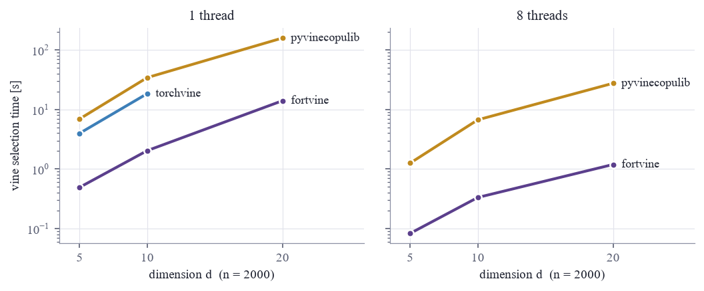

---
hide:
  - navigation
  - toc
---

<div class="fv-hero" markdown>


<div markdown>

# fortvine

<p class="fv-tagline">Vine copulas in modern Fortran: 111 pair-copula families with exact
parameter scores, structure selection, densities, Rosenblatt transforms and simulation.</p>

[Get started](getting-started/installation.md){ .md-button .md-button--primary }
[Browse the families](families/index.md){ .md-button }

</div>
</div>

<figure class="fv-strip" markdown>

<figcaption>Eight of the 111 families, drawn by fortvine in normal scores: Gaussian, Student t,
Clayton, Gumbel, Frank, Tawn's asymmetric logistic, an Archimax copula (gamma generator with an
asymmetric logistic Pickands function) and a Khoudraji-Joe copula.</figcaption>
</figure>

fortvine fits, evaluates and simulates bivariate (pair) copulas and regular-vine copulas. It is
standard Fortran 2008 with OpenMP, needs nothing but the compiler, and can be called from
Fortran, C, Python (ctypes) or any language that speaks the C ABI.

## Thirty seconds of fortvine

```fortran
program hello_fortvine
  use fortvine_api
  implicit none
  integer, parameter :: dp = kind(1.0d0), n = 2000
  type(fv_bicop) :: cop
  real(dp) :: u1(n), w(n), u2(n)

  cop%family = FV_CLAYTON; cop%par(1) = 2.0_dp       ! Clayton copula, Kendall's tau = 0.5
  call random_number(u1); call random_number(w)
  call cop%hinv1(u1, w, u2)                          ! simulate (u1, u2) from it

  call cop%select(u1, u2)                            ! choose family, rotation and parameters by BIC
  print *, trim(fv_fam_name(cop%family)), cop%rotation, cop%par(1)
end program hello_fortvine
```

```text
 clayton           0   2.1450855929878818
```

The sample is random, so the last digits differ from run to run. `bash build.sh` builds
`build/libfortvine.a`, the module files and a shared library; see
[Installation](getting-started/installation.md) and the [Quick start](getting-started/quickstart.md).

## What is in the box

| Area | What fortvine provides |
|---|---|
| Families | elliptical (Gaussian, t); Archimedean (Clayton, Gumbel, Frank, Joe, AMH, BB1-BB3, BB6-BB10 and 6 new Laplace-transform compositions); extreme-value (Tawn, Galambos, Hüsler-Reiss, t-EV, BB5 and 9 new asymmetric and mixed Pickands families); Archimax (BB4 and 67 new); Khoudraji (3 new); Plackett, FGM; nonparametric TLL and Bernstein. All with 90/180/270 degree rotations where they apply. See [Families](families/index.md). |
| Pair copulas | density, log-density, CDF, both h-functions and their inverses, maximum-likelihood fit with exact scores, family selection (log-likelihood, AIC, BIC, mBIC), Kendall's tau inversion, weights, discrete margins. See [Pair copulas](manual/bicop.md). |
| Vines | R-, C- and D-vine structures; Dissmann selection with Kendall's tau, Spearman's rho, Hoeffding's D, Chatterjee's xi, mutual information and other tree criteria; truncation and thresholding by mBICv; fixed structures. See [Vine copulas](manual/vinecop.md). |
| Vine functions | density on samples and on prediction grids, log-likelihood, Rosenblatt and inverse Rosenblatt, simulation, parameter counts, structure matrix, printing. |
| Interfaces | a typed Fortran API (`fortvine_api`) and a C ABI (`bind(C)` kernels). See [C interface](manual/c-api.md). |
| Quality | test suites over every family and rotation (density / h-function / CDF consistency, inverses, MLE recovery); the generic engine reproduces the hand-coded families to 1e-15-1e-9. See [Validation](theory/validation.md). |

## How it compares

fortvine follows the conventions of [vinecopulib](https://github.com/vinecopulib/vinecopulib)
(rotations, structure arrays, selection algorithm), so the two can be compared one to one: on
the benchmark data they reach the same maximum log-likelihoods, and fortvine gets there
11-23 times faster.



| | fortvine | vinecopulib / pyvinecopulib | torchvine |
|---|---|---|---|
| language | Fortran 2008 + OpenMP | C++ (Python bindings) | Python / PyTorch |
| parametric families | 108 | 11 | 10 |
| asymmetric families | 32 | 1 (Tawn) | — |
| nonparametric | TLL, Bernstein | TLL | TLL |
| exact parameter gradients | yes (dual numbers) | yes (analytic, 1.0) | autograd |
| GPU | no | no | yes |

All timings and the method are on the [Benchmarks](benchmarks.md) page.

## Citing

If fortvine is useful in your work, please cite the repository:

```bibtex
@software{fortvine,
  author  = {Shojaeezadeh, Shahab Aldin},
  title   = {fortvine: vine copulas in Fortran},
  year    = {2026},
  url     = {https://github.com/Bluerrror/fortvine},
  version = {1.0.0}
}
```

fortvine is released under the [MIT licence](https://github.com/Bluerrror/fortvine/blob/main/LICENSE).
