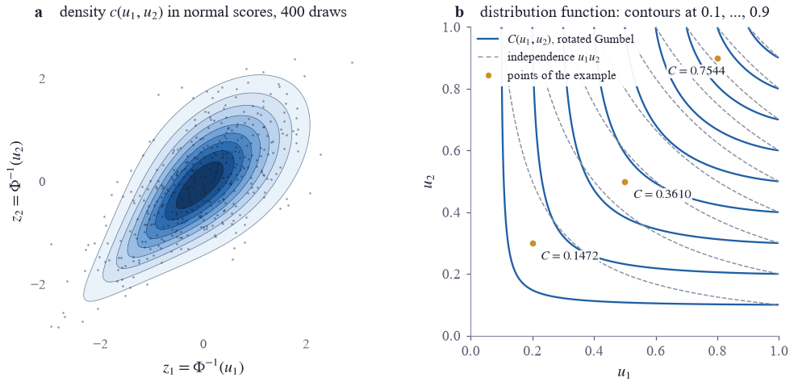
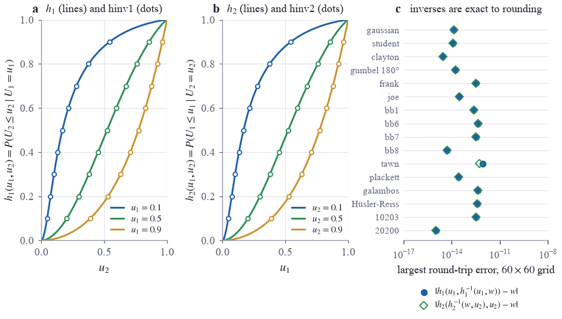
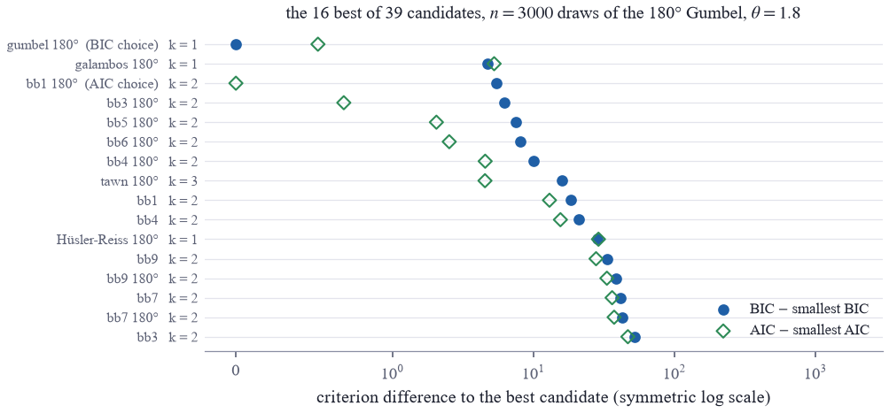

# Pair copulas (`fv_bicop`)

`fv_bicop` holds one bivariate copula $C(u_1, u_2)$. It is the building block of every vine
edge, but it is also useful on its own: to evaluate a known copula, to fit one family, or to
let fortvine choose the family and rotation for a pair of variables.

=== "Fortran"

    ```fortran
    use fortvine_api
    type(fv_bicop) :: cop
    cop%family = FV_CLAYTON; cop%par(1) = 2.0_dp     ! a Clayton copula with theta = 2
    ```

=== "Python"

    ```python
    import fortvine as fv
    cop = fv.Bicop("clayton", 0, [2.0])              # a Clayton copula with theta = 2
    ```

=== "R"

    ```r
    library(fortvine)
    cop <- bicop_dist("clayton", 0, 2)               # a Clayton copula with theta = 2
    ```

## Fields

| field | type | default | meaning |
|---|---|---|---|
| `family` | `integer` | `FV_INDEP` (0) | family code: 0 to 25 for the hand-coded families, $\ge 10000$ for the [generic engine](generic.md). See the [catalogue](../families/catalogue.md). |
| `rotation` | `integer` | 0 | 0, 90, 180 or 270 (counter-clockwise, in degrees). Ignored by rotationless families, see [Rotations](rotations.md). |
| `par(3)` | `real(dp)` | 0 | parameters; only the first `npars()` entries are used. The order is the one of the [catalogue](../families/catalogue.md). |
| `loglik` | `real(dp)` | 0 | log-likelihood (weighted if weights were given) of the last `fit` or `select`. Not updated by evaluation methods. |
| `aux(:)` | `real(dp), allocatable` | unallocated | estimate of the nonparametric families `FV_TLL` / `FV_BERNSTEIN` (length `NAUX` = 933). Allocated by `fit` and `select`. See [Nonparametric families](nonparametric.md). |

The fields are public: you may set `family`, `rotation` and `par` directly and then evaluate.
No validation happens at assignment; evaluation clips parameters to the range in which the
formulas are defined (for example Gaussian $\rho$ to $\pm 0.999999$, Student $\nu$ to
$[2, 100]$), so out-of-range values give the density of the nearest admissible copula rather
than an error.

## Methods at a glance

| method | kind | result |
|---|---|---|
| `pdf(u1, u2, out)` | subroutine | density $c(u_1, u_2)$ |
| `logpdf(u1, u2, out)` | subroutine | $\log c(u_1, u_2)$ (computed directly in log space) |
| `cdf(u1, u2, out)` | subroutine | distribution function $C(u_1, u_2)$ |
| `hfunc1(u1, u2, out)` | subroutine | $h_1 = \partial C / \partial u_1 = P(U_2 \le u_2 \mid U_1 = u_1)$ |
| `hfunc2(u1, u2, out)` | subroutine | $h_2 = \partial C / \partial u_2 = P(U_1 \le u_1 \mid U_2 = u_2)$ |
| `hinv1(u1, u2, out)` | subroutine | the $v$ with $h_1(u_1, v) = u_2$ |
| `hinv2(u1, u2, out)` | subroutine | the $v$ with $h_2(v, u_2) = u_1$ |
| `fit(u1, u2 [, ctl, weights])` | subroutine | maximum-likelihood (or tau-inversion) parameters for the current `family` and `rotation` |
| `select(u1, u2 [, ctl, weights])` | subroutine | family, rotation and parameters chosen by a criterion |
| `npars()` | integer function | number of parameters |
| `npars_eff()` | real function | number of parameters, or the effective degrees of freedom of a nonparametric estimate |

All evaluation methods take three arrays of the same length: `u1(:)`, `u2(:)` (input) and
`out(:)` (output). Signatures with argument tables are in the
[API reference](../api/bicop.md). The Python class `Bicop` has the same methods
(`cop.pdf(u)`, `cop.cdf(u)`, `cop.hfunc1(u)`, ... on an $n \times 2$ array, `cop.npars`); in
R they are `dbicop(u, cop)`, `dbicop(u, cop, log = TRUE)`, `pbicop(u, cop)`, `hbicop(u, 1, cop)`,
`hbicop(u, 2, cop)`, `hbicop(u, 1, cop, inverse = TRUE)`, `hbicop(u, 2, cop, inverse = TRUE)`
and `cop$npars`. In both bindings `npars` is the value of `npars_eff`: the effective degrees
of freedom for a nonparametric estimate (see the [Python](../python.md) and [R](../r.md)
pages).

!!! note "No generic `eval`"
    The typed object has one method per quantity instead of a single `eval` with a selector.
    The selector-style routine exists in the kernel and C interface (`fv_bicop_eval`, with
    `what` = 0 logpdf, 1 pdf, 2 hfunc1, 3 hfunc2, 4 hinv1, 5 hinv2), see the
    [C interface](c-api.md#fv_bicop_eval).

## Density and distribution function

`pdf` returns $\max(e^{\log c}, \text{tiny})$, so it never returns exactly zero; `logpdf`
returns the logarithm without that floor. The density of every family is written in log
space, which keeps it finite deep in the tails and for strong dependence (see
[Numerics](../theory/numerics.md)).

`cdf` is available for every family. It is in closed form wherever one exists: the
Archimedean and extreme-value families directly, the Gaussian through a bivariate-normal
integral routine, TLL as the exact integral of its bilinear interpolant, Bernstein as a sum
of binomial terms. The Student copula has no closed form; its CDF is computed as
$C(u_1, u_2) = \int_0^{u_1} h_1(s, u_2)\, ds$ with 16-point Gauss-Legendre rules on 8 equal
panels. Its accuracy is of the order of $10^{-6}$ (for $\rho = 0.7$, $\nu = 4$ the
largest deviation of $\partial C/\partial u_1$ from $h_1$ on a $9 \times 9$ grid is
$2.4 \cdot 10^{-6}$, and $C(1, 0.3) = 0.2999991$), which is ample for probabilities but
worth knowing if you difference the CDF over very small rectangles.

<figure markdown>
{ width="700" }
<figcaption>The copula of the example below, a Gumbel copula with $\theta = 1.8$ rotated by 180
degrees. (a) `pdf` on a grid in normal scores $z = \Phi^{-1}(u)$, with 400 draws from
`hinv1`; the rotation puts the tail dependence in the lower-left corner. (b) `cdf` (blue) at
the levels $0.1, \ldots, 0.9$, against the independence copula $C = u_1 u_2$ (dashed), and the
three points evaluated in the example with their values.</figcaption>
</figure>

## h-functions and their inverses

The two h-functions are the conditional distribution functions of one margin given the other:

$$
h_1(u_1, u_2) = \frac{\partial C(u_1,u_2)}{\partial u_1} = P(U_2 \le u_2 \mid U_1 = u_1),
\qquad
h_2(u_1, u_2) = \frac{\partial C(u_1,u_2)}{\partial u_2} = P(U_1 \le u_1 \mid U_2 = u_2).
$$

The numeral names the **conditioning** argument. The inverses keep the conditioning value in
the same slot as the h-function they invert:

| call | solves for | conditioning value | level |
|---|---|---|---|
| `hinv1(u1, w, v)` | $v$ with $h_1(u_1, v) = w$ | first argument | second argument |
| `hinv2(w, u2, v)` | $v$ with $h_2(v, u_2) = w$ | second argument | first argument |

This is the vinecopulib convention, and it is what makes `hinv1` a sampler: if $U_1$ and $W$
are independent uniforms then $(U_1, h_1^{-1}(U_1, W))$ has distribution $C$.

Closed-form inverses are used for the Gaussian, Student, Clayton and Frank families, and a
monotone Newton iteration in a transformed variable for Gumbel and Joe; other families use a
bracketed Newton iteration on the exact h-function with the density as its derivative. The
result is clipped to $[0, 1]$.

!!! tip "Round trips are exact to rounding"
    `hfunc1(u1, hinv1(u1, w))` reproduces `w` to about $10^{-14}$ for the parametric families
    (see the example below), which is what makes Rosenblatt transforms and simulation in a
    vine reliable.

<figure markdown>
{ width="700" }
<figcaption>(a) $h_1(u_1, u_2)$ as a function of $u_2$ for $u_1 = 0.1, 0.5, 0.9$ (lines) and
the points $\big(h_1^{-1}(u_1, w), w\big)$ returned by `hinv1` for $w = 0.1, \ldots, 0.9$
(dots), for the rotated Gumbel copula of the example. (b) The same for $h_2$ as a function of
$u_1$ and `hinv2`. (c) The largest error of the round trips
$h_1(u_1, h_1^{-1}(u_1, w))$ and $h_2(h_2^{-1}(w, u_2), u_2)$ over a $60 \times 60$ grid of
$(u, w)$ in $[0.001, 0.999]^2$, for sixteen families including the generic codes 10203
(Archimax) and 20200 (Khoudraji-Clayton): every error is below $10^{-12}$.</figcaption>
</figure>

## Fitting a given family

`fit` estimates the parameters of the family and rotation already stored in the object:

=== "Fortran"

    ```fortran
    cop%family = FV_GUMBEL; cop%rotation = 180
    call cop%fit(u1, u2)          ! cop%par, cop%loglik updated
    ```

=== "Python"

    ```python
    cop = fv.Bicop("gumbel", 180).fit(u)              # cop.parameters, cop.loglik() updated
    ```

=== "R"

    ```r
    cop <- bicop(u, family_set = "gumbel", rotation = 180)   # cop$parameters, cop$loglik
    ```

What happens inside (details in [Fitting and selection](fitting.md)):

1. The data are rotated, and Kendall's $\tau$ of the rotated pair is computed
   (`ctl%tau_mode`; weighted $\tau$ if weights are given).
2. A start value and a search box are derived. For the one-parameter families Gaussian,
   Clayton, Gumbel, Frank and Joe, and for the Student, the start is the $\tau$-inversion
   and the box is narrowed to the parameters of $\tau \pm 0.1$ (as vinecopulib does). Other
   families start from family-specific grids inside the full box of
   [`fv_par_bounds`](#parameter-bounds).
3. The maximum-likelihood estimate in that box is found with exact parameter scores
   (Fisher scoring with BFGS refinement; closed-form or one-dimensional Newton for the five
   one-parameter families). For $n > 1800$ the search runs on a stride subsample first and is
   then polished on all observations.

The controls that matter for `fit` are `method`, `fast_mle`, `tau_mode` and `nthreads`
(Python: the keyword arguments `method`, `fast_mle`, `tau_mode`, `num_threads`; R:
`par_method` and `cores`).

| `ctl%method` / `ctl%fast_mle` | Gaussian, Clayton, Gumbel, Frank, Joe | Student | other families |
|---|---|---|---|
| `FV_MLE` (default) | MLE | MLE of $(\rho, \nu)$ | MLE |
| `FV_MLE` + `fast_mle = .true.` | $\tau$-inversion, no optimisation | MLE | MLE |
| `FV_ITAU` | $\tau$-inversion | $\rho = \sin(\pi\tau/2)$, $\nu$ by MLE | **not supported** (see warning) |

!!! warning "`FV_ITAU` with families that have no tau inversion"
    In `select`, `FV_ITAU` silently restricts the candidates to families 0 to 6. A direct
    `fit` of another family with `ctl%method = FV_ITAU` does not fall back to MLE: it
    evaluates the likelihood at a zero parameter vector, which is not a valid estimate.
    Use `FV_MLE` for those families.

The independence copula has nothing to fit: `fit` sets `par = 0` and `loglik = 0`.

## Selecting the family

`select` tries every family of `ctl%family_set(1:ctl%nfam)` in every admissible rotation,
fits each candidate and keeps the one with the best criterion `ctl%selcrit`:

=== "Fortran"

    ```fortran
    call cop%select(u1, u2)                 ! default controls: BIC over families 0..22
    print *, fv_fam_name(cop%family), cop%rotation, cop%par
    ```

=== "Python"

    ```python
    cop = fv.Bicop().select(u)              # default: BIC over families 0..22
    print(cop.family, cop.rotation, cop.parameters)
    ```

=== "R"

    ```r
    cop <- bicop(u)                         # default: BIC over families 0..22 ("all")
    cop
    ```

* With the default `allow_rotations = .true.` a rotatable family is tried at 0 and 180
  degrees when $\hat\tau > 0$ and at 90 and 270 degrees when $\hat\tau < 0$; rotationless
  families once.
* With `preselect = .true.` (default) candidates whose tail behaviour contradicts the data
  are dropped before fitting, see [Fitting](fitting.md#preselection-by-tail-asymmetry).
* Candidates are fitted in parallel, and slow candidates that cannot win are abandoned early
  (racing, see [Fitting](fitting.md#racing-screen-then-polish)).

The criteria are log-likelihood, AIC, BIC, mBIC (with prior `ctl%psi0`) and mBICv; for a
single pair copula `FV_MBICV` behaves like `FV_MBIC`. The formulas are in
[Fitting](fitting.md#selection-criteria). Independence is among the default candidates, so a
weakly dependent pair can legitimately come back as `FV_INDEP`.

<figure markdown>
{ width="700" }
<figcaption>What `select` compares, on the sample of the Python example ($n = 3000$ draws of the
180-degree Gumbel with $\theta = 1.8$): every family of the default set (codes 0 to 22) was
fitted with `fit` at rotations 0 and 180 (rotationless families once), and the sixteen
candidates with the smallest BIC are shown with their BIC and AIC distance to the best one
(symmetric log scale, $k$ = number of parameters). BIC keeps the true one-parameter family,
Galambos is a close second; AIC, with its smaller penalty, prefers the two-parameter BB1, as
in the output of the example. The choices marked on the left are those of `select` itself.</figcaption>
</figure>

## Number of parameters

`npars()` returns 0 for independence, 1 for the one-parameter families, 2 for Student, the
BB families, BB2 to BB10 and t-EV, 3 for Tawn, and `gen_npar(family)` (1 to 3) for the
[generic families](generic.md). For TLL and Bernstein it returns the rounded effective degrees
of freedom. `npars_eff()` returns the same count as a real number, with the unrounded effective
degrees of freedom of a nonparametric fit (`aux(2)`; 0 before a fit).

## Parameter bounds

`fv_par_bounds(fam, lb, ub)` returns the box in which the MLE is searched. The box of the
hand-coded families:

| code | family | lower | upper |
|---:|---|---|---|
| 1 | gaussian | $\rho \ge -1$ | $\rho \le 1$ |
| 2 | student | $\rho \ge -1$, $\nu \ge 2$ | $\rho \le 1$, $\nu \le 30$ |
| 3 | clayton | $\theta \ge 10^{-10}$ | 28 |
| 4 | gumbel | 1 | 50 |
| 5 | frank | $-35$ | 35 |
| 6 | joe | 1 | 30 |
| 7 | bb1 | $(0, 1)$ | $(7, 7)$ |
| 8 | bb6 | $(1, 1)$ | $(6, 8)$ |
| 9 | bb7 | $(1, 0.01)$ | $(6, 25)$ |
| 10 | bb8 | $(1, 10^{-4})$ | $(8, 1)$ |
| 11 | tawn | $(0, 0, 1)$ | $(1, 1, 60)$ |
| 12 | plackett | $10^{-3}$ | $10^{3}$ |
| 13 | fgm | $-1$ | 1 |
| 14 | amh | $-1$ | 0.9999 |
| 15, 16 | galambos, husler_reiss | 0.01 | 30 |
| 17 | bb2 | $(0.01, 0.01)$ | $(30, 30)$ |
| 18, 19, 20 | bb3, bb5, bb9 | $(1, 0.01)$ | $(10, 30)$ |
| 21 | bb10 | $(0.01, 0)$ | $(30, 1)$ |
| 22 | bb4 | $(0.01, 0.01)$ | $(15, 15)$ |
| 23 | tev | $(-0.95, 1)$ | $(0.99, 30)$ |

Independence, TLL and Bernstein return `lb = ub = 0`. The boxes of the generic families
follow from their generator and Pickands parts, see [The generic engine](generic.md#parameters-and-bounds).

These boxes bound the *search*; evaluation accepts parameters outside them (for example a
Gumbel with $\theta = 80$ evaluates fine), but `fit` will not return such values.

## Weights

`fit` and `select` accept `weights(n)`, one non-negative weight per observation. The
log-likelihood becomes $\sum_i w_i \log c(u_{i1}, u_{i2})$, Kendall's $\tau$ used for starts
and preselection becomes the weighted $\tau_b$, and `loglik` reports the weighted sum. Weights
are not normalised: doubling all of them doubles `loglik`. The BIC-type penalties still use
the number of observations $n$, not $\sum_i w_i$.

## A complete example

=== "Fortran"

    ```fortran title="bicop_demo.f90"
    program bicop_demo
      use fortvine_api
      implicit none
      integer, parameter :: dp = kind(1.0d0), n = 3000
      type(fv_bicop) :: cop, fit, best
      type(fv_controls) :: ctl
      real(dp) :: u1(n), u2(n), w(n), h(n), back(n), c(3), wt(n)
      real(dp) :: a(3) = [0.2_dp, 0.5_dp, 0.8_dp], b(3) = [0.3_dp, 0.5_dp, 0.9_dp]
      integer :: i

      ! a 180-degree rotated Gumbel (lower-tail dependence), theta = 1.8
      cop%family = FV_GUMBEL; cop%rotation = 180; cop%par(1) = 1.8_dp
      call cop%pdf(a, b, c);   print '(a,3f9.4)', 'pdf    ', c
      call cop%cdf(a, b, c);   print '(a,3f9.4)', 'cdf    ', c
      call cop%hfunc1(a, b, c); print '(a,3f9.4)', 'hfunc1 ', c

      ! simulation: u2 = hinv1(u1, w) turns independent uniforms into a sample of the copula
      call random_seed(put=[(3 * i + 1, i = 1, 33)])
      call random_number(u1); call random_number(w)
      call cop%hinv1(u1, w, u2)
      call cop%hfunc1(u1, u2, h); print '(a,es9.2)', 'max |hfunc1(u1, hinv1(u1, w)) - w| =', maxval(abs(h - w))
      call cop%hfunc2(u1, u2, h); call cop%hinv2(h, u2, back)
      print '(a,es9.2)', 'max |hinv2(hfunc2(u1, u2), u2) - u1| =', maxval(abs(back - u1))

      ! fit a fixed family and rotation
      fit%family = FV_GUMBEL; fit%rotation = 180
      call fit%fit(u1, u2)
      print '(a,f8.4,a,f10.2)', 'fit: theta =', fit%par(1), '  loglik =', fit%loglik

      ! choose family and rotation by BIC (default controls), then by AIC
      call best%select(u1, u2)
      print '(3a,i0,a,2f8.4)', 'BIC choice: ', trim(fv_fam_name(best%family)), ' rot ', best%rotation, ' par', best%par(1:2)
      ctl%selcrit = FV_AIC
      call best%select(u1, u2, ctl)
      print '(3a,i0,a,i0)', 'AIC choice: ', trim(fv_fam_name(best%family)), ' rot ', best%rotation, '  npars ', best%npars()

      ! observation weights: here the second half of the sample counts twice
      wt = 1.0_dp; wt(n / 2 + 1:) = 2.0_dp
      call fit%fit(u1, u2, weights=wt)
      print '(a,f8.4,a,f10.2)', 'weighted fit: theta =', fit%par(1), '  weighted loglik =', fit%loglik
    end program bicop_demo
    ```

=== "Python"

    ```python title="bicop_demo.py"
    import numpy as np
    import fortvine as fv

    n = 3000
    a = np.array([[0.2, 0.3], [0.5, 0.5], [0.8, 0.9]])

    # a 180-degree rotated Gumbel (lower-tail dependence), theta = 1.8
    cop = fv.Bicop("gumbel", 180, [1.8])
    print("pdf    " + "".join(f"{x:9.4f}" for x in cop.pdf(a)))
    print("cdf    " + "".join(f"{x:9.4f}" for x in cop.cdf(a)))
    print("hfunc1 " + "".join(f"{x:9.4f}" for x in cop.hfunc1(a)))

    # simulation: u2 = hinv1(u1, w) turns independent uniforms into a sample of the copula
    rng = np.random.default_rng(3)
    u1, w = rng.random(n), rng.random(n)
    u2 = cop.hinv1(np.column_stack([u1, w]))
    u = np.column_stack([u1, u2])
    h = cop.hfunc1(u)
    print(f"max |hfunc1(u1, hinv1(u1, w)) - w| ={np.max(np.abs(h - w)):9.2E}")
    back = cop.hinv2(np.column_stack([cop.hfunc2(u), u2]))
    print(f"max |hinv2(hfunc2(u1, u2), u2) - u1| ={np.max(np.abs(back - u1)):9.2E}")

    # fit a fixed family and rotation
    fit = fv.Bicop("gumbel", 180).fit(u)
    print(f"fit: theta ={fit.parameters[0]:8.4f}  loglik ={fit.loglik():10.2f}")

    # choose family and rotation by BIC (the default), then by AIC
    best = fv.Bicop().select(u)
    print(f"BIC choice: {best.family} rot {best.rotation} par" + "".join(f"{p:8.4f}" for p in best.parameters))
    best = fv.Bicop().select(u, criterion="aic")
    print(f"AIC choice: {best.family} rot {best.rotation}  npars {best.npars}")

    # observation weights: here the second half of the sample counts twice
    wt = np.ones(n); wt[n // 2:] = 2.0
    fit = fv.Bicop("gumbel", 180).fit(u, weights=wt)
    print(f"weighted fit: theta ={fit.parameters[0]:8.4f}  weighted loglik ={fit.loglik():10.2f}")
    ```

=== "R"

    ```r title="bicop_demo.R"
    library(fortvine)
    n <- 3000
    a <- rbind(c(0.2, 0.3), c(0.5, 0.5), c(0.8, 0.9))

    # a 180-degree rotated Gumbel (lower-tail dependence), theta = 1.8
    cop <- bicop_dist("gumbel", 180, 1.8)
    cat("pdf    ", sprintf("%9.4f", dbicop(a, cop)), "\n", sep = "")
    cat("cdf    ", sprintf("%9.4f", pbicop(a, cop)), "\n", sep = "")
    cat("hfunc1 ", sprintf("%9.4f", hbicop(a, 1, cop)), "\n", sep = "")

    # simulation: u2 = hinv1(u1, w) turns independent uniforms into a sample of the copula
    set.seed(3)
    u1 <- runif(n); w <- runif(n)
    u2 <- hbicop(cbind(u1, w), 1, cop, inverse = TRUE)
    u <- cbind(u1, u2)
    h <- hbicop(u, 1, cop)
    cat(sprintf("max |hfunc1(u1, hinv1(u1, w)) - w| =%9.2E\n", max(abs(h - w))))
    back <- hbicop(cbind(hbicop(u, 2, cop), u2), 2, cop, inverse = TRUE)
    cat(sprintf("max |hinv2(hfunc2(u1, u2), u2) - u1| =%9.2E\n", max(abs(back - u1))))

    # fit a fixed family and rotation
    fit <- bicop(u, family_set = "gumbel", rotation = 180)
    cat(sprintf("fit: theta =%8.4f  loglik =%10.2f\n", fit$parameters, fit$loglik))

    # choose family and rotation by BIC (the default), then by AIC
    best <- bicop(u)
    cat("BIC choice: ", best$family, " rot ", best$rotation, " par", sprintf("%8.4f", best$parameters),
        "\n", sep = "")
    best <- bicop(u, selcrit = "aic")
    cat("AIC choice: ", best$family, " rot ", best$rotation, "  npars ", best$npars, "\n", sep = "")

    # observation weights: here the second half of the sample counts twice
    wt <- rep(c(1, 2), each = n / 2)
    fit <- bicop(u, family_set = "gumbel", rotation = 180, weights = wt)
    cat(sprintf("weighted fit: theta =%8.4f  weighted loglik =%10.2f\n", fit$parameters, fit$loglik))
    ```

Output:

=== "Fortran"

    ```text
    pdf       1.6406   1.3924   1.7906
    cdf       0.1472   0.3610   0.7544
    hfunc1    0.5258   0.4694   0.8306
    max |hfunc1(u1, hinv1(u1, w)) - w| = 5.11E-15
    max |hinv2(hfunc2(u1, u2), u2) - u1| = 1.23E-14
    fit: theta =  1.8537  loglik =    951.92
    BIC choice: galambos rot 180 par  1.1416  0.0000
    AIC choice: galambos rot 180  npars 1
    weighted fit: theta =  1.8433  weighted loglik =   1387.94
    ```

=== "Python"

    ```text
    pdf       1.6406   1.3924   1.7906
    cdf       0.1472   0.3610   0.7544
    hfunc1    0.5258   0.4694   0.8306
    max |hfunc1(u1, hinv1(u1, w)) - w| = 8.99E-15
    max |hinv2(hfunc2(u1, u2), u2) - u1| = 2.56E-14
    fit: theta =  1.7515  loglik =    855.48
    BIC choice: gumbel rot 180 par  1.7515
    AIC choice: bb1 rot 180  npars 2
    weighted fit: theta =  1.7485  weighted loglik =   1290.62
    ```

=== "R"

    ```text
    pdf       1.6406   1.3924   1.7906
    cdf       0.1472   0.3610   0.7544
    hfunc1    0.5258   0.4694   0.8306
    max |hfunc1(u1, hinv1(u1, w)) - w| = 1.58E-14
    max |hinv2(hfunc2(u1, u2), u2) - u1| = 5.44E-15
    fit: theta =  1.8219  loglik =    904.96
    BIC choice: gumbel rot 180 par  1.8219
    AIC choice: bb6 rot 180  npars 2
    weighted fit: theta =  1.8140  weighted loglik =   1345.34
    ```

The density, CDF and h-function lines are the same in every language; the rest depends on
the sample, and the three languages draw different uniforms. On the Fortran sample the
selected family is Galambos rather than the true Gumbel (the Python and R samples give
Gumbel itself; their AIC choices are two-parameter BB families). Galambos and Gumbel are
both one-parameter
extreme-value copulas with upper-tail dependence (here rotated to the lower tail) and their
densities are very close; with 3000 observations the likelihood slightly prefers Galambos.
That is expected behaviour, not a fitting failure.

## Threads

`fit` and `select` use `ctl%nthreads` (see [Performance](performance.md)). The evaluation
methods take no thread argument: they use `fv_threads()` (the `FORTVINE_THREADS` variable or
half the logical CPUs) and only go parallel for more than 4096 points. `cdf` runs on the
OpenMP default team (`OMP_NUM_THREADS`).
