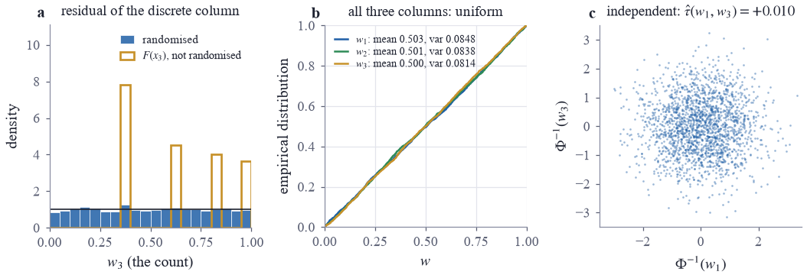
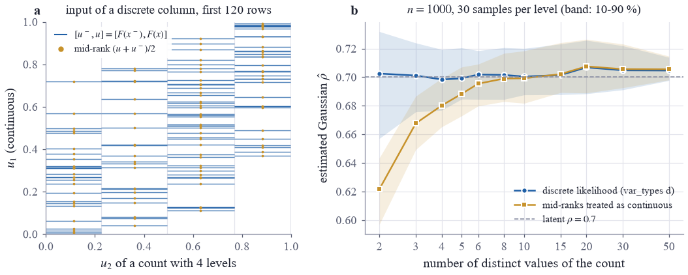

# Discrete and mixed data

Counts, ordinal scores, rounded measurements and zero-inflated variables have marginal
distributions with jumps. A copula still links such margins (Sklar's theorem holds), but the
probability integral transform $F(X)$ is no longer uniform, and the likelihood of an
observation is a probability mass rather than a density. fortvine handles this with the
convention of vinecopulib's `var_types = "d"` (Panagiotelis, Czado & Joe 2012; Panagiotelis,
Czado, Joe & Stöber 2017): each discrete variable is described by two numbers per
observation.

## Input: `u` and `u_minus`

For a discrete variable $X_j$ with distribution function $F_j$:

$$
u_{ij} = F_j(x_{ij}), \qquad u^-_{ij} = F_j(x_{ij}^-) = P(X_j < x_{ij}),
$$

so that $u_{ij} - u^-_{ij} = P(X_j = x_{ij})$. For integer data $F_j(x^-) = F_j(x - 1)$.
Pass

* `u(n, d)`: $F(x)$ for every column (continuous columns as usual),
* `u_minus(n, d)`: $F(x^-)$ for the discrete columns; entries of continuous columns are not
  read (copying `u` there is fine),
* `discrete(d)`: `.true.` for the discrete columns.

The [Python](../python.md#discrete-and-mixed-margins) and [R](../r.md#discrete-margins)
packages follow vinecopulib instead: `var_types` gives `"c"` or `"d"` per variable, and with
$k$ discrete variables the data have $d + k$ columns, $F(x)$ of every variable followed by
$F(x^-)$ of the discrete ones, in their order.

=== "Fortran"

    ```fortran
    call vc%select(u, ctl, discrete=[.false., .false., .true.], u_minus=um)
    ll = vc%loglik(u, u_minus=um)
    ```

=== "Python"

    ```python
    vc = fv.Vinecop.from_data(u, var_types=["c", "c", "d"])   # F(x) of every variable, then F(x-) of variable 3
    ll = vc.loglik(u)
    ```

=== "R"

    ```r
    vc <- vinecop(u, var_types = c("c", "c", "d"))             # F(x) of every variable, then F(x-) of variable 3
    ll <- sum(log(dvinecop(u, vc)))
    ```

$F_j$ can be a fitted parametric margin or the empirical distribution function; with the
latter, using the denominator $n + 1$ (as `fv_pseudo_obs_nd` does for continuous columns)
keeps $u < 1$.

The discreteness flags are stored in `vc%disc`. Every evaluation of a vine with any discrete
variable then requires `u_minus` (`pdf`, `loglik`, `rosenblatt`) or `ugm` (`pdf_grid`).
`fv_bicop` methods have no `u_minus` argument; to fit or select a single pair with discrete
margins, use a two-dimensional `fv_vinecop`.

## The likelihood of a pair

Let $a, b$ be the two (conditional) margins of an edge, with $a^-, b^-$ their left limits.
The pair-copula likelihood used by fortvine is the joint probability divided by the product
of the marginal masses, so that it is a density with respect to the product of the margins
and directly comparable between candidates:

| margins of the observation | contribution |
|---|---|
| both continuous | $c(a, b)$ |
| $a$ discrete, $b$ continuous | $\dfrac{h_2(a, b) - h_2(a^-, b)}{a - a^-}$ |
| $a$ continuous, $b$ discrete | $\dfrac{h_1(a, b) - h_1(a, b^-)}{b - b^-}$ |
| both discrete | $\dfrac{C(a,b) - C(a^-,b) - C(a,b^-) + C(a^-,b^-)}{(a - a^-)(b - b^-)}$ |

A variable declared discrete whose observation has $a - a^- \le 10^{-12}$ is treated as
continuous for that observation, so mixed (partly continuous, partly atomic) margins such as
zero-inflated data are handled row by row.

## Conditional margins in higher trees

The next tree needs $F(b \mid a)$ and its left limit. If the conditioning variable $a$ is
discrete, the conditional distribution averages over its jump:

$$
F(b \mid a) = \frac{C(a, b) - C(a^-, b)}{a - a^-} = \frac{1}{a - a^-}\int_{a^-}^{a} h_1(s, b)\, ds .
$$

fortvine computes this from the closed-form CDF when the jump is at least $10^{-3}$ and the
family has one, and by Gauss-Legendre quadrature of the h-function otherwise (the Student
copula always uses quadrature). Both $F(b \mid a)$ and $F(b^- \mid a)$ are propagated, and a
conditional margin is discrete exactly when the variable it describes is.

## Fitting with discrete margins

* **Gaussian, Clayton, Gumbel, Frank, Joe:** the exact discrete likelihood with its score and
  curvature in closed form, maximised by Newton's method (as on continuous data).
* **Other one-parameter families:** Brent's method on the exact discrete likelihood.
* **Multi-parameter families:** the start grid followed by Nelder-Mead in logit coordinates
  on the exact discrete likelihood (value only: no dual-number scores on this path). The
  two-stage subsample scheme applies for $n > 1800$.
* **TLL, Bernstein:** the estimate is computed from the mid-points
  $\big(F(x) + F(x^-)\big)/2$ of the discrete margins, and its log-likelihood is then
  evaluated with the discrete formulas above.

Discrete fits are slower than continuous ones, mainly because the multi-parameter families
lose the exact scores and because every observation needs two to four copula evaluations. The
generic-family pre-screen is skipped on discrete edges, and [`relax`](vinecop.md#non-simplified-edges-relax)
is not available for vines with discrete variables.

## Rosenblatt transform

For a discrete variable the conditional distribution function $F(x_k \mid \cdot)$ evaluated
at the data is not uniform. `rosenblatt` therefore returns, by default, Brockwell's (2007)
randomised transform for the discrete columns,

$$
w_{ik} = W_{ik}\, F(x_{ik} \mid \dots) + (1 - W_{ik})\, F(x_{ik}^- \mid \dots),
$$

with independent uniforms $W_{ik}$; under the model the $w_{ik}$ are iid uniform, so the usual
goodness-of-fit diagnostics apply. Continuous columns are transformed as usual.

=== "Fortran"

    ```fortran
    call vc%rosenblatt(u, w, u_minus=um)                          ! randomised, seed 1
    call vc%rosenblatt(u, w, u_minus=um, seed=7)                  ! another randomisation
    call vc%rosenblatt(u, w, u_minus=um, randomize=.false., out_minus=wm)   ! F(x|.), F(x-|.)
    ```

=== "Python"

    ```python
    w = vc.rosenblatt(u)                                        # randomised, seed 1
    w = vc.rosenblatt(u, seed=7)                                # another randomisation
    w = vc.rosenblatt(u, randomize_discrete=False)              # F(x|.)
    ```

=== "R"

    ```r
    w <- rosenblatt(u, vc)                                      # randomised; the seed follows set.seed()
    w <- rosenblatt(u, vc, randomize_discrete = FALSE)          # F(x|.)
    ```

The uniforms come from a counter-based hash of `(seed, row, column)`, so the result is
reproducible and independent of the number of threads and of the Fortran random generator.
`randomize = .false.` returns $F(x_k \mid \dots)$ itself, and `out_minus(n, d)` (optional)
receives $F(x_k^- \mid \dots)$.

<figure markdown>
{ width="700" }
<figcaption>The Rosenblatt transform of the [example](#example) below (a latent Gaussian D-vine
whose third variable is a count with four levels), computed with the Python package
(`rosenblatt(u, seed=3)`). (a) The discrete column: randomised (blue) it is uniform; without
randomisation (`randomize_discrete=False`, gold) it keeps the four atoms of the count. Variable 3
is `order(d)` here, so its non-randomised value is $F(x_3)$ itself. (b) Empirical distribution
functions of the three randomised columns, on the diagonal of the uniform distribution, with
their means and variances ($1/2$ and $1/12 \approx 0.0833$ expected). (c) Columns 1 and 3 in
normal scores: no dependence is left.</figcaption>
</figure>

!!! note "Simulation"
    `inverse_rosenblatt` and `simulate` do not use the discreteness flags: they return a sample
    $U$ of the copula on the continuous scale. Discrete observations are obtained by applying
    the marginal quantile functions, $x_j = F_j^{-1}(u_j)$, which is the standard latent-variable
    construction.

## Example

A latent Gaussian D-vine whose third variable is observed only as a count with four levels:

=== "Fortran"

    ```fortran title="discrete_demo.f90"
    program discrete_demo
      use fortvine_api
      implicit none
      integer, parameter :: dp = kind(1.0d0), n = 2000, d = 3
      type(fv_vinecop) :: gen, vc
      type(fv_controls) :: ctl
      real(dp) :: v(n, d), u(n, d), um(n, d), r(n, d)
      integer :: k(n), j, i

      ! latent Gaussian-copula sample; variable 3 is then made a count with 4 levels
      call gen%set_dvine([1, 2, 3])
      gen%fam(1:2, 1) = FV_GAUSSIAN; gen%par(1, 1:2, 1) = 0.7_dp
      call gen%simulate(n, v, seed=2)
      k = min(int(4.0_dp * v(:, 3)**1.5_dp), 3)            ! counts 0..3

      ! continuous columns: u_minus = u (not used); discrete column: empirical F(x) and F(x-)
      u = v; um = v
      do i = 1, n
        u(i, 3) = count(k <= k(i)) / (n + 1.0_dp)
        um(i, 3) = count(k < k(i)) / (n + 1.0_dp)
      end do

      ctl%nthreads = 4
      call vc%select(u, ctl, discrete=[.false., .false., .true.], u_minus=um)
      call vc%print()
      print '(a,f10.2)', 'discrete log-likelihood:', vc%loglik(u, u_minus=um)

      ! randomised (Brockwell) Rosenblatt transform: iid uniform under the model
      call vc%rosenblatt(u, r, u_minus=um, seed=3)
      do j = 1, d
        print '(a,i0,a,f7.4,a,f7.4)', 'column ', j, ': mean', sum(r(:, j)) / n, &
          '  variance', sum((r(:, j) - 0.5_dp)**2) / n
      end do
      print '(a,f8.4)', 'tau(r1, r3):', fv_kendall_tau(r(:, 1), r(:, 3))
    end program discrete_demo
    ```

=== "Python"

    ```python title="discrete_demo.py"
    import numpy as np
    import fortvine as fv

    n, d = 2000, 3

    # latent Gaussian-copula sample; variable 3 is then made a count with 4 levels
    gen = fv.Vinecop().set_dvine([1, 2, 3])
    for e in range(2):
        gen.set_pair_copula(0, e, fv.Bicop("gaussian", 0, [0.7]))
    v = gen.simulate(n, seed=2)
    k = np.minimum((4.0 * v[:, 2] ** 1.5).astype(int), 3)       # counts 0..3

    # F(x) of every variable (empirical for the count), then F(x-) of the discrete one: d + 1 columns
    ks = np.sort(k)
    fx = np.searchsorted(ks, k, side="right") / (n + 1.0)
    fxm = np.searchsorted(ks, k, side="left") / (n + 1.0)
    u = np.column_stack([v[:, 0], v[:, 1], fx, fxm])

    vc = fv.Vinecop.from_data(u, var_types=["c", "c", "d"], num_threads=4)
    print(vc)
    print(f"discrete log-likelihood:{vc.loglik(u):10.2f}")

    # randomised (Brockwell) Rosenblatt transform: iid uniform under the model
    r = vc.rosenblatt(u, seed=3)
    for j in range(d):
        print(f"column {j + 1}: mean{r[:, j].mean():7.4f}  variance{np.mean((r[:, j] - 0.5) ** 2):7.4f}")
    print(f"tau(r1, r3):{fv.kendall_tau(r[:, 0], r[:, 2]):8.4f}")
    ```

=== "R"

    ```r title="discrete_demo.R"
    library(fortvine)
    n <- 2000; d <- 3

    # latent Gaussian-copula sample; variable 3 is then made a count with 4 levels
    gen <- vinecop_dist(list(rep(list(bicop_dist("gaussian", 0, 0.7)), 2), list(bicop_dist("indep"))),
                        dvine_structure(1:3))
    set.seed(2)
    v <- rvinecop(n, gen)
    k <- pmin(floor(4 * v[, 3]^1.5), 3)                    # counts 0..3

    # F(x) of every variable (empirical for the count), then F(x-) of the discrete one: d + 1 columns
    Fk <- ecdf(k)
    u <- cbind(v[, 1:2], Fk(k) * n / (n + 1), Fk(k - 1) * n / (n + 1))

    vc <- vinecop(u, var_types = c("c", "c", "d"), cores = 4)
    print(vc)
    cat(sprintf("discrete log-likelihood:%10.2f\n", sum(log(dvinecop(u, vc)))))

    # randomised (Brockwell) Rosenblatt transform: iid uniform under the model
    set.seed(3)
    r <- rosenblatt(u, vc)
    for (j in 1:d)
      cat(sprintf("column %d: mean%7.4f  variance%7.4f\n", j, mean(r[, j]), mean((r[, j] - 0.5)^2)))
    cat(sprintf("tau(r1, r3):%8.4f\n", cor(r[, 1], r[, 3], method = "kendall")))
    ```

Output:

=== "Fortran"

    ```text
    fortvine vine copula: d = 3, trunc = 2
    order: 1 2 3
      tree 1 edge 1:     gaussian rot   0 par  6.9863E-01  0.0000E+00  0.0000E+00
      tree 1 edge 2:     gaussian rot   0 par  6.9748E-01  0.0000E+00  0.0000E+00
      tree 2 edge 1:        indep rot   0 par  0.0000E+00  0.0000E+00  0.0000E+00
    discrete log-likelihood:   1112.53
    column 1: mean 0.4918  variance 0.0830
    column 2: mean 0.4974  variance 0.0798
    column 3: mean 0.4993  variance 0.0831
    tau(r1, r3): -0.0190
    ```

=== "Python"

    ```text
    fortvine vine copula: d = 3, trunc = 2
    order: 1 2 3
    discrete: 3
      tree 1 edge 1: gaussian     rot   0 par 0.6915
      tree 1 edge 2: gaussian     rot   0 par 0.6878
      tree 2 edge 1: indep        rot   0 par 
    discrete log-likelihood:   1135.49
    column 1: mean 0.5032  variance 0.0848
    column 2: mean 0.5013  variance 0.0838
    column 3: mean 0.5003  variance 0.0814
    tau(r1, r3):  0.0103
    ```

=== "R"

    ```text
    Vine copula ('vinecop_dist'): d = 3, trunc_lvl = 2, order = 1 2 3
      npars = 2, loglik = 1146.31 (n = 2000)
      discrete variables: 3
     tree edge conditioned conditioning   family rotation parameters
        1    1        1, 2              gaussian        0     0.6835
        1    2        2, 3              gaussian        0     0.6959
        2    1        1, 3            2    indep        0       none
    discrete log-likelihood:   1146.31
    column 1: mean 0.5005  variance 0.0851
    column 2: mean 0.5064  variance 0.0832
    column 3: mean 0.4984  variance 0.0840
    tau(r1, r3):  0.0079
    ```

Both latent correlations (true value 0.7) are recovered although one of the variables has
only four distinct values, and the transformed columns have the mean $1/2$ and variance
$1/12 \approx 0.0833$ of independent uniforms. Treating the count as continuous instead (its
mid-ranks $(u + u^-)/2$ passed as ordinary pseudo-observations) gives 0.679 for the second
parameter on the same (Fortran) data: the ties attenuate the dependence estimate, and the effect grows
as the number of distinct values shrinks.

<figure markdown>
{ width="700" }
<figcaption>(a) What a discrete column contributes: each observation of a count with four
equiprobable levels is the interval $[u^-, u] = [F(x^-), F(x)]$ (blue), not a point; the
mid-rank (gold) is the naive point summary. (b) A Gaussian copula with $\rho = 0.7$ whose second
variable is cut into $K$ equiprobable levels, $n = 1000$, 30 samples per $K$ (mean and 10-90 %
band): the discrete likelihood (a two-dimensional vine with `var_types=["c", "d"]`) is unbiased
for every $K$, the mid-ranks fitted as continuous data underestimate $\rho$ (0.62 at two
levels, 0.68 at four) until the count has about ten distinct values.</figcaption>
</figure>
