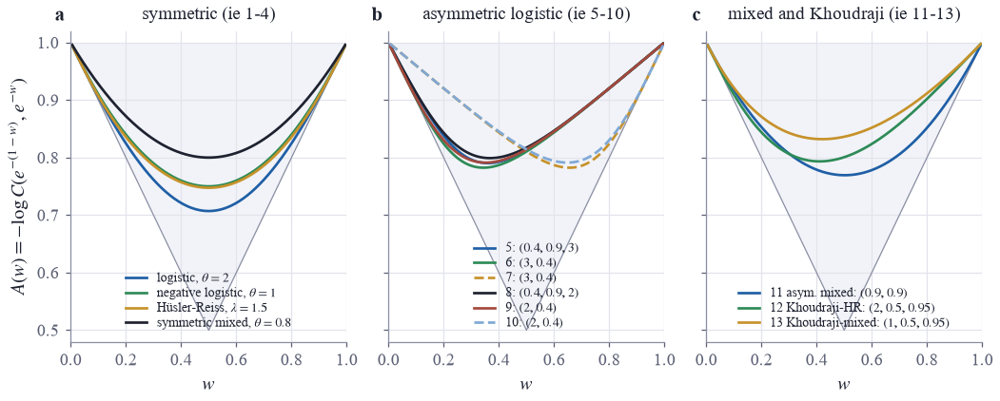
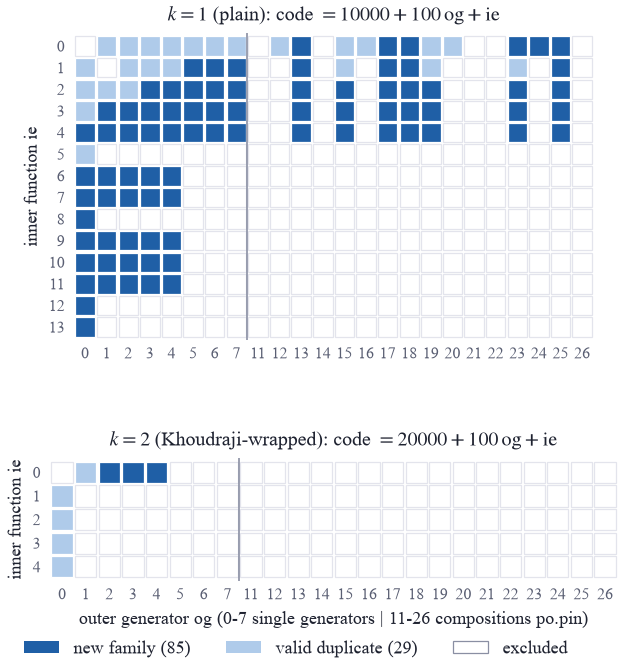
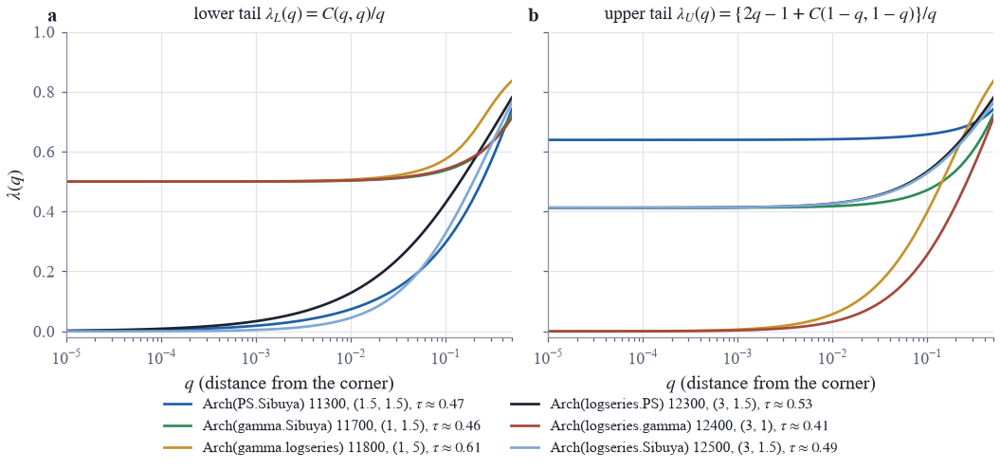

# The generic engine

Besides the 26 hand-coded families, fortvine contains a generic pair-copula engine
(`src/families_gen.inc`) that builds Archimedean, extreme-value and Archimax copulas, their
compositions and their Khoudraji asymmetrisations from a small set of parts. One
implementation evaluates all of them, in log space and with exact parameter derivatives. The
engine has 114 valid codes: **85 new families** (codes $\ge 10000$) and 29 that reproduce a
hand-coded family or another generic code.

The family pages ([Archimedean](../families/archimedean.md),
[extreme-value](../families/extreme-value.md), [Archimax](../families/archimax.md),
[Khoudraji](../families/khoudraji.md)) describe the copulas; this page describes the code
scheme, the parameters, the exclusions and how to extend the engine. The complete list is in
the [catalogue](../families/catalogue.md).

## One formula

Every generic family is of the form (Capéraà, Fougères & Genest 2000; Joe 2014, sections
3.5 and 3.18)

$$
C(u, v) = \Psi\big(\,\ell(\Phi(u), \Phi(v))\,\big), \qquad \Phi = \Psi^{-1},
$$

with two ingredients:

* the **outer generator** $\Psi$: either none ($\Psi(s) = e^{-s}$), a Laplace transform of a
  positive random variable with one or two parameters, or a composition
  $\Psi(s) = \psi_{\text{po}}\big(-\log\zeta_{\text{pin}}(s)\big)$ of two one-parameter Laplace
  transforms (Joe 2014, appendix A.1.2);
* the **inner function** $\ell$ on the log scale: either $\ell(s, t) = s + t$, which makes
  $C$ Archimedean, or $\ell(s, t) = (s + t)\, A\!\left(\frac{t}{s+t}\right)$ with a Pickands
  dependence function $A$, which makes $C$ Archimax (and extreme-value when $\Psi = e^{-s}$).

With $S = \Phi(u)$, $T = \Phi(v)$ and $L = \ell(S, T)$ the h-functions and density are

$$
h_1 = \frac{\Psi'(L)\,\ell_s}{\Psi'(S)}, \qquad
h_2 = \frac{\Psi'(L)\,\ell_t}{\Psi'(T)}, \qquad
c = \frac{\Psi''(L)\,\ell_s\,\ell_t + \big(-\Psi'(L)\big)\big(-\ell_{st}\big)}{\Psi'(S)\,\Psi'(T)} .
$$

Since $\Psi' < 0 \le \Psi''$, $\ell_s, \ell_t \ge 0$ and $\ell_{st} \le 0$, both terms of the
numerator are non-negative, so the density is a log-sum-exp of two finite logarithms and never
suffers from cancellation.

### The Khoudraji wrapper

Any member can be made asymmetric with Khoudraji's (1995) device

$$
C_K(u, v) = u^{1-a}\, v^{1-b}\; C\big(u^{a}, v^{b}\big), \qquad a, b \in [0.01, 1],
$$

whose density, with $x = u^a$, $y = v^b$, is
$u^{-a}v^{-b}\,C(x,y)\,\big[(1-a)(1-b) + (1-a)\,b\,y\,\tfrac{h_2}{C} + (1-b)\,a\,x\,\tfrac{h_1}{C} + ab\,xy\,\tfrac{c}{C}\big]$,
again a sum of non-negative terms.

## The code scheme

$$
\texttt{fam} = 10000\,k + 100\,\text{og} + \text{ie}
$$

| part | values | meaning |
|---|---|---|
| $k$ | 1, 2 | 1 plain, 2 Khoudraji-wrapped (two extra parameters $a, b$) |
| og | 0 to 7, 11 to 26 | outer generator $\Psi$ |
| ie | 0 to 13 | inner function: 0 Archimedean, 1 to 13 a Pickands function |

`gen_is(fam)` is true for every code $\ge 10000$. The parts are extracted as
`og = mod(fam, 10000) / 100` and `ie = mod(fam, 100)`.

### Outer generators (og)

| og | name | $\Psi(s)$ | parameters | box |
|---:|---|---|---|---|
| 0 | none | $e^{-s}$ | none | |
| 1 | positive stable (PS) | $\exp(-s^{1/\theta})$ | $\theta$ | $[1, 20]$ |
| 2 | gamma | $(1+s)^{-1/\theta}$ | $\theta$ | $[10^{-3}, 20]$ |
| 3 | Sibuya | $1 - (1-e^{-s})^{1/\theta}$ | $\theta$ | $[1, 20]$ |
| 4 | logarithmic series | $-\theta^{-1}\log\big(1 - (1-e^{-\theta})e^{-s}\big)$ | $\theta$ | $[10^{-3}, 35]$ |
| 5 | exponentially tilted PS | $\exp\big(\delta^{-1} - (\delta^{-\theta} + s)^{1/\theta}\big)$ | $\theta, \delta$ | $[1, 10] \times [0.01, 25]$ |
| 6 | generalised Sibuya | $\delta^{-1}\big[1 - (1 - \eta e^{-s})^{1/\theta}\big]$, $\eta = 1-(1-\delta)^\theta$ | $\theta, \delta$ | $[1, 8] \times [10^{-3}, 1]$ |
| 7 | negative binomial | $\big[(1-\pi)/(e^{s} - \pi)\big]^{1/\theta}$ | $\theta, \pi$ | $[0.01, 30] \times [0, 0.99]$ |
| 11 to 26 | composition po.pin | $\psi_{\text{po}}\big(-\log\zeta_{\text{pin}}(s)\big)$ | $\theta_{\text{po}}, \theta_{\text{pin}}$ | see below |

With og = 0 to 7 alone ($\ell = s + t$) these are Gumbel, Clayton, Joe, Frank, BB9, BB8 and
BB10, all available as hand-coded families; their value is as building blocks for Archimax
copulas.

The compositions combine po, pin $\in$ {1 PS, 2 gamma, 3 Sibuya, 4 log series} as
og $= 10 + 4(\text{po} - 1) + \text{pin}$. Inside a composition the boxes are PS $[1, 10]$,
gamma $[10^{-3}, 15]$, Sibuya $[1, 10]$, log series $[10^{-3}, 30]$; the outer parameter comes
first.

| og | composition | status |
|---:|---|---|
| 11 | PS.PS | excluded (reduces to PS) |
| 12 | PS.gamma | = BB3 as Archimedean |
| 13 | PS.Sibuya | new |
| 14 | PS.logseries | excluded (inaccurate in double precision) |
| 15 | gamma.PS | = BB1 as Archimedean |
| 16 | gamma.gamma | = BB2 as Archimedean |
| 17 | gamma.Sibuya | new |
| 18 | gamma.logseries | new |
| 19 | Sibuya.PS | = BB6 as Archimedean |
| 20 | Sibuya.gamma | = BB7 as Archimedean |
| 21 | Sibuya.Sibuya | excluded (reduces to Sibuya) |
| 22 | Sibuya.logseries | excluded (inaccurate in double precision) |
| 23 | logseries.PS | new |
| 24 | logseries.gamma | new |
| 25 | logseries.Sibuya | new |
| 26 | logseries.logseries | excluded (inaccurate in double precision) |

### Inner functions (ie)

$w = t/(s+t)$ is the share of the second margin, the convention of fortvine's Tawn and
Galambos families.

| ie | name | $A(w)$ | parameters | box |
|---:|---|---|---|---|
| 0 | none (Archimedean) | $\ell = s + t$ | none | |
| 1 | logistic | $\big[(1-w)^\theta + w^\theta\big]^{1/\theta}$ | $\theta$ | $[1, 20]$ |
| 2 | negative logistic | $1 - \big[(1-w)^{-\theta} + w^{-\theta}\big]^{-1/\theta}$ | $\theta$ | $[0.01, 20]$ |
| 3 | Hüsler-Reiss | $w\,\Phi_N(z_1) + (1-w)\,\Phi_N(z_2)$, $z_{1,2} = \lambda^{-1} \pm \tfrac{\lambda}{2}\log\tfrac{w}{1-w}$ | $\lambda$ | $[0.01, 20]$ |
| 4 | symmetric mixed | $1 - \theta w(1-w)$ | $\theta$ | $[0, 1]$ |
| 5 | asymmetric logistic | $(1-\psi_1)(1-w) + (1-\psi_2)w + \big[(\psi_1(1-w))^\theta + (\psi_2 w)^\theta\big]^{1/\theta}$ | $\psi_1, \psi_2, \theta$ | $[0.01,1]^2 \times [1, 20]$ |
| 6 | asymmetric logistic, type 1 | ie 5 with $\psi_2 = 1$ | $\theta, \psi_1$ | $[1, 20] \times [0.01, 1]$ |
| 7 | asymmetric logistic, type 2 | ie 5 with $\psi_1 = 1$ | $\theta, \psi_2$ | $[1, 20] \times [0.01, 1]$ |
| 8 | asymmetric negative logistic | $1 - \big[(\psi_1(1-w))^{-\theta} + (\psi_2 w)^{-\theta}\big]^{-1/\theta}$ | $\psi_1, \psi_2, \theta$ | $[0.01,1]^2 \times [0.01, 20]$ |
| 9 | asym. negative logistic, type 1 | ie 8 with $\psi_2 = 1$ | $\theta, \psi_1$ | $[0.01, 20] \times [0.01, 1]$ |
| 10 | asym. negative logistic, type 2 | ie 8 with $\psi_1 = 1$ | $\theta, \psi_2$ | $[0.01, 20] \times [0.01, 1]$ |
| 11 | asymmetric mixed | $1 - (\theta+\phi)w + \theta w^2 + \phi w^3$, $\phi = -\tfrac\theta3 + \kappa\big(\tfrac{1-\theta}{2} + \tfrac\theta3\big)$ | $\theta, \kappa$ | $[0, 1]^2$ |
| 12 | Khoudraji-Hüsler-Reiss | $(1-a)(1-w) + (1-b)w + v\,A_3(z)$, $v = a(1-w) + bw$, $z = bw/v$ | $\lambda, a, b$ | $[0.01, 20] \times [0.01, 1]^2$ |
| 13 | Khoudraji-mixed | as ie 12 with $A_4$ | $\theta, a, b$ | $[0, 1] \times [0.01, 1]^2$ |

($\Phi_N$ is the standard normal distribution function.) The parametrisation $\kappa \in [0, 1]$
of ie 11 maps the unit square onto the admissible region of Tawn's (1988) asymmetric mixed
model, so the box constraints are enough to keep $A$ a valid Pickands function. ie 12 and 13
are the Khoudraji asymmetrisations of ie 3 and 4 written as Pickands functions, so that they
can be combined with an outer generator.

<figure markdown>
{ width="700" }
<figcaption>All thirteen inner functions, as the Pickands functions of the extreme-value codes
$10000 + \text{ie}$ (og = 0), recovered from the library's distribution function as
$A(w) = -\log C(e^{-(1-w)}, e^{-w})$; the shaded triangle between
$\max(w, 1 - w)$ (comonotone) and 1 (independence) is the admissible region. (a) The symmetric
ones, $A(w) = A(1 - w)$. (b) The asymmetric logistic family: types 1 and 2 (ie 6, 7 and 9, 10,
dashed for type 2) with the same parameters are mirror images, $A_7(w) = A_6(1 - w)$, which is
what `gen_flip` uses. (c) The asymmetric mixed model and the two Khoudraji-type inner
functions.</figcaption>
</figure>

### Examples of codes

| code | $k$ | og | ie | name (`fv_fam_name`) |
|---:|---:|---:|---:|---|
| 10203 | 1 | 2 gamma | 3 HR | Archimax(gamma\|HuslerReiss) |
| 11700 | 1 | 17 gamma.Sibuya | 0 | `Arch(gamma.Sibuya)` |
| 10013 | 1 | 0 | 13 | `Khoudraji-mixed` |
| 10006 | 1 | 0 | 6 | `Tawn-type1` |
| 20200 | 2 | 2 gamma | 0 | `Khoudraji-Clayton` |
| 20300 | 2 | 3 Sibuya | 0 | `Khoudraji-Joe` |

Because of the three-parameter limit, the Khoudraji wrapper can only be applied to the
one-parameter Archimedean generators and to the one-parameter Pickands functions; the new
Khoudraji codes are 20200 (Clayton), 20300 (Joe) and 20400 (Frank), and the extreme-value
ones are already covered by ie 5, 8, 12 and 13.

## Parameters and bounds

Parameters are stored in `par(1:3)` in the order **outer, inner, Khoudraji**: first the 0 to 2
parameters of og, then the 0 to 3 of ie, then $a, b$ if $k = 2$. A code is valid only if the
total is between 1 and 3. `gen_npar(fam)` returns the count, `fv_par_bounds(fam, lb, ub)` the
box assembled from the tables above.

## Valid codes and duplicates

`gen_valid(fam)` accepts a code only if it is well defined and identifiable. Excluded are:

* og outside 0-7 and 11-26, ie above 13, or a total of more than three parameters;
* og 0 with ie 0 (the independence copula) and og 1 with ie 1 (equal to the logistic
  extreme-value copula, Gumbel);
* the compositions PS.PS and Sibuya.Sibuya (they collapse to one family), and the three with
  a logarithmic-series inner part under PS, Sibuya or logarithmic series (og 14, 22, 26),
  which cannot be evaluated accurately in double precision;
* compositions with a gamma inner part (og 12, 16, 20, 24) combined with a Pickands function:
  they fail the engine's consistency tests;
* Khoudraji wrapping ($k = 2$) of inner functions 5 to 13, which are already asymmetric.

`gen_dup(fam)` marks valid codes whose copula is available elsewhere: the Archimedean codes of
og 0-7, 12, 15, 16, 19, 20 (Gumbel, Clayton, Joe, Frank, BB9, BB8, BB10, BB3, BB1, BB2, BB6,
BB7), the extreme-value codes 10001, 10002, 10003, 10005 (Gumbel, Galambos, Hüsler-Reiss,
Tawn), PS and gamma outer with the negative logistic inner (BB5, BB4), any one-parameter
generator with the logistic inner (equal to its composition with PS), the compositions with
a PS inner part (gamma.PS, Sibuya.PS, logseries.PS) with the logistic inner, Khoudraji-wrapped
extreme-value codes (they equal ie 5, 8, 12, 13) and Khoudraji-Gumbel (equal to Tawn).
Duplicates are kept because they are useful for testing: `test/test_genfam.f90` checks that
they reproduce the hand-coded families.

```fortran
codes = fv_generic_families()                   ! 85 codes, duplicates left out (default)
codes = fv_generic_families(new_only=.false.)   ! all 114 valid codes
```

<figure markdown>
{ width="700" }
<figcaption>The code space, one cell per (og, ie): top the plain codes $10000 + 100\,\text{og}
+ \text{ie}$, bottom the Khoudraji-wrapped ones ($20000 + \dots$, ie 0 to 4; ie 5 to 13 are
already asymmetric and excluded). Dark: the 85 new families listed by `fv.families()`; light:
the 29 valid codes that duplicate another family; white: excluded codes (`fv_fam_name` returns
`invalid`). The vertical line separates the single generators (og 0 to 7) from the
compositions po.pin (og 11 to 26); most compositions combine with the Archimedean inner part
(ie 0) or the symmetric Pickands functions (ie 1 to 4) only.</figcaption>
</figure>

## Names

`fv_fam_name(fam)` returns the literature name where one exists (`Gumbel`, `BB4`,
`Tawn-type1`, `Galambos`, ...) and otherwise a name built from the parts:
`Arch(<generator>)` for Archimedean codes, `Archimax(<generator>|<inner>)` for Archimax codes,
the inner name alone for extreme-value codes, with the prefix `Khoudraji-` for $k = 2$.
Generator names are `PS`, `gamma`, `Sibuya`, `logseries`, `tiltedPS`, `genSibuya`, `negbin`
and `po.pin` for compositions. Invalid codes return `invalid`.

## Tail dependence, symmetry and transposition

* `gen_lt(fam)`: lower-tail dependence, present when a gamma part (polynomially decaying
  Laplace transform) is the outer generator or either part of a composition.
* `gen_ut(fam)`: upper-tail dependence, from a PS or Sibuya part or from any Pickands inner.
* `gen_exch(fam)`: exchangeable, true for $k = 1$ and ie $\le 4$.
* `gen_flip(fam, par)`: replaces the code and parameters by those of the transposed copula
  $C(v, u)$; see [Rotations and asymmetry](rotations.md#asymmetric-families-and-edge-flips).

The two tail flags drive the [preselection](fitting.md#preselection-by-tail-asymmetry) of
generic candidates.

<figure markdown>
{ width="700" }
<figcaption>The tail flags checked numerically for the six new Archimedean compositions:
(a) $\lambda_L(q) = C(q, q)/q$ and (b) $\lambda_U(q) = \{2q - 1 + C(1-q, 1-q)\}/q$ from the
library's `cdf`, down to $q = 10^{-5}$ ($\tau$ from 20 000 simulated pairs). The three codes
with a gamma part (11700, 11800, 12400) level off at a positive $\lambda_L$, the others decay
to 0; the four with a PS or Sibuya part (11300, 11700, 12300, 12500) level off at a positive
$\lambda_U$, while gamma.logseries and logseries.gamma have none, as `gen_lt` and `gen_ut`
state.</figcaption>
</figure>

## Exactness

The engine is written once with abstract arithmetic and compiled four times: for `real(dp)`
(evaluation) and for the three dual-number types of `fortvine_ad` with 1, 2 and 3 derivative
slots (exact parameter scores). Every generator returns $\log\Psi$, $\log(-\Psi')$ and
$\log\Psi''$; every inner function returns $\ell$, $\log\ell_s$, $\log\ell_t$ and
$\log(-\ell_{st})$. Each argument $s$ travels together with $\log s$, because $\Phi(u)$ of a
gamma-inner composition overflows long before its logarithm does. Stable building blocks are
used throughout: $\log(1 - e^{x})$ by Mächler's (2012) two-branch rule, $\log\Phi_N(z)$ by an
asymptotic series below $z = -30$, series expansions where a Sibuya or logarithmic-series
expression would cancel, and partial derivatives of $A$ written per family so that
$A - wA'$ is never formed by subtraction. See [Numerics](../theory/numerics.md).

In fitting, generic families start from a grid ranked by Blomqvist's $\beta$, use three
Newton starts, and in vine selection are pre-screened on a subsample (only the four best per
edge are fitted on all data), see [Fitting](fitting.md#generic-family-pre-screen-in-vine-selection).

## Extending the engine

Adding a family part means adding cases to a few routines; everything else (density,
h-functions, inverses by Newton, CDF, scores, fitting, rotations, selection) follows.

**A new one- or two-parameter generator** (for example as og = 8):

1. `families_gen.inc`, subroutine `prim(k, th, de, s, ls, l0, l1, l2)`: add `case (8)`
   returning `l0` $= \log\Psi(s)$, `l1` $= \log(-\Psi'(s))$, `l2` $= \log\Psi''(s)$, given
   `s` and `ls` $= \log s$. Use only the generic operations of `fortvine_ad` (`flog`, `fexp`,
   `flog1p`, `fexpm1`, `flse`, `fval`, ...) so the code compiles for reals and duals.
2. Same file, `primphi`: the inverse $s = \Phi(x)$ and $\log s$, given `x`, `log x` and
   `log(1-x)`.
3. Same file, `gpsi` and `gphi`: they dispatch `case (1:7)` to `prim`/`primphi` and treat
   everything else as a composition; widen the range to include the new code.
4. `fortvine.f90`: `gen_npo` (parameter count), `gen_bounds` (box), `gen_valid` (the accepted
   og range), `gen_name` (name array `GN`), `gen_lt` / `gen_ut` (tail flags) and, if the new
   copula exists elsewhere, `gen_dup`.

To use a generator as the *inner* part of a composition, also add its Bernstein function
$g = -\log\zeta$ to `bern` (returning $g$, $\log g$, $\log g'$, $-g''$) and its inverse to
`berninv`, and extend the composition index arithmetic, which assumes four inner generators.

**A new Pickands function** (as ie = 14):

1. `families_gen.inc`, subroutine `pick(k, Rp, w, lw, l1w, aa, lsd, ltd, la2)`: add
   `case (14)` returning $A(w)$, $\log(A - wA')$, $\log(A + (1-w)A')$ and $\log A''$ from
   `w`, `lw` $= \log w$, `l1w` $= \log(1-w)$ and the parameters `Rp(1:3)`.
2. `fortvine.f90`: `gen_npi`, `gen_bounds`, `gen_exch`, `gen_flip` (how the parameters change
   under $A(w) \mapsto A(1-w)$, if not exchangeable), `gen_name` (array `IN`), `gen_valid`
   (`ie > 13` is rejected) and `gen_codes` (its loop runs to ie = 13 and its buffer is sized
   for it).

Then run `bash build.sh test`: `test/test_genfam.f90` checks every valid code for
self-consistency on a grid ($\partial h_1/\partial v = c$, $\partial h_2/\partial u = c$,
$\partial C/\partial u = h_1$), and that maximum likelihood recovers simulated parameters.
`tools/catalogue.f90` regenerates the family catalogue.

## Example

```fortran
program generic_demo
  use fortvine_api
  implicit none
  integer, parameter :: dp = kind(1.0d0)
  integer, allocatable :: all(:), new(:)
  integer :: codes(6) = [10203, 11700, 10013, 20200, 10101, 10100], k, f
  real(dp) :: lb(3), ub(3)

  all = fv_generic_families(new_only=.false.)
  new = fv_generic_families()
  print '(a,i0,a,i0)', 'valid generic codes: ', size(all), '   without duplicates: ', size(new)
  print '(a)', '   code  name                                  valid  dup  npar  exch  lower upper'
  do k = 1, size(codes)
    f = codes(k)
    print '(i7,2x,a36,4x,l1,4x,l1,3x,i2,4x,l1,5x,l1,5x,l1)', f, fv_fam_name(f), gen_valid(f), gen_dup(f), &
      gen_npar(f), gen_exch(f), gen_lt(f), gen_ut(f)
  end do
  call fv_par_bounds(10203, lb, ub)
  print '(a,3f8.3,a,3f8.3)', 'bounds of 10203: lower', lb, '  upper', ub
end program generic_demo
```

Output:

```text
valid generic codes: 114   without duplicates: 85
   code  name                                  valid  dup  npar  exch  lower upper
  10203  Archimax(gamma|HuslerReiss)             T    F    2    T     T     T
  11700  Arch(gamma.Sibuya)                      T    F    2    T     T     T
  10013  Khoudraji-mixed                         T    F    3    F     F     T
  20200  Khoudraji-Clayton                       T    F    3    F     T     F
  10101  invalid                                 F    T    2    T     F     T
  10100  Gumbel                                  T    T    1    T     F     T
bounds of 10203: lower   0.001   0.010   0.000  upper  20.000  20.000   0.000
```

Code 10101 (PS outer with logistic inner) is rejected because it is the Gumbel copula again;
the flags of invalid codes are not meaningful. For fitting and selecting generic families see
the example in `example/ex03_generic_families.f90` and [Generic families](../examples/generic.md).
