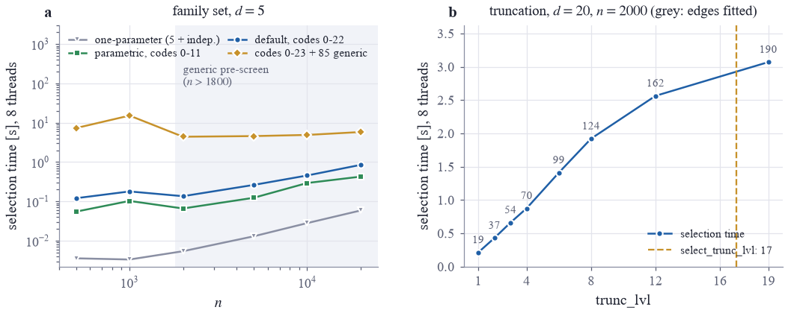
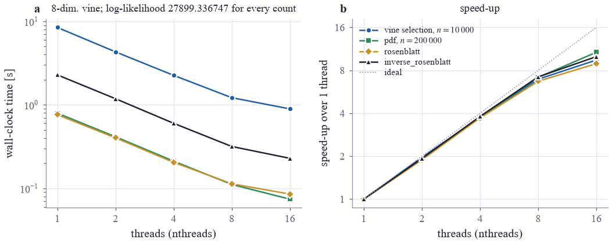

# Performance and threads

fortvine is parallelised with OpenMP and written so that results do not depend on the number
of threads. This page explains how the thread count is chosen, what runs in parallel, how to
build for speed, and which modelling options cost the most.

## How many threads

Every routine that can run in parallel resolves its thread count with `fv_threads(req)`:

1. `req > 0` (from `ctl%nthreads` or an `nthreads` argument): exactly that many threads;
2. otherwise the environment variable `FORTVINE_THREADS`, if it holds a positive integer;
3. otherwise half the number of logical processors reported by OpenMP
   (`max(1, omp_get_num_procs() / 2)`), and 1 if the library was built without OpenMP.

Half the logical CPUs is a deliberate default: on machines with simultaneous multithreading
it usually equals the number of physical cores, which is where the likelihood loops stop
scaling, and it leaves the rest of the machine responsive.

```bash
export FORTVINE_THREADS=8       # default for every call that does not set nthreads
```

| routine | thread count taken from |
|---|---|
| `fv_bicop%fit`, `%select`, `fv_vinecop%select`, `%relax` | `ctl%nthreads` |
| `fv_vinecop%pdf`, `%pdf_grid`, `%rosenblatt`, `%inverse_rosenblatt`, `%simulate` | optional `nthreads` argument |
| `fv_tau_mat`, `fv_pseudo_obs_nd` | optional `nthreads` argument |
| `fv_bicop%pdf`, `%logpdf`, `%hfunc1`, `%hfunc2`, `%hinv1`, `%hinv2` | `fv_threads()` (environment or default); parallel only above 4096 points |
| `fv_bicop%cdf` | the OpenMP default team (`OMP_NUM_THREADS`), not `fv_threads` |
| C interface | the `nthreads` argument of each routine |

## What runs in parallel

| operation | parallel over |
|---|---|
| pair-copula evaluation (pdf, h-functions, inverses) | observations (above 4096) |
| vine `pdf`, `pdf_grid`, Rosenblatt, inverse Rosenblatt | observations |
| one likelihood pass of a fit | 128 fixed blocks of observations |
| `fv_bicop%select` | candidates (family, rotation) |
| vine selection, per tree | tree criteria of candidate edges, then all (edge, candidate) fits as one job list, then the h-functions of the selected edges |
| Kendall's $\tau$ matrix | variable pairs |
| pseudo-observations | columns |

In selection the parallelism is nested. The outer team runs the (edge, candidate) jobs; a job
whose likelihood passes are large enough can borrow idle threads from a shared pool (at most
one per 2000 observations, a fair share of what is idle, reserved atomically so the budget in
`nthreads` is never exceeded). Short jobs run single-threaded; this keeps all threads busy
both at the start of a tree, when there are many jobs, and at its end, when a few slow fits
remain. Jobs are ordered cheapest-first and then longest-first, see
[Racing](fitting.md#racing-screen-then-polish).

### Results do not depend on the thread count

Every likelihood pass sums the contributions of 128 fixed blocks of observations in a fixed
order, whatever the number of threads, so log-likelihoods, scores and therefore the fitted
parameters and the selected model are **bit-identical** for any thread count (see the example
below). The randomisation of the discrete Rosenblatt transform uses a counter-based hash, so
it is reproducible as well. `simulate` uses the Fortran intrinsic random generator once, before
the parallel part, and is reproducible for a given `seed`.

## Building for speed

`build.sh` compiles with

```bash
FFLAGS="-O3 -march=native -funroll-loops -fno-math-errno -ffree-line-length-none -fopenmp"
```

plus `-cpp` (the family formulas are included through the preprocessor) and `-fPIC`. Notes:

* `-march=native` tunes for the build machine; the library may not run on older CPUs. For a
  library you distribute, override it: `FFLAGS="-O3 -funroll-loops -fno-math-errno -ffree-line-length-none -fopenmp" bash build.sh`.
* Without `-fopenmp` the library builds serially (all OpenMP code sits behind `!$`
  sentinels) and `fv_threads()` returns 1.
* Do not add `-ffast-math` or `-ffinite-math-only`: the code tests for NaN and infinity to
  reject failed evaluations (for example `x /= x`), and those tests are removed under
  finite-math assumptions.
* The `fpm.toml` manifest builds the same sources with `fpm build`; pass the flags with
  `--flag`.

Setting the environment variable `FORTVINE_PROFILE` (to any value) makes vine selection print
the time spent per tree on criteria, candidates, fits and h-functions, and the mBICv of every
threshold pass. It is meant for diagnosing slow selections.

## What costs time

Selection time is roughly (number of edges) $\times$ (candidates per edge) $\times$ (cost per
candidate). Each factor has a knob.

**Edges: truncate.** A vine has $d(d-1)/2$ edges, but trees beyond the first few are often
close to independence. `ctl%trunc_lvl = k` fits only $\sum_{t \le k} (d - t)$ edges;
`ctl%select_trunc = .true.` stops automatically when a tree no longer pays for itself;
`ctl%threshold` (or `select_threshold`) turns weak edges into independence without fitting
them. For $d = 50$, truncating after 5 trees keeps 235 of the 1225 edges.

**Candidates: keep the family set focused.** The default set has 23 families; adding all 85
generic families multiplies the candidate count by almost five. The pre-screen of generic
candidates (four per edge reach the full data) recovers most of that cost for $n > 1800$, but
not all. Keep `preselect = .true.`: whenever the tails of a pair are clearly asymmetric it
drops the rotations of a family that put its tail dependence in the wrong corner, before any
fit.

**Cost per candidate.**

* The five closed-form one-parameter families (Gaussian, Clayton, Gumbel, Frank, Joe) take a
  couple of passes over the data and are essentially free.
* Two-parameter BB-type families need a start grid and a few Newton passes; with $n > 1800$
  most of the work is done on a 600-row subsample.
* The Student copula (profile in $\nu$) and t-EV are the most expensive parametric fits; t-EV
  is not in the default set for that reason.
* TLL and Bernstein cost about as much as a slow parametric family, see
  [Nonparametric](nonparametric.md#cost).
* Discrete margins make every multi-parameter fit derivative-free and every observation two to
  four copula evaluations, see [Discrete data](discrete.md).

**Repeated work: cache it.** If you select several times on the same data (comparing
criteria, thresholds, family sets), enable the [fit cache](fitting.md#fit-cache); identical
pair fits are then looked up instead of recomputed.

**Prediction.** For predictive densities on a grid of one variable, use `pdf_grid` instead of
calling `pdf` on an expanded array; edges that do not involve the varying variable are
evaluated once per sample.

<figure markdown>
{ width="700" }
<figcaption>Two of the knobs, measured with the Python package and 8 threads (one run each;
timings depend on the machine). (a) Candidates: selection time of a five-dimensional vine (the
BB1 / Student D-vine of the [fitting example](fitting.md#example-what-the-options-cost)) for
four family sets. Each larger set costs a roughly constant factor; the 109-family set with the
generic codes is 7 times ($n = 20\,000$) to 80 times ($n = 1000$) slower than the default set, and *faster* above
$n = 1800$ than below, where the generic pre-screen on a 600-row subsample starts (shaded).
(b) Edges: selection time of a 20-dimensional vine ($n = 2000$, Kendall's $\tau$ fading from
0.5 in tree 1 to 0.03 from tree 5 on) against `trunc_lvl`, with the number of fitted edges in
grey; the time grows with the number of fitted edges. The dashed line is the level chosen by `select_trunc_lvl` (mBICv), which
here keeps 17 of the 19 trees because even $\tau = 0.03$ is detectable at $n = 2000$.</figcaption>
</figure>

## Example: thread scaling

```fortran
program perf_demo
  use fortvine_api
  use iso_fortran_env, only: int64
  implicit none
  integer, parameter :: dp = kind(1.0d0), n = 10000, d = 8
  type(fv_vinecop) :: truth, vc
  type(fv_controls) :: ctl
  real(dp) :: u(n, d)
  integer(int64) :: t0, t1, rate
  integer :: e, k, nt(4) = [1, 2, 4, 8]

  call truth%set_dvine([(e, e = 1, d)])
  truth%fam(1:d - 1, 1) = FV_GUMBEL; truth%par(1, 1:d - 1, 1) = 1.8_dp
  truth%fam(1:d - 2, 2) = FV_CLAYTON; truth%par(1, 1:d - 2, 2) = 0.8_dp
  call truth%simulate(n, u, seed=9)
  do k = 1, size(nt)
    ctl%nthreads = nt(k)
    call system_clock(t0, rate)
    call vc%select(u, ctl, fixed=.false.)
    call system_clock(t1)
    print '(a,i2,a,f7.2,a,f14.6)', 'nthreads', nt(k), ':', real(t1 - t0, dp) / rate, ' s   loglik', vc%loglik(u)
  end do
end program perf_demo
```

Output (an 8-dimensional vine, 10 000 observations, default family set; timings from one test
machine, compiled with `-O3 -march=native`):

```text
nthreads 1:  10.17 s   loglik  27197.910281
nthreads 2:   5.13 s   loglik  27197.910281
nthreads 4:   2.61 s   loglik  27197.910281
nthreads 8:   1.40 s   loglik  27197.910281
```

The selected vine, and with it the log-likelihood to the last printed digit, is the same for
every thread count.

<figure markdown>
{ width="700" }
<figcaption>The same program in Python, with 1, 2, 4, 8 and 16 threads (`num_threads`) on a
32-thread machine (8 performance cores with two threads each, 16 efficiency cores); the sample
comes from NumPy, so the numbers differ from the Fortran output above. (a) Wall-clock time of
the vine selection ($n = 10\,000$, one run) and of `pdf`, `rosenblatt` and `inverse_rosenblatt`
of the selected vine on 200 000 points (best of three). (b) Speed-up over one thread, with the
ideal line. Scaling is close to ideal up to 8 threads; at 16 threads, which share cores or run
on efficiency cores, selection reaches about 9 and the evaluations 9 to 10. The selected vine and
its log-likelihood (27899.336747) are identical for every thread count.</figcaption>
</figure>
