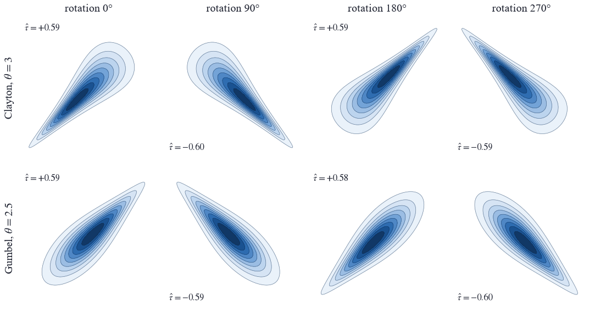
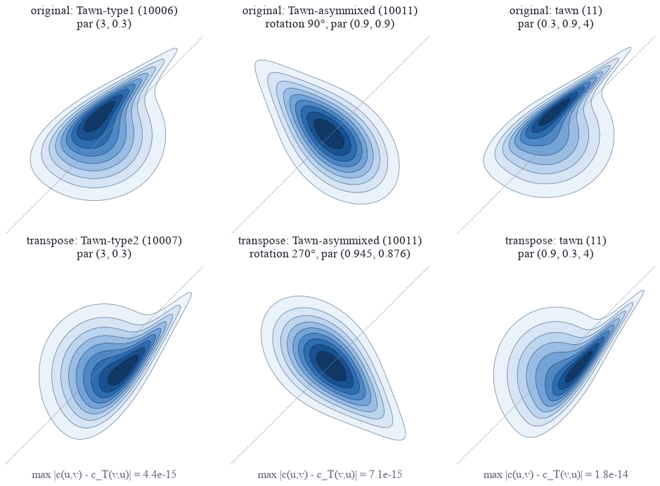

# Rotations and asymmetry

Many copula families can only express positive dependence, and many have tail dependence in
one corner only. Rotating the unit square extends each such family to the other three
corners; transposing it (swapping the two arguments) matters for families that are not
symmetric in their arguments. This page defines both operations exactly as fortvine
implements them.

## Definition

A rotation by $r \in \{0, 90, 180, 270\}$ degrees turns the data counter-clockwise, following
vinecopulib. With $c$ the density of the unrotated family, the rotated densities are

$$
c_{90}(u_1, u_2) = c(u_2,\, 1-u_1), \qquad
c_{180}(u_1, u_2) = c(1-u_1,\, 1-u_2), \qquad
c_{270}(u_1, u_2) = c(1-u_2,\, u_1),
$$

and the distribution functions

$$
C_{90}(u_1,u_2) = u_2 - C(u_2, 1-u_1),\quad
C_{180}(u_1,u_2) = u_1 + u_2 - 1 + C(1-u_1, 1-u_2),\quad
C_{270}(u_1,u_2) = u_1 - C(1-u_2, u_1).
$$

The h-functions follow by differentiation. Writing $(a, b)$ for the rotated point that is
passed to the unrotated family and $g_1, g_2$ for its h-functions there:

| rotation | $(a, b)$ | $h_1(u_1, u_2)$ | $h_2(u_1, u_2)$ |
|---:|---|---|---|
| 0 | $(u_1, u_2)$ | $g_1(a, b)$ | $g_2(a, b)$ |
| 90 | $(u_2, 1-u_1)$ | $g_2(a, b)$ | $1 - g_1(a, b)$ |
| 180 | $(1-u_1, 1-u_2)$ | $1 - g_1(a, b)$ | $1 - g_2(a, b)$ |
| 270 | $(1-u_2, u_1)$ | $1 - g_2(a, b)$ | $g_1(a, b)$ |

The inverse h-functions are mapped in the same way, so every rotated copula has exact
`hinv1` / `hinv2` and can be used in Rosenblatt transforms and simulation.

## Which families rotate

`rotation` is ignored by families that already cover both signs of dependence or are
radially symmetric:

| rotationless | codes |
|---|---|
| independence | 0 |
| Gaussian, Student | 1, 2 |
| Frank | 5 |
| Plackett, FGM, AMH | 12, 13, 14 |
| TLL, Bernstein (nonparametric; the estimate itself carries any orientation) | 24, 25 |

Every other family, including all [generic families](generic.md), accepts the four
rotations. The [catalogue](../families/catalogue.md) has a "rotations" column.

## Rotations, negative dependence and tails

A 90- or 270-degree rotation reverses the sign of concordance: if the unrotated family has
Kendall's $\tau > 0$, the rotated one has $-\tau$. A 180-degree rotation keeps $\tau$ and
moves tail dependence to the opposite corner (the *survival* copula). For a family whose tail
dependence sits at the lower-left corner (Clayton) or the upper-right corner (Gumbel, Joe),
the corners after rotation are:

| base tail | 0 | 90 | 180 | 270 |
|---|---|---|---|---|
| lower-left, $(0, 0)$ (Clayton type) | $(0,0)$ | $(1,0)$ | $(1,1)$ | $(0,1)$ |
| upper-right, $(1, 1)$ (Gumbel type) | $(1,1)$ | $(0,1)$ | $(0,0)$ | $(1,0)$ |

Here $(1, 0)$ means $u_1 \to 1$ while $u_2 \to 0$. Two-tailed families such as BB1 or BB7
carry both of their tails along.

<figure markdown>
{ width="700" }
<figcaption>The four rotations of Clayton ($\theta = 3$, top) and Gumbel ($\theta = 2.5$,
bottom), densities in normal scores $z = \Phi^{-1}(u)$ with $u_1$ on the horizontal axis.
The sharp tip of each density is its tail-dependent corner, at the positions of the table above:
Clayton's moves from $(0, 0)$ at 0° to $(1, 0)$, $(1, 1)$ and $(0, 1)$, Gumbel's from
$(1, 1)$ to $(0, 1)$, $(0, 0)$ and $(1, 0)$. $\hat\tau$ is Kendall's tau of 2000 pairs
$(u_1, h_1^{-1}(u_1, w))$ from the same uniforms in every panel: 90 and 270 degrees flip its
sign, 180 degrees keeps it.</figcaption>
</figure>

In selection, the sign of the sample $\tau$ decides which rotations are tried: 0 and 180 for
$\tau > 0$, 90 and 270 for $\tau < 0$. Preselection may then remove one of the two, depending
on where the data show stronger tail dependence
([details](fitting.md#preselection-by-tail-asymmetry)). With
`ctl%allow_rotations = .false.` only rotation 0 is used, so negatively dependent pairs can
only get rotationless families.

## Asymmetric families and edge flips

A copula is *exchangeable* if $C(u_1, u_2) = C(u_2, u_1)$. Most classical families are, but
some are not:

* Tawn (code 11) with $\psi_1 \neq \psi_2$;
* generic families with an asymmetric Pickands function (inner index `ie` = `mod(fam, 100)`
  from 5 to 13) and every Khoudraji wrapper (codes 20000 and above); `gen_exch(fam)` tells
  which;
* TLL and Bernstein estimates, which need not be symmetric.

For these the order of the arguments matters. Inside a vine the first argument of the pair
copula of edge $(e, t)$ is the variable `order(e)` (see
[Vine copulas](vinecop.md#how-the-structure-is-stored)). During selection fortvine builds the
trees from unordered edges and orients them only at the end, when the trees are converted to
the natural-order matrix. If that conversion needs an edge with its two variables swapped, the
fitted pair copula is replaced by its exact **transpose** $C^\top(u_1, u_2) = C(u_2, u_1)$,
not refitted:

| family | transpose |
|---|---|
| Tawn | swap $\psi_1 \leftrightarrow \psi_2$ (parameters 1 and 2) |
| TLL, Bernstein | transpose the density grid / cell-weight matrix |
| generic, asymmetric logistic / negative logistic (05, 08) | swap $\psi_1 \leftrightarrow \psi_2$ |
| generic, their types 1 and 2 (06 $\leftrightarrow$ 07, 09 $\leftrightarrow$ 10) | change the code, keep $(\theta, \psi)$ |
| generic, asymmetric mixed (11) | $(\theta, \phi) \mapsto (\theta + 3\phi, -\phi)$, then back to $(\theta, \kappa)$ |
| generic, Khoudraji-Husler-Reiss / Khoudraji-mixed (12, 13) | swap $a \leftrightarrow b$ |
| any Khoudraji wrapper ($k = 2$) | swap $a \leftrightarrow b$ |
| exchangeable families | nothing |

The rotation is transposed too: since $(C_{90})^\top = (C^\top)_{270}$ and vice versa, a
flipped edge with rotation 90 becomes 270 and the other way round; 0 and 180 stay. The routine
for the generic families is the public `gen_flip(fam, par)`, which may change both the code and
the parameters in place (Python: `fv.gen_flip(family, parameters)` returns the new code and
parameters; R: `gen_flip(model)` returns the transposed `bicop_dist`, with 90 and 270 swapped).

!!! note "Why the transpose is exact"
    For the outer generator nothing changes (it is symmetric in $s$ and $t$). For the Pickands
    part, transposition maps $A(w)$ to $A(1-w)$; the asymmetric logistic models swap their
    asymmetry weights, and the asymmetric mixed model
    $A(w) = 1 - (\theta+\phi)w + \theta w^2 + \phi w^3$ becomes the same polynomial with
    $\theta' = \theta + 3\phi$, $\phi' = -\phi$. For the Khoudraji construction
    $C_K(u,v) = u^{1-a}v^{1-b}C(u^a, v^b)$ with exchangeable $C$, swapping the arguments is
    the same as swapping $a$ and $b$.

<figure markdown>
{ width="640" }
<figcaption>Top: three asymmetric copulas, Tawn type 1 (10006), the asymmetric mixed model
(10011) rotated by 90 degrees and the hand-coded Tawn (11), densities in normal scores with the
diagonal $u_1 = u_2$ dotted. Bottom: their transposes, from `gen_flip` for the generic codes
(type 1 becomes type 2 with the same parameters; 10011 gets new $(\theta, \kappa)$ and rotation
270) and by swapping $\psi_1, \psi_2$ for Tawn. Each bottom density is the top one mirrored
across the diagonal; the largest difference of $c(u, v)$ and $c^\top(v, u)$ over 1000 random
points is printed below each column.</figcaption>
</figure>

If you build a vine by hand with asymmetric pair copulas, you are responsible for the
orientation: the copula you assign to edge $(e, t)$ is applied with `order(e)` as its first
argument.

## Example

=== "Fortran"

    ```fortran title="rot_demo.f90"
    program rot_demo
      use fortvine_api
      implicit none
      integer, parameter :: dp = kind(1.0d0), n = 2000
      type(fv_bicop) :: c, t
      real(dp) :: u(4) = [0.1_dp, 0.3_dp, 0.6_dp, 0.95_dp], v(4) = [0.7_dp, 0.2_dp, 0.9_dp, 0.4_dp]
      real(dp) :: p1(4), p2(4), x1(n), x2(n), w(n)
      integer :: r, k, i, fams(3) = [FV_TAWN, 10011, 10006]
      real(dp) :: pars(3, 3)

      ! Kendall's tau of a Clayton(3) sample under each rotation
      c%family = FV_CLAYTON; c%par(1) = 3.0_dp
      call random_seed(put=[(i, i = 1, 33)])
      call random_number(x1); call random_number(w)
      do r = 0, 270, 90
        c%rotation = r
        call c%hinv1(x1, w, x2)
        print '(a,i4,a,f7.3)', 'rotation', r, ':  tau =', fv_kendall_tau(x1, x2)
      end do

      ! exact transpose of asymmetric families: c_T(u, v) = c(v, u), also under rotation 90 <-> 270
      pars(:, 1) = [0.4_dp, 0.9_dp, 3.0_dp]; pars(:, 2) = [0.6_dp, 0.3_dp, 0.0_dp]; pars(:, 3) = [2.5_dp, 0.4_dp, 0.0_dp]
      do k = 1, 3
        c%family = fams(k); c%par = pars(:, k); c%rotation = 90
        t = c
        if (t%family == FV_TAWN) then
          t%par(1:2) = c%par([2, 1])                      ! Tawn: swap psi1 and psi2
        else
          call gen_flip(t%family, t%par)                  ! generic families
        end if
        t%rotation = 270
        call c%pdf(u, v, p1); call t%pdf(v, u, p2)
        print '(5a,es9.2)', 'transpose of ', trim(fv_fam_name(c%family)), ' is ', trim(fv_fam_name(t%family)), &
          ': max |c(u,v) - c_T(v,u)| =', maxval(abs(p1 - p2))
      end do
    end program rot_demo
    ```

=== "Python"

    ```python title="rot_demo.py"
    import numpy as np
    import fortvine as fv

    n = 2000
    uv = np.array([[0.1, 0.7], [0.3, 0.2], [0.6, 0.9], [0.95, 0.4]])

    # Kendall's tau of a Clayton(3) sample under each rotation
    rng = np.random.default_rng(1)
    x1, w = rng.random(n), rng.random(n)
    for r in (0, 90, 180, 270):
        c = fv.Bicop("clayton", r, [3.0])
        x2 = c.hinv1(np.column_stack([x1, w]))
        print(f"rotation{r:4d}:  tau ={fv.kendall_tau(x1, x2):7.3f}")

    # exact transpose of asymmetric families: c_T(u, v) = c(v, u), also under rotation 90 <-> 270
    for fam, par in [("tawn", [0.4, 0.9, 3.0]), (10011, [0.6, 0.3]), (10006, [2.5, 0.4])]:
        c = fv.Bicop(fam, 90, par)
        if c.family == "tawn":
            tfam, tpar = c.family_code, c.parameters[[1, 0, 2]]     # Tawn: swap psi1 and psi2
        else:
            tfam, tpar = fv.gen_flip(c.family_code, c.parameters)   # generic families
        t = fv.Bicop(tfam, 270, tpar)
        err = np.max(np.abs(c.pdf(uv) - t.pdf(uv[:, ::-1])))
        print(f"transpose of {c.family} is {t.family}: max |c(u,v) - c_T(v,u)| ={err:9.2E}")
    ```

=== "R"

    ```r title="rot_demo.R"
    library(fortvine)
    n <- 2000
    uv <- rbind(c(0.1, 0.7), c(0.3, 0.2), c(0.6, 0.9), c(0.95, 0.4))

    # Kendall's tau of a Clayton(3) sample under each rotation
    set.seed(1)
    x1 <- runif(n); w <- runif(n)
    for (r in c(0, 90, 180, 270)) {
      x2 <- hbicop(cbind(x1, w), 1, bicop_dist("clayton", r, 3), inverse = TRUE)
      cat(sprintf("rotation%4d:  tau =%7.3f\n", r, cor(x1, x2, method = "kendall")))
    }

    # exact transpose of asymmetric families: c_T(u, v) = c(v, u), also under rotation 90 <-> 270
    models <- list(bicop_dist("tawn", 90, c(0.4, 0.9, 3)), bicop_dist(10011, 90, c(0.6, 0.3)),
                   bicop_dist(10006, 90, c(2.5, 0.4)))
    for (cop in models) {
      tr <- if (cop$family == "tawn") {
        bicop_dist("tawn", 270, cop$parameters[c(2, 1, 3)])   # Tawn: swap psi1 and psi2
      } else {
        gen_flip(cop)                                         # generic families (rotation 90 -> 270)
      }
      err <- max(abs(dbicop(uv, cop) - dbicop(uv[, 2:1], tr)))
      cat(sprintf("transpose of %s is %s: max |c(u,v) - c_T(v,u)| =%9.2E\n", cop$family, tr$family, err))
    }
    ```

Output:

=== "Fortran"

    ```text
    rotation   0:  tau =  0.620
    rotation  90:  tau = -0.594
    rotation 180:  tau =  0.612
    rotation 270:  tau = -0.614
    transpose of tawn is tawn: max |c(u,v) - c_T(v,u)| = 4.44E-16
    transpose of Tawn-asymmixed is Tawn-asymmixed: max |c(u,v) - c_T(v,u)| = 1.11E-15
    transpose of Tawn-type1 is Tawn-type2: max |c(u,v) - c_T(v,u)| = 4.44E-16
    ```

=== "Python"

    ```text
    rotation   0:  tau =  0.586
    rotation  90:  tau = -0.602
    rotation 180:  tau =  0.588
    rotation 270:  tau = -0.593
    transpose of tawn is tawn: max |c(u,v) - c_T(v,u)| = 8.88E-16
    transpose of Tawn-asymmixed is Tawn-asymmixed: max |c(u,v) - c_T(v,u)| = 1.11E-15
    transpose of Tawn-type1 is Tawn-type2: max |c(u,v) - c_T(v,u)| = 4.44E-16
    ```

=== "R"

    ```text
    rotation   0:  tau =  0.595
    rotation  90:  tau = -0.596
    rotation 180:  tau =  0.586
    rotation 270:  tau = -0.599
    transpose of tawn is tawn: max |c(u,v) - c_T(v,u)| = 8.88E-16
    transpose of Tawn-asymmixed is Tawn-asymmixed: max |c(u,v) - c_T(v,u)| = 1.11E-15
    transpose of Tawn-type1 is Tawn-type2: max |c(u,v) - c_T(v,u)| = 4.44E-16
    ```

The theoretical $\tau$ of Clayton(3) is $3/5 = 0.6$; the four samples differ only by sampling
noise and sign (and between the languages, which draw different uniforms). The last three lines confirm that the transposed, 270-degree copula evaluated
at swapped arguments equals the original 90-degree copula to rounding.
