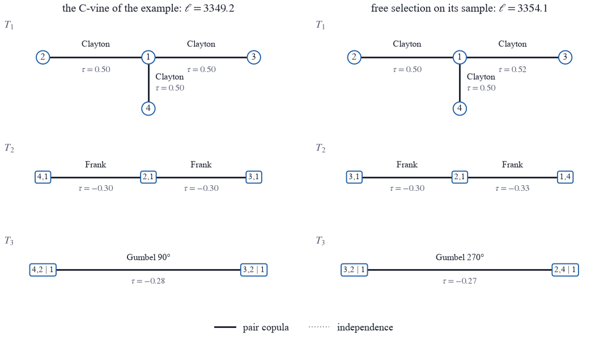
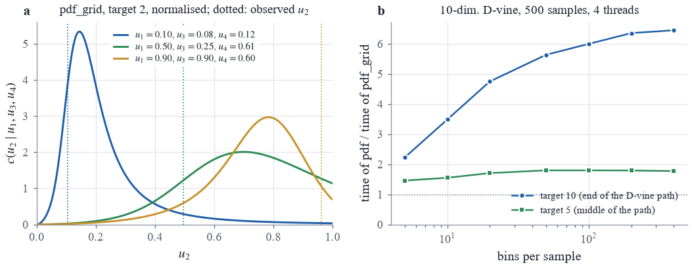
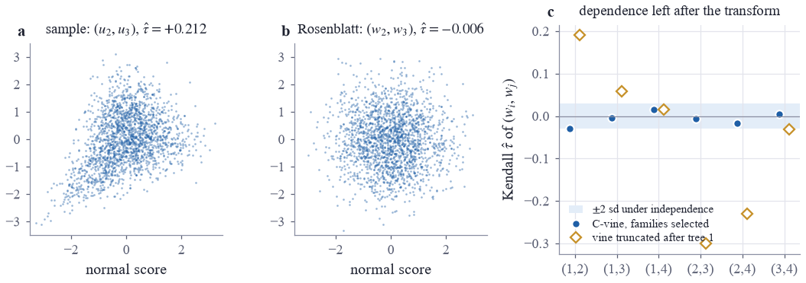
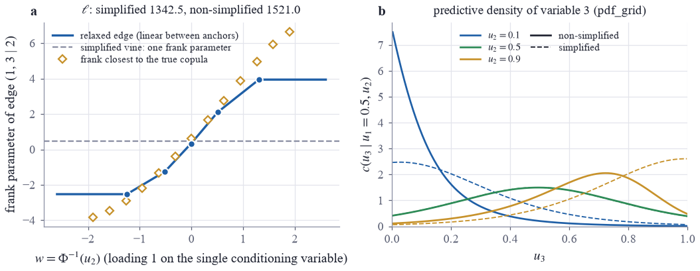

# Vine copulas (`fv_vinecop`)

A regular vine (R-vine) copula builds a $d$-dimensional copula from $d(d-1)/2$ bivariate
pair copulas arranged on a nested sequence of trees $T_1, \dots, T_{d-1}$ (Bedford & Cooke
2002; Aas et al. 2009). Edge $e$ of tree $t$ links two variables *conditionally* on $t-1$
others, and its pair copula is applied to conditional distribution functions computed from the
trees below. `fv_vinecop` stores such a model and provides selection, density, Rosenblatt
transforms and simulation.

## Fields

| field | type | meaning |
|---|---|---|
| `d` | `integer` | dimension |
| `trunc` | `integer` | number of trees actually stored; edges of trees `> trunc` are independence |
| `order(d)` | `integer, allocatable` | structure order (variable labels, 1-based) |
| `st(d, d)` | `integer, allocatable` | natural-order structure array, `st(edge, tree)` |
| `fam(d, d)`, `rot(d, d)` | `integer, allocatable` | family code and rotation of edge `(e, t)` |
| `par(3, d, d)` | `real(dp), allocatable` | parameters of edge `(e, t)` in `par(:, e, t)` |
| `edge_ll(d, d)` | `real(dp), allocatable` | log-likelihood of each edge at selection time |
| `aux(:, d, d)` | `real(dp), allocatable` | nonparametric estimates; first extent `NAUX` if the family set contained TLL/Bernstein, else 1 |
| `disc(d)` | `logical, allocatable` | discrete variables (original labels), set by `select` |
| `threshold` | `real(dp)` | threshold used by the last `select` |
| `nrel`, `erel`, `wa`, `wk`, `pk` | | non-simplified edges added by [`relax`](#non-simplified-edges-relax) |

Only edges with `t <= trunc` and `e <= d - t` are meaningful.

## How the structure is stored

The vine is described by two arrays, in the natural-order convention of vinecopulib:

* `order(1:d)` is a permutation of the variable labels.
* For tree `t` and edge `e` (`1 <= e <= d - t`) the edge joins the variables
  `order(e)` and `order(st(e, t))`, conditionally on `order(st(e, 1))`, ...,
  `order(st(e, t-1))`.

The pair copula of edge `(e, t)` is evaluated as
$c\big(u_{\,\text{order}(e) \mid D},\; u_{\,\text{order}(\text{st}(e,t)) \mid D}\big)$: the
variable `order(e)` is its **first** argument. For exchangeable families this does not
matter; for asymmetric ones (Tawn, the Khoudraji and asymmetric extreme-value members of the
generic engine) it does, see [Rotations and asymmetry](rotations.md#asymmetric-families-and-edge-flips).

`vc%matrix()` converts this into the R-vine matrix of vinecopulib in original labels:
row `t` of column `e` holds `order(st(e, t))`, and the anti-diagonal holds `order`
(`m(d - j + 1, j) = order(j)`).

## Creating a vine

| method | what it does |
|---|---|
| `init(d)` | allocates every array for dimension `d`, sets `order = [1, ..., d]`, every edge to independence and `trunc = 0` (an empty structure) |
| `set_dvine(order [, trunc])` | a D-vine (path) in the given order: tree 1 links `order(1)-order(2)`, `order(2)-order(3)`, ... |
| `set_cvine(order [, trunc])` | a C-vine (star in every tree). The root of tree `t` is `order(d - t + 1)`: the **last** element of `order` is the first root |

Both `set_*` routines call `init` first, so they discard any families set before. `trunc`
(default `d - 1`) limits the number of trees.

!!! warning "C-vine root order"
    `set_cvine([1, 2, 3, 4])` makes variable 4 the root of tree 1, 3 the root of tree 2 and
    so on. To make variable 1 the first root, pass the order reversed: `set_cvine([4, 3, 2, 1])`.

### Setting families and parameters by hand

After `set_dvine` / `set_cvine` (or `init` plus your own `order`, `st` and `trunc`), assign the
pair copulas directly:

=== "Fortran"

    ```fortran
    call vc%set_dvine([1, 2, 3, 4])
    vc%fam(1:3, 1) = FV_GUMBEL; vc%par(1, 1:3, 1) = 2.0_dp          ! tree 1: (1,2), (2,3), (3,4)
    vc%fam(1:2, 2) = FV_FRANK;  vc%par(1, 1:2, 2) = 3.0_dp          ! tree 2: (1,3|2), (2,4|3)
    vc%fam(1, 3) = FV_CLAYTON; vc%rot(1, 3) = 90; vc%par(1, 1, 3) = 1.5_dp
    ```

=== "Python"

    ```python
    vc = fv.Vinecop().set_dvine([1, 2, 3, 4])                   # arrays are indexed [tree, edge] from 0
    for e in range(3):
        vc.set_pair_copula(0, e, fv.Bicop("gumbel", 0, [2.0]))  # tree 1: (1,2), (2,3), (3,4)
    for e in range(2):
        vc.set_pair_copula(1, e, fv.Bicop("frank", 0, [3.0]))   # tree 2: (1,3|2), (2,4|3)
    vc.set_pair_copula(2, 0, fv.Bicop("clayton", 90, [1.5]))    # tree 3: (1,4|2,3)
    ```

=== "R"

    ```r
    pcs <- list(rep(list(bicop_dist("gumbel", 0, 2)), 3),       # tree 1: (1,2), (2,3), (3,4)
                rep(list(bicop_dist("frank", 0, 3)), 2),        # tree 2: (1,3|2), (2,4|3)
                list(bicop_dist("clayton", 90, 1.5)))           # tree 3: (1,4|2,3)
    vc <- vinecop_dist(pcs, dvine_structure(1:4))
    ```

Such a model can be evaluated, transformed and simulated straight away. Python also has
`set_cvine`; R builds D- and C-vine structures (`dvine_structure()`, `cvine_structure()`), or
takes the structure of a selected vine (`fit$structure`). For a nonparametric
edge, allocate `vc%aux(NAUX, d, d)` yourself (`init` only allocates a first extent of 1) and
copy the `aux` vector of a fitted `fv_bicop` into `vc%aux(:, e, t)`.

## Selection

=== "Fortran"

    ```fortran
    call vc%select(u, ctl, fixed, info, weights, discrete, u_minus)
    ```

=== "Python"

    ```python
    vc = fv.Vinecop.from_data(u, family_set=None, criterion="bic", trunc_lvl=None, threshold=0.0,
                              tree_criterion="tau", tree_algorithm="prim", num_threads=1,
                              weights=None, var_types=None)
    vc.select(u, fixed=True)            # on a Vinecop that holds a structure
    ```

=== "R"

    ```r
    vc <- vinecop(u, family_set = "all", structure = NA, selcrit = "bic", trunc_lvl = Inf,
                  threshold = 0, tree_crit = "tau", tree_algorithm = "mst_prim", cores = 1,
                  weights = numeric(), var_types = NULL)
    ```

`u(n, d)` are pseudo-observations; every other argument is optional (the controls are
keyword arguments in Python and R). `select` chooses the
structure (unless it is fixed), then the family, rotation and parameters of every edge.

### The Dissmann algorithm

With a free structure, selection proceeds tree by tree (Dissmann et al. 2013):

1. **Candidate edges.** In tree 1 every pair of variables is a candidate. In tree $t \ge 2$
   the vertices are the edges of tree $t-1$, and two of them may be joined only if they share
   a vertex in tree $t-1$ (the proximity condition), which guarantees a valid R-vine.
2. **Edge weights.** Each candidate gets the absolute value of the tree criterion
   `ctl%tree_crit` (Kendall's $\tau$ by default) of its two pseudo-observation columns.
3. **Spanning tree.** The tree with the largest total weight is found with Prim's
   (default) or Kruskal's algorithm (`ctl%tree_algo`).
4. **Pair copulas.** For every kept edge the family, rotation and parameters are selected as
   in [`fv_bicop%select`](bicop.md#selecting-the-family), with all (edge, candidate) fits of
   the tree running in parallel.
5. **Next tree's data.** The h-functions of the fitted pair copulas give the conditional
   pseudo-observations on which tree $t+1$ is built.

Selecting the tree by dependence strength first places the strongest dependencies in the low
trees, where estimation error propagates least. The tree criteria available are listed in
[Controls](controls.md#tree_crit).

<figure markdown>
{ width="700" }
<figcaption>Left: the C-vine of the [example](#example) (Clayton $\theta = 2$ in tree 1, Frank
$\theta = -3$ in tree 2, Gumbel 90° in tree 3), drawn tree by tree; the nodes of tree $t \ge 2$
are the edges of tree $t - 1$ (conditioned pair | conditioning set). Right: `select` with a free
structure on 2000 draws from it (Python `Vinecop.from_data`). The Dissmann algorithm recovers
the star around variable 1 and the second tree; the last edge is the same copula with its
arguments in the other order, hence Gumbel 270° instead of 90°. Edge labels give the family and
Kendall's $\tau$ of each pair copula; $\ell$ is the log-likelihood on the sample.</figcaption>
</figure>

### Fixed structure

Pass `fixed = .true.` to keep the stored structure and select only the pair copulas. When
`fixed` is absent it defaults to `.true.` **whenever the object already holds a structure**
(`trunc > 0`), for example after `set_dvine`, `set_cvine` or a previous `select`.

!!! warning "Re-selecting with the same object"
    Calling `vc%select(u, ctl)` a second time on an already selected vine keeps the first
    structure and its truncation level. To search the structure again, either use a fresh
    `fv_vinecop`, call `vc%init(d)` first, or pass `fixed = .false.`.

### Truncation

A truncated vine sets every pair copula above tree $k$ to independence, which removes
$\binom{d-k}{2}$ edges and can make high-dimensional models much cheaper.

* `ctl%trunc_lvl = k` stops after tree `k` (`-1`, the default, means `d - 1`).
* `ctl%select_trunc = .true.` lets the data decide: after each tree, the mBICv of that tree
  is compared with the mBICv of an all-independence tree $t$, and selection stops at the
  first tree that does not improve on it (as vinecopulib's `select_trunc_lvl`).

The level reached is stored in `vc%trunc`.

### Thresholding

`ctl%threshold = c` (default 0) declares every edge whose tree criterion is below `c` an
independence edge without fitting it; such edges also get the weight of an independent pair
in the spanning-tree step. `ctl%select_threshold = .true.` chooses `c` by mBICv: starting from
$c = 1$ (every edge independent), each pass lowers $c$ to the $\lceil 5\% \rceil$-th largest
criterion among the edges still below it, reselects the vine and accumulates its mBICv over
the trees; the search stops when the mBICv no longer decreases or $c < 0.01$, and the best
vine is kept (vinecopulib's `select_threshold`, Nagler et al. 2019). All passes share pair
fits through the [fit cache](fitting.md#fit-cache), which is switched on for the search if you
have not enabled it. With weights, the mBICv uses the effective sample size
$(\sum w_i)^2 / \sum w_i^2$. The chosen value is returned in `vc%threshold`.

Combining `select_threshold` with `select_trunc` applies vinecopulib's truncation rule inside
each pass.

### Other options

* `weights(n)`: observation weights for every pair fit and for the weighted tree criteria
  (tau, rho, joe; the other criteria ignore weights). Python and R: `weights`.
* `discrete(d)`, `u_minus(n, d)`: discrete or mixed margins, see
  [Discrete and mixed data](discrete.md). `u_minus` is required when any variable is
  discrete. Python and R: `var_types` (`"c"` or `"d"` per variable), with the $F(x^-)$
  columns of the discrete variables appended to the data.
* `info`: 0 on success. Non-zero values (2, 3, 4) mean that the internal spanning-tree or
  tree-to-matrix step failed; they are not expected for valid input and indicate a bug.

`select` removes any non-simplified edges (it calls `unrelax`).

## Density and log-likelihood

=== "Fortran"

    ```fortran
    call vc%pdf(u, dens)                ! dens(n)
    ll = vc%loglik(u)                   ! sum(log(dens))
    call vc%pdf_grid(ug, tgt, out)      ! ug(d, bins, n), out(bins, n)
    ```

=== "Python"

    ```python
    dens = vc.pdf(u)                    # dens[n]
    ll = vc.loglik(u)                   # sum(log(dens))
    out = vc.pdf_grid(ug, tgt)          # ug[n, bins, d], out[n, bins]
    ```

=== "R"

    ```r
    dens <- dvinecop(u, vc)             # dens[n]
    ll <- sum(log(dens))
    out <- dvinecop_grid(u, vc, tgt, grid)   # variable tgt of each row set to grid[b]; out[n, bins]
    ```

`pdf` evaluates the joint copula density at every row of `u(n, d)`; `loglik` is the sum of
its logarithms. With discrete variables both need `u_minus`.

`pdf_grid` is designed for predictive densities: `ug(d, bins, n)` holds, for each of `n`
samples, `bins` points that differ only in variable `tgt` (1-based label). Edges whose inputs
do not involve `tgt` are evaluated once per sample rather than once per bin, which saves most
of the work when only one variable varies. The result is `out(bins, n)`. With discrete
variables pass the matching `ugm(d, bins, n)` of $F(x^-)$ values.

<figure markdown>
{ width="700" }
<figcaption>(a) Predictive densities from `pdf_grid` with target 2 on 200 bins, for the vine
selected on the fixed C-vine structure of the example and three of its samples (other
variables held at their observed values). As a function of $u_2$ the joint density is
proportional to the conditional density $c(u_2 \mid u_1, u_3, u_4)$, so each curve is divided by
its integral; the dotted lines are the observed $u_2$. (b) Time of `pdf` on the expanded
$(n \cdot \text{bins}, d)$ array divided by the time of `pdf_grid` on the same points, for a
10-dimensional D-vine (500 samples, 4 threads). For the end variable of the path (10) only 9 of
the 45 edges depend on it and `pdf_grid` is up to 6.5 times faster; for a variable in the
middle (5) more edges involve it and the gain is about 2.</figcaption>
</figure>

## Rosenblatt transform and simulation

The Rosenblatt transform maps a sample of the copula to independent uniforms (Rosenblatt
1952); its inverse maps independent uniforms to a sample of the copula.

=== "Fortran"

    ```fortran
    call vc%rosenblatt(u, w)            ! u(n, d) -> w(n, d)
    call vc%inverse_rosenblatt(w, u)    ! w(n, d) -> u(n, d)
    call vc%simulate(n, u, seed=42)     ! u(n, d) drawn from the vine
    ```

=== "Python"

    ```python
    w = vc.rosenblatt(u)                # u(n, d) -> w(n, d)
    u = vc.inverse_rosenblatt(w)        # w(n, d) -> u(n, d)
    u = vc.simulate(n, seed=42)         # u(n, d) drawn from the vine
    ```

=== "R"

    ```r
    w <- rosenblatt(u, vc)              # u (n x d) -> w (n x d)
    u <- inverse_rosenblatt(w, vc)      # w (n x d) -> u (n x d)
    set.seed(42)
    u <- rvinecop(n, vc)                # u (n x d) drawn from the vine
    ```

The conditioning order follows the structure. The variable `order(d)` is returned unchanged,
and the others are replaced by conditional distribution functions given variables that come
after them in `order`; for a D-vine with order $(1, \dots, d)$ the output is
$w_d = u_d$, $w_{d-1} = F(u_{d-1} \mid u_d)$, ..., $w_1 = F(u_1 \mid u_2, \dots, u_d)$.
The columns of `w` keep the original variable labels.

<figure markdown>
{ width="700" }
<figcaption>The Rosenblatt transform as a goodness-of-fit check, on the 2000 draws of the
example's C-vine. (a) Variables 2 and 3 of the sample, in normal scores. (b) The same columns
after `rosenblatt` under the vine selected on the C-vine structure: no dependence is left.
(c) Kendall's $\tau$ of every pair of transformed columns, under that vine (blue) and under a
vine truncated after tree 1 (gold). Under a correct model the $w_j$ are independent and the
$\hat\tau$ stay inside the band of $\pm 2$ standard deviations of $\hat\tau$ for independent
data; the truncated vine ignores the Frank and Gumbel edges of trees 2 and 3, and the dependence
they carry remains in $w$.</figcaption>
</figure>

`simulate(n, out, seed, nthreads)` draws `w` with the Fortran intrinsic `random_number` and
applies `inverse_rosenblatt`. If `seed` is given, it reseeds the intrinsic generator
(which changes the generator state of the calling program too); without `seed` the current
state is used. Python's `simulate(n, seed)` draws its uniforms with NumPy and R's
`rvinecop()` with `runif()` (so `set.seed()` applies), which gives other samples than
the Fortran generator.

With discrete variables `rosenblatt` returns Brockwell's randomised transform by default, see
[Discrete and mixed data](discrete.md#rosenblatt-transform).

## Counting parameters

`npars_eff()` sums the parameters of all edges up to `trunc`, using the effective degrees of
freedom for nonparametric edges and `(NK - 1)` extra parameter sets per non-simplified edge;
`npars()` is its rounded value.

## Inspecting a vine

`vc%print([unit])` writes the dimension, truncation level, order and one line per edge
(family name, rotation, parameters) to `unit` (default 6). Generic family names are cut to 12
characters in this listing; use `fv_fam_name(vc%fam(e, t))` for the full name.

`vc%matrix()` returns the `d x d` R-vine matrix described [above](#how-the-structure-is-stored)
(Python: `vc.matrix`; R: `as_rvine_matrix(vc)`).

## Non-simplified edges (`relax`)

Most vine models assume that the pair copulas of trees $t \ge 2$ do not depend on the values of
their conditioning variables (the simplifying assumption, Haff et al. 2010; Spanhel & Kurz
2019). `relax` lifts that assumption edge by edge, in the spirit of local likelihood
estimation of conditional copulas (Acar, Craiu & Yao 2011):

=== "Fortran"

    ```fortran
    call vc%relax(u, tgt, mode, ctl [, weights, nrel_out])
    ```

=== "Python"

    ```python
    vc.relax(u, target=0, mode="test", weights=None)   # mode="all": every eligible edge
    vc.nrel, vc.relaxed_edges                          # count; (tree, edge), 0-based
    p = vc.rel_params(u)                               # (n, nrel, 3) parameters at each sample
    vc.unrelax()
    ```

=== "R"

    ```r
    rel <- vinecop_relax(vc, u, tgt = 0, mode = 1)     # mode = 2: every eligible edge
    rel$relaxed$erel                                   # edge (row 1) and tree (row 2)
    p <- vinecop_rel_params(rel, u)                    # n x nrel x 3 parameters at each sample
    un <- vinecop_unrelax(rel, u)                      # delete the relaxed edges
    ```

For every parametric edge of tree $t \ge 2$ whose conditioned pair contains variable `tgt`
(`tgt = 0`: any edge) and whose conditioning set $D$ does not:

1. $w$ is the first principal component of the normal scores $\Phi^{-1}(u_j)$, $j \in D$
   (loadings stored in `wa`).
2. The edge's family is fitted with Gaussian kernel weights in the rank of $w$ (bandwidth
   0.15 in rank units) at five anchors, the 10, 30, 50, 70 and 90 % quantiles of $w$
   (values in `wk`, parameters in `pk`). Between anchors the parameters are interpolated
   linearly in $w$, beyond them held constant.
3. `mode = 2` relaxes every eligible edge. `mode = 1` relaxes only those for which a test of
   constant conditional correlation rejects at the 5 % level: the Fisher-$z$ heterogeneity of
   the normal-score correlation across the quartiles of $w$, with a null distribution from 99
   circular shifts of $w$ (which preserves serial dependence; after Kurz & Spanhel 2022).
4. An independence edge that is relaxed becomes Gaussian. Edges of later trees are refitted
   (same families) on the conditional data that the relaxed edges now produce.

`nrel_out` returns the number of relaxed edges. `relax` does nothing if `trunc < 2` or any
variable is discrete. `vc%rel_params(uc)` returns the per-sample parameters
`prel(3, nrel, n)` of the relaxed edges for samples `uc(d, n)`.

<figure markdown>
{ width="700" }
<figcaption>The non-simplified example of the [Python page](../python.md#non-simplified-vines):
three variables whose copula of $(U_1, U_3)$ given $U_2$ is Gaussian with correlation
$-0.6 + 1.4\,u_2$, selected as a D-vine and then relaxed with `mode = 1` (the test relaxes the
single tree-2 edge). (a) The Frank parameter of edge (1, 3 | 2) at the five anchors `wk` (dots)
with the linear interpolation between them and the constant beyond, the single parameter of
the simplified vine (dashed) and, for reference, the Frank copula fitted to 20 000 draws of
the true conditional Gaussian copula at each $u_2$ (diamonds). The log-likelihood rises by 179.
(b) Predictive density of $u_3$ at $u_1 = 0.5$ for three values of $u_2$ (`pdf_grid`, target 3):
in the non-simplified vine (solid) the dependence between $u_1$ and $u_3$ changes sign with
$u_2$; the simplified vine (dashed) applies the same edge copula for every $u_2$, so its curves
differ only through the tree-1 edges.</figcaption>
</figure>

Which methods honour relaxed edges:

| method | uses the $w$-dependent parameters |
|---|---|
| `pdf`, `loglik`, `pdf_grid` | yes |
| `rosenblatt`, `inverse_rosenblatt`, `simulate` | **no**: they use `par`, which `relax` sets to the parameters at the middle anchor |
| `npars`, `npars_eff`, `print` | yes (counted / listed) |

!!! warning "`unrelax` does not restore the original fit"
    `vc%unrelax()` only deletes the relaxed-edge records. The parameters `relax` wrote (the
    middle-anchor values of relaxed edges, Gaussian instead of independence, refitted later
    trees) stay in `fam` and `par`. Keep a copy of the vine (`saved = vc`) if you want to go
    back to the simplified model.

!!! note "pdf_grid after relax"
    `pdf_grid` takes the conditioning values of the relaxed edges from the first bin of each
    sample. That is exact when `tgt` of `pdf_grid` was also the `tgt` passed to `relax` (then
    no relaxed edge conditions on it); with `relax(..., tgt = 0, ...)` it is an approximation.

## Example

=== "Fortran"

    ```fortran title="vine_demo.f90"
    program vine_demo
      use fortvine_api
      implicit none
      integer, parameter :: dp = kind(1.0d0), n = 2000, d = 4
      type(fv_vinecop) :: cv, fitd, free
      type(fv_controls) :: ctl
      real(dp) :: u(n, d), r(n, d), back(n, d), ug(d, 3, 2), dens(3, 2)
      integer :: m(d, d), i, k

      ! a C-vine written by hand; set_cvine roots tree t at order(d - t + 1)
      call cv%set_cvine([4, 3, 2, 1])                 ! roots: variable 1, then 2, then 3
      cv%fam(1:3, 1) = FV_CLAYTON; cv%par(1, 1:3, 1) = 2.0_dp
      cv%fam(1:2, 2) = FV_FRANK;   cv%par(1, 1:2, 2) = -3.0_dp
      cv%fam(1, 3) = FV_GUMBEL; cv%rot(1, 3) = 90; cv%par(1, 1, 3) = 1.4_dp
      m = cv%matrix()
      print '(a)', 'R-vine matrix (original labels):'
      do i = 1, d
        print '(4i3)', m(i, :)
      end do
      call cv%simulate(n, u, seed=11)

      ! Rosenblatt transform and its inverse
      call cv%rosenblatt(u, r); call cv%inverse_rosenblatt(r, back)
      print '(a,es9.2)', 'max round-trip error:', maxval(abs(back - u))

      ! keep the C-vine structure, let select choose families and parameters
      ctl%nthreads = 4
      call fitd%set_cvine([4, 3, 2, 1])
      call fitd%select(u, ctl)                          ! fixed = .true. by default here
      do k = 1, d - 1
        print '(a,i0,a,*(1x,a))', 'tree ', k, ':', (trim(fv_fam_name(fitd%fam(i, k))), i = 1, d - k)
      end do

      ! a free structure search, truncated after the first tree
      ctl%trunc_lvl = 1
      call free%select(u, ctl)
      print '(a,i0,a,f10.2,a,f10.2,a)', 'trunc = ', free%trunc, '   loglik', free%loglik(u), &
        '   (full C-vine:', fitd%loglik(u), ')'

      ! conditional density of variable 2 on a 3-point grid, other variables fixed per sample
      ug(:, :, 1) = 0.3_dp; ug(:, :, 2) = 0.7_dp
      ug(2, :, 1) = [0.1_dp, 0.5_dp, 0.9_dp]; ug(2, :, 2) = [0.1_dp, 0.5_dp, 0.9_dp]
      call fitd%pdf_grid(ug, 2, dens)
      print '(a,3f9.4)', 'pdf_grid sample 1:', dens(:, 1)
      print '(a,3f9.4)', 'pdf_grid sample 2:', dens(:, 2)
    end program vine_demo
    ```

=== "Python"

    ```python title="vine_demo.py"
    import numpy as np
    import fortvine as fv

    n, d = 2000, 4

    # a C-vine written by hand; set_cvine roots tree t at order[d - t]
    cv = fv.Vinecop().set_cvine([4, 3, 2, 1])            # roots: variable 1, then 2, then 3
    for e in range(3):
        cv.set_pair_copula(0, e, fv.Bicop("clayton", 0, [2.0]))
    for e in range(2):
        cv.set_pair_copula(1, e, fv.Bicop("frank", 0, [-3.0]))
    cv.set_pair_copula(2, 0, fv.Bicop("gumbel", 90, [1.4]))
    print("R-vine matrix (original labels):")
    print(cv.matrix)
    u = cv.simulate(n, seed=11)

    # Rosenblatt transform and its inverse
    r = cv.rosenblatt(u)
    back = cv.inverse_rosenblatt(r)
    print(f"max round-trip error:{np.max(np.abs(back - u)):9.2E}")

    # keep the C-vine structure, let select choose families and parameters
    fitd = fv.Vinecop().set_cvine([4, 3, 2, 1])
    fitd.select(u, num_threads=4)                        # fixed=True by default here
    for t, fams in enumerate(fitd.families):
        print(f"tree {t + 1}: " + " ".join(fams))

    # a free structure search, truncated after the first tree
    free = fv.Vinecop.from_data(u, trunc_lvl=1, num_threads=4)
    print(f"trunc = {free.trunc}   loglik{free.loglik(u):10.2f}   (full C-vine:{fitd.loglik(u):10.2f})")

    # conditional density of variable 2 on a 3-point grid, other variables fixed per sample
    ug = np.empty((2, 3, d))                             # (samples, bins, d)
    ug[0], ug[1] = 0.3, 0.7
    ug[:, :, 1] = [0.1, 0.5, 0.9]
    dens = fitd.pdf_grid(ug, target=2)
    for s in range(2):
        print(f"pdf_grid sample {s + 1}:" + "".join(f"{x:9.4f}" for x in dens[s]))
    ```

=== "R"

    ```r title="vine_demo.R"
    library(fortvine)
    n <- 2000; d <- 4

    # a C-vine written by hand; cvine_structure roots tree t at order[d - t + 1]
    pcs <- list(rep(list(bicop_dist("clayton", 0, 2)), 3),
                rep(list(bicop_dist("frank", 0, -3)), 2),
                list(bicop_dist("gumbel", 90, 1.4)))
    cv <- vinecop_dist(pcs, cvine_structure(c(4, 3, 2, 1)))   # roots: variable 1, then 2, then 3
    cat("R-vine matrix (original labels):\n")
    print(as_rvine_matrix(cv))
    set.seed(11)
    u <- rvinecop(n, cv)

    # Rosenblatt transform and its inverse
    r <- rosenblatt(u, cv)
    back <- inverse_rosenblatt(r, cv)
    cat(sprintf("max round-trip error:%9.2E\n", max(abs(back - u))))

    # keep the C-vine structure, let vinecop choose families and parameters
    fitd <- vinecop(u, structure = cvine_structure(c(4, 3, 2, 1)), cores = 4)
    for (t in 1:(d - 1))
      cat("tree ", t, ": ", paste(vapply(fitd$pair_copulas[[t]], function(b) b$family, ""),
                                 collapse = " "), "\n", sep = "")

    # a free structure search, truncated after the first tree
    free <- vinecop(u, trunc_lvl = 1, cores = 4)
    cat(sprintf("trunc = %d   loglik%10.2f   (full C-vine:%10.2f)\n", free$trunc,
                sum(log(dvinecop(u, free))), sum(log(dvinecop(u, fitd)))))

    # conditional density of variable 2 on a 3-point grid, other variables fixed per sample
    dens <- dvinecop_grid(matrix(c(0.3, 0.7), 2, d), fitd, tgt = 2, grid = c(0.1, 0.5, 0.9))
    for (s in 1:2) cat("pdf_grid sample ", s, ":", sprintf("%9.4f", dens[s, ]), "\n", sep = "")
    ```

Output:

=== "Fortran"

    ```text
    R-vine matrix (original labels):
      1  1  1  1
      2  2  2  0
      3  3  0  0
      4  0  0  0
    max round-trip error: 2.01E-14
    tree 1: clayton clayton clayton
    tree 2: frank plackett
    tree 3: gumbel
    trunc = 1   loglik   2511.36   (full C-vine:   3196.47)
    pdf_grid sample 1:   0.4149   8.4234   1.2163
    pdf_grid sample 2:   0.0793   3.6472   1.6376
    ```

=== "Python"

    ```text
    R-vine matrix (original labels):
    [[1 1 1 1]
     [2 2 2 0]
     [3 3 0 0]
     [4 0 0 0]]
    max round-trip error: 4.24E-14
    tree 1: clayton clayton clayton
    tree 2: frank frank
    tree 3: gumbel
    trunc = 1   loglik   2658.64   (full C-vine:   3354.12)
    pdf_grid sample 1:   0.4293   9.0746   1.4403
    pdf_grid sample 2:   0.0825   3.6496   1.8278
    ```

=== "R"

    ```text
    R-vine matrix (original labels):
         [,1] [,2] [,3] [,4]
    [1,]    1    1    1    1
    [2,]    2    2    2    0
    [3,]    3    3    0    0
    [4,]    4    0    0    0
    max round-trip error: 2.03E-13
    tree 1: clayton clayton clayton
    tree 2: frank frank
    tree 3: gumbel
    trunc = 1   loglik   2469.68   (full C-vine:   3202.69)
    pdf_grid sample 1:   0.3102   8.1820   1.2356
    pdf_grid sample 2:   0.0740   3.5746   1.5104
    ```

Each language draws its own uniforms, so the samples and everything fitted to them differ;
the matrix does not depend on the sample.

Reading the matrix column by column: column 1 has `4` on the anti-diagonal and `1` above it,
so the tree-1 edge is (4, 1); column 2 gives (3, 1) in tree 1 and (3, 2 | 1) in tree 2, and so
on. Variable 1 is the root of tree 1 and variable 2 the root of tree 2, as intended.
