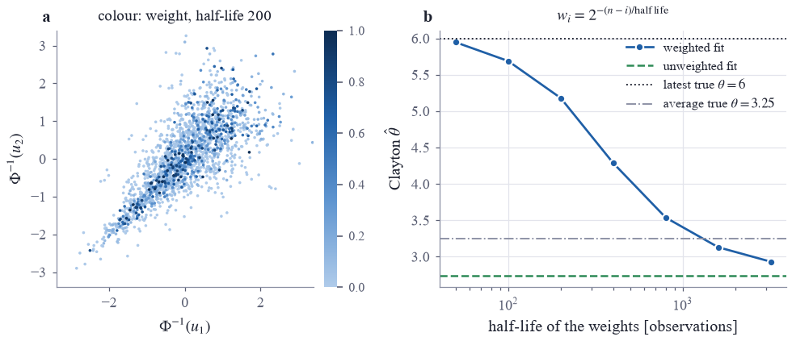
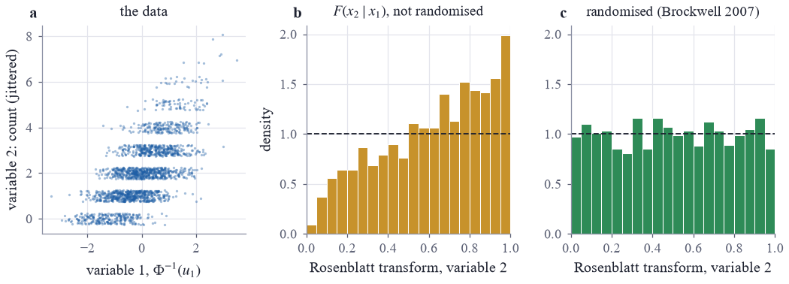
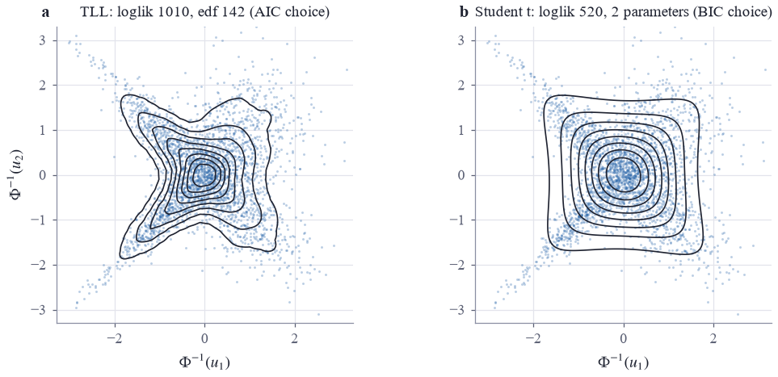
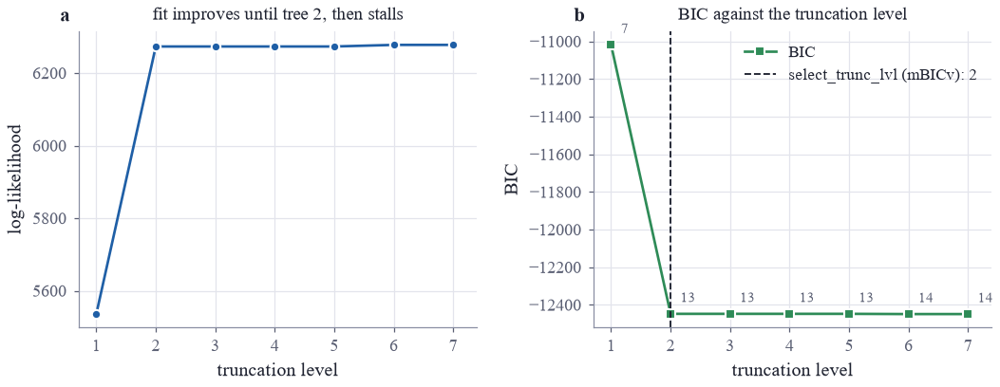
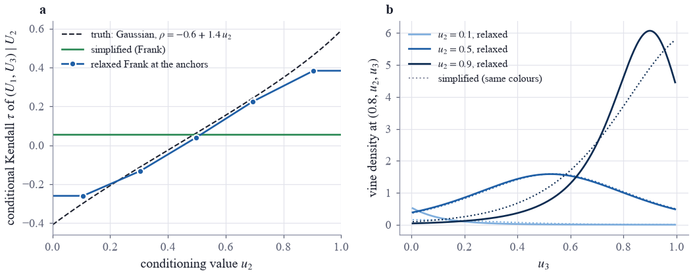

# Python package

The `fortvine` Python package lets you use the library from Python with NumPy arrays. It is a
binding, not a port: every density, h-function, fit, family selection, vine selection,
Rosenblatt transform and simulation is computed by the compiled Fortran library through its
[C interface](manual/c-api.md). Python converts arrays and family names into the layout the C
routines expect and wraps what they return in two classes, `Bicop` and `Vinecop`. The class and
method names follow [pyvinecopulib](https://github.com/vinecopulib/pyvinecopulib), so code
written for it needs few changes.

Besides the `fv_*` routines of `src/fortvine.f90`, the package calls `src/fortvine_capi.f90`
(the `fvc_*` routines), a C interface to the typed Fortran API (`fortvine_api`). Through it
the Python package has everything the Fortran API offers: observation weights, discrete and
mixed margins, the nonparametric families `tll` and `bernstein`, every selection control
(`select_trunc_lvl`, `select_threshold`, `fast_mle`, ...), non-simplified vines (`relax`),
`pdf_grid`, the fit cache, the abort flag, parameter bounds and `gen_flip`. Nothing is
recomputed in Python.

## Installation

```bash
pip install fortvine
```

The wheels on PyPI (Linux x86_64, macOS arm64 and x86_64, Windows x86_64) contain the compiled
library, so no compiler is needed. Elsewhere pip builds the package from the source
distribution, which needs **gfortran** on the `PATH` (set `FC` to choose another compiler).

From a clone of the repository, or straight from GitHub, the package is always compiled from
the Fortran sources in `src/`:

```bash
pip install ./python
pip install "git+https://github.com/Bluerrror/fortvine#subdirectory=python"
```

The build compiles `src/fortvine_ad.f90`, `src/fortvine.f90`, `src/fortvine_api.f90` and
`src/fortvine_capi.f90` with `-O3 -fopenmp`, without `-march=native`, so the library runs on any CPU of the
platform. It is placed in `fortvine/_lib/`. On Windows the gfortran, OpenMP, quadmath and
winpthread runtimes are linked statically into `libfortvine.dll`, which then depends only on
system DLLs and loads in a fresh virtual environment. On Linux and macOS the library uses the
compiler's runtime libraries; the wheels bundle them (auditwheel, delocate). `FORTVINE_LIB` points the package at a
library built elsewhere.

## Quick start

```python
import numpy as np
import fortvine as fv

cop = fv.Bicop("clayton", rotation=0, parameters=[2.0])
u = cop.simulate(2000, seed=1)          # (2000, 2) array in (0, 1)
cop.pdf(u[:5]), cop.hfunc1(u[:5]), cop.cdf(u[:5])

est = fv.Bicop("clayton").fit(u)        # maximum likelihood
best = fv.Bicop().select(u, family_set=["gaussian", "clayton", "gumbel", "frank"])

x = np.random.default_rng(0).standard_normal((1000, 4)).cumsum(axis=1)
v = fv.to_pseudo_obs(x)
vc = fv.Vinecop.from_data(v, criterion="bic", trunc_lvl=2, num_threads=4)
print(vc)
vc.loglik(v), vc.npars, vc.simulate(500, seed=2)
```

Data are copula data: an `(n, d)` array with values in $(0, 1)$, one row per observation.
Because the C interface keeps observations in the last Fortran dimension, such a C-order
array is passed to Fortran without a copy. Families are given by name (case-insensitive, as
`fv_fam_name` spells them, e.g. `"bb1"` or `"Archimax(gamma|HuslerReiss)"`) or by integer
code, including the generic codes 10000 and up. `fv.families()` lists all 111.

## API

| Python | does | C routine |
|---|---|---|
| `Bicop(family, rotation, parameters, aux=None)` | pair copula; `family`, `family_code`, `rotation`, `parameters`, `npars`, `aux`, `is_nonparametric` | |
| `.pdf(u)`, `.logpdf(u)` | density, log-density on `u` of shape $(n, 2)$ | `fv_bicop_eval`; `fvc_bicop_eval` for tll / bernstein |
| `.cdf(u)` | distribution function | `fvc_bicop_eval` |
| `.hfunc1(u)`, `.hfunc2(u)` | $h_1 = P(U_2 \le u_2 \mid U_1 = u_1)$, $h_2 = P(U_1 \le u_1 \mid U_2 = u_2)$ | as `.pdf` |
| `.hinv1(u)`, `.hinv2(u)` | inverses in the second / first argument | as `.pdf` |
| `.loglik(u=None)`, `.aic(u=None)`, `.bic(u=None)` | log-likelihood on `u`, or of the last fit; AIC, BIC with `npars` | as `.pdf` |
| `.fit(u, method, ..., weights=None)` | estimate the parameters (tll / bernstein: the estimate `aux`) of the current family and rotation | `fvc_bicop_fit` |
| `.select(u, family_set, criterion, ..., weights=None)` | choose family, rotation and parameters | `fvc_bicop_fit` |
| `.parameters_lower_bounds`, `.parameters_upper_bounds` | the parameter box | `fvc_par_bounds` |
| `.simulate(n, seed)` | $u_2 = h_1^{-1}(w \mid u_1)$ for uniform $u_1, w$ | as `.pdf` |
| `Vinecop(d, var_types=None)` | empty vine: `d`, `trunc`, `order`, `st`, `fam`, `rot`, `par`, `edge_ll`, `aux`, `disc`, `threshold` | |
| `.set_dvine(order)`, `.set_cvine(order)` | fixed D- or C-vine structure | `fvc_vine_structure` |
| `Vinecop.from_data(u, ...)`, `.select(u, ..., weights, var_types, select_trunc_lvl, select_threshold)` | select structure (unless fixed), families, parameters | `fvc_vine_select` |
| `.pdf(u)`, `.loglik(u=None)`, `.aic(u=None)`, `.bic(u=None)` | vine density; log-likelihood; AIC, BIC | `fvc_vine_eval` |
| `.pdf_grid(ug, target)` | density on a prediction grid | `fvc_vine_pdf_grid` |
| `.rosenblatt(u, randomize_discrete=True, seed=1)`, `.inverse_rosenblatt(w)` | Rosenblatt transform and its inverse | `fvc_vine_eval` |
| `.simulate(n, seed)` | inverse Rosenblatt transform of uniforms | `fvc_vine_eval` |
| `.relax(u, target=0, mode="test", ..., weights=None)`, `.unrelax()` | non-simplified edges; `nrel`, `relaxed_edges`, `erel`, `wa`, `wk`, `pk` | `fvc_vine_relax` |
| `.rel_params(u)` | parameters `(n, nrel, 3)` of the relaxed edges at the samples `u` | `fvc_vine_rel_params` |
| `.matrix`, `.families`, `.rotations`, `.parameters`, `.npars`, `.var_types` | R-vine matrix; pair copulas per tree; parameter count; variable types | `fvc_vine_matrix` |
| `.get_pair_copula(t, e)`, `.set_pair_copula(t, e, bicop)` | one edge as a `Bicop` | |
| `to_pseudo_obs(x)`, `kendall_tau(x, y)` | ranks / $(n + 1)$; Kendall's $\tau_b$ | `fv_pseudo_obs`, `fv_kendall_tau` |
| `families()`, `family_group(name)` | the family list; the codes of a family group | `fvc_families` |
| `par_bounds(family)`, `gen_flip(family, parameters)` | parameter box; the transposed generic copula | `fvc_par_bounds`, `fvc_gen_flip` |
| `fitcache_enable(capacity)`, `fitcache_clear()`, `fitcache_disable()`, `fitcache_stats()` | the pair-fit cache | `fvc_fitcache` |
| `set_abort(flag=True)` | the abort flag of running fits and selections | `fvc_set_abort` |
| `cite()`, `__version__`, `NAUX`, `NK` | the citation; the version; length of a tll / bernstein estimate; anchors of a relaxed edge | `fvc_naux`, `fvc_nk` |

The options of `select` are those of `fv_controls`: `family_set` (default: the
`fv_controls` default, codes 0 to 22), `criterion` (`"loglik"`, `"aic"`, `"bic"`, `"mbic"`,
`"mbicv"`), `method` (`"mle"`, `"itau"`), `preselect`, `allow_rotations`, `fast_mle`,
`tau_mode` (`"auto"`, `"exact"`, `"approx"`), `psi0` and `num_threads` (default: the
environment variable `FORTVINE_THREADS`, otherwise half the logical CPUs — the same rule as the
Fortran library), and the keyword-only `weights`; for vines also
`tree_criterion` (`"tau"`, `"rho"`, `"joe"`, `"hoeffd"`, `"xi"`, `"mi"`, `"ferreira"`),
`tree_algorithm` (`"prim"`, `"kruskal"`), `trunc_lvl`, `threshold`, `fixed` and the
keyword-only `var_types`, `select_trunc_lvl` and `select_threshold`. The pyvinecopulib and
Fortran spellings are accepted too: `selection_criterion`, `parametric_method`, `tree_crit`,
`tree_algo`, `preselect_families`, `select_trunc`. `fit` takes `method`, `fast_mle`,
`tau_mode`, `num_threads` and `weights`.

A `family_set` is a list of family names, codes or group names; a single name or group is
accepted as well. The groups (`family_group(name)` returns their codes):

| group | codes | Fortran |
|---|---|---|
| `"default"` | 0 to 22, every parametric hand-coded family except `tev` | `fv_controls` default |
| `"parametric"` | 0 to 11 | `FV_PARAMETRIC` |
| `"all_parametric"` | 0 to 23 | `FV_ALL` |
| `"nonparametric"` | 24 (`tll`), 25 (`bernstein`) | `FV_NONPAR` |
| `"all"` | 0 to 25 | `FV_NCLASSIC` families |
| `"one_par"` | 1, 3, 4, 5, 6 | `FV_ONE_PAR` |
| `"generic"` | the 85 generic codes 10000 and up | `fv_generic_families()` |

In a `Vinecop` the arrays are indexed `[tree, edge]` from 0, the transpose of the Fortran
`fam(edge, tree)`: edge `e` of tree `t` joins variables `order[e]` and `order[st[t, e] - 1]`
(the labels in `order` and `st` are 1-based, as in Fortran). `par` is `(d, d, 3)`, `aux` is
`(d, d, naux)` with `naux = NAUX` when the vine has a `tll` or `bernstein` edge and 1
otherwise, and `disc` is a `(d,)` boolean array of the discrete variables. Seeds make
`simulate` reproducible; the uniforms come from NumPy, so the draws differ from Fortran's
`simulate` with the same seed. `Bicop` and `Vinecop` hold only NumPy arrays and numbers, so
they pickle (and copy) like any Python object, including their estimates, discreteness flags
and non-simplified edges.

Vine selection and `relax` run in a worker thread when they are called from the main thread,
so Ctrl-C (`KeyboardInterrupt`) interrupts them: the package sets the abort flag, waits until
the Fortran code returns (a few milliseconds), clears the flag and re-raises.

## Observation weights

`weights` (one value per row) is accepted by `Bicop.fit`, `Bicop.select`, `Vinecop.select`
and `Vinecop.relax`. The weighted log-likelihood is maximised and weighted Kendall taus build
the trees. With integer weights a weighted fit is the fit to the sample with rows repeated:

```python
import numpy as np
import fortvine as fv

u = fv.Bicop("clayton", parameters=[2.0]).simulate(1000, seed=1)
w = np.random.default_rng(2).integers(1, 3, len(u))           # weights 1 or 2
a = fv.Bicop("clayton").fit(u, weights=w)
b = fv.Bicop("clayton").fit(np.repeat(u, w, axis=0))           # rows repeated w times
print("weighted fit   :", a.parameters, round(a.loglik(), 4))
print("duplicated rows:", b.parameters, round(b.loglik(), 4))

x = np.random.default_rng(0).standard_normal((1000, 4)).cumsum(axis=1)
v = fv.to_pseudo_obs(x)
recent = 0.998 ** np.arange(len(v))[::-1]                      # time-decay weights
vc = fv.Vinecop.from_data(v, weights=recent, family_set=["gaussian", "clayton", "gumbel", "frank"])
print(vc.families, round(vc.loglik(), 2))
```

```text
weighted fit   : [1.87015409] 549.3913
duplicated rows: [1.87015409] 549.3913
[['gaussian', 'gaussian', 'gaussian'], ['clayton', 'clayton'], ['clayton']] 663.87
```

`loglik()` without data returns the weighted log-likelihood of the fit.

<figure markdown>
{ width="700" }
<figcaption>Time-decay weights on a sample whose dependence strengthens over time: 2000
observations, the $i$-th drawn from a Clayton copula with $\theta$ rising linearly from 0.5 to 6.
(a) The sample in normal scores, coloured by the weight $2^{-(n - i)/200}$. (b) The Clayton
parameter fitted with `fit(u, weights=w)` against the half-life of the weights: short half-lives
track the latest $\theta = 6$ (5.95 at half-life 50), long ones approach the unweighted fit
(2.73), which describes the whole period.</figcaption>
</figure>

## Discrete and mixed margins

Discrete variables follow pyvinecopulib's convention ([Discrete data](manual/discrete.md)
explains the likelihood). `var_types` gives `"c"` or `"d"` per variable, and with $k$ discrete
variables the data are an $(n, d + k)$ array: the first $d$ columns hold $F(x)$ of every
variable, the last $k$ columns $F(x^-)$ of the discrete ones, in their order. An $(n, 2d)$
array with $F(x^-)$ of every variable in columns $d, \dots, 2d - 1$ is accepted too (only the
discrete columns are read). The vine keeps the flags (`disc`, `var_types`), and `pdf`,
`loglik`, `rosenblatt` and `pdf_grid` then expect data of the same form.

```python
import numpy as np
from scipy.stats import poisson
import fortvine as fv

# a Gaussian D-vine 1-2-3; variable 2 is observed as a Poisson(2) count
truth = fv.Vinecop().set_dvine([1, 2, 3])
truth.fam[0, :2] = 1                       # gaussian
truth.par[0, :2, 0] = [0.7, 0.5]
v = truth.simulate(2000, seed=1)
k = poisson.ppf(v[:, 1], 2.0)              # the counts
# F(x) of the three variables, then F(x-) of the discrete one: an (n, d + 1) array
u = np.column_stack([v[:, 0], poisson.cdf(k, 2.0), v[:, 2], poisson.cdf(k - 1, 2.0)])

vc = fv.Vinecop.from_data(u, var_types=["c", "d", "c"], family_set=["indep", "gaussian", "frank"])
print(vc)
print("var_types:", vc.var_types, "  loglik %.2f" % vc.loglik(u))
r = vc.rosenblatt(u, seed=3)               # Brockwell's randomised transform
print("Rosenblatt means", r.mean(axis=0).round(4), " variances", r.var(axis=0).round(4))
```

```text
fortvine vine copula: d = 3, trunc = 2
order: 1 2 3
discrete: 2
  tree 1 edge 1: gaussian     rot   0 par 0.6995
  tree 1 edge 2: gaussian     rot   0 par 0.5155
  tree 2 edge 1: indep        rot   0 par 
var_types: ['c', 'd', 'c']   loglik 894.19
Rosenblatt means [0.4933 0.5008 0.5083]  variances [0.0846 0.0829 0.0854]
```

Both latent correlations (0.7 and 0.5) are recovered from a count with a handful of values,
and the randomised Rosenblatt transform has the mean $1/2$ and variance $1/12$ of uniforms.
`rosenblatt(u, randomize_discrete=False)` returns $F(x_k \mid \dots)$ itself; `seed` (non-zero)
selects the randomisation. `inverse_rosenblatt` and `simulate` return the copula sample on the
continuous scale; apply the marginal quantile functions to get discrete data. The test suite
rebuilds such a vine in pyvinecopulib and finds the same discrete density to $10^{-6}$
relative. `relax` is not available for vines with discrete variables, and a `Bicop` has no
discrete margins (use a two-dimensional `Vinecop`).

<figure markdown>
{ width="700" }
<figcaption>The example above. (a) Variable 2 is a Poisson(2) count driven by a latent Gaussian
dependence on variable 1. (b) The non-randomised Rosenblatt transform
(`randomize_discrete=False`) of the count is not uniform: it is $F(x_2 \mid x_1)$ at the upper end
of each jump. (c) Brockwell's randomised transform (`rosenblatt(u, seed=3)`) is uniform under the
fitted model, as a goodness-of-fit residual should be.</figcaption>
</figure>

## Nonparametric families

`tll` (24) and `bernstein` (25) ([Nonparametric pair copulas](manual/nonparametric.md)) are
fitted like any other family. Their estimate is the vector `aux` (`NAUX` = 933 values); their
`parameters` are empty, `rotation` is ignored, and `npars` is the effective number of
parameters of the estimate, the penalty that AIC and BIC use. They are not in the default
family set: name them or use the `"nonparametric"` or `"all"` group.

```python
import numpy as np
import fortvine as fv

# an equal mixture of a Clayton and a 90-degree Gumbel copula
rng = np.random.default_rng(5)
a = fv.Bicop("clayton", parameters=[4.0]).simulate(3000, seed=1)
b = fv.Bicop("gumbel", 90, [3.0]).simulate(3000, seed=2)
u = np.where(rng.random((3000, 1)) < 0.5, a, b)

tll = fv.Bicop("tll").fit(u)
print(tll, " loglik %.2f" % tll.loglik(), " aux", tll.aux.shape)
print("density at (0.1,0.1), (0.5,0.5), (0.9,0.1):", tll.pdf(np.array([[.1, .1], [.5, .5], [.9, .1]])).round(3))
for crit in ("bic", "aic"):
    best = fv.Bicop().select(u, family_set=["parametric", "nonparametric"], criterion=crit)
    print(crit, "->", best.family, " loglik %.2f  npars %.2f" % (best.loglik(), best.npars))

vc = fv.Vinecop.from_data(np.column_stack([u, rng.random(3000)]), family_set=["indep", "gaussian", "tll"])
print(vc)
print("npars %.2f" % vc.npars, " aux", vc.aux.shape)
```

```text
Bicop(family='tll', npars=142.21)  loglik 1009.79  aux (933,)
density at (0.1,0.1), (0.5,0.5), (0.9,0.1): [2.81  1.835 1.688]
bic -> student  loglik 520.45  npars 2.00
aic -> tll  loglik 1009.79  npars 142.21
fortvine vine copula: d = 3, trunc = 2
order: 1 2 3
  tree 1 edge 1: tll          edf 142.21
  tree 1 edge 2: indep        rot   0 par 
  tree 2 edge 1: indep        rot   0 par 
npars 142.21  aux (3, 3, 933)
```

TLL nearly doubles the log-likelihood of the best parametric family (Student), but with 142
effective parameters: BIC keeps the Student copula, AIC takes TLL. Every evaluation (`pdf`,
h-functions and their inverses, `cdf`, the vine methods) uses the stored estimate, and
`get_pair_copula` / `set_pair_copula` carry it between a vine and a `Bicop`. In `families()`
the two families have `npars = -1`.

<figure markdown>
{ width="700" }
<figcaption>The mixture sample of the example (3000 points, normal scores) with the density
contours of (a) the TLL estimate and (b) the Student copula that BIC prefers. TLL follows both
arms of the mixture, the Clayton lower tail along the diagonal and the rotated Gumbel tail in the
upper-left corner; the Student copula can only spread its mass symmetrically.</figcaption>
</figure>

## Truncation, thresholding and other controls

`select_trunc_lvl=True` lets mBICv choose the truncation level and `select_threshold=True`
the threshold below which edges are set to independence, as vinecopulib's options of the same
names (the threshold found is in `vc.threshold`):

```python
import numpy as np
import fortvine as fv

rng = np.random.default_rng(4)                 # a Gaussian AR(1) chain: only tree 1 matters
z = np.zeros((2000, 6))
z[:, 0] = rng.standard_normal(2000)
for j in range(1, 6):
    z[:, j] = 0.7 * z[:, j - 1] + np.sqrt(0.51) * rng.standard_normal(2000)
u = fv.to_pseudo_obs(z)

full = fv.Vinecop.from_data(u)
trunc = fv.Vinecop.from_data(u, select_trunc_lvl=True)
thr = fv.Vinecop.from_data(u, select_threshold=True, criterion="mbicv")
print("full      : trunc", full.trunc, " npars", full.npars, " loglik %.2f" % full.loglik())
print("mBICv trunc: trunc", trunc.trunc, " npars", trunc.npars, " loglik %.2f" % trunc.loglik())
print("mBICv thr : threshold %.4f" % thr.threshold, " npars", thr.npars, " loglik %.2f" % thr.loglik())
alt = fv.Vinecop.from_data(u, tree_crit="rho", tree_algo="kruskal", parametric_method="itau",
                           fast_mle=True, preselect=False, allow_rotations=False, trunc_lvl=2)
print("rho/kruskal/itau, 2 trees:", alt.families)
```

```text
full      : trunc 5  npars 5  loglik 3264.58
mBICv trunc: trunc 1  npars 5  loglik 3264.58
mBICv thr : threshold 0.3167  npars 5  loglik 3264.58
rho/kruskal/itau, 2 trees: [['gaussian', 'gaussian', 'gaussian', 'gaussian', 'gaussian'], ['indep', 'indep', 'indep', 'indep']]
```

BIC already sets every edge above the first tree to independence; with `select_trunc_lvl` the
vine is also cut after tree 1.

<figure markdown>
{ width="700" }
<figcaption>A second chain, $d = 8$, in which each variable depends on the two before it
($z_j = 0.5 z_{j-1} + 0.35 z_{j-2} + 0.6\,\varepsilon_j$, $n = 2000$), fitted with every fixed
`trunc_lvl` from 1 to 7. (a) The log-likelihood jumps from tree 1 to tree 2 and is flat after it.
(b) BIC with the number of parameters at each point; `select_trunc_lvl=True` (mBICv) stops at
2. BIC itself is lowest at level 6, by 1.2 units for one extra parameter; mBICv's prior against
dependence in high trees removes such an edge.</figcaption>
</figure>

## Non-simplified vines

`relax(u, target=0, mode="test")` lets the parameters of edges of trees $t \ge 2$ vary with
their conditioning variables (see [`relax`](manual/vinecop.md#non-simplified-edges-relax)):
`target` is the variable label whose edges may be relaxed (0: any), `mode="test"` relaxes the
edges whose constant-conditional-correlation test rejects at 5 %, `mode="all"` every eligible
edge; `method`, `fast_mle`, `tau_mode`, `num_threads` and `weights` control the local fits.
The relaxed edges are stored in the vine (`nrel`, `relaxed_edges` as 0-based `(tree, edge)`,
and the Fortran arrays `erel` (`(nrel, 2)`: edge, tree, 1-based), `wa` (`(nrel, d)`), `wk`
(`(nrel, NK)`) and `pk` (`(nrel, NK, 3)`)). `pdf`, `loglik` and `pdf_grid` use them;
`rosenblatt`, `inverse_rosenblatt` and `simulate` use `par` (the middle-anchor values), as in
Fortran. `unrelax()` deletes the records, and `select` starts from a simplified vine again.

```python
import numpy as np
from scipy.stats import norm
import fortvine as fv

# the copula of (U1, U3) given U2 changes with U2: not a simplified vine
rng = np.random.default_rng(1)
n = 2000
u2, w1, w3 = rng.random(n), rng.random(n), rng.random(n)
x1 = fv.Bicop("clayton", parameters=[2.0]).hinv1(np.column_stack([u2, w1]))
rho = -0.6 + 1.4 * u2
v3 = norm.cdf(rho * norm.ppf(w1) + np.sqrt(1 - rho**2) * norm.ppf(w3))
x3 = fv.Bicop("frank", parameters=[5.0]).hinv1(np.column_stack([u2, v3]))
u = np.column_stack([x1, u2, x3])

vc = fv.Vinecop().set_dvine([1, 2, 3]).select(u, family_set=["indep", "gaussian", "clayton", "frank"])
print("simplified    : loglik %.2f  npars %d" % (vc.loglik(), vc.npars))
vc.relax(u, target=0, mode="test")
print("non-simplified: loglik %.2f  npars %d  relaxed edges %s" % (vc.loglik(), vc.npars, vc.relaxed_edges))
print("check: sum log pdf = %.2f" % vc.loglik(u))
print(vc)
print("anchors wk:", vc.wk.round(3), " loadings wa:", vc.wa.round(3))

# predictive density of variable 3 on a grid, for the first two samples
g = np.repeat(u[:2, None, :], 5, axis=1)
g[:, :, 2] = [0.1, 0.3, 0.5, 0.7, 0.9]
print(vc.pdf_grid(g, target=3).round(4))
```

```text
simplified    : loglik 1342.48  npars 3
non-simplified: loglik 1521.02  npars 7  relaxed edges [(1, 0)]
check: sum log pdf = 1521.02
fortvine vine copula: d = 3, trunc = 2
order: 3 2 1
  tree 1 edge 1: frank        rot   0 par 5.0930
  tree 1 edge 2: clayton      rot   0 par 1.9290
  tree 2 edge 1: frank        rot   0 par 0.3364
  non-simplified tree 2 edge 1: first parameter at the w anchors -2.5260 -1.2442 0.3364 2.0974 3.9420
anchors wk: [[-1.249 -0.51  -0.004  0.506  1.305]]  loadings wa: [[0. 1. 0.]]
[[0.8766 1.6637 2.1001 1.5994 0.8216]
 [0.0397 0.1    0.2134 0.2932 0.1411]]
```

The test relaxes the single second-tree edge; its Frank parameter now runs from $-2.5$ to
$3.9$ across the anchors of $w = \Phi^{-1}(u_2)$, and the log-likelihood gains 179 for four
extra parameter sets.

<figure markdown>
{ width="700" }
<figcaption>The non-simplified example. (a) Conditional Kendall's $\tau$ of $(U_1, U_3)$ given
$U_2 = u_2$: the truth (Gaussian, $\rho = -0.6 + 1.4\,u_2$), the single Frank copula of the
simplified vine ($\tau = 0.06$), and the relaxed Frank edge at its five anchors (parameters
`pk`, at $u_2 = \Phi(w_k)$, converted to $\tau$ by simulation; constant beyond the outer anchors).
(b) The predictive density of $u_3$ from `pdf_grid` at $u_1 = 0.8$ and three values of $u_2$,
relaxed (solid) and simplified (dotted): the two agree at $u_2 = 0.5$, where the relaxed
parameter is close to the constant one, and differ where the conditional dependence has changed
sign or strength.</figcaption>
</figure>

## Prediction grids

`pdf_grid(ug, target)` evaluates the vine density on `ug` of shape `(n, bins, d)`: for each of
the `n` samples, `bins` points that differ only in variable `target` (1-based label, as in
`order`). It returns `(n, bins)`, the same values as `pdf` at those points, but edges that do
not involve `target` are evaluated once per sample (the example above). With discrete
variables the last axis is `d + k` (or `2d`), as for `pdf`. After `relax(target=0)` the
conditioning values of relaxed edges are taken from the first bin of each sample, which is
exact when no relaxed edge conditions on `target` (see the note in
[`relax`](manual/vinecop.md#non-simplified-edges-relax)).

## Fit cache, abort flag, bounds

```python
import numpy as np
import fortvine as fv

u = fv.to_pseudo_obs(np.random.default_rng(0).standard_normal((1500, 5)).cumsum(axis=1))
fv.fitcache_enable(20000)
a = fv.Vinecop.from_data(u)
print("after the first select :", fv.fitcache_stats())
b = fv.Vinecop.from_data(u)
print("after the second select:", fv.fitcache_stats(), " same loglik:", a.loglik() == b.loglik())
fv.fitcache_disable()

fv.set_abort(True)                      # e.g. from another thread or a GUI callback
print("aborted select: trunc", fv.Vinecop.from_data(u).trunc)
fv.set_abort(False)

print(fv.par_bounds("bb1"))
print(fv.gen_flip("tawn-asymmixed", [0.5, 0.5]))
```

```text
after the first select : FitCacheStats(hits=0, misses=260, used=260)
after the second select: FitCacheStats(hits=260, misses=260, used=260)  same loglik: True
aborted select: trunc 0
(array([0., 1.]), array([7., 7.]))
(10011, array([0.625     , 0.42105263]))
```

The [fit cache](manual/fitting.md#fit-cache) is shared by every fit and selection while it is
enabled; `fitcache_clear()` empties it and resets the counters. With the abort flag set, fits
return at once and a selection stops (its result is to be discarded); the flag stays set until
`set_abort(False)`. `par_bounds` is the MLE search box of a family, and `gen_flip` the generic
family and parameters of the transposed copula $C(u_2, u_1)$ (other families are returned
unchanged).

## Worked example

This is the program of the [Quick start](getting-started/quickstart.md) in Python
(`example/python/python_quickstart.py` in the repository): a Gumbel pair copula that is
evaluated, simulated, fitted and selected, then a four-dimensional C-vine with Clayton pairs
that is simulated, selected from the sample and simulated again.

```python
import numpy as np
import fortvine as fv

n = 1000

# one pair copula: Gumbel with theta = 1.5 (Kendall tau = 1 - 1/theta = 1/3)
cop = fv.Bicop("gumbel", parameters=[1.5])
g = np.array([0.1, 0.5, 0.95])
print("density c(u,u)   :", cop.pdf(np.column_stack([g, g])).round(4))
print("h1(u | u)        :", cop.hfunc1(np.column_stack([g, g])).round(4))

u12 = cop.simulate(n, seed=42)                       # u2 = h1^-1(w | u1)
print("sample Kendall tau: %.4f" % fv.kendall_tau(u12[:, 0], u12[:, 1]))

est = fv.Bicop("gumbel").fit(u12)
print("Gumbel MLE theta : %.4f   loglik %.3f" % (est.parameters[0], est.loglik()))
best = fv.Bicop().select(u12)
print("BIC selection    :", best)

# a 4-dimensional vine: a C-vine with Clayton pairs as the truth
truth = fv.Vinecop().set_cvine([1, 2, 3, 4])
truth.fam[0, :3] = 3; truth.par[0, :3, 0] = 3.0      # tree 1: Clayton(3)
truth.fam[1, :2] = 3; truth.par[1, :2, 0] = 1.0      # tree 2: Clayton(1)
u = truth.simulate(n, seed=1)

vc = fv.Vinecop.from_data(u)                         # structure, families, parameters
print(vc)
print("loglik %.2f   (truth %.2f)   parameters %d" % (vc.loglik(u), truth.loglik(u), vc.npars))
print("five draws from the fitted vine:")
print(vc.simulate(5, seed=2).round(4))
```

Output (Windows, Python 3.14, gfortran 16):

```text
density c(u,u)   : [1.8518 1.2196 4.5946]
h1(u | u)        : [0.2052 0.5282 0.7701]
sample Kendall tau: 0.3683
Gumbel MLE theta : 1.5544   loglik 202.420
BIC selection    : Bicop(family='gumbel', rotation=0, parameters=[1.55436957060358])
fortvine vine copula: d = 4, trunc = 3
order: 2 3 1 4
  tree 1 edge 1: joe          rot 180 par 3.9498
  tree 1 edge 2: joe          rot 180 par 4.1778
  tree 1 edge 3: clayton      rot   0 par 3.1232
  tree 2 edge 1: clayton      rot   0 par 0.3395
  tree 2 edge 2: clayton      rot   0 par 0.6397
  tree 3 edge 1: clayton      rot   0 par 0.5037
loglik 2296.80   (truth 2308.14)   parameters 6
five draws from the fitted vine:
[[0.0767 0.0961 0.1321 0.0919]
 [0.0701 0.0766 0.0495 0.0551]
 [0.1275 0.202  0.1577 0.1501]
 [0.6095 0.7533 0.6169 0.6332]
 [0.571  0.2968 0.2622 0.1873]]
```

The density and h-function values match the Fortran quick start digit for digit: both call
the same compiled routines. The samples differ, because Python draws its uniforms with NumPy.

| quantity | $n$ | Kendall $\hat\tau$ | $\hat\theta$ | log-likelihood |
|---|---|---|---|---|
| Gumbel pair, $\theta = 1.5$, $\tau = 1/3$ | 1000 | 0.368 | 1.554 | 202.42 |

The selected vine is not the true one edge for edge. Its first tree is the path 2-3-1-4
rather than the star around variable 4, two of its edges are survival Joe (`joe` rotated by
180 degrees, which has lower tail dependence like Clayton), and the third tree picks up a
little dependence. Its log-likelihood is still within 12 units of the truth's, with six
parameters where the truth has five. The Fortran quick start lands on the same structure.


*(a) Density of the selected Gumbel copula (colour scale clipped at 3) with 200 of the
simulated pairs. (b) Variables 1 and 4 of the C-vine sample (blue) and of a simulation of the
same size from the fitted vine (green). (c) The Rosenblatt transform of the sample under the
fitted vine, all four coordinates pooled: close to the uniform density (gold line), as expected
for a well-specified model (the pairwise Kendall $\tau$ of the transformed coordinates are
all below 0.05).*

The figure is drawn by the same script: `python example/python/python_quickstart.py
docs/assets/python_example.png`.

## Tests

`python/tests/test_basic.py` checks that $h_1^{-1}(h_1(u))$ is the identity, that densities
integrate to 1, that fitting recovers parameters, that selection finds the true family, that a
vine's log-likelihood equals the sum of its log-densities, that the Rosenblatt transform
round-trips, and that a generic family works. For the features of the typed API it checks that
a weighted fit equals the fit to the sample with duplicated rows (pair copula and vine), that
`tll` and `bernstein` densities are positive and integrate to 1 and their h-inverses
round-trip, that a discrete vine has the density pyvinecopulib computes for the same model,
that `relax` relaxes the non-simplified edge of a known example and keeps `loglik()` equal to
the sum of the log-densities, that `pdf_grid` equals `pdf`, that `select_trunc_lvl` truncates
a Markov chain, that the fit cache counts hits, that the abort flag and Ctrl-C stop a
selection, that `gen_flip` transposes asymmetric generic copulas, and that all objects pickle.
When pyvinecopulib is installed, a few densities and h-functions are compared with it (they
agree to $10^{-6}$ relative).

```bash
pip install ./python pytest scipy
pytest python/tests
```

## Citing

If you use fortvine in published work, please cite

> Shojaeezadeh, S. A. (2026). fortvine: a complete compendium to work on vine copula modeling.
> In preparation.

```bibtex
@unpublished{shojaeezadeh2026fortvine,
  author = {Shojaeezadeh, Shahab Aldin},
  title  = {fortvine: a complete compendium to work on vine copula modeling},
  year   = {2026},
  note   = {In preparation. Software: https://github.com/Bluerrror/fortvine}
}
```

`fortvine.cite()` prints this reference and returns it as a string.
