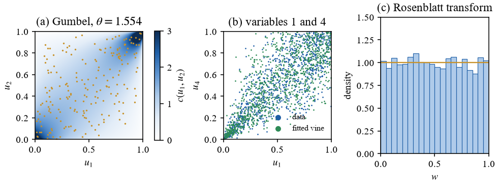

# Python package

The `fortvine` Python package lets you use the library from Python with NumPy arrays. It is a
binding, not a port: every density, h-function, fit, family selection, vine selection,
Rosenblatt transform and simulation is computed by the compiled Fortran library through its
[C interface](manual/c-api.md). Python converts arrays and family names into the layout the C
routines expect and wraps what they return in two classes, `Bicop` and `Vinecop`. The class and
method names follow [pyvinecopulib](https://github.com/vinecopulib/pyvinecopulib), so code
written for it needs few changes.

A handful of operations of the typed Fortran API have no C binding in `src/`: family names
and parameter counts, the family list, the pair-copula distribution function, the D- and
C-vine constructors and the R-vine matrix. The package compiles a small extra Fortran file,
`python/fortvine_py.f90`, whose `bind(C)` routines forward these calls to
`fortvine_api`. Nothing is recomputed in Python.

## Installation

```bash
pip install fortvine
```

The wheels on PyPI (Linux x86_64, macOS arm64 and x86_64, Windows x86_64) contain the compiled
library, so no compiler is needed. Elsewhere pip builds the package from the source
distribution, which needs **gfortran** on the `PATH` (set `FC` to choose another compiler).

From a clone of the repository, or straight from GitHub, the package is always compiled from
the Fortran sources in `src/`:

```bash
pip install ./python
pip install "git+https://github.com/Bluerrror/fortvine#subdirectory=python"
```

The build compiles `src/fortvine_ad.f90`, `src/fortvine.f90`, `src/fortvine_api.f90` and the
shim with `-O3 -fopenmp`, without `-march=native`, so the library runs on any CPU of the
platform. It is placed in `fortvine/_lib/`. On Windows the gfortran, OpenMP, quadmath and
winpthread runtimes are linked statically into `libfortvine.dll`, which then depends only on
system DLLs and loads in a fresh virtual environment. On Linux and macOS the library uses the
compiler's runtime libraries; the wheels bundle them (auditwheel, delocate). `FORTVINE_LIB` points the package at a
library built elsewhere.

## Quick start

```python
import numpy as np
import fortvine as fv

cop = fv.Bicop("clayton", rotation=0, parameters=[2.0])
u = cop.simulate(2000, seed=1)          # (2000, 2) array in (0, 1)
cop.pdf(u[:5]), cop.hfunc1(u[:5]), cop.cdf(u[:5])

est = fv.Bicop("clayton").fit(u)        # maximum likelihood
best = fv.Bicop().select(u, family_set=["gaussian", "clayton", "gumbel", "frank"])

x = np.random.default_rng(0).standard_normal((1000, 4)).cumsum(axis=1)
v = fv.to_pseudo_obs(x)
vc = fv.Vinecop.from_data(v, criterion="bic", trunc_lvl=2, num_threads=4)
print(vc)
vc.loglik(v), vc.npars, vc.simulate(500, seed=2)
```

Data are copula data: an `(n, d)` array with values in $(0, 1)$, one row per observation.
Because the C interface keeps observations in the last Fortran dimension, such a C-order
array is passed to Fortran without a copy. Families are given by name (case-insensitive, as
`fv_fam_name` spells them, e.g. `"bb1"` or `"Archimax(gamma|HuslerReiss)"`) or by integer
code, including the generic codes 10000 and up. `fv.families()` lists all 111.

## API

| Python | does | C routine |
|---|---|---|
| `Bicop(family, rotation, parameters)` | pair copula; `family`, `family_code`, `rotation`, `parameters`, `npars` | |
| `.pdf(u)`, `.logpdf(u)` | density, log-density on `u` of shape $(n, 2)$ | `fv_bicop_eval` |
| `.cdf(u)` | distribution function | `fvpy_bicop_cdf` (shim) |
| `.hfunc1(u)`, `.hfunc2(u)` | $h_1 = P(U_2 \le u_2 \mid U_1 = u_1)$, $h_2 = P(U_1 \le u_1 \mid U_2 = u_2)$ | `fv_bicop_eval` |
| `.hinv1(u)`, `.hinv2(u)` | inverses in the second / first argument | `fv_bicop_eval` |
| `.loglik(u=None)` | log-likelihood on `u`, or of the last fit | `fv_bicop_eval` |
| `.fit(u, method, ...)` | estimate the parameters of the current family and rotation | `fv_bicop_fit` |
| `.select(u, family_set, criterion, ...)` | choose family, rotation and parameters | `fv_bicop_select` |
| `.simulate(n, seed)` | $u_2 = h_1^{-1}(w \mid u_1)$ for uniform $u_1, w$ | `fv_bicop_eval` |
| `Vinecop(d)` | empty vine: `d`, `trunc`, `order`, `st`, `fam`, `rot`, `par`, `edge_ll` | |
| `.set_dvine(order)`, `.set_cvine(order)` | fixed D- or C-vine structure | `fvpy_vine_structure` (shim) |
| `Vinecop.from_data(u, ...)`, `.select(u, ...)` | select structure (unless fixed), families, parameters | `fv_vine_select` |
| `.pdf(u)`, `.loglik(u=None)` | vine density; log-likelihood | `fv_vine_pdf` |
| `.rosenblatt(u)`, `.inverse_rosenblatt(w)` | Rosenblatt transform and its inverse | `fv_vine_rosenblatt`, `fv_vine_inverse_rosenblatt` |
| `.simulate(n, seed)` | inverse Rosenblatt transform of uniforms | `fv_vine_inverse_rosenblatt` |
| `.matrix`, `.families`, `.rotations`, `.parameters`, `.npars` | R-vine matrix; pair copulas per tree | `fvpy_vine_matrix` (shim) |
| `.get_pair_copula(t, e)`, `.set_pair_copula(t, e, bicop)` | one edge as a `Bicop` | |
| `to_pseudo_obs(x)`, `kendall_tau(x, y)` | ranks / $(n + 1)$; Kendall's $\tau_b$ | `fv_pseudo_obs`, `fv_kendall_tau` |
| `families()`, `cite()`, `__version__` | the family list; the citation; the version | `fvpy_families` (shim) |

The options of `select` are those of the C routines: `family_set` (default: the
`fv_controls` default, codes 0 to 22), `criterion` (`"loglik"`, `"aic"`, `"bic"`, `"mbic"`,
`"mbicv"`), `method` (`"mle"`, `"itau"`), `preselect`, `allow_rotations`, `fast_mle`,
`tau_mode` (`"auto"`, `"exact"`, `"approx"`), `psi0` and `num_threads` (default: the
environment variable `FORTVINE_THREADS`, otherwise half the logical CPUs — the same rule as the
Fortran library); for vines also
`tree_criterion` (`"tau"`, `"rho"`, `"joe"`, `"hoeffd"`, `"xi"`, `"mi"`, `"ferreira"`),
`tree_algorithm` (`"prim"`, `"kruskal"`), `trunc_lvl`, `threshold` and `fixed`.

In a `Vinecop` the arrays are indexed `[tree, edge]` from 0, the transpose of the Fortran
`fam(edge, tree)`: edge `e` of tree `t` joins variables `order[e]` and `order[st[t, e] - 1]`
(the labels in `order` and `st` are 1-based, as in Fortran). Seeds make `simulate`
reproducible; the uniforms come from NumPy, so the draws differ from Fortran's `simulate`
with the same seed.

The C interface does not pass the nonparametric estimate of `tll` (24) and `bernstein` (25),
so those families raise an error; observation weights, discrete margins, `select_trunc`,
`select_threshold`, `relax` and the fit cache are likewise only in the
[Fortran API](api/index.md).

## Worked example

This is the program of the [Quick start](getting-started/quickstart.md) in Python
(`example/python/python_quickstart.py` in the repository): a Gumbel pair copula that is
evaluated, simulated, fitted and selected, then a four-dimensional C-vine with Clayton pairs
that is simulated, selected from the sample and simulated again.

```python
import numpy as np
import fortvine as fv

n = 1000

# one pair copula: Gumbel with theta = 1.5 (Kendall tau = 1 - 1/theta = 1/3)
cop = fv.Bicop("gumbel", parameters=[1.5])
g = np.array([0.1, 0.5, 0.95])
print("density c(u,u)   :", cop.pdf(np.column_stack([g, g])).round(4))
print("h1(u | u)        :", cop.hfunc1(np.column_stack([g, g])).round(4))

u12 = cop.simulate(n, seed=42)                       # u2 = h1^-1(w | u1)
print("sample Kendall tau: %.4f" % fv.kendall_tau(u12[:, 0], u12[:, 1]))

est = fv.Bicop("gumbel").fit(u12)
print("Gumbel MLE theta : %.4f   loglik %.3f" % (est.parameters[0], est.loglik()))
best = fv.Bicop().select(u12)
print("BIC selection    :", best)

# a 4-dimensional vine: a C-vine with Clayton pairs as the truth
truth = fv.Vinecop().set_cvine([1, 2, 3, 4])
truth.fam[0, :3] = 3; truth.par[0, :3, 0] = 3.0      # tree 1: Clayton(3)
truth.fam[1, :2] = 3; truth.par[1, :2, 0] = 1.0      # tree 2: Clayton(1)
u = truth.simulate(n, seed=1)

vc = fv.Vinecop.from_data(u)                         # structure, families, parameters
print(vc)
print("loglik %.2f   (truth %.2f)   parameters %d" % (vc.loglik(u), truth.loglik(u), vc.npars))
print("five draws from the fitted vine:")
print(vc.simulate(5, seed=2).round(4))
```

Output (Windows, Python 3.14, gfortran 16):

```text
density c(u,u)   : [1.8518 1.2196 4.5946]
h1(u | u)        : [0.2052 0.5282 0.7701]
sample Kendall tau: 0.3683
Gumbel MLE theta : 1.5544   loglik 202.420
BIC selection    : Bicop(family='gumbel', rotation=0, parameters=[1.55436957060358])
fortvine vine copula: d = 4, trunc = 3
order: 2 3 1 4
  tree 1 edge 1: joe          rot 180 par 3.9498
  tree 1 edge 2: joe          rot 180 par 4.1778
  tree 1 edge 3: clayton      rot   0 par 3.1232
  tree 2 edge 1: clayton      rot   0 par 0.3395
  tree 2 edge 2: clayton      rot   0 par 0.6397
  tree 3 edge 1: clayton      rot   0 par 0.5037
loglik 2296.80   (truth 2308.14)   parameters 6
five draws from the fitted vine:
[[0.0767 0.0961 0.1321 0.0919]
 [0.0701 0.0766 0.0495 0.0551]
 [0.1275 0.202  0.1577 0.1501]
 [0.6095 0.7533 0.6169 0.6332]
 [0.571  0.2968 0.2622 0.1873]]
```

The density and h-function values match the Fortran quick start digit for digit: both call
the same compiled routines. The samples differ, because Python draws its uniforms with NumPy.

| quantity | $n$ | Kendall $\hat\tau$ | $\hat\theta$ | log-likelihood |
|---|---|---|---|---|
| Gumbel pair, $\theta = 1.5$, $\tau = 1/3$ | 1000 | 0.368 | 1.554 | 202.42 |

The selected vine is not the true one edge for edge. Its first tree is the path 2-3-1-4
rather than the star around variable 4, two of its edges are survival Joe (`joe` rotated by
180 degrees, which has lower tail dependence like Clayton), and the third tree picks up a
little dependence. Its log-likelihood is still within 12 units of the truth's, with six
parameters where the truth has five. The Fortran quick start lands on the same structure.



*(a) Density of the selected Gumbel copula (colour scale clipped at 3) with 200 of the
simulated pairs. (b) Variables 1 and 4 of the C-vine sample (blue) and of a simulation of the
same size from the fitted vine (green). (c) The Rosenblatt transform of the sample under the
fitted vine, all four coordinates pooled: close to the uniform density (gold line), as expected
for a well-specified model (the pairwise Kendall $\tau$ of the transformed coordinates are
all below 0.05).*

The figure is drawn by the same script: `python example/python/python_quickstart.py
docs/assets/python_example.png`.

## Tests

`python/tests/test_basic.py` checks that $h_1^{-1}(h_1(u))$ is the identity, that densities
integrate to 1, that fitting recovers parameters, that selection finds the true family, that a
vine's log-likelihood equals the sum of its log-densities, that the Rosenblatt transform
round-trips, and that a generic family works. When pyvinecopulib is installed, a few densities
and h-functions are compared with it (they agree to $10^{-6}$ relative).

```bash
pip install ./python pytest
pytest python/tests
```

## Citing

If you use fortvine in published work, please cite

> Shojaeezadeh, S. A. (2026). fortvine: a complete compendium to work on vine copula modeling.
> In preparation.

```bibtex
@unpublished{shojaeezadeh2026fortvine,
  author = {Shojaeezadeh, Shahab Aldin},
  title  = {fortvine: a complete compendium to work on vine copula modeling},
  year   = {2026},
  note   = {In preparation. Software: https://github.com/Bluerrror/fortvine}
}
```

`fortvine.cite()` prints this reference and returns it as a string.
