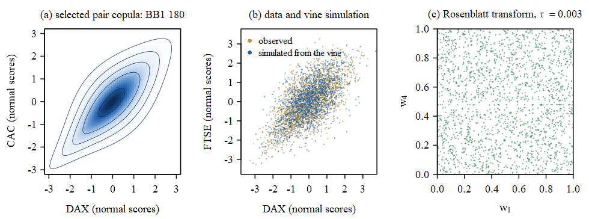

# R package

The R package `fortvine` lets you use the library from R. It is a binding, not a port: every
density, distribution function, h-function, fit, family selection, vine selection, Rosenblatt
transform and pseudo-observation is computed by the Fortran code through its
[C interface](manual/c-api.md) (the `fvc_*` routines of `fortvine_capi`, the C interface to the
typed API).
The R functions only check and convert their arguments (an `n x d` R matrix becomes the
`u(d, n)` array of the C routines, family names become integer codes) and wrap the results in
R objects with `print`, `summary` and `logLik` methods. The function names follow
[rvinecopulib](https://github.com/vinecopulib/rvinecopulib), so code written for it needs few
changes.

## Installation

The package compiles the library from source with R's own toolchain, so you need a Fortran
compiler that R can use:

| platform | what to install |
|---|---|
| Windows | [Rtools](https://cran.r-project.org/bin/windows/Rtools/) matching your R version (Rtools43 for R 4.3, Rtools44 for R 4.4, ...). It contains gfortran. |
| Linux | gfortran, e.g. `sudo apt-get install gfortran` (Debian, Ubuntu) or `sudo dnf install gcc-gfortran` (Fedora) |
| macOS | the gfortran build that CRAN recommends for your R version ([mac.r-project.org/tools](https://mac.r-project.org/tools/)) |

Then, from R:

```r
install.packages("remotes")
remotes::install_github("Bluerrror/fortvine", subdir = "r")
```

or, from a clone of the repository:

```bash
R CMD INSTALL r
```

OpenMP is used when R's compiler supports it; otherwise the library runs on one thread and
gives the same results. The `cores` argument of each function sets the number of threads
(default 1, as CRAN expects of R packages). Selection over large family sets is several times
faster with more threads, e.g. `cores = parallel::detectCores() %/% 2`.

## Quick start

A pair copula: build a model, evaluate the density and the h-function, simulate, fit and
select.

```r
library(fortvine)
cop <- bicop_dist("clayton", 0, 2)
u <- rbind(c(0.1, 0.1), c(0.5, 0.5), c(0.9, 0.9))
dbicop(u, cop)
#> [1] 5.370177 1.481004 2.157801
hbicop(u, 1, cop)
#> [1] 0.3562217 0.4319594 0.7703349
pbicop(u, cop)                                              # distribution function C(u1, u2)
#> [1] 0.07088812 0.37796447 0.82502865

set.seed(42)
x <- rbicop(2000, cop)
bicop(x, family_set = "clayton", rotation = 0)$parameters   # fit one family and rotation
#> [1] 1.974684
bicop(x, family_set = "all")                                # select among families 0-22
#> Bivariate copula ('bicop_dist'): family = clayton (3), rotation = 0, parameters = 1.975
```

Families are given by their fortvine name (any case; `"t"` also means `"student"`) or code.
`fortvine_families()` lists the 111 families with their codes and numbers of parameters,
read from the library. The generic families (codes $\ge 10000$) work everywhere a family is
accepted:

```r
fam <- fortvine_families()
table(generic = fam$code >= 10000)
#> generic
#> FALSE  TRUE
#>    26    85
bicop(x, family_set = "generic", cores = 2)
#> Bivariate copula ('bicop_dist'): family = Arch(gamma.Sibuya) (11700), rotation = 0, parameters = 1.936, 1.064
```

## Functions

| R function | what it does | computed by |
|---|---|---|
| `bicop_dist(family, rotation, parameters)` | pair-copula model object | (checks only) |
| `dbicop(u, model, log = FALSE)` | density $c(u_1, u_2)$ or $\log c$ | `fvc_bicop_eval` |
| `pbicop(u, model)` | distribution function $C(u_1, u_2)$ | `fvc_bicop_eval` |
| `hbicop(u, cond_var, model, inverse = FALSE)` | $h_1 = \partial C / \partial u_1$, $h_2 = \partial C / \partial u_2$ and their inverses | `fvc_bicop_eval` |
| `rbicop(n, model)` | simulation $\big(u_1, h_1^{-1}(u_1, w)\big)$ | `fvc_bicop_eval` |
| `bicop(data, family_set, selcrit, rotation = NULL, weights, ...)` | select family, rotation and parameters; or, with `rotation`, fit one family | `fvc_bicop_fit` |
| `bicop_par_bounds(family)` | parameter box of a family | `fvc_par_bounds` |
| `gen_flip(model)` | generic family of the transposed copula $C(u_2, u_1)$ | `fvc_gen_flip` |
| `dvine_structure(order, trunc_lvl)`, `cvine_structure(order, trunc_lvl)` | D-vine and C-vine structures | `fvc_vine_structure` |
| `as_rvine_matrix(x)` | R-vine matrix of a structure or a vine, in original labels | `fvc_vine_matrix` |
| `vinecop_dist(pair_copulas, structure, var_types)` | vine model object from pair copulas | (checks only) |
| `vinecop(data, family_set, structure, selcrit, trunc_lvl, threshold, var_types, weights, ...)` | Dissmann selection, or families on a fixed structure | `fvc_vine_select` |
| `dvinecop(u, vinecop)` | vine density | `fvc_vine_eval` |
| `dvinecop_grid(u, vinecop, tgt, grid)` | vine density on a grid of one variable | `fvc_vine_pdf_grid` |
| `rosenblatt(x, model)`, `inverse_rosenblatt(u, model)` | Rosenblatt transform and its inverse | `fvc_vine_eval` |
| `rvinecop(n, vinecop)` | simulation: inverse Rosenblatt of uniforms | `fvc_vine_eval` |
| `vinecop_relax(vinecop, data, tgt, mode)` | non-simplified (relaxed) edges | `fvc_vine_relax` |
| `vinecop_rel_params(vinecop, u)`, `vinecop_unrelax(vinecop, data)` | parameters of the relaxed edges at given points; delete the relaxed edges | `fvc_vine_rel_params`, (R) |
| `fitcache_enable(capacity)`, `fitcache_clear()`, `fitcache_disable()`, `fitcache_stats()` | the fit cache | `fvc_fitcache` |
| `pseudo_obs(x)` | ranks / $(n + 1)$, ties averaged | `fv_pseudo_obs` |
| `fortvine_families()` | the 111 families: code, name, number of parameters | `fvc_families`, `fvc_fam_name` |
| `logLik()`, `AIC()`, `BIC()`, `print()`, `summary()` | methods for fitted `bicop_dist` and `vinecop_dist` objects | (stored results) |

`family_set` takes names, codes and four groups: `"all"` (codes 0-22, the default set of the
library), `"parametric"` (0-11, the parametric families of vinecopulib), `"nonparametric"`
(`"tll"` and `"bernstein"`, codes 24 and 25) and `"generic"` (the 85 generic families); a list
combines them, e.g. `list("all", "nonparametric")`. `selcrit` is one of `"loglik"`, `"aic"`,
`"bic"`, `"mbic"` and `"mbicv"`.

The [controls](manual/controls.md) are arguments of `bicop()` and `vinecop()`, with the
defaults of `fv_controls`:

| argument | control | values |
|---|---|---|
| `par_method` | `method` | `"mle"`, `"itau"` |
| `selcrit`, `psi0` | `selcrit`, `psi0` | see above; `psi0` in $(0, 1)$ |
| `presel`, `allow_rotations`, `fast_mle` | `preselect`, `allow_rotations`, `fast_mle` | `TRUE` / `FALSE` |
| `tau_mode` | `tau_mode` | `"exact"` (default), `"approx"`, `"auto"` |
| `weights` | observation weights | `n` non-negative numbers |
| `tree_crit`, `tree_algorithm` (vines) | `tree_crit`, `tree_algo` | `"tau"`, `"rho"`, `"joe"`, `"hoeffd"`, `"xi"`, `"mi"`, `"ferreira"`; `"mst_prim"`, `"mst_kruskal"` |
| `trunc_lvl` (vines) | `trunc_lvl`; `NA` sets `select_trunc` | a number, `Inf` (all trees) or `NA` |
| `threshold` (vines) | `threshold`; `NA` sets `select_threshold` | in $[0, 1]$, or `NA` |
| `var_types` (vines) | discrete variables | `"c"` or `"d"` per variable |
| `cores` | `nthreads` | number of threads, default 1 |

As in rvinecopulib, `trunc_lvl = NA` and `threshold = NA` let the data choose the truncation
level and the threshold (by mBICv, see [Truncation](manual/vinecop.md#truncation) and
[Thresholding](manual/vinecop.md#thresholding)).

**Random numbers.** `rbicop()` and `rvinecop()` draw their uniforms with R's `runif()`, so
`set.seed()` makes them reproducible. They do not use the counter-based generator behind the
`seed` argument of `fv_vinecop%simulate`, so the same seed gives different samples in R and
in Fortran. The randomised Rosenblatt transform of discrete variables takes its seed from R's
generator, so it follows `set.seed()` too.

**Not exposed.** The abort flag (`fvc_set_abort`) has no R function: R cannot run code while
the library computes, so there is nothing to call it from. Everything else of the Fortran API
has an R function, including `vinecop_rel_params()` (the per-sample parameters of relaxed
edges) and `vinecop_unrelax()`.

## Worked example

Daily log returns of four European stock indices, 1991-1998 (`EuStockMarkets`, shipped with
R): first a pair copula for DAX and CAC, then a vine for all four indices.

```r
library(fortvine)
x <- diff(log(EuStockMarkets))          # daily log returns of DAX, SMI, CAC, FTSE
u <- pseudo_obs(x)
dim(u)
#> [1] 1859    4

pair <- bicop(u[, c("DAX", "CAC")], family_set = "all", cores = 2)
summary(pair)
#>   family code rotation    parameters npars   loglik
#> 1    bb1    7      180 0.3035, 1.771     2 709.9664
c(AIC = AIC(pair), BIC = BIC(pair))
#>       AIC       BIC
#> -1415.933 -1404.877
```

The DAX-CAC pair is a survival BB1 copula (rotation 180), which has a stronger lower tail
than upper tail: large joint losses are more common than large joint gains. The vine:

```r
fit <- vinecop(u, family_set = "all", cores = 2)
fit
#> Vine copula ('vinecop_dist'): d = 4, trunc_lvl = 3, order = 2 1 3 4
#>   npars = 11, loglik = 2038.51 (n = 1859)
#>  tree edge conditioned conditioning   family rotation    parameters
#>     1    1    SMI, DAX                   bb3        0 1.577, 0.2891
#>     1    2    DAX, CAC                   bb1      180 0.3035, 1.771
#>     1    3   CAC, FTSE                   bb1      180 0.2627, 1.607
#>     2    1    SMI, CAC          DAX  student        0 0.2101,  11.9
#>     2    2   DAX, FTSE          CAC  student        0 0.3204, 10.88
#>     3    1   SMI, FTSE     DAX, CAC plackett        0          1.87
```

Tree 1 is the path SMI - DAX - CAC - FTSE. `summary(fit)` returns the same table as a data
frame, with the log-likelihood of each edge. The vine log-likelihood is the sum of the edge
log-likelihoods, and the density routine reproduces it:

```r
c(loglik = fit$loglik, sum_log_density = sum(log(dvinecop(u, fit))), npars = fit$npars)
#>          loglik sum_log_density           npars
#>        2038.507        2038.507          11.000
```

If the model fits, the Rosenblatt transform $w = T(u)$ has independent uniform columns, and the
inverse transform recovers $u$:

```r
w <- rosenblatt(u, fit)
round(cor(w, method = "kendall"), 3)
#>       [,1]   [,2]  [,3]   [,4]
#> [1,] 1.000  0.008 0.011  0.003
#> [2,] 0.008  1.000 0.007 -0.004
#> [3,] 0.011  0.007 1.000  0.002
#> [4,] 0.003 -0.004 0.002  1.000
max(abs(inverse_rosenblatt(w, fit) - u))
#> [1] 6.448175e-13

set.seed(1)
round(rvinecop(3, fit), 4)
#>        [,1]   [,2]   [,3]   [,4]
#> [1,] 0.2132 0.6958 0.6235 0.0618
#> [2,] 0.2926 0.1680 0.4114 0.2060
#> [3,] 0.3630 0.6858 0.3562 0.1766
```

The figure is drawn by `tools/r_example.R` with the package. Panel (a) is the density of the
selected DAX-CAC pair copula in normal scores, $c\big(\Phi(z_1), \Phi(z_2)\big)\,
\varphi(z_1)\varphi(z_2)$; panel (b) compares the DAX-FTSE returns with a sample of the same
size simulated from the vine (DAX and FTSE are not neighbours in tree 1, so this pair is
modelled through the higher trees); panel (c) shows two columns of the Rosenblatt transform.

<figure markdown>
{ width="700" }
<figcaption>The EuStockMarkets vine fitted from R: (a) the selected DAX-CAC pair copula, (b) data
and vine simulation, (c) Rosenblatt-transformed data.</figcaption>
</figure>

## Nonparametric families and weights

TLL and Bernstein copulas are fitted like any other family. Their estimate is kept in the
model (`$aux`, 933 numbers) and used by every function that evaluates it; `npars` is the
effective number of degrees of freedom, which `logLik()`, `AIC()` and `BIC()` use. For the
DAX-CAC pair the parametric BB1 copula is preferred:

```r
tl <- bicop(u[, c("DAX", "CAC")], family_set = "tll")
tl
#> Bivariate copula ('bicop_dist'): family = tll (24), rotation = 0, parameters = none (nonparametric, edf 65.1)
c(edf = tl$npars, loglik = tl$loglik, AIC = AIC(tl))
#>        edf     loglik        AIC
#>    65.0559   743.3251 -1356.5385
bicop(u[, c("DAX", "CAC")], family_set = list("all", "nonparametric"), cores = 2)$family
#> [1] "bb1"
```

Observation weights enter every pair fit (and the weighted tree criteria of `vinecop()`); here
the second half of the sample counts three times:

```r
wts <- rep(c(1, 3), c(930, 929))
bicop(u[, c("DAX", "CAC")], family_set = "student", rotation = 0, weights = wts)$parameters
#> [1] 0.7342719 6.6380788
bicop(u[, c("DAX", "CAC")], family_set = "student", rotation = 0)$parameters
#> [1] 0.7226908 6.4391172
```

## Structures, truncation and thresholding

`as_rvine_matrix()` gives the R-vine matrix of vinecopulib in original labels: the
anti-diagonal holds `order`, and row `t` of column `e` the partner of `order[e]` in tree `t`.
`cvine_structure(order)` makes the **last** element of `order` the root of the first tree, as
`set_cvine` does (and as rvinecopulib's `cvine_structure`). With a fixed structure only the
families and parameters are selected:

```r
as_rvine_matrix(fit)
#>      [,1] [,2] [,3] [,4]
#> [1,]    1    3    4    4
#> [2,]    3    4    3    0
#> [3,]    4    1    0    0
#> [4,]    2    0    0    0
cv <- cvine_structure(c(4, 3, 2, 1))      # DAX (variable 1) is the root of tree 1
fc <- vinecop(u, family_set = "all", structure = cv, cores = 2)
summary(fc)[, c("tree", "conditioned", "conditioning", "family")]
#>   tree conditioned conditioning   family
#> 1    1    CAC, DAX                   bb1
#> 2    1    SMI, DAX                   bb3
#> 3    1   DAX, FTSE                   bb1
#> 4    2    CAC, SMI          DAX  student
#> 5    2   SMI, FTSE          DAX plackett
#> 6    3   CAC, FTSE     DAX, SMI plackett
```

`trunc_lvl = NA` and `threshold = NA` select both by mBICv. On these returns the sparse vine
keeps tree 1 only:

```r
sp <- vinecop(u, family_set = "all", selcrit = "mbicv", trunc_lvl = NA, threshold = NA, cores = 2)
c(trunc = sp$trunc, threshold = sp$threshold, npars = sp$npars, loglik = sp$loglik)
#>        trunc    threshold        npars       loglik
#>    1.0000000    0.4370411    6.0000000 1846.5384662
```

## Discrete margins

Discrete variables follow rvinecopulib: `var_types` marks each variable `"c"` or `"d"`, and
the data have `d + k` columns, the `d` columns $F_j(x_j)$ followed by the columns
$F_j(x_j^-)$ of the `k` discrete variables (see [Discrete and mixed data](manual/discrete.md)).
The flags are stored in the model (`$var_types`), and `dvinecop()`, `rosenblatt()` and
`dvinecop_grid()` of that model expect the same layout. A latent Gaussian vector whose third
variable is observed only as a count with four levels:

```r
set.seed(2)
z <- matrix(rnorm(3000), 1000, 3) %*% chol(matrix(c(1, .7, .5, .7, 1, .6, .5, .6, 1), 3))
cnt <- findInterval(z[, 3], c(-1, 0, 1))       # variable 3 observed as a count 0..3
Fc <- ecdf(cnt)
xd <- cbind(pseudo_obs(z[, 1:2]), Fc(cnt) * 1000 / 1001, Fc(cnt - 1) * 1000 / 1001)
vd <- vinecop(xd, family_set = "parametric", var_types = c("c", "c", "d"))
vd
#> Vine copula ('vinecop_dist'): d = 3, trunc_lvl = 2, order = 1 2 3
#>   npars = 3, loglik = 560.78 (n = 1000)
#>   discrete variables: 3
#>  tree edge conditioned conditioning   family rotation parameters
#>     1    1        1, 2              gaussian        0     0.7211
#>     1    2        2, 3              gaussian        0     0.6013
#>     2    1        1, 3            2   gumbel        0      1.085
c(loglik = vd$loglik, sum_log_density = sum(log(dvinecop(xd, vd))))
#>          loglik sum_log_density
#>        560.7824        560.7824
```

`rosenblatt()` returns Brockwell's randomised transform for the discrete columns, so every
column is uniform under the model (mean $1/2$, variance $1/12 \approx 0.0833$);
`randomize_discrete = FALSE` returns $F(x \mid \cdot)$ instead:

```r
set.seed(3)
r <- rosenblatt(xd, vd)
round(rbind(mean = colMeans(r), var = apply(r, 2, var)), 4)
#>        [,1]   [,2]   [,3]
#> mean 0.5016 0.4991 0.5014
#> var  0.0813 0.0840 0.0831
```

`inverse_rosenblatt()` and `rvinecop()` work on the copula scale; discrete observations follow
from the marginal quantile functions.

## Density on a grid

`dvinecop_grid(u, vinecop, tgt, grid)` evaluates the density at every row of `u` with variable
`tgt` replaced by each grid value (`pdf_grid` of the library, which evaluates the edges that do
not involve `tgt` once per row instead of once per point). The values are those of `dvinecop()`
at the same points:

```r
grid <- c(0.05, 0.25, 0.5, 0.75, 0.95)
dvinecop_grid(u[1:2, ], fit, tgt = 4, grid = grid)
#>          [,1]     [,2]      [,3]      [,4]       [,5]
#> [1,] 1.578372 1.308332 0.5737784 0.2176129 0.04716697
#> [2,] 7.241727 1.895510 0.6856401 0.2816178 0.07218052
dvinecop(cbind(u[1, 1], u[1, 2], u[1, 3], grid), fit)
#> [1] 1.57837176 1.30833193 0.57377844 0.21761289 0.04716697
```

For a discrete `tgt`, pass the $F(x^-)$ values of the grid as `grid_minus`.

## Non-simplified vines

`vinecop_relax(vinecop, data, tgt, mode)` lets the parameters of edges in trees $t \ge 2$ vary
with their conditioning variables (see
[Non-simplified edges](manual/vinecop.md#non-simplified-edges-relax)). `mode = 1` relaxes only
the edges whose test of constant conditional correlation rejects; `mode = 2` relaxes every
eligible edge. The relaxed edges are stored in `$relaxed` and used by `dvinecop()` and
`dvinecop_grid()`; the Rosenblatt transforms and `rvinecop()` use the middle-anchor
parameters, as the library does. Each relaxed edge counts its parameters at four more anchors
in `npars`. On the stock returns the test relaxes nothing, and relaxing all three eligible
edges raises the log-likelihood by 14 for 20 more parameters, which AIC does not support:

```r
is.null(vinecop_relax(fit, u, tgt = 0, mode = 1)$relaxed)
#> [1] TRUE
rel <- vinecop_relax(fit, u, tgt = 0, mode = 2)
rel$relaxed$erel                                 # edge (row 1) and tree (row 2)
#>      [,1] [,2] [,3]
#> [1,]    1    2    1
#> [2,]    2    2    3
c(loglik = rel$loglik, npars = rel$npars, sum_log_density = sum(log(dvinecop(u, rel))))
#>          loglik           npars sum_log_density
#>        2052.445          31.000        2052.445
c(AIC_simplified = AIC(fit), AIC_relaxed = AIC(rel))
#> AIC_simplified    AIC_relaxed
#>      -4055.014      -4042.889
```

Relaxing is not available for vines with discrete variables.

## Fit cache and parameter bounds

The [fit cache](manual/fitting.md#fit-cache) stores every pair fit, so repeated selections on
the same data reuse them, here a second selection with another tree criterion:

```r
fitcache_enable(20000)
f1 <- vinecop(u, family_set = "all", cores = 2)
f2 <- vinecop(u, family_set = "all", tree_crit = "rho", cores = 2)
fitcache_stats()
#>   hits misses   used
#>    148    254    254
fitcache_disable()
bicop_par_bounds("bb1")
#>       [,1] [,2]
#> lower    0    1
#> upper    7    7
```

## From rvinecopulib

The names and the main arguments are those of rvinecopulib, including `var_types` with the
`d + k` data layout for discrete variables, `weights`, and `trunc_lvl = NA` /
`threshold = NA` for automatic selection. The differences:

* families use fortvine names and codes (`fortvine_families()`), and `family_set = "all"`
  means the hand-coded parametric families 0-22;
* vine structures are stored in the natural-order arrays of fortvine (`order`,
  `struct_array[edge, tree]`, see [Vine copulas](manual/vinecop.md#how-the-structure-is-stored));
  `as_rvine_matrix()` converts them to an R-vine matrix, but an R-vine matrix cannot be passed
  as `structure`;
* `bicop()` accepts `rotation` to fit a single family with a fixed rotation, and has no
  `var_types` (fit a two-dimensional vine for a pair with discrete margins);
* `vinecop_relax()`, `dvinecop_grid()` and the fit cache have no rvinecopulib counterpart.

## Citing

If you use fortvine, from R or otherwise, please cite:

> Shojaeezadeh, S. A. (2026). fortvine: a complete compendium to work on vine copula modeling.
> In preparation. Software: <https://github.com/Bluerrror/fortvine>

In R, `citation("fortvine")` prints this reference and a BibTeX entry.
