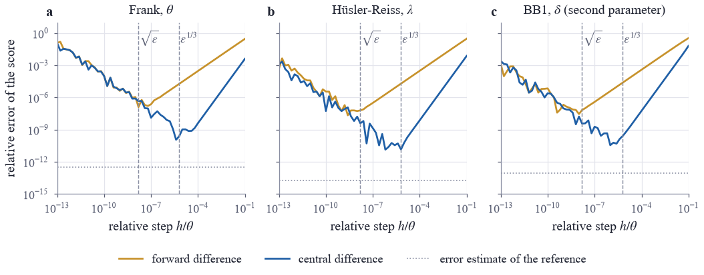

# Exact parameter scores

Maximum likelihood needs the gradient of the log-likelihood with respect to the copula
parameters, the *score*

$$
g(\theta) = \sum_{i=1}^n w_i\, s_i(\theta), \qquad s_i(\theta) = \frac{\partial}{\partial\theta} \log c(u_{i1}, u_{i2}; \theta) \in \mathbb R^k,
$$

for every candidate family and every edge of a vine, many thousands of times during one
selection. Writing out $\partial \log c / \partial\theta$ by hand for 111 families, some
with three parameters and nested generators, is error-prone and was done only for a few
families in the literature (Schepsmeier & Stöber 2014 derive them for the classic
bivariate families). Finite differences are the usual fallback, with their well-known
costs. fortvine takes a third route: each family's log-density is written **once**, in
generic code, and compiled both for ordinary reals and for **dual numbers** that carry
exact derivatives alongside every value.

## Dual numbers

A dual number is a value together with its gradient with respect to the parameters,

$$
\tilde x = \bigl(x,\ \nabla_\theta x\bigr), \qquad \nabla_\theta x \in \mathbb R^k .
$$

Arithmetic on dual numbers applies the chain rule to every operation:

$$
\widetilde{x y} = \bigl(x y,\ x \nabla y + y \nabla x\bigr), \qquad
\widetilde{f(x)} = \bigl(f(x),\ f'(x)\, \nabla x\bigr).
$$

Starting from the parameters themselves, $\tilde\theta_j = (\theta_j, e_j)$, and the data
as constants, $\tilde u = (u, 0)$, any formula evaluated in dual arithmetic delivers
$\log c$ and its exact gradient in one pass. This is forward-mode automatic
differentiation; the result is exact up to floating-point rounding, like the value itself.

`src/fortvine_ad.f90` defines the types and their operator overloads:

```fortran
type, public :: hd
  real(dp) :: v = 0.0_dp          ! value
  real(dp) :: g(3) = 0.0_dp       ! gradient with respect to up to 3 parameters
end type hd
```

* `hvar(x, i)` creates the $i$-th independent variable, `hconst(x)` a constant;
* `+ - * / **` are overloaded for every combination of `hd` and `real(dp)`;
* `hexp`, `hlog`, `hlog1p`, `hexpm1`, `hsqrt`, `habs` and the normal `hpnorm`, `hdnorm`
  propagate gradients through the elementary functions (each through one helper,
  `hunary(x, f, f')`), and `hlse` is a log-sum-exp.

`hd` always has three gradient slots, the most any family needs. Most families have one or
two parameters, so `src/fortvine_adk.inc` is a template of the same type with a fixed
width `AD_N`; the end of `fortvine_ad.f90` instantiates it twice through the preprocessor,

```fortran
#define AD_MOD fortvine_ad1
#define AD_T hd1
#define AD_N 1
...
#include "fortvine_adk.inc"
```

giving modules `fortvine_ad1` (type `hd1`, one slot) and `fortvine_ad2` (type `hd2`, two
slots). Their scores are 1.1 to 2 times cheaper than through `hd` because no work is spent
on unused slots.

### One generic interface for reals and duals

The modules also define generic names that resolve to the real *or* the dual version,
depending on the argument type: `fval` (the value), `flog`, `fexp`, `flog1p`, `fexpm1`,
`fsqrt`, `fabs`, `fpnorm`, `fdnorm`, `flse`. A family written with these names and with
the type left open compiles for every type.

## Writing each family once

The family code lives in three include files that never declare a concrete type for the
quantities depending on the parameters. They use preprocessor macros instead:

| Macro | Meaning |
|---|---|
| `VT` | the value type: `real(dp)`, `type(hd)`, `type(hd1)` or `type(hd2)` |
| `VCONST(x)` | lift a real constant into `VT` (`hconst`, `h1const`, `h2const`; empty in real mode) |
| `LPDF_NAME` | name of the compiled log-density of the core families (`families_core.inc`) |
| `EXT_NAME` | name of the compiled extended families (`families_ext.inc`: Plackett, FGM, AMH, Galambos, Hüsler-Reiss, BB2-BB5, BB9, BB10) |
| `GEN_NAME` | name of the compiled generic engine (`families_gen.inc`, codes 10000+) |
| `REALMODE` | defined only for the real-valued build, which additionally computes the h-functions |

`src/fortvine.f90` includes the files once per type:

```fortran
#define VT type(hd)
#define VCONST hconst
#define LPDF_NAME lpdf_hd
#define EXT_NAME ext_lpdf_hd
#define GEN_NAME gen_ext_lpdf_hd
#include "families_core.inc"
#include "families_ext.inc"
#include "families_gen.inc"
#undef VT
...                                     ! the same for type(hd1) -> lpdf_h1, ... and type(hd2) -> lpdf_h2, ...
#define VT real(dp)
#define REALMODE
#define EXT_NAME ext_eval_r              ! evaluation: log-density and both h-functions
#include "families_ext.inc"
...
#define GEN_NAME gen_eval_rv
#include "families_gen.inc"
```

so one source line of, say, the Tawn Pickands function becomes four compiled routines: a
plain evaluator used by `pdf`, `hfunc1`, vine densities and simulation, and three score
evaluators of widths 3, 1 and 2 used by the optimiser. A correction to a formula reaches
all of them at once, and the value computed in dual arithmetic is, operation for operation,
the value computed in real arithmetic, so the numerical safeguards described in
[Numerics](numerics.md) (log-space evaluation, `log1p`/`expm1` forms, asymptotic branches)
protect the scores as well as the values.

Branches on the *value* of a dual quantity are written with `fval(x)`, e.g.
`if (fval(z) > -30.0_dp)` selects between the direct and the asymptotic form of
$\log\Phi(z)$. The derivative of the branch taken is exact; at a switch point the two
branches agree to the accuracy of the expansion.

### Families with their own derivative code

A few families bypass the dual numbers because something faster or better is available:

* The one-parameter Gaussian, Clayton, Gumbel, Frank and Joe copulas have hand-derived
  first *and second* parameter derivatives of the log-density (and of the h-functions and
  $C$, for discrete margins). One pass over the data then yields $\ell$, $\ell'$ and
  $\ell''$, and Newton's method started at the Kendall's-tau inversion converges in about
  two passes (a Le Cam one-step estimator followed by a check); the Gaussian likelihood
  equation is solved exactly as a cubic.
* The Student copula's $\nu$ and the t-EV copula's $\nu$ enter through the $t$ distribution
  function, whose derivative in the degrees of freedom has no closed form; fortvine
  profiles $\nu$ by Brent's method while $\rho$ is solved by Newton's method on its exact
  score, and for the t-EV copula finishes with a joint Fisher-scoring step that uses a
  differentiated continued fraction for the $\nu$-score.
* Pair copulas with discrete margins are fitted on the exact discrete likelihood with
  value-only methods (Brent for one parameter, Nelder-Mead from a grid otherwise).

Every other family, hand-coded or generic, gets its scores from dual numbers.

## From scores to a maximiser: Fisher scoring

The score alone does not give a step length. Newton's method would also need the Hessian,
$\sum_i \partial^2 \log c_i / \partial\theta\,\partial\theta^\top$, which forward-mode duals
do not provide without carrying $k^2$ more numbers through every operation. fortvine instead
uses the outer-product approximation of Berndt, Hall, Hall & Hausman (1974), BHHH:

$$
H(\theta) \;\approx\; -\sum_i w_i\, s_i(\theta)\, s_i(\theta)^\top .
$$

At the true parameter, the expected outer product of the score equals the Fisher
information (the information matrix identity), so the step

$$
\delta = \bigl(B + \lambda \operatorname{diag}(B)\bigr)^{-1} g, \qquad B = \sum_i w_i s_i s_i^\top,
$$

is a Fisher-scoring step, with a Levenberg-Marquardt damping $\lambda$ that is increased
when a step fails to improve the likelihood and decreased tenfold after each success. The
implementation (`newton_fit` in `src/fortvine.f90`) adds:

* **Box constraints** by projection: a parameter at a bound whose score points outward is
  held fixed for the step (an active set), the others are solved by Cholesky
  factorisation of the free block, and the new point is clipped into the box.
* **Backtracking by interpolation**: a rejected step is shortened to the maximiser of the
  quadratic through the old value, the step's directional derivative and the trial value,
  limited to between 10 % and 50 % of its length.
* **Log scale** for positive parameters whose box spans two or more decades in families
  where that was measured to help (BB8, Hüsler-Reiss, BB2, BB9, BB10): the optimiser works
  in $z = \log\theta$ with score $\theta\, \partial\ell/\partial\theta$.
* **Aitken extrapolation** when successive steps shrink geometrically in one direction
  (a slow crawl along a ridge or towards a bound).
* **A BFGS update** of the curvature model from the exact score changes for ridge-shaped
  likelihoods (used for the subsample stage and for t-EV), where BHHH alone zig-zags.
* **Convergence** when the Newton decrement $\tfrac12 g^\top\delta$, the predicted
  remaining gain, falls below $10^{-8}(1 + |\ell|)$, or the step becomes negligible.
* **Two stages.** A fit first runs on a deterministic stride subsample of about 600
  observations from a few starting points (grid, Blomqvist-beta or tau-based starts), and
  only the best result is polished on all $n$ observations, which typically takes 1-3
  full-data iterations. The final stopping rule is the full-data one, so the result is the
  full-data MLE.
* **Racing** during selection: the predicted gain also bounds how much a candidate can
  still improve; a candidate whose bound falls below the best criterion already achieved is
  abandoned.

Because the BHHH matrix is a sum of outer products it is positive semi-definite by
construction, so every undamped step is an ascent direction, unlike Newton steps with an
indefinite Hessian far from the optimum.

## Why not finite differences?

A central finite-difference gradient of a $k$-parameter log-likelihood needs $2k$ extra
likelihood evaluations, each a full pass over the data, and has an error of order
$h^2 \lVert \partial^3\ell \rVert + \varepsilon\lvert\ell\rvert/h$, minimised near
$h \approx \varepsilon^{1/3}$ at a relative accuracy of roughly $10^{-5}$ to $10^{-6}$.
Forward differences ($k$ extra passes) do worse, about $\sqrt\varepsilon \approx 10^{-8}$ at
best. Several properties of copula likelihoods make this worse in practice:

* **Bounds.** Many optima lie on or next to the parameter box ($\delta \to 1$ in BB
  families, $\psi \to 1$ in Tawn models, $\nu$ at its upper bound). A difference stencil must
  be one-sided there, losing an order of accuracy.
* **Scale.** Parameters range over several decades (a Hüsler-Reiss $\lambda$ of 0.05 and of
  20 are both legitimate), so no single step $h$ is right everywhere.
* **Branches.** The numerically safe evaluation switches formulas at thresholds
  (asymptotic expansions, `log1mexp`'s switch, clamping). A stencil that straddles a switch
  differentiates the switching error, not the function.
* **Per-observation scores.** BHHH needs the score of *every observation*, not only of the
  sum; with finite differences that is $n \times 2k$ density evaluations stored or
  recomputed, with each per-observation difference noisier than the total.

<figure markdown>
{ width="700" }
<figcaption>Relative error of forward and central finite differences of fortvine's
log-likelihood ($n = 2000$ points from the family itself, derivative taken at 0.85 times the true
parameter) against the relative step $h/\theta$. The reference is Ridders' extrapolation of the
same function; the dotted line is its error estimate. The V shape is the trade-off described
above: truncation error to the right, rounding
error to the left. Even with the step chosen after the fact from the reference, forward
differences stop at $10^{-8}$ to $10^{-7}$; central differences reach $10^{-11}$ to $10^{-10}$
here, but at a step that moves with the family and the parameter and costs two extra
likelihood passes per parameter. Exact dual-number scores need neither.</figcaption>
</figure>

Dual numbers avoid all four: the gradient costs one pass whose arithmetic is roughly
$(1 + k)$ times that of the value, it is exact wherever the value is accurate, it needs no
step size, and it is available per observation for free. In fortvine the one pass that
evaluates the log-likelihood also returns the gradient and the BHHH matrix, which is what
makes fitting all 112 parametric candidates of a vine edge affordable (see the
[benchmarks](../benchmarks.md)).
